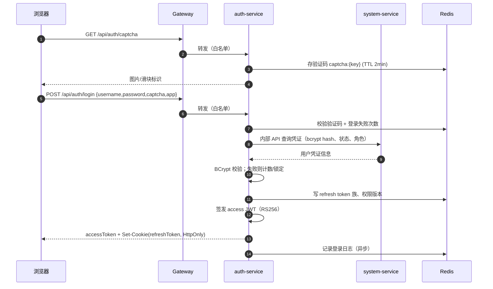
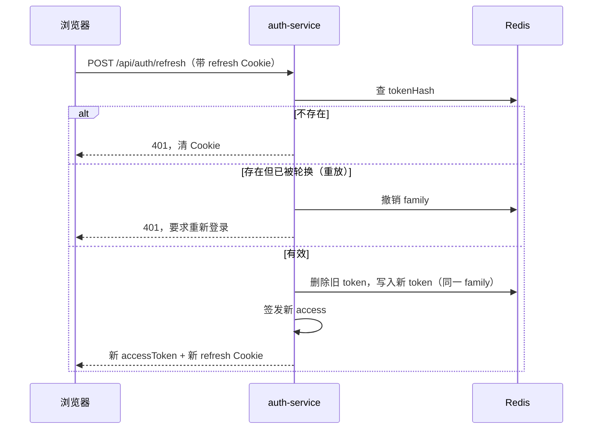

# 03 · 统一登录、鉴权与权限设计

> 对应需求：「统一登录鉴权，区分用户角色，管理员能分配用户权限，能勾选不同角色可操作的菜单」。  
> 关键词：一个认证中心、网关统一验签、RBAC、菜单/按钮/接口三层一致、候选人隔离、数据范围。

---

## 1. 设计原则

1. **一个认证中心**：只有 `auth-service` 签发和刷新令牌；其他服务不生成令牌。
2. **一个权限中心**：只有 `system-service` 管理用户、角色、菜单、按钮权限；业务服务只校验权限码。
3. **认证与授权分离**：网关只判断「你是谁、令牌是否有效」；「你能不能做这件事」由业务服务的权限码校验决定。
4. **菜单可见性 ≠ 接口安全**：隐藏菜单只是 UI 行为，接口必须独立校验权限码。
5. **默认拒绝**：没有显式授权的接口视为拒绝；白名单只用于登录、验证码、健康检查、公开岗位列表。
6. **最小权限**：候选人只能访问 `/portal/**` 且只能操作自己的数据；面试官只能看分配给自己的面试。
7. **可撤销**：支持强制下线、禁用账号、改密后旧令牌失效；角色/菜单变更尽快生效。

---

## 2. 账号模型

### 2.1 两类账号

| 类型 | `user_type` | 登录方式 | 入口 | 说明 |
|---|---|---|---|---|
| 员工 | `EMPLOYEE` | 用户名/手机号 + 密码 | `web-admin` | 管理员、HR、面试官、用人经理 |
| 候选人 | `CANDIDATE` | 手机号 + 短信验证码 | `web-candidate` | 自助注册；也可由 HR 导入后绑定 |

共同点：都在 `sys_user` 表，都由 `auth-service` 认证，都走同一套 JWT 与 Redis。

差异：

- 员工账号由管理员创建/禁用；候选人在短信登录时自动创建。
- 候选人的业务档案在 resume 服务的 `cand_candidate`，通过 `sys_user.id` 1:1 关联。
- 候选人不能拥有后台角色；员工不能拥有 `CANDIDATE` 角色（服务端校验）。

### 2.2 默认角色

| `role_code` | 名称 | 类型 | 数据范围 | 说明 |
|---|---|---|---|---|
| `SUPER_ADMIN` | 超级管理员 | SYSTEM | ALL | 全部权限，含角色/菜单配置；代码中短路放行 |
| `HR_ADMIN` | 招聘管理员 | BUSINESS | ALL | 招聘全模块 + 用户查看（不含系统配置） |
| `HR` | 招聘专员 | BUSINESS | DEPT | 本部门岗位/候选人/面试/Offer |
| `INTERVIEWER` | 面试官 | BUSINESS | SELF | 只看分配给自己的面试与候选人材料 |
| `DEPT_MANAGER` | 用人经理 | BUSINESS | DEPT_AND_CHILD | 本部门流程、评价、审批 |
| `CANDIDATE` | 候选人 | CANDIDATE | SELF | 候选人门户 |

> 「管理员分配用户权限」的落地方式：管理员给用户分配**角色**；权限来自角色勾选的菜单/按钮。若确实需要「给某个人额外开一个按钮」，建议新增一个细粒度角色，而不是做用户级直授权限，保持模型可解释。

---

## 3. 登录与令牌

### 3.1 密码登录时序



登录时校验入口与账号类型：`app=ADMIN` 只允许 `EMPLOYEE`；`app=CANDIDATE` 只允许 `CANDIDATE`。不匹配返回 `40302`，避免员工账号从候选人入口登录后拿到错误受众的令牌。

### 3.2 短信登录（候选人）

1. `POST /api/auth/sms/send`：图形验证码/人机校验 + 手机号限频（60s 一条、每日 10 条）。
2. `POST /api/auth/sms/login`：校验验证码（5 分钟有效，5 次错误作废）。
3. 用户不存在时，auth 调用 system 内部接口 `ensureCandidateUser(phone)` 幂等创建候选人账号（`user_type=CANDIDATE`）并绑定 `CANDIDATE` 角色，system 发布 `user.created`；resume 消费后创建 `cand_candidate`（若首次访问档案时仍未创建，则懒创建兜底）。
4. 签发令牌，`app=CANDIDATE`。

### 3.3 令牌设计

| 项 | 设计 |
|---|---|
| 算法 | RS256（RSA 2048/3072），`kid` 标识密钥版本 |
| Access Token | 30 分钟；无状态，网关本地验签 |
| Refresh Token | 7 天（记住我可 30 天）；随机 256bit；HttpOnly Cookie |
| Refresh 存储 | Redis，存哈希/ID，不落库 |
| 传输 | Access 放 `Authorization: Bearer`，仅内存；Refresh 用 HttpOnly + Secure + SameSite=Strict Cookie（路径 `/api/auth`） |
| 撤销 | `jti` 黑名单 + 用户 token version |
| 轮换 | 每次刷新作废旧 refresh，签发新 refresh；检测重放则撤销整个 token 族 |
| 受众 | `aud=HR_ADMIN_APP` / `CANDIDATE_APP`；网关按路径校验，防止跨端使用 |
| 时钟 | 允许 60 秒时钟偏移 |

Access Token 载荷：

```json
{
  "iss": "recruit-auth",
  "sub": "183920000000000001",
  "aud": "HR_ADMIN_APP",
  "app": "ADMIN",
  "ut": "EMPLOYEE",
  "un": "hr01",
  "jti": "8f3c2b1a-...",
  "tv": 12,
  "iat": 1760700000,
  "exp": 1760701800,
  "kid": "k2026a"
}
```

说明：

- **不把权限码放进 JWT**。权限变化频繁，放 JWT 会导致旧令牌长期携带过期权限；改为 Redis 权限缓存 + 版本号。
- `tv` 是 token version，用于禁用账号/改密/强制下线；网关校验 `auth:tv:{userId}` 与 `tv` 一致。
- `ut` 是用户类型，用于网关做粗粒度入口隔离（员工/候选人）。
- `aud` 与 `app` 用于区分两个前端入口。

### 3.4 Redis Key 规范

| Key | 值 | TTL | 写入方 | 说明 |
|---|---|---|---|---|
| `auth:captcha:{key}` | 验证码答案（小写） | 2min | auth | 一次性 |
| `auth:sms:{scene}:{phone}` | code + attempts | 5min | auth | `send` 冷却 60s |
| `auth:login:fail:{username}` | 次数 | 15min | auth | 5 次锁定 15 分钟 |
| `auth:refresh:{tokenHash}` | `{userId,app,familyId,jti,exp}` | 7d/30d | auth | 刷新令牌 |
| `auth:refresh:family:{familyId}` | 当前 jti | 7d/30d | auth | 重放检测 |
| `auth:bl:{jti}` | `1` | 剩余有效期 | auth | Access 黑名单 |
| `auth:tv:{userId}` | 整数 | 永久/长 TTL | system/auth | token version |
| `auth:permver:{userId}` | 整数 | 永久 | system | 权限版本 |
| `auth:perm:{userId}:{ver}` | `{roles:[],perms:[]}` | 30min | system/auth | 权限缓存 |
| `auth:menu:{app}:{roleHash}:{ver}` | 菜单树 JSON | 10min | system | 动态菜单缓存 |
| `auth:rate:{scope}:{key}` | 计数 | 窗口 | gateway/auth | 限流 |

> 这些 Key 是三个服务之间的**显式契约**，改动必须同步 auth/system 与各业务服务的 `common-security`。生产 Redis 建议 ACL/前缀隔离。

### 3.5 登录/刷新/注销接口

| 方法 | 路径 | 鉴权 | 说明 |
|---|---|---|---|
| GET | `/api/auth/captcha` | 公开 | 返回 captchaKey + base64 图片 |
| POST | `/api/auth/login` | 公开 | 密码登录；返回 accessToken，设置 refresh Cookie |
| POST | `/api/auth/sms/send` | 公开（限频） | 发送候选人登录验证码 |
| POST | `/api/auth/sms/login` | 公开 | 验证码登录/自动注册 |
| POST | `/api/auth/refresh` | Refresh Cookie | 轮换刷新令牌，返回新 accessToken |
| POST | `/api/auth/logout` | 登录 | 删除 refresh、黑名单 access、清 Cookie |
| GET | `/api/auth/me` | 登录 | 当前用户、角色、权限码、数据范围 |
| PUT | `/api/auth/password` | 登录 | 改密；使其他会话失效 |
| GET | `/api/auth/logs/login` | `system:log:login:view` | 登录日志（管理员） |
| POST | `/api/auth/sessions/revoke` | `system:user:kick` | 强制下线指定用户 |

刷新流程：



### 3.6 SSO（可选增强）

如果两个前端部署在同一父域（如 `admin.example.com`、`jobs.example.com`），可做轻量 SSO：

1. 未登录访问 B 应用 → 跳转 `auth.example.com/sso/authorize?app=ADMIN&redirect=...`。
2. auth 已有会话（父域 Cookie）→ 生成一次性 `code`（Redis，60 秒，绑定 app 与 redirect）。
3. 回跳 B 应用 → 后端用 code 换 tokens。
4. code 一次性、短时效、校验 redirect 白名单，防开放重定向。

不做 SSO 也不影响「统一登录鉴权」：两个前端调用同一个 auth 服务、同一套账号与权限即可。

---

## 4. 网关鉴权

### 4.1 职责

- 白名单放行。
- 校验 JWT 签名、过期、`kid`、`aud`、`token version`、`jti` 黑名单。
- 剥离客户端伪造的 `X-User-*` / `X-Internal-*` 头。
- 注入可信身份头：
  - `X-User-Id`
  - `X-User-Type`
  - `X-Username`
  - `X-App`
  - `X-Token-Id`
  - `X-Trace-Id`
- 员工/候选人入口隔离：
  - `/api/*/portal/**`、`/api/auth/sms/**` → 仅 `CANDIDATE`（登录接口除外）。
  - 其他 `/api/**` → 仅 `EMPLOYEE`（公开接口除外）。
- 限流：登录、短信、文件预签名、AI 触发接口单独限流。
- 统一 401/403 JSON，不把内部异常栈返回给浏览器。

### 4.2 白名单

```
/api/auth/captcha
/api/auth/login
/api/auth/sms/send
/api/auth/sms/login
/api/auth/refresh
/api/system/health
/api/interview/portal/jobs/**        # 公开岗位列表/详情
/api/interview/portal/public/**      # 公开投递入口（可选）
```

`/internal/**`、`/actuator/**` 一律不允许从外网访问；内部接口走集群网络 + 内部 HMAC。

> ASR WebSocket（`/api/ai/v1/asr/stream`）不经过网关：Nginx 直接转发到 AI 服务，AI 校验 room-service 签发的房间短时令牌（`scope=asr`）。这样避免长连接占用网关，同时令牌仍绑定房间/用户/角色。

### 4.3 网关过滤器伪代码

```java
@Component
public class AuthGlobalFilter implements GlobalFilter, Ordered {

  private final JwtVerifier verifier;
  private final StringRedisTemplate redis;

  @Override
  public Mono<Void> filter(ServerWebExchange exchange, GatewayFilterChain chain) {
    String path = exchange.getRequest().getURI().getPath();
    if (whitelist.match(path)) {
      return chain.filter(stripIdentityHeaders(exchange));
    }

    String token = bearer(exchange.getRequest());
    if (token == null) return unauthorized(exchange, "40101", "未登录");

    Claims c;
    try {
      c = verifier.verify(token);                 // 本地验签，不调用 auth
    } catch (JwtException e) {
      return unauthorized(exchange, "40103", "令牌无效或已过期");
    }

    String uid = c.getSubject();
    String jti = c.getId();
    String app = c.get("app", String.class);
    String ut  = c.get("ut", String.class);
    int tv     = c.get("tv", Integer.class);

    // 1) 黑名单（注销/强制下线）
    if (Boolean.TRUE.equals(redis.hasKey("auth:bl:" + jti))) {
      return unauthorized(exchange, "40104", "会话已失效");
    }
    // 2) token version（禁用/改密/踢下线）
    String curTv = redis.opsForValue().get("auth:tv:" + uid);
    if (curTv != null && Integer.parseInt(curTv) != tv) {
      return unauthorized(exchange, "40104", "会话已失效，请重新登录");
    }
    // 3) 入口隔离
    if (path.contains("/portal/") && !"CANDIDATE".equals(ut)) {
      return forbidden(exchange, "40302", "请使用候选人门户");
    }
    if (!path.contains("/portal/") && "CANDIDATE".equals(ut)) {
      return forbidden(exchange, "40302", "候选人无权访问管理端");
    }
    // 4) 受众校验
    if (!audienceMatches(path, app, c.getAudience())) {
      return unauthorized(exchange, "40105", "令牌受众不匹配");
    }

    ServerHttpRequest req = exchange.getRequest().mutate()
        .headers(h -> {
          h.remove("X-User-Id"); h.remove("X-User-Type");
          h.remove("X-Username"); h.remove("X-App");
          h.remove("X-Token-Id"); h.remove("X-Internal-Token");
          h.set("X-User-Id", uid);
          h.set("X-User-Type", ut);
          h.set("X-Username", c.get("un", String.class));
          h.set("X-App", app);
          h.set("X-Token-Id", jti);
        })
        .build();

    return chain.filter(exchange.mutate().request(req).build());
  }

  @Override public int getOrder() { return -100; }
}
```

要点：

- 网关只验签，不查权限；权限在业务服务。
- 客户端传入的身份头必须先删除；否则可伪造。
- 网关拿不到 Redis 时，默认拒绝（fail closed），不能放行。
- 令牌过期返回 401 + 统一错误码，前端触发 refresh（单飞、排队重放）。

### 4.4 下游服务身份上下文

```java
public class LoginUserFilter extends OncePerRequestFilter {
  @Override
  protected void doFilterInternal(HttpServletRequest req, HttpServletResponse res, FilterChain chain) {
    String uid = req.getHeader("X-User-Id");
    if (uid != null) {
      LoginUser user = new LoginUser();
      user.setUserId(Long.valueOf(uid));
      user.setUserType(req.getHeader("X-User-Type"));
      user.setUsername(req.getHeader("X-Username"));
      user.setApp(req.getHeader("X-App"));
      user.setTokenId(req.getHeader("X-Token-Id"));
      // 权限从 Redis/Caffeine 加载，而不是信任请求头
      user.setPermissions(permissionCache.get(user.getUserId()));
      SecurityContextHolder.getContext().setAuthentication(
          new UsernamePasswordAuthenticationToken(user, null, user.getAuthorities()));
    }
    try { chain.doFilter(req, res); }
    finally { SecurityContextHolder.clearContext(); }
  }
}
```

权限缓存：

- 业务服务从 Redis 读 `auth:perm:{userId}:{permVersion}`，本地 Caffeine 缓存 30~60 秒。
- 缓存缺失时回源 system-service 内部接口，而不是让每个服务直连 system 数据库。
- 角色/菜单变更时 system 递增 `auth:permver:{userId}`；业务服务下次请求自然读到新版本。允许最多 60 秒延迟，管理员可在「角色管理」里点「立即刷新」强制清缓存。

---

## 5. RBAC 模型

### 5.1 关系

```
用户 (sys_user) ──< 用户角色 (sys_user_role) >── 角色 (sys_role)
角色 (sys_role) ──< 角色菜单 (sys_role_menu) >── 菜单/按钮 (sys_menu)
角色 (sys_role) ──< 角色部门 (sys_role_dept)     # 自定义数据范围
```

- 菜单类型：`M` 目录、`C` 菜单/页面、`F` 按钮/接口权限、`L` 外链。
- `F` 类型必须有 `perms`；`C` 类型可有一个 `view` 权限码；`M` 一般没有。
- 一个用户可以有多个角色，权限取并集；数据范围取**最宽**（ALL > DEPT_AND_CHILD > DEPT > SELF > CUSTOM），除非业务规则显式收紧。
- `SUPER_ADMIN` 在权限校验器中短路放行，但**仍然要记录操作日志**；系统必须保证至少保留一个启用的超级管理员。

### 5.2 菜单与权限码约定

权限码格式：

```
{domain}:{resource}:{action}
```

示例：

- `interview:schedule:create`
- `resume:talent:follow`
- `room:recording:play`
- `system:role:assign-menu`
- `portal:interview:join`

动作词表：

| 动作 | 含义 |
|---|---|
| `view` | 查看列表/详情 |
| `create` | 新建 |
| `update` | 编辑 |
| `delete` | 删除/作废 |
| `export` | 导出 |
| `assign` | 分配关系（角色/菜单/部门） |
| `approve` | 审批 |
| `execute` / `run` | 执行任务/跑批 |
| `publish` / `close` | 发布/关闭 |
| `upload` / `download` / `play` | 文件/录像 |
| `manage` | 综合管理（谨慎使用） |

约束：

1. 权限码一旦发布不得复用；废弃的码保留在种子中并标记 `DISABLED`，避免旧角色误命中新功能。
2. 菜单的 `perms` 与后端 `@PreAuthorize` 必须完全一致；由 `permission-registry.json` 统一维护，CI 比对。
3. 前端按钮权限码来自登录后的 `permissions[]`，不在前端写死角色判断。
4. 数据范围不通过权限码表达，用角色 `data_scope` + 查询条件。

### 5.3 管理员操作流程

**新建角色 → 勾选菜单 → 分配用户**：

1. `POST /api/system/roles` 创建角色（代码、名称、数据范围）。
2. `GET /api/system/menus/tree?app=ADMIN` 获取完整菜单树（含按钮节点）。
3. `PUT /api/system/roles/{roleId}/menus`，body `{"menuIds":["..."]}`：
   - 校验菜单存在且属于同一 app；
   - 事务内删除旧关系、插入新关系；
   - 若父节点未勾选但子节点勾选，自动补齐父目录（避免出现孤立按钮）；
   - 递增该角色下所有用户的 `auth:permver`；
   - 发布 `role.changed` 事件，清菜单缓存。
4. `PUT /api/system/users/{userId}/roles` 给用户分配角色，同样递增该用户的权限版本。
5. 管理员可在「角色详情」看到「已选菜单 ID」，前端树控件回显。

**权限变更的生效时间**：

| 变更 | 生效 |
|---|---|
| 角色菜单 | 下一次请求（权限缓存版本递增），最迟 60 秒 |
| 用户角色 | 同上 |
| 禁用用户/改密/强制下线 | 立即（token version / 黑名单） |
| 菜单名称/图标/排序 | 下次拉取菜单（10 分钟缓存或手动刷新） |

### 5.4 菜单树返回结构

`GET /api/system/menus/routes?app=ADMIN`：

```json
{
  "code": 0,
  "data": {
    "routes": [
      {
        "id": "100",
        "path": "/interview",
        "name": "Interview",
        "component": "Layout",
        "redirect": "/interview/schedule",
        "meta": { "title": "招聘管理", "icon": "briefcase", "hidden": false },
        "children": [
          {
            "id": "110",
            "path": "schedule",
            "name": "InterviewSchedule",
            "component": "interview/schedule/index",
            "meta": {
              "title": "面试日程",
              "icon": "calendar",
              "keepAlive": true,
              "perms": "interview:schedule:view"
            }
          }
        ]
      }
    ],
    "permissions": [
      "interview:schedule:view",
      "interview:schedule:create",
      "interview:schedule:cancel"
    ]
  }
}
```

前端动态路由：

```ts
const modules = import.meta.glob('@/views/**/*.vue')

function toRoute(node: MenuNode): RouteRecordRaw {
  return {
    path: node.path,
    name: node.name,
    component: node.component === 'Layout'
      ? Layout
      : modules[`/src/views/${node.component}.vue`],
    meta: node.meta,
    children: node.children?.map(toRoute)
  }
}
```

按钮权限指令：

```ts
app.directive('perm', {
  mounted(el, binding) {
    const perms = usePermissionStore().permissions
    if (!perms.includes(binding.value)) el.remove()
  }
})
```

```vue
<el-button v-perm="'interview:schedule:create'" type="primary">新建排期</el-button>
```

路由守卫：

```ts
router.beforeEach(async (to) => {
  if (isPublic(to)) return true
  if (!authStore.accessToken) {
    const ok = await authStore.tryRefresh()
    if (!ok) return { name: 'Login', query: { redirect: to.fullPath } }
  }
  if (!permissionStore.loaded) await permissionStore.loadMenus()
  if (to.meta.perms && !permissionStore.has(to.meta.perms)) return { name: 'Forbidden' }
  return true
})
```

### 5.5 默认角色 × 菜单矩阵

图例：✓ 默认拥有；△ 仅本人/本部门数据；— 无。

| 菜单 | SUPER_ADMIN | HR_ADMIN | HR | INTERVIEWER | DEPT_MANAGER | CANDIDATE |
|---|---|---|---|---|---|---|
| 工作台 | ✓ | ✓ | ✓ | ✓ | ✓ | ✓（门户首页） |
| 职位管理 | ✓ | ✓ | △ | — | △ | 公开职位 |
| 候选人流程 | ✓ | ✓ | △ | — | △ | 我的投递 |
| 面试日程 | ✓ | ✓ | △ | △ | △ | 我的面试 |
| 面试安排 | ✓ | ✓ | △ | — | — | — |
| 评价中心 | ✓ | ✓ | △ | △ | △ | — |
| Offer 管理 | ✓ | ✓ | △ | — | 审批 | 我的 Offer |
| 招聘漏斗 | ✓ | ✓ | △ | — | △ | — |
| 简历库 | ✓ | ✓ | △ | △（仅被安排候选人） | △ | 我的简历 |
| 解析任务 | ✓ | ✓ | △ | — | — | — |
| 人岗匹配 | ✓ | ✓ | △ | — | — | — |
| 筛选规则 | ✓ | ✓ | △ | — | — | — |
| 人才库 | ✓ | ✓ | △ | — | △ | — |
| 跟进提醒 | ✓ | ✓ | △ | — | — | — |
| 面试房间 | ✓ | ✓ | △ | △ | △ | 我的房间 |
| 面试监控 | ✓ | ✓ | △ | — | — | — |
| 录像回放 | ✓ | ✓ | △ | △（自己参与） | △ | — |
| 异步面试 | ✓ | ✓ | △ | — | — | 我的异步面试 |
| 题库 | ✓ | ✓ | ✓ | — | — | — |
| 防作弊报告 | ✓ | ✓ | △ | △（自己参与） | △ | — |
| AI 任务 | ✓ | ✓ | — | — | — | — |
| 提示词管理 | ✓ | — | — | — | — | — |
| 用户/角色/菜单/部门 | ✓ | 只读用户 | — | — | — | — |
| 字典/参数/日志 | ✓ | — | — | — | — | — |
| 通知模板 | ✓ | ✓ | — | — | — | — |

> 具体到按钮由 `sys_role_menu` 勾选；上表只作为种子数据的默认值。管理员可以随时调整，不需要改代码。

---

## 6. 后端权限校验

### 6.1 接口权限码

```java
@RestController
@RequestMapping("/api/interview/schedules")
public class ScheduleController {

  @PreAuthorize("@perm.has('interview:schedule:create')")
  @PostMapping
  public R<ScheduleVO> create(@RequestBody @Valid ScheduleCreateDTO dto) { ... }

  @PreAuthorize("@perm.has('interview:schedule:view')")
  @GetMapping
  public R<PageResult<ScheduleVO>> page(ScheduleQuery query) { ... }
}
```

```java
@Component("perm")
public class PermissionChecker {

  public boolean has(String code) {
    LoginUser u = SecurityUtils.getLoginUserOrNull();
    if (u == null) return false;
    if (u.hasRole("SUPER_ADMIN")) return true;
    return u.getPermissions().contains(code);
  }

  public boolean hasAny(String... codes) {
    for (String code : codes) if (has(code)) return true;
    return false;
  }
}
```

规则：

- 所有非公开接口必须有权限码；`/api/auth/me` 等「登录即可」的接口只要求认证。
- 新增接口时先加权限码，再更新菜单种子。
- 不使用 `hasRole('HR')` 硬编码角色（角色可变化）；只有入口隔离和特殊规则例外。
- `@PreAuthorize` 失败统一返回 403 + `40301`，不暴露权限码细节。

### 6.2 对象级校验（防 IDOR）

权限码只回答「能不能访问这个功能」，还要回答「能不能访问这条数据」：

| 对象 | 校验 |
|---|---|
| 投递 `application` | HR 校验部门/负责人；候选人校验 `candidate_id == 当前候选人` |
| 简历 `resume` | HR 部门范围；面试官仅限被安排的投递对应简历；候选人仅限自己 |
| 排期 `schedule` | 面试官仅限 `itv_schedule_interviewer` 中有自己；候选人仅限自己的投递 |
| 房间/录像 | 参与者、主持人、HR 数据范围内；候选人仅限自己的房间 |
| 评价 | 面试官本人；HR 可看聚合；其他面试官是否互看由配置决定 |
| 文件 | `owner_user_id` 或业务归属；预签名 URL 短时效 |

实现建议：每个服务写一个 `AccessChecker`，在 Controller 或 Service 入口调用，不要散落在 SQL 里；越权返回 403，不返回 404 以免泄露存在性（或统一 404，按团队规范）。

### 6.3 数据范围（Data Scope）

角色上的 `data_scope`：

| 值 | SQL 语义 |
|---|---|
| `ALL` | 无附加条件 |
| `DEPT` | `dept_id = 当前用户的部门` |
| `DEPT_AND_CHILD` | `dept_id IN (当前部门及子部门)` |
| `SELF` | `owner_id = 当前用户` 或 `created_by = 当前用户` |
| `CUSTOM` | `dept_id IN (sys_role_dept 配置的部门)` |

```java
@DataScope(deptAlias = "d", userAlias = "u")
public Page<ApplicationVO> selectApplicationPage(ApplicationQuery query);
```

MyBatis 拦截器根据注解拼接：

```sql
AND (d.id IN (3, 5, 8))          -- DEPT/DEPT_AND_CHILD/CUSTOM
AND u.id = 183920000000000001   -- SELF
```

安全要求：

- 只拼接来自服务端的部门 ID 列表，绝不拼接前端传入的 SQL 片段。
- 多角色取并集：`(scope1 OR scope2)`，不是简单覆盖。
- 特殊列表（我的面试、我的评价、我的投递）用显式查询条件，比通用拦截器更清晰、更安全：
  - `GET /api/interview/schedules/my`
  - `GET /api/interview/evaluations/my`
  - `GET /api/resume/portal/profile`
  - `GET /api/interview/portal/applications`
- 导出、统计接口同样应用数据范围；不要只给列表加、给导出忘加。

---

## 7. 候选人门户隔离

### 7.1 入口与令牌

- 候选人只能通过 `web-candidate` 登录，令牌 `app=CANDIDATE`、`aud=CANDIDATE_APP`。
- 网关规则：`/api/*/portal/**` 只允许 `CANDIDATE`；其他管理端 API 只允许 `EMPLOYEE`。
- 业务服务再加一层 `@RequireUserType(CANDIDATE)` 或显式 `SecurityUtils.requireCandidate()`，防止网关配置错误导致越权。

### 7.2 候选人数据边界

| 数据 | 候选人可见 | 限制 |
|---|---|---|
| 公开职位 | 是 | 只返回已发布岗位，隐藏内部备注/薪资上限可配置 |
| 我的简历 | 是 | 仅自己的 `cand_candidate` / `cand_resume` |
| 我的投递/流程 | 是 | 仅 `application.candidate_id = 自己` |
| 面试邀请/房间 | 是 | 仅自己被邀请的房间；令牌短时效 |
| 异步面试 | 是 | 仅自己的邀请；邀请令牌一次性/短时效 |
| Offer | 是 | 仅自己的 Offer；可接受/拒绝 |
| 评价/面试官笔记 | 否 | 永不返回 |
| 防作弊报告 | 否 | 仅 HR/管理员 |
| 其他候选人 | 否 | 列表、搜索、房间参与者均过滤 |

### 7.3 候选人菜单

`sys_menu.app_code='CANDIDATE'`，由 `CANDIDATE` 角色勾选：

```
首页
职位广场
我的简历
我的投递
面试邀请 / 在线面试
异步面试
我的 Offer
消息中心
```

候选人不能拥有管理端菜单；角色-菜单保存时校验 `app_code` 与角色类型匹配。

---

## 8. 服务间鉴权

### 8.1 外部 vs 内部

| 类型 | 入口 | 鉴权 |
|---|---|---|
| 外部 API | `gateway` | JWT + 入口隔离 |
| 内部 API | `http://service:port/internal/**` | 网络隔离 + `X-Internal-Token` HMAC |
| LiveKit Webhook | room-service 内部 | LiveKit 签名 |
| AI 回调 | 业务服务内部 | HMAC + 时间戳 |
| ASR WebSocket | Nginx 直达 AI | 房间短时令牌（`scope=asr`），AI 校验 |

### 8.2 内部请求签名

```
X-Internal-Service: interview
X-Internal-Timestamp: 1760700000000
X-Internal-Signature: HMAC_SHA256(secret, timestamp + "\n" + method + "\n" + path)
```

- 服务端校验时间戳 ±5 分钟，防重放；密钥从 Nacos 加密配置读取，定时轮换。
- 网关**拒绝**外部携带 `X-Internal-*`；并在转发前删除。
- 内部接口不返回敏感字段；只允许白名单调用方（配置 `caller-service`）。
- Feign 拦截器统一注入；Python AI 服务用同一套 HMAC 校验/生成。

### 8.3 用户上下文透传

- 业务服务需要代表用户调用另一个服务时，透传原始 `Authorization`（或只传身份头），并加 `X-On-Behalf-Of`。
- 后台任务/定时任务以 `system` 身份调用，内部 token 的 `caller-service=job`，不带用户身份。
- 下游服务仍需做对象级校验；不能因为「来自内部」就跳过权限。

---

## 9. 权限码清单

> 这是基线清单；实际开发中以 `permission-registry.json` 为准，新增权限码必须同时更新菜单种子和接口注解。

### 9.1 系统管理

| 权限码 | 说明 |
|---|---|
| `system:user:view` | 查看用户 |
| `system:user:create` | 新建用户 |
| `system:user:update` | 编辑用户 |
| `system:user:delete` | 删除/停用用户 |
| `system:user:reset-password` | 重置密码 |
| `system:user:assign-role` | 分配角色 |
| `system:user:kick` | 强制下线 |
| `system:role:view` | 查看角色 |
| `system:role:create` | 新建角色 |
| `system:role:update` | 编辑角色 |
| `system:role:delete` | 删除角色 |
| `system:role:assign-menu` | 勾选角色菜单 |
| `system:role:assign-user` | 角色下分配用户 |
| `system:menu:view` | 查看菜单 |
| `system:menu:create` | 新建菜单 |
| `system:menu:update` | 编辑菜单 |
| `system:menu:delete` | 删除菜单 |
| `system:dept:view` | 查看部门 |
| `system:dept:create` | 新建部门 |
| `system:dept:update` | 编辑部门 |
| `system:dept:delete` | 删除部门 |
| `system:dict:view` | 查看字典 |
| `system:dict:update` | 编辑字典 |
| `system:config:view` | 查看参数 |
| `system:config:update` | 修改参数 |
| `system:log:login:view` | 登录日志 |
| `system:log:oper:view` | 操作日志 |
| `system:notice:view` | 通知模板查看 |
| `system:notice:update` | 通知模板编辑 |

### 9.2 面试管理

| 权限码 | 说明 |
|---|---|
| `interview:job:view` | 职位列表/详情 |
| `interview:job:create` | 新建职位 |
| `interview:job:update` | 编辑职位 |
| `interview:job:delete` | 删除职位 |
| `interview:job:publish` | 发布职位 |
| `interview:job:close` | 关闭职位 |
| `interview:process:view` | 流程模板查看 |
| `interview:process:create` | 新建流程模板 |
| `interview:process:update` | 编辑流程模板 |
| `interview:process:delete` | 删除流程模板 |
| `interview:application:view` | 投递/流程查看 |
| `interview:application:create` | 创建投递（HR 代投） |
| `interview:application:update` | 更新投递 |
| `interview:application:withdraw` | 撤回投递（候选人） |
| `interview:application:reject` | 淘汰 |
| `interview:application:transfer` | 转岗 |
| `interview:schedule:view` | 排期查看 |
| `interview:schedule:create` | 新建排期 |
| `interview:schedule:update` | 修改排期 |
| `interview:schedule:cancel` | 取消排期 |
| `interview:schedule:batch` | 批量安排 |
| `interview:evaluation-template:view` | 评价模板查看 |
| `interview:evaluation-template:create` | 新建评价模板 |
| `interview:evaluation-template:update` | 编辑评价模板 |
| `interview:evaluation-template:delete` | 删除评价模板 |
| `interview:evaluation:view` | 查看评价/对比 |
| `interview:evaluation:submit` | 提交评价 |
| `interview:offer:view` | Offer 查看 |
| `interview:offer:create` | 发起 Offer |
| `interview:offer:approve` | Offer 审批 |
| `interview:offer:send` | 发送 Offer |
| `interview:offer:withdraw` | 撤回 Offer |
| `interview:stats:view` | 招聘漏斗/统计 |

### 9.3 简历与人才

| 权限码 | 说明 |
|---|---|
| `resume:candidate:view` | 候选人查看 |
| `resume:candidate:create` | 新建候选人 |
| `resume:candidate:update` | 编辑候选人 |
| `resume:candidate:delete` | 删除候选人 |
| `resume:candidate:merge` | 合并重复候选人 |
| `resume:candidate:export` | 导出候选人 |
| `resume:resume:view` | 简历查看 |
| `resume:resume:upload` | 上传简历 |
| `resume:resume:delete` | 删除简历 |
| `resume:resume:retry-parse` | 重新解析 |
| `resume:resume:edit-structured` | 校正结构化字段 |
| `resume:resume:download` | 下载原件 |
| `resume:tag:view` | 标签查看 |
| `resume:tag:create` | 新建标签 |
| `resume:tag:update` | 编辑标签 |
| `resume:tag:delete` | 删除标签 |
| `resume:tag:assign` | 给候选人打标签 |
| `resume:screening-rule:view` | 筛选规则查看 |
| `resume:screening-rule:create` | 新建规则 |
| `resume:screening-rule:update` | 编辑规则 |
| `resume:screening-rule:delete` | 删除规则 |
| `resume:screening-rule:run` | 执行筛选 |
| `resume:match:view` | 匹配结果查看 |
| `resume:match:run` | 触发匹配 |
| `resume:search:execute` | 简历/人才检索 |
| `resume:talent:view` | 人才库查看 |
| `resume:talent:create` | 加入人才库 |
| `resume:talent:update` | 编辑人才库 |
| `resume:talent:delete` | 移出人才库 |
| `resume:talent:follow` | 跟进记录 |
| `resume:talent:export` | 导出人才 |
| `resume:portrait:view` | AI 画像查看 |
| `resume:portrait:generate` | 重新生成画像 |
| `resume:task:view` | 解析任务查看 |
| `resume:task:retry` | 解析任务重试 |

### 9.4 在线面试

| 权限码 | 说明 |
|---|---|
| `room:room:view` | 房间查看 |
| `room:room:create` | 创建房间 |
| `room:room:update` | 修改房间 |
| `room:room:cancel` | 取消房间 |
| `room:room:end` | 结束房间 |
| `room:room:admit` | 候场准入 |
| `room:room:kick` | 踢人 |
| `room:room:mute` | 静音/解除 |
| `room:recording:view` | 录像查看 |
| `room:recording:start` | 开始录制 |
| `room:recording:stop` | 停止录制 |
| `room:recording:play` | 回放 |
| `room:recording:download` | 下载录像 |
| `room:note:view` | 笔记查看 |
| `room:note:create` | 笔记编辑 |
| `room:transcript:view` | 转写查看 |
| `room:cheat:view` | 防作弊事件查看 |
| `room:cheat:handle` | 标记/处理事件 |
| `room:monitor:view` | 面试监控 |
| `room:async:view` | 异步面试查看 |
| `room:async:create` | 新建异步面试 |
| `room:async:update` | 编辑异步面试 |
| `room:async:publish` | 发布异步面试 |
| `room:async:delete` | 删除异步面试 |
| `room:async-invite:view` | 邀请查看 |
| `room:async-invite:create` | 发送邀请 |
| `room:async-invite:cancel` | 取消邀请 |
| `room:async-review:view` | 异步面试复核 |
| `room:async-review:submit` | 提交复核 |
| `room:question:view` | 题库查看 |
| `room:question:create` | 新建题目 |
| `room:question:update` | 编辑题目 |
| `room:question:delete` | 删除题目 |

### 9.5 候选人门户

| 权限码 | 说明 |
|---|---|
| `portal:job:view` | 浏览公开职位 |
| `portal:resume:view` | 我的简历 |
| `portal:resume:upload` | 上传/更新简历 |
| `portal:application:view` | 我的投递 |
| `portal:application:create` | 投递职位 |
| `portal:application:withdraw` | 撤回投递 |
| `portal:interview:view` | 面试邀请 |
| `portal:interview:join` | 进入在线面试 |
| `portal:async:view` | 异步面试 |
| `portal:async:start` | 开始异步面试 |
| `portal:async:submit` | 提交异步面试 |
| `portal:offer:view` | 我的 Offer |
| `portal:offer:respond` | 接受/拒绝 Offer |
| `portal:message:view` | 消息中心 |

### 9.6 AI 与文件

| 权限码 | 说明 |
|---|---|
| `ai:task:view` | AI 任务监控 |
| `ai:task:retry` | 重试 AI 任务 |
| `ai:prompt:view` | 提示词查看 |
| `ai:prompt:update` | 提示词编辑/发布 |
| `file:upload` | 申请上传 |
| `file:download` | 获取下载地址 |
| `file:delete` | 删除文件（管理员） |

---

## 10. 安全加固

### 10.1 口令与会话

- 密码 8~32 位，至少包含字母和数字；禁止常见弱口令。
- BCrypt cost 10+；不可逆；管理员重置后强制首次改密（可选）。
- 连续失败 5 次锁定 15 分钟；失败 3 次后必须验证码。
- 短信验证码 6 位、5 分钟有效、一次性；同手机号 60 秒冷却、每日 10 条；同 IP 限频。
- 会话并发策略：同一账号最多 3 个 refresh 族，超出踢最早；管理员可强制下线。
- 改密/禁用后，递增 `auth:tv` 并撤销全部 refresh。

### 10.2 令牌与 Cookie

- Access Token 只放内存，不写 localStorage，降低 XSS 窃取风险。
- Refresh Token：`HttpOnly; Secure; SameSite=Strict; Path=/api/auth`。前端通过 `/api/auth/refresh` 静默续期。
- 前后端同源部署（Nginx 统一 `/api`），避免 CORS + Cookie 复杂度；开发环境用 Vite proxy。
- 若必须跨子域：Cookie `Domain=.example.com`；校验 `Origin`；refresh 接口加 CSRF 双提交令牌。
- JWT 密钥放 Nacos 加密配置/环境变量，不进 Git；支持 `kid` 轮换（新旧公钥并存至少一个 refresh 周期）。

### 10.3 接口与网关

- 只允许必要 HTTP 方法；管理端写操作加幂等键（创建排期/Offer/上传）。
- 请求体大小限制；文件走预签名，不经过网关转发大文件。
- 统一异常处理：认证失败 401、权限失败 403、参数 422、冲突 409、限流 429。
- 限流：
  - 登录：IP 10 次/分钟，账号 5 次/分钟。
  - 短信：手机号 1 次/60s，10 次/天；IP 20 次/天。
  - AI 同步接口：用户 10 次/分钟，全局按 GPU 容量。
  - 文件预签名：用户 60 次/分钟。
- CORS：只允许 `web-admin`、`web-candidate` 的域名；`allowCredentials=true` 时不能用 `*`。
- 安全响应头：HSTS、CSP、X-Content-Type-Options、Referrer-Policy、X-Frame-Options（面试房间允许同源 iframe 需单独配置）。

### 10.4 审计与合规

- 登录成功/失败、角色/菜单变更、Offer 审批、录像回放/下载、候选人删除、数据导出，全部记操作日志。
- 日志脱敏：手机号 `138****1234`、邮箱 `a***@example.com`；不记录密码、验证码、完整令牌。
- 权限变更保留变更前后快照（至少记录操作者、时间、角色、菜单 ID 列表）。
- 候选人可申请删除数据：逻辑删除 + 异步清 ES/MinIO；录像按合规要求保留或匿名化。

---

## 11. 三人协作中的鉴权约定

1. **只有 system-service 写权限数据**：其他人不要直接往 `sys_menu`/`sys_role_menu` 插数据；通过 seed 或管理 API。
2. **新增接口必须登记权限码**：在 `permission-registry.json` 增加条目，在菜单种子中增加 `F` 节点，并在接口上写 `@PreAuthorize`；CI 检查三者一致。
3. **不要硬编码角色**：除 `SUPER_ADMIN` 短路和入口隔离外，一律用权限码。
4. **候选人接口统一前缀** `/portal/**`：便于网关隔离、日志审计和权限审查。
5. **跨服务调用用内部 HMAC**：不要为了省事把内部接口暴露到网关。
6. **权限变更要清缓存**：任何修改 `sys_user_role`/`sys_role_menu`/`sys_menu` 的代码，必须递增相关用户的 `auth:permver` 并发布事件。
7. **菜单 ID 不要写死在代码里**：前端按 `route_name`/`path` 匹配，后端按权限码判断。
8. **测试用例**：每个服务至少覆盖「无 token、过期 token、候选人访问管理端、HR 访问别人部门、面试官访问未分配面试」五类。

### 11.1 权限注册表示例

```json
{
  "version": 1,
  "permissions": [
    {
      "code": "interview:schedule:create",
      "name": "新建排期",
      "service": "interview",
      "app": "ADMIN",
      "menuPath": "/interview/schedule",
      "method": "POST",
      "api": "/api/interview/schedules"
    }
  ]
}
```

CI 可以做三件事：

1. 扫描 Java `@PreAuthorize("@perm.has('...')")`，收集权限码。
2. 扫描 `permission-registry.json` 与菜单种子，检查缺失/重复。
3. 生成权限清单文档，供管理员配置角色时参考。

---

## 12. 认证错误码

| 错误码 | HTTP | 含义 | 前端动作 |
|---|---|---|---|
| `40101` | 401 | 未携带令牌 | 跳登录 |
| `40102` | 401 | 令牌过期 | 尝试 refresh，失败跳登录 |
| `40103` | 401 | 令牌无效/签名错误 | 清会话，跳登录 |
| `40104` | 401 | 令牌已撤销/版本失效 | 清会话，跳登录 |
| `40105` | 401 | 受众不匹配 | 清会话，跳登录 |
| `40301` | 403 | 无权限码 | 显示 403 |
| `40302` | 403 | 用户类型/入口不匹配 | 跳对应门户或 403 |
| `42301` | 423 | 账号锁定 | 提示稍后再试 |
| `42901` | 429 | 触发限流 | 提示稍后再试 |
| `40001` | 400 | 参数错误 | 表单提示 |
| `40901` | 409 | 状态冲突/重复操作 | 刷新数据 |

> 错误响应体统一为 `{code, message, data, traceId}`；HTTP 状态码与业务码同时使用，前端先看 HTTP，再看业务码。
