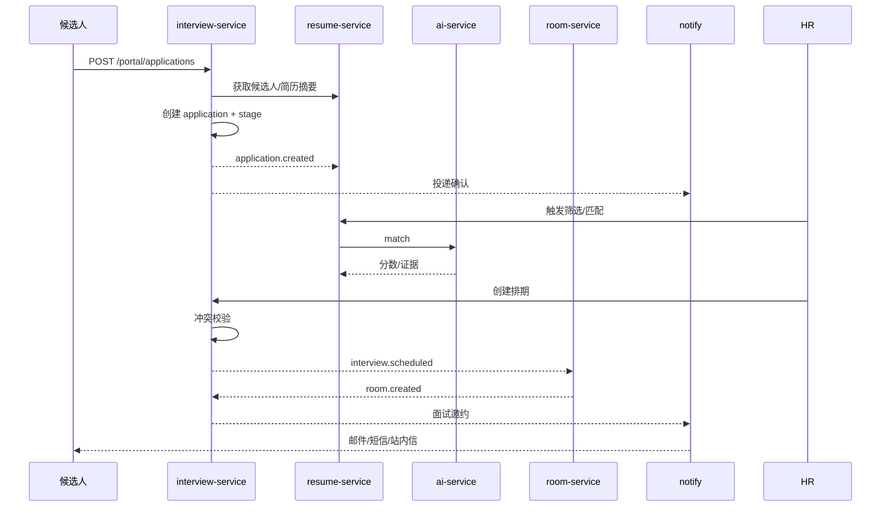
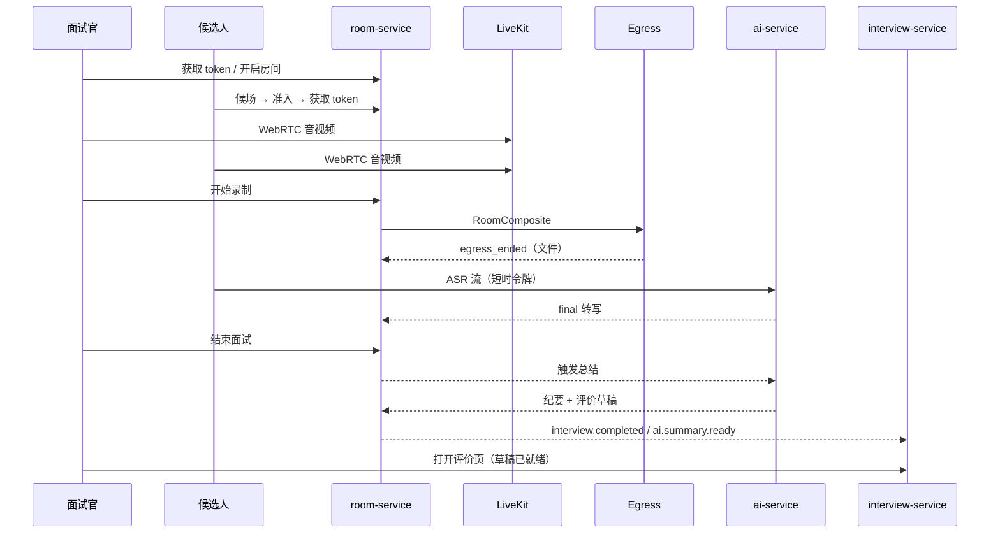
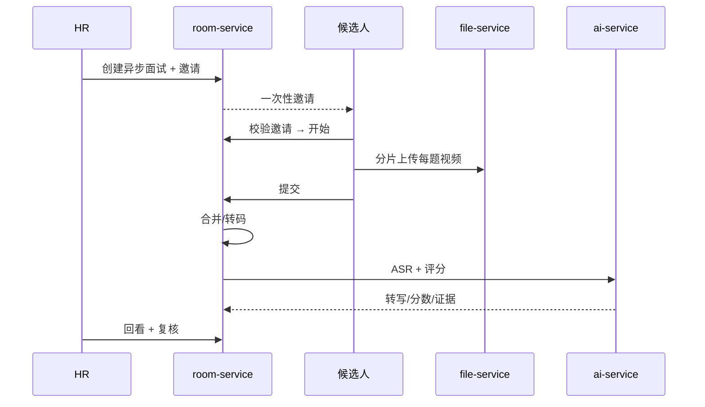

# 06 · REST / WebSocket 接口设计

> 目标：三人按同一份契约并行开发。建议用 OpenAPI 3 维护（每个服务 `/v3/api-docs`），Apifox/Postman 做 Mock 与联调。  
> 本文是接口基线；**权限码、状态枚举、字段名**必须与数据库/鉴权文档一致。

---

## 1. 通用约定

### 1.1 基础信息

| 项 | 约定 |
|---|---|
| Base URL | `https://{host}/api` |
| 内容类型 | `application/json; charset=utf-8`；文件上传走预签名，不经过业务接口 |
| 认证 | `Authorization: Bearer {accessToken}`（候选人/员工同） |
| 追踪 | 响应头/体带 `traceId`；客户端可传 `X-Trace-Id` |
| 时间 | ISO 8601 带时区，如 `2026-11-02T10:00:00+08:00` |
| ID | 雪花 ID，JSON 中一律为**字符串** |
| 分页 | `pageNum`（默认 1）、`pageSize`（默认 20，最大 200） |
| 排序 | `sort=startTime,desc`（字段白名单，后端校验） |
| 幂等 | 创建排期/Offer/投递/上传完成支持 `Idempotency-Key` 请求头，24 小时 |
| 乐观锁 | 更新请求带 `version`；版本不一致返回 409 |
| 批量 | 单次最多 200 条；超出拆分 |
| 语言 | 错误消息中文；错误码稳定，前端按 code 处理 |

### 1.2 响应结构

成功：

```json
{
  "code": 0,
  "message": "ok",
  "data": { },
  "traceId": "4f2a9c..."
}
```

分页：

```json
{
  "code": 0,
  "message": "ok",
  "data": {
    "records": [],
    "total": 128,
    "pageNum": 1,
    "pageSize": 20
  },
  "traceId": "…"
}
```

失败：

```json
{
  "code": 40901,
  "message": "该时间段面试官已有安排",
  "data": {
    "conflicts": [
      {"scheduleId": "…", "interviewerId": "…", "startTime": "…", "endTime": "…"}
    ]
  },
  "traceId": "…"
}
```

HTTP 状态码与业务码同时使用：401/403/404/409/422/429/500。前端先判 HTTP，再按 `code` 展示。

### 1.3 路径与入口隔离

| 前缀 | 服务 | 说明 |
|---|---|---|
| `/api/auth/**` | auth | 登录、刷新、注销、当前用户 |
| `/api/system/**` | system | 用户、角色、菜单、部门、字典、日志 |
| `/api/interview/**` | interview | 岗位、投递、排期、评价、Offer |
| `/api/resume/**` | resume | 候选人、简历、标签、匹配、人才库 |
| `/api/room/**` | room | 房间、录制、纪要、防作弊、异步面试 |
| `/api/notify/**` | notify | 站内信、通知模板 |
| `/api/file/**` | file | 预签名、文件元数据 |
| `/api/ai/v1/asr/stream` | AI | 唯一的公网 AI WebSocket |
| `/internal/**` | 各服务 | 集群内部，网关拒绝外部访问 |

候选人接口统一嵌 `/portal/`：

```
/api/interview/portal/jobs
/api/resume/portal/profile
/api/room/portal/async-invites
```

网关规则：`/portal/**` 仅 `CANDIDATE`；其余仅 `EMPLOYEE`（公开白名单除外）。

### 1.4 错误码

| 区间 | 含义 | 示例 |
|---|---|---|
| `400xx` | 参数/校验 | `40001 参数错误`、`40002 文件类型不支持` |
| `401xx` | 认证 | `40101 未登录`、`40102 过期`、`40104 已撤销` |
| `403xx` | 授权 | `40301 无权限`、`40302 入口不匹配`、`40303 非房间成员` |
| `404xx` | 不存在 | `40401 资源不存在` |
| `409xx` | 冲突 | `40901 状态冲突`、`40902 排期冲突`、`40903 重复投递` |
| `422xx` | 业务规则 | `42201 房间已满`、`42202 不在可面试时间` |
| `429xx` | 限流 | `42901 请求过频` |
| `500xx` | 系统 | `50001 内部错误`、`50002 AI 服务不可用` |
| `51xxx` | 业务域 | 见各模块 |

常用业务码：

| code | 含义 |
|---|---|
| `51001` | 面试官/候选人/房间时间冲突 |
| `51002` | 房间尚未就绪 |
| `51003` | 房间人数已满 |
| `51004` | 候选人不在候场/未准入 |
| `51005` | Offer 已过期 |
| `51006` | 简历解析中，暂不可操作 |
| `51007` | 重复候选人，需合并 |
| `51008` | 当前状态不允许该操作 |
| `52001` | AI 任务排队中 |
| `52002` | AI 任务失败，可重试 |

---

## 2. 认证接口（auth）

| 方法 | 路径 | 权限 | 说明 |
|---|---|---|---|
| GET | `/api/auth/captcha` | 公开 | 图形验证码，返回 `captchaKey` + base64 |
| POST | `/api/auth/login` | 公开 | 员工密码登录 |
| POST | `/api/auth/sms/send` | 公开（限频） | 候选人短信验证码 |
| POST | `/api/auth/sms/login` | 公开 | 候选人验证码登录/自动注册 |
| POST | `/api/auth/refresh` | Refresh Cookie | 刷新 access token |
| POST | `/api/auth/logout` | 登录 | 注销当前会话 |
| GET | `/api/auth/me` | 登录 | 当前用户、角色、权限码、数据范围 |
| PUT | `/api/auth/password` | 登录 | 修改密码 |
| GET | `/api/auth/logs/login` | `system:log:login:view` | 登录日志 |
| POST | `/api/auth/sessions/revoke` | `system:user:kick` | 强制下线 |

登录请求：

```json
POST /api/auth/login
{
  "username": "hr01",
  "password": "Hr@123456",
  "captchaKey": "c_8f3a",
  "captchaCode": "7K2M",
  "app": "ADMIN",
  "rememberMe": false
}
```

响应：

```json
{
  "code": 0,
  "data": {
    "accessToken": "eyJhbGciOiJSUzI1NiIs...",
    "expiresIn": 1800,
    "user": {
      "id": "183920000000000001",
      "username": "hr01",
      "realName": "王 HR",
      "userType": "EMPLOYEE",
      "deptId": "1839...",
      "roles": ["HR"],
      "dataScope": "DEPT"
    }
  }
}
```

`Set-Cookie: refreshToken=...; HttpOnly; Secure; SameSite=Strict; Path=/api/auth`.

`GET /api/auth/me`：

```json
{
  "code": 0,
  "data": {
    "user": { "id": "…", "realName": "王 HR", "userType": "EMPLOYEE" },
    "roles": [{ "code": "HR", "name": "招聘专员", "dataScope": "DEPT" }],
    "permissions": ["interview:schedule:view", "interview:schedule:create", "resume:resume:view"],
    "deptIds": ["1839..."]
  }
}
```

刷新：

```
POST /api/auth/refresh
Cookie: refreshToken=...
→ { "code": 0, "data": { "accessToken": "…", "expiresIn": 1800 } }
```

---

## 3. 系统管理（system）

### 3.1 菜单与权限

| 方法 | 路径 | 权限 | 说明 |
|---|---|---|---|
| GET | `/api/system/menus/routes` | 登录 | 当前用户动态路由树；`?app=ADMIN/CANDIDATE` |
| GET | `/api/system/menus/tree` | `system:menu:view` | 完整菜单树（角色勾选用） |
| POST | `/api/system/menus` | `system:menu:create` | 新建菜单/按钮 |
| PUT | `/api/system/menus/{id}` | `system:menu:update` | 编辑 |
| DELETE | `/api/system/menus/{id}` | `system:menu:delete` | 删除 |
| GET | `/api/system/permissions` | `system:menu:view` | 权限注册表（码/名称/服务/API） |

`GET /api/system/menus/routes?app=ADMIN` 返回 `routes[] + permissions[]`，结构见 [02-auth-rbac.md](02-auth-rbac.md) 5.4。

### 3.2 角色与用户

| 方法 | 路径 | 权限 | 说明 |
|---|---|---|---|
| GET | `/api/system/roles` | `system:role:view` | 角色分页 |
| POST | `/api/system/roles` | `system:role:create` | 新建角色 |
| PUT | `/api/system/roles/{id}` | `system:role:update` | 编辑角色（含 dataScope） |
| DELETE | `/api/system/roles/{id}` | `system:role:delete` | 删除（有用户/内置角色拒绝） |
| GET | `/api/system/roles/{id}/menus` | `system:role:view` | 已勾选菜单 ID |
| PUT | `/api/system/roles/{id}/menus` | `system:role:assign-menu` | 全量覆盖勾选 |
| GET | `/api/system/roles/{id}/users` | `system:role:view` | 角色下用户 |
| PUT | `/api/system/roles/{id}/depts` | `system:role:update` | 自定义数据范围部门 |
| GET | `/api/system/users` | `system:user:view` | 用户分页 |
| POST | `/api/system/users` | `system:user:create` | 新建员工 |
| PUT | `/api/system/users/{id}` | `system:user:update` | 编辑 |
| PUT | `/api/system/users/{id}/roles` | `system:user:assign-role` | 分配角色 |
| PUT | `/api/system/users/{id}/status` | `system:user:update` | 启用/禁用 |
| POST | `/api/system/users/{id}/reset-password` | `system:user:reset-password` | 重置密码 |
| DELETE | `/api/system/users/{id}` | `system:user:delete` | 删除/停用 |

角色勾选菜单：

```json
PUT /api/system/roles/1839.../menus
{
  "menuIds": ["100", "110", "111", "120", "121"],
  "version": 3
}
```

服务端：校验菜单属于该角色的 `app_code`；父目录自动补齐；事务替换；递增该角色用户权限版本；返回新版本。

### 3.3 部门、字典、参数、日志

| 方法 | 路径 | 权限 |
|---|---|---|
| GET | `/api/system/depts/tree` | `system:dept:view` |
| POST/PUT/DELETE | `/api/system/depts` | 对应 create/update/delete |
| GET | `/api/system/dicts` | `system:dict:view` |
| POST/PUT/DELETE | `/api/system/dicts` | `system:dict:update` |
| GET | `/api/system/configs` | `system:config:view` |
| PUT | `/api/system/configs/{key}` | `system:config:update` |
| GET | `/api/system/logs/oper` | `system:log:oper:view` |

### 3.4 通知模板（可由 notify 提供）

| 方法 | 路径 | 权限 |
|---|---|---|
| GET | `/api/notify/templates` | `system:notice:view` |
| POST/PUT/DELETE | `/api/notify/templates` | `system:notice:update` |
| POST | `/api/notify/templates/{id}/test` | `system:notice:update` |

---

## 4. 面试管理（interview）

### 4.1 岗位

| 方法 | 路径 | 权限 | 说明 |
|---|---|---|---|
| GET | `/api/interview/jobs` | `interview:job:view` | 分页/筛选 |
| GET | `/api/interview/jobs/{id}` | `interview:job:view` | 详情 |
| POST | `/api/interview/jobs` | `interview:job:create` | 新建草稿 |
| PUT | `/api/interview/jobs/{id}` | `interview:job:update` | 编辑 |
| DELETE | `/api/interview/jobs/{id}` | `interview:job:delete` | 删除草稿/无投递 |
| POST | `/api/interview/jobs/{id}/publish` | `interview:job:publish` | 发布；触发 JD 解析与快照 |
| POST | `/api/interview/jobs/{id}/close` | `interview:job:close` | 关闭 |
| GET | `/api/interview/jobs/{id}/stats` | `interview:job:view` | 投递/面试统计 |

新建岗位：

```json
POST /api/interview/jobs
Idempotency-Key: job-20261102-001
{
  "jobCode": "JAVA-BE-2026",
  "title": "Java 后端工程师",
  "deptId": "1839...",
  "jobType": "FULL_TIME",
  "city": "上海",
  "salaryMin": 20000,
  "salaryMax": 35000,
  "headcount": 3,
  "jdText": "岗位职责：……\n任职要求：……",
  "ownerHrId": "1839..."
}
```

发布响应返回 `requirementsJson` 解析状态（异步）：`{"jobId":"...","parseTaskNo":"ai_..."}`。

### 4.2 流程模板

| 方法 | 路径 | 权限 |
|---|---|---|
| GET | `/api/interview/process-templates` | `interview:process:view` |
| GET | `/api/interview/process-templates/{id}` | `interview:process:view` |
| POST | `/api/interview/process-templates` | `interview:process:create` |
| PUT | `/api/interview/process-templates/{id}` | `interview:process:update` |
| DELETE | `/api/interview/process-templates/{id}` | `interview:process:delete` |

### 4.3 投递与流程

| 方法 | 路径 | 权限 | 说明 |
|---|---|---|---|
| GET | `/api/interview/applications` | `interview:application:view` | HR 视角 |
| GET | `/api/interview/applications/{id}` | `interview:application:view` | 详情（含阶段、排期、评价摘要） |
| GET | `/api/interview/applications/{id}/timeline` | `interview:application:view` | 流转日志 |
| POST | `/api/interview/applications/{id}/actions` | 按动作校验 | 推进/淘汰/待定/转岗 |
| GET | `/api/interview/portal/applications` | `portal:application:view` | 我的投递 |
| POST | `/api/interview/portal/applications` | `portal:application:create` | 候选人投递 |
| POST | `/api/interview/portal/applications/{id}/withdraw` | `portal:application:withdraw` | 撤回 |
| GET | `/api/interview/portal/jobs` | 公开/`portal:job:view` | 已发布岗位 |
| GET | `/api/interview/portal/jobs/{id}` | 公开/`portal:job:view` | 岗位详情 |

动作请求：

```json
POST /api/interview/applications/1839.../actions
{
  "action": "PASS",            // PASS/REJECT/HOLD/TRANSFER/NEXT_STAGE
  "comment": "一面通过，进入二面",
  "rejectReasonCode": null,
  "transferJobId": null,
  "version": 5
}
```

规则：

- `PASS` 必须当前阶段评价已满足「必填评价人数」；
- `REJECT` 必须带原因；
- `TRANSFER` 必须带目标岗位；
- 操作写 `itv_application_log`，状态冲突返回 `51008`；
- 只有具备权限且数据范围覆盖的人可操作。

### 4.4 排期

| 方法 | 路径 | 权限 | 说明 |
|---|---|---|---|
| GET | `/api/interview/schedules` | `interview:schedule:view` | 分页 |
| GET | `/api/interview/schedules/{id}` | `interview:schedule:view` | 详情 |
| POST | `/api/interview/schedules` | `interview:schedule:create` | 新建 |
| PUT | `/api/interview/schedules/{id}` | `interview:schedule:update` | 改期 |
| POST | `/api/interview/schedules/{id}/cancel` | `interview:schedule:cancel` | 取消 |
| POST | `/api/interview/schedules/batch` | `interview:schedule:batch` | 批量安排 |
| POST | `/api/interview/schedules/conflict-check` | `interview:schedule:view` | 冲突预检 |
| GET | `/api/interview/schedules/my` | 登录 | 我的面试（面试官/候选人） |
| GET | `/api/interview/calendar` | `interview:schedule:view` | 面试官日历 |
| GET | `/api/interview/schedules/{id}/calendar.ics` | 登录 | 导出日历 |

创建排期：

```json
POST /api/interview/schedules
Idempotency-Key: sched-20261102-001
{
  "applicationId": "1839...",
  "stageId": "1839...",
  "roundNo": 1,
  "mode": "ONLINE",
  "startTime": "2026-11-02T10:00:00+08:00",
  "endTime": "2026-11-02T11:00:00+08:00",
  "timezone": "Asia/Shanghai",
  "interviewerIds": ["1839...", "1839..."],
  "evaluationTemplateId": "1839...",
  "room": {
    "roomType": "ONLINE_1V1",
    "maxParticipants": 2,
    "waitingRoom": true,
    "record": true
  }
}
```

成功：

```json
{
  "code": 0,
  "data": {
    "scheduleId": "1839...",
    "scheduleNo": "SC-20261102-0001",
    "status": "ROOM_PENDING",
    "roomNo": null
  }
}
```

冲突：

```json
{
  "code": 40902,
  "message": "该时间段存在冲突",
  "data": {
    "conflicts": [
      {"type": "INTERVIEWER", "id": "1839...", "scheduleId": "…", "startTime": "…", "endTime": "…"},
      {"type": "CANDIDATE", "id": "1839...", "scheduleId": "…", "startTime": "…", "endTime": "…"}
    ]
  }
}
```

批量安排：

```json
POST /api/interview/schedules/batch
{
  "items": [
    {"applicationId": "…", "stageId": "…", "startTime": "…", "endTime": "…", "interviewerIds": ["…"], "mode": "ONLINE"}
  ],
  "stopOnConflict": false
}
```

返回逐条结果（成功/冲突/跳过），不因一条失败回滚全部（除非 `stopOnConflict=true`）。

### 4.5 评价

| 方法 | 路径 | 权限 | 说明 |
|---|---|---|---|
| GET | `/api/interview/evaluation-templates` | `interview:evaluation-template:view` | 模板列表 |
| POST/PUT/DELETE | `/api/interview/evaluation-templates/**` | 对应权限 | 模板 CRUD |
| GET | `/api/interview/schedules/{id}/evaluations` | `interview:evaluation:view` | 某场评价 |
| GET | `/api/interview/evaluations/my` | `interview:evaluation:view` | 我的待填/已填 |
| POST | `/api/interview/schedules/{id}/evaluations` | `interview:evaluation:submit` | 保存/提交评价 |
| POST | `/api/interview/evaluations/{id}/submit` | `interview:evaluation:submit` | 提交 |
| GET | `/api/interview/schedules/{id}/evaluations/comparison` | `interview:evaluation:view` | 多面试官对比 |
| GET | `/api/interview/schedules/{id}/ai-draft` | `interview:evaluation:view` | 拉取 AI 评价草稿 |

提交评价：

```json
POST /api/interview/schedules/1839.../evaluations
{
  "dimensionScores": {
    "professional": 4,
    "problem_solving": 3,
    "communication": 4,
    "potential": 4
  },
  "recommendation": "PASS",
  "summary": "基础扎实，项目经验匹配……",
  "strengths": "微服务拆分经验",
  "risks": "高并发场景经验偏少",
  "version": 0
}
```

AI 草稿只读，人工修改后提交；`ai_draft_status` 记录是否采纳。

### 4.6 Offer

| 方法 | 路径 | 权限 | 说明 |
|---|---|---|---|
| GET | `/api/interview/offers` | `interview:offer:view` | 列表 |
| GET | `/api/interview/offers/{id}` | `interview:offer:view` | 详情 |
| POST | `/api/interview/offers` | `interview:offer:create` | 发起审批 |
| POST | `/api/interview/offers/{id}/approve` | `interview:offer:approve` | 审批通过/驳回 |
| POST | `/api/interview/offers/{id}/send` | `interview:offer:send` | 发送 |
| POST | `/api/interview/offers/{id}/withdraw` | `interview:offer:withdraw` | 撤回 |
| GET | `/api/interview/portal/offers` | `portal:offer:view` | 我的 Offer |
| POST | `/api/interview/portal/offers/{id}/respond` | `portal:offer:respond` | 接受/拒绝 |
| GET | `/api/interview/portal/offers/{id}/onboarding` | `portal:offer:view` | 入职资料清单 |
| POST | `/api/interview/portal/offers/{id}/onboarding` | `portal:offer:respond` | 提交入职资料 |
| POST | `/api/interview/offers/{id}/onboarding/review` | `interview:offer:approve` | HR 审核入职资料 |

审批：

```json
POST /api/interview/offers/1839.../approve
{
  "taskId": "1839...",
  "decision": "APPROVED",   // APPROVED/REJECTED
  "comment": "同意"
}
```

候选人响应：

```json
POST /api/interview/portal/offers/1839.../respond
{
  "decision": "ACCEPTED",   // ACCEPTED/DECLINED
  "comment": "接受"
}
```

入职资料（最小闭环）：

```json
POST /api/interview/portal/offers/1839.../onboarding
{
  "expectedOnboardDate": "2026-12-01",
  "documents": [
    {"type": "ID_CARD", "fileId": "1839..."},
    {"type": "DEGREE_CERT", "fileId": "1839..."},
    {"type": "BANK_CARD", "fileId": "1839..."}
  ]
}
```

- 文件先走 file-service 上传，得到 `fileId`；服务端校验文件归属与类型。
- 资料清单存 `itv_offer.onboarding_json`；HR 审核通过/驳回；不扩展成完整入职系统。
- 候选人只能在 Offer 状态为 `SENT/ACCEPTED` 时提交；HR 只能审核自己数据范围内的 Offer。

### 4.7 统计

| 方法 | 路径 | 权限 |
|---|---|---|
| GET | `/api/interview/stats/funnel?jobId=&from=&to=` | `interview:stats:view` |
| GET | `/api/interview/stats/workload?from=&to=` | `interview:stats:view` |
| GET | `/api/interview/stats/time-to-hire` | `interview:stats:view` |

---

## 5. 简历与人才（resume）

### 5.1 候选人

| 方法 | 路径 | 权限 | 说明 |
|---|---|---|---|
| GET | `/api/resume/candidates` | `resume:candidate:view` | 分页/搜索 |
| GET | `/api/resume/candidates/{id}` | `resume:candidate:view` | 详情 |
| POST | `/api/resume/candidates` | `resume:candidate:create` | 新建（手动） |
| PUT | `/api/resume/candidates/{id}` | `resume:candidate:update` | 编辑 |
| DELETE | `/api/resume/candidates/{id}` | `resume:candidate:delete` | 删除/归档 |
| POST | `/api/resume/candidates/{id}/merge` | `resume:candidate:merge` | 合并 |
| GET | `/api/resume/candidates/duplicates` | `resume:candidate:view` | 重复候选列表 |
| GET | `/api/resume/candidates/{id}/portrait` | `resume:portrait:view` | AI 画像 |
| POST | `/api/resume/candidates/{id}/portrait` | `resume:portrait:generate` | 重新生成画像 |

### 5.2 简历

| 方法 | 路径 | 权限 | 说明 |
|---|---|---|---|
| POST | `/api/resume/resumes` | `resume:resume:upload` | 用 `fileId` 创建简历并触发解析 |
| GET | `/api/resume/resumes` | `resume:resume:view` | 列表 |
| GET | `/api/resume/resumes/{id}` | `resume:resume:view` | 详情（原件、结构化、解析状态） |
| GET | `/api/resume/resumes/{id}/parse-status` | `resume:resume:view` | 解析进度 |
| POST | `/api/resume/resumes/{id}/retry-parse` | `resume:resume:retry-parse` | 重试 |
| PUT | `/api/resume/resumes/{id}/structured` | `resume:resume:edit-structured` | 人工校正 |
| GET | `/api/resume/resumes/{id}/download` | `resume:resume:download` | 获取原件预签名 URL |
| DELETE | `/api/resume/resumes/{id}` | `resume:resume:delete` | 删除 |
| GET | `/api/resume/resumes/{id}/markdown` | `resume:resume:view` | MinerU Markdown 预览 |
| POST | `/api/resume/resumes/search` | `resume:search:execute` | 混合检索 |
| GET | `/api/resume/portal/profile` | `portal:resume:view` | 我的候选人档案 |
| PUT | `/api/resume/portal/profile` | `portal:resume:upload` | 更新档案 |
| GET | `/api/resume/portal/resumes` | `portal:resume:view` | 我的简历 |
| POST | `/api/resume/portal/resumes` | `portal:resume:upload` | 上传简历 |
| DELETE | `/api/resume/portal/resumes/{id}` | `portal:resume:upload` | 删除自己的简历 |

创建简历：

```json
POST /api/resume/resumes
Idempotency-Key: resume-sha256-abc123
{
  "fileId": "1839...",
  "candidateId": null,
  "sourceChannel": "UPLOAD"
}
```

响应：

```json
{
  "code": 0,
  "data": {
    "resumeId": "1839...",
    "candidateId": "1839...",
    "parseStatus": "PENDING",
    "parseTaskNo": "ai_20261017_xxx",
    "duplicate": false
  }
}
```

解析状态：

```json
GET /api/resume/resumes/1839.../parse-status
{
  "code": 0,
  "data": {
    "status": "PARSING",
    "stage": "EXTRACT",
    "progress": 60,
    "message": "正在抽取工作经历"
  }
}
```

人工校正：

```json
PUT /api/resume/resumes/1839.../structured
{
  "manualEdits": {
    "basic": {"phone": "13800000000"},
    "experiences": [{"company": "某某科技", "title": "后端工程师", "start": "2020-07", "end": "2023-08"}]
  },
  "version": 2
}
```

### 5.3 检索与匹配

| 方法 | 路径 | 权限 | 说明 |
|---|---|---|---|
| POST | `/api/resume/search` | `resume:search:execute` | 简历/人才混合检索 |
| GET | `/api/resume/search/talent` | `resume:search:execute` | 人才库检索 |
| POST | `/api/resume/matches` | `resume:match:run` | 触发匹配（可批量/异步） |
| GET | `/api/resume/matches/{jobId}` | `resume:match:view` | 岗位匹配结果 |
| GET | `/api/resume/matches/detail/{id}` | `resume:match:view` | 单条匹配详情 |
| GET | `/api/resume/talents/reactivate?jobId=` | `resume:talent:view` | 按新岗位盘活人才 |

匹配请求：

```json
POST /api/resume/matches
{
  "jobId": "1839...",
  "resumeIds": ["1839...", "1839..."],
  "forceRefresh": false
}
→ { "taskNo": "ai_...", "status": "QUEUED" }
```

检索请求：

```json
POST /api/resume/search
{
  "query": "3年以上 Java 微服务经验，熟悉 Elasticsearch",
  "jobId": "1839...",
  "filters": {
    "city": ["上海"],
    "educationLevel": ["BACHELOR", "MASTER"],
    "workYearsMin": 3,
    "tags": ["Java", "Spring Cloud"]
  },
  "pageNum": 1,
  "pageSize": 20
}
```

返回候选人聚合 + 命中块/证据。

### 5.4 标签、筛选规则

| 方法 | 路径 | 权限 |
|---|---|---|
| GET | `/api/resume/tags` | `resume:tag:view` |
| POST/PUT/DELETE | `/api/resume/tags/**` | `resume:tag:*` |
| POST | `/api/resume/candidates/{id}/tags` | `resume:tag:assign` |
| DELETE | `/api/resume/candidates/{id}/tags/{tagId}` | `resume:tag:assign` |
| GET | `/api/resume/screening-rules` | `resume:screening-rule:view` |
| POST/PUT/DELETE | `/api/resume/screening-rules/**` | `resume:screening-rule:*` |
| POST | `/api/resume/screening-rules/{id}/run` | `resume:screening-rule:run` |
| GET | `/api/resume/screening-results` | `resume:screening-rule:view` |

执行筛选：

```json
POST /api/resume/screening-rules/1839.../run
{
  "jobId": "1839...",
  "resumeIds": null,          // 空表示该岗位全部简历
  "withAiMatch": true
}
→ { "batchNo": "SCR-20261102-001", "status": "RUNNING" }
```

### 5.5 人才库与跟进

| 方法 | 路径 | 权限 | 说明 |
|---|---|---|---|
| GET | `/api/resume/talents` | `resume:talent:view` | 人才库列表 |
| GET | `/api/resume/talents/{id}` | `resume:talent:view` | 详情 |
| POST | `/api/resume/talents` | `resume:talent:create` | 加入人才库 |
| PUT | `/api/resume/talents/{id}` | `resume:talent:update` | 编辑状态/优先级 |
| DELETE | `/api/resume/talents/{id}` | `resume:talent:delete` | 移出 |
| POST | `/api/resume/talents/{id}/follow` | `resume:talent:follow` | 新增跟进 |
| GET | `/api/resume/talents/{id}/follows` | `resume:talent:view` | 跟进历史 |
| GET | `/api/resume/talents/reminders` | `resume:talent:view` | 待跟进提醒 |
| GET | `/api/resume/talents/portrait` | `resume:portrait:view` | 画像 |

### 5.6 解析任务

| 方法 | 路径 | 权限 |
|---|---|---|
| GET | `/api/resume/tasks` | `resume:task:view` |
| GET | `/api/resume/tasks/{id}` | `resume:task:view` |
| POST | `/api/resume/tasks/{id}/retry` | `resume:task:retry` |
| GET | `/api/resume/tasks/{id}/ai-detail` | `resume:task:view` |

---

## 6. 在线面试（room）

### 6.1 房间管理

| 方法 | 路径 | 权限 | 说明 |
|---|---|---|---|
| POST | `/internal/rooms` | 内部 HMAC | interview 创建房间 |
| GET | `/api/room/rooms` | `room:room:view` | 房间列表 |
| GET | `/api/room/rooms/{roomNo}` | `room:room:view` / 参会人 | 房间详情 |
| GET | `/api/room/rooms/{roomNo}/participants` | `room:room:view` / 参会人 | 参与人 |
| POST | `/api/room/rooms/{roomNo}/open` | HOST / `room:room:update` | 开启候场 |
| POST | `/api/room/rooms/{roomNo}/join-request` | 参会人 | 候选人请求进入候场 |
| GET | `/api/room/rooms/{roomNo}/waiting` | HOST | 候场列表 |
| POST | `/api/room/rooms/{roomNo}/admit` | HOST | 准入 |
| POST | `/api/room/rooms/{roomNo}/reject` | HOST | 拒绝 |
| POST | `/api/room/rooms/{roomNo}/mute` | HOST | 静音/解除 |
| POST | `/api/room/rooms/{roomNo}/kick` | HOST | 踢出 |
| POST | `/api/room/rooms/{roomNo}/end` | HOST / `room:room:end` | 结束 |
| POST | `/api/room/rooms/{roomNo}/cancel` | `room:room:cancel` | 取消 |
| POST | `/api/room/rooms/{roomNo}/token` | 参会人 | 获取 LiveKit 令牌 |
| POST | `/api/room/rooms/{roomNo}/ws-ticket` | 参会人 | 获取 WS 短时票据 |
| POST | `/api/room/rooms/{roomNo}/ai-token` | 参会人 | 获取 ASR 短时令牌 |
| POST | `/api/room/rooms/{roomNo}/client-events` | 参会人 | 客户端异常上报 |
| GET | `/api/room/monitor/rooms` | `room:monitor:view` | 监控大盘 |

加入候场：

```json
POST /api/room/rooms/IV-8F3K2/join-request
{}
→ { "code": 0, "data": { "status": "WAITING", "position": 2, "estimatedWaitSec": 300 } }
```

获取令牌：

```json
POST /api/room/rooms/IV-8F3K2/token
{}
→ {
  "code": 0,
  "data": {
    "url": "wss://livekit.example.com",
    "token": "eyJhbGciOiJIUzI1NiIs...",
    "role": "CANDIDATE",
    "expiresIn": 7200,
    "roomNo": "IV-8F3K2"
  }
}
```

未准入返回 `51004`；房间满返回 `42201`；房间已结束返回 `40901`。

主持人操作：

```json
POST /api/room/rooms/IV-8F3K2/admit
{ "candidateId": "1839..." }

POST /api/room/rooms/IV-8F3K2/mute
{ "identity": "c_candidate_1839...", "muted": true }

POST /api/room/rooms/IV-8F3K2/kick
{ "identity": "c_candidate_1839...", "reason": "身份核验未通过" }
```

### 6.2 聊天与笔记

| 方法 | 路径 | 权限 | 说明 |
|---|---|---|---|
| GET | `/api/room/rooms/{roomNo}/messages` | 参会人 | 聊天历史（分页） |
| POST | `/api/room/rooms/{roomNo}/messages` | 参会人 | 发送消息（REST 兜底） |
| GET | `/api/room/rooms/{roomNo}/notes` | 面试官/HR | 笔记 |
| POST | `/api/room/rooms/{roomNo}/notes` | `room:note:create` | 新建笔记 |
| PUT | `/api/room/rooms/{roomNo}/notes/{id}` | 作者/HR | 编辑 |
| GET | `/api/room/rooms/{roomNo}/transcript` | `room:transcript:view` | 转写全文 |
| GET | `/api/room/rooms/{roomNo}/suggestions` | `room:note:view` | AI 建议历史 |

### 6.3 录制

| 方法 | 路径 | 权限 | 说明 |
|---|---|---|---|
| POST | `/api/room/rooms/{roomNo}/recordings/start` | `room:recording:start` | 开始录制 |
| POST | `/api/room/rooms/{roomNo}/recordings/stop` | `room:recording:stop` | 停止 |
| GET | `/api/room/rooms/{roomNo}/recordings` | `room:recording:view` | 录像列表 |
| GET | `/api/room/recordings/{id}/play` | `room:recording:play` | 播放地址（预签名） |
| GET | `/api/room/recordings/{id}/download` | `room:recording:download` | 下载地址 |

开始录制：

```json
POST /api/room/rooms/IV-8F3K2/recordings/start
{ "layout": "grid", "consentConfirmed": true }
→ { "code": 0, "data": { "recordingId": "…", "egressId": "…", "status": "STARTING" } }
```

播放：

```json
GET /api/room/recordings/1839.../play
→ {
  "code": 0,
  "data": {
    "url": "https://minio.../interview-recording/...mp4?X-Amz-...",
    "expiresAt": "2026-11-02T10:30:00+08:00",
    "durationSec": 3540
  }
}
```

### 6.4 防作弊

| 方法 | 路径 | 权限 | 说明 |
|---|---|---|---|
| POST | `/api/room/rooms/{roomNo}/cheat-events` | 参会人 | 批量上报事件 |
| GET | `/api/room/rooms/{roomNo}/cheat-events` | `room:cheat:view` | 事件列表 |
| GET | `/api/room/rooms/{roomNo}/cheat-report` | `room:cheat:view` | 风险报告 |
| POST | `/api/room/rooms/{roomNo}/face-verify` | 候选人 | 入场人脸核验 |
| POST | `/api/room/rooms/{roomNo}/snapshot` | 参会人 | 上报环境快照（证据文件） |

人脸核验：

```json
POST /api/room/rooms/IV-8F3K2/face-verify
{ "imageFileId": "1839...", "verifyType": "ENTRY" }
→ { "code": 0, "data": { "result": "PASS", "similarity": 0.62, "livenessScore": 0.91 } }
```

### 6.5 异步面试

| 方法 | 路径 | 权限 | 说明 |
|---|---|---|---|
| GET | `/api/room/async-interviews` | `room:async:view` | 列表 |
| GET | `/api/room/async-interviews/{id}` | `room:async:view` | 详情 |
| POST | `/api/room/async-interviews` | `room:async:create` | 新建 |
| PUT | `/api/room/async-interviews/{id}` | `room:async:update` | 编辑 |
| POST | `/api/room/async-interviews/{id}/publish` | `room:async:publish` | 发布 |
| DELETE | `/api/room/async-interviews/{id}` | `room:async:delete` | 删除 |
| GET | `/api/room/async-interviews/{id}/invites` | `room:async-invite:view` | 邀请列表 |
| POST | `/api/room/async-interviews/{id}/invites` | `room:async-invite:create` | 发送邀请 |
| POST | `/api/room/async-invites/{id}/cancel` | `room:async-invite:cancel` | 取消邀请 |
| GET | `/api/room/async-invites/{id}/review` | `room:async-review:view` | 复核详情 |
| POST | `/api/room/async-invites/{id}/review` | `room:async-review:submit` | 提交复核 |
| GET | `/api/room/portal/async-invites` | `portal:async:view` | 我的异步面试 |
| POST | `/api/room/portal/async-invites/{id}/start` | `portal:async:start` | 开始 |
| POST | `/api/room/portal/async-invites/{id}/submit` | `portal:async:submit` | 提交 |
| POST | `/api/room/portal/async-invites/{id}/answers/{seq}` | `portal:async:start` | 登记单题作答文件 |

创建异步面试：

```json
POST /api/room/async-interviews
{
  "jobId": "1839...",
  "title": "Java 后端初面（录播）",
  "startAt": "2026-11-01T00:00:00+08:00",
  "endAt": "2026-11-10T23:59:59+08:00",
  "maxAttempts": 1,
  "prepSeconds": 30,
  "answerSeconds": 180,
  "allowRetake": false,
  "questions": [
    {"content": "请介绍一次你主导的服务拆分", "questionType": "TECHNICAL", "weight": 1.0},
    {"content": "遇到线上故障如何定位？", "questionType": "SITUATIONAL", "weight": 1.0}
  ]
}
```

候选人提交：

```json
POST /api/room/portal/async-invites/1839.../submit
{
  "answers": [
    {"seq": 1, "videoFileId": "1839...", "durationSec": 172},
    {"seq": 2, "videoFileId": "1839...", "durationSec": 165}
  ]
}
```

### 6.6 题库

| 方法 | 路径 | 权限 |
|---|---|---|
| GET | `/api/room/questions` | `room:question:view` |
| POST/PUT/DELETE | `/api/room/questions/**` | `room:question:*` |
| POST | `/api/room/questions/search` | `room:question:view` |

### 6.7 内部接口

| 方法 | 路径 | 调用方 | 说明 |
|---|---|---|---|
| POST | `/internal/rooms` | interview | 创建房间 |
| POST | `/internal/livekit/webhook` | LiveKit | 房间/参与者/录制事件 |
| POST | `/internal/rooms/{roomNo}/transcript` | AI | 批量写转写 final |
| POST | `/internal/rooms/{roomNo}/ai-callback` | AI | 纪要/建议结果 |
| POST | `/internal/rooms/{roomNo}/end` | interview | 排期取消/结束联动 |

内部接口校验 HMAC；LiveKit Webhook 校验其签名。

---

## 7. 通知（notify）

| 方法 | 路径 | 权限 | 说明 |
|---|---|---|---|
| GET | `/api/notify/messages` | 登录 | 我的站内信 |
| GET | `/api/notify/messages/unread-count` | 登录 | 未读数 |
| PUT | `/api/notify/messages/{id}/read` | 登录 | 标记已读 |
| PUT | `/api/notify/messages/read-all` | 登录 | 全部已读 |
| GET | `/api/notify/templates` | `system:notice:view` | 模板列表 |
| POST/PUT/DELETE | `/api/notify/templates/**` | `system:notice:update` | 模板 CRUD |
| POST | `/api/notify/templates/{id}/test` | `system:notice:update` | 测试发送 |

发送由事件驱动：业务服务发布 `notification.requested`，notify 消费；不提供「业务方直接调用发送」的公开接口。

---

## 8. 文件（file）

| 方法 | 路径 | 权限 | 说明 |
|---|---|---|---|
| POST | `/api/file/presign` | 登录 | 获取单文件上传预签名 |
| POST | `/api/file/complete` | 登录 | 上传完成校验/登记 |
| POST | `/api/file/multipart/init` | 登录 | 分片上传初始化 |
| POST | `/api/file/multipart/{uploadId}/complete` | 登录 | 分片完成 |
| GET | `/api/file/{id}` | 登录 | 文件元数据 |
| GET | `/api/file/{id}/url` | `file:download` / 业务授权 | 预签名下载 |
| DELETE | `/api/file/{id}` | `file:delete` | 删除 |

预签名：

```json
POST /api/file/presign
{
  "fileName": "张三-Java-2026.pdf",
  "size": 1048576,
  "mimeType": "application/pdf",
  "bizType": "RESUME"
}
→ {
  "code": 0,
  "data": {
    "fileId": "1839...",
    "bucket": "resume-origin",
    "objectKey": "2026/10/17/…pdf",
    "uploadUrl": "https://minio...?X-Amz-...",
    "headers": { "Content-Type": "application/pdf" },
    "expiresIn": 900
  }
}
```

完成：

```json
POST /api/file/complete
{ "fileId": "1839...", "sha256": "…" }
```

大文件（录像/异步作答）用 multipart；分片大小 5~10MB，支持断点续传。

内部接口：

| 方法 | 路径 | 调用方 | 说明 |
|---|---|---|---|
| POST | `/internal/files/register` | AI / room / Egress 回调 | 登记已写入 MinIO 的对象，返回 `fileId` |
| GET | `/internal/files/{id}/stat` | AI / 运维 | 校验对象存在、大小、校验和 |

> 内部接口走集群网络 + HMAC；不经过网关，不允许浏览器直接调用。

---

## 9. AI 接口（内部 + ASR）

### 9.1 内部 REST（不经过网关）

| 方法 | 路径 | 调用方 | 说明 |
|---|---|---|---|
| POST | `/internal/ai/v1/resume/parse-tasks` | resume | 创建解析任务 |
| GET | `/internal/ai/v1/tasks/{taskNo}` | 各服务 | 任务状态 |
| POST | `/internal/ai/v1/tasks/{taskNo}/cancel` | 各服务 | 取消 |
| POST | `/internal/ai/v1/jd/parse` | interview | JD 结构化 |
| POST | `/internal/ai/v1/embeddings` | resume | 文本向量 |
| POST | `/internal/ai/v1/search/resumes` | resume | 简历混合检索 |
| POST | `/internal/ai/v1/search/talent` | resume | 人才检索 |
| POST | `/internal/ai/v1/dedup/check` | resume | 查重 |
| POST | `/internal/ai/v1/match` | resume | 人岗匹配 |
| POST | `/internal/ai/v1/interview/summary` | room | 纪要与评价草稿 |
| POST | `/internal/ai/v1/interview/suggest` | room | 实时建议 |
| POST | `/internal/ai/v1/async/score` | room | 异步评分 |
| POST | `/internal/ai/v1/face/verify` | room | 人脸核验 |
| POST | `/internal/ai/callback` | AI → 业务 | 任务回调 |
| GET | `/health`、`/metrics` | 运维 | 健康/指标 |

> AI 任务监控/提示词管理是可选增强：如需管理页面，建议由 system-service 代理 AI 内部接口，复用 `ai:task:*` / `ai:prompt:*` 权限码，**不要**把 AI 服务直接暴露到公网。MVP 阶段可在业务侧查看解析任务与 AI 纪要状态，提示词通过迁移脚本/配置管理。

任务创建：

```json
POST /internal/ai/v1/resume/parse-tasks
X-Internal-Timestamp: 1760700000000
X-Internal-Service: resume
X-Internal-Signature: ...
{
  "resumeId": "1839...",
  "candidateId": "1839...",
  "fileId": "1839...",
  "fileUrl": "https://minio.../...",
  "fileName": "张三-后端.pdf",
  "sourceChannel": "UPLOAD",
  "idempotencyKey": "sha256:..."
}
→ 202 { "code": 0, "data": { "taskNo": "ai_20261017_xxx", "status": "QUEUED" } }
```

回调：

```json
POST /internal/ai/callback
X-Internal-Signature: ...
{
  "taskNo": "ai_20261017_xxx",
  "bizType": "RESUME_PARSE",
  "status": "SUCCEEDED",
  "resultRef": {
    "structuredObjectKey": "ai-result/2026/10/17/xxx.json",
    "markdownFileId": "1839...",
    "chunkCount": 12,
    "summaryText": "……"
  },
  "errorCode": null,
  "errorMessage": null
}
```

### 9.2 ASR WebSocket

```
WSS /api/ai/v1/asr/stream?token={roomAsrToken}
```

协议见 [03-ai.md](03-ai.md) 7.1；令牌由 `POST /api/room/rooms/{roomNo}/ai-token` 获取。

---

## 10. WebSocket：房间控制通道

媒体走 LiveKit；聊天、笔记、准入、AI 建议等控制消息走 room-service 的 STOMP WebSocket。

### 10.1 连接

```
POST /api/room/rooms/{roomNo}/ws-ticket
→ { "ticket": "one-time", "expiresIn": 60, "wsUrl": "wss://host/ws/room/IV-8F3K2" }

WebSocket: wss://host/ws/room/IV-8F3K2?ticket=...
```

- 票据一次性、60 秒有效、绑定用户/房间；避免把 access token 放进 URL 日志。
- 网关校验平台 token 后签发/转发；room-service 校验票据与房间成员关系。
- STOMP 协议；心跳 10 秒；断线重连需重新取票据。

### 10.2 目的地

| 方向 | Destination | 说明 |
|---|---|---|
| 客户端 → 服务端 | `/app/room/{roomNo}/chat` | 发送聊天 |
| 客户端 → 服务端 | `/app/room/{roomNo}/note` | 新增/编辑笔记 |
| 客户端 → 服务端 | `/app/room/{roomNo}/cheat` | 防作弊事件批量 |
| 客户端 → 服务端 | `/app/room/{roomNo}/ping` | 保活 |
| 服务端 → 客户端 | `/topic/room/{roomNo}` | 广播：聊天、参与人变化、录制状态、结束 |
| 服务端 → 用户 | `/user/queue/room` | 私信：准入结果、个人提醒 |

消息示例：

```json
// 广播
{
  "type": "PARTICIPANT_ADMITTED",
  "roomNo": "IV-8F3K2",
  "data": { "candidateId": "1839...", "displayName": "张三", "admittedAt": "…" }
}

{
  "type": "CHAT",
  "roomNo": "IV-8F3K2",
  "data": {
    "messageId": "1839...",
    "senderId": "1839...",
    "senderRole": "INTERVIEWER",
    "content": "请先做一个自我介绍",
    "sentAt": "2026-11-02T10:01:00+08:00"
  }
}

{
  "type": "AI_SUGGESTION",
  "roomNo": "IV-8F3K2",
  "data": {
    "suggestions": [
      {"question": "能具体说说分布式锁的续期处理吗？", "priority": "HIGH"}
    ],
    "generatedAt": "…"
  }
}

{
  "type": "RECORDING_STATUS",
  "roomNo": "IV-8F3K2",
  "data": { "status": "RECORDING", "recordingId": "…" }
}

{
  "type": "ROOM_ENDED",
  "roomNo": "IV-8F3K2",
  "data": { "endedAt": "…", "reason": "HOST_ENDED" }
}
```

规则：

- 消息带服务端时间与自增序号（按房间）；客户端按序号去重/排序。
- 聊天内容长度限制（如 2000 字），做 XSS 转义；图片消息先上传 file-service。
- 主持人可开启「候选人禁言」；服务端校验。
- WS 只传控制消息，不传音视频；避免把媒体塞进业务 WebSocket。

---

## 11. 关键时序

### 11.1 投递 → 筛选 → 排期 → 面试



### 11.2 面试 → 录制 → AI 纪要



### 11.3 异步面试



---

## 12. 契约管理与联调

### 12.1 OpenAPI

- 每个 Java 服务用 SpringDoc 暴露 `/v3/api-docs`；FastAPI 自带 `/openapi.json`。
- 网关聚合或 Apifox 导入，生成前端 TypeScript 类型（可选 `openapi-typescript`）。
- 接口变更流程：改 OpenAPI → 评审 → 实现 → 更新 Mock → 通知前端。
- 破坏性变更：新增字段可兼容；删除/改语义必须新路径或新版本。

### 12.2 Mock 顺序

1. 第 2 周冻结本文接口与字段；
2. 前端用 Apifox Mock 并行开发；
3. 后端先返回假数据（`feature.mock=true`）跑通；
4. AI 服务用 Mock 结果（确定性 JSON）跑通全链路；
5. 逐个替换真实实现，保持接口不变。

### 12.3 联调检查清单

- [ ] 所有接口返回统一 `code/message/data/traceId`
- [ ] 所有 ID 是字符串
- [ ] 时间带时区，跨时区显示正确
- [ ] 401 能自动 refresh，refresh 失败跳登录
- [ ] 403 与入口隔离正确（候选人/员工）
- [ ] 分页/排序/过滤参数生效
- [ ] 幂等键重复提交不产生重复数据
- [ ] 乐观锁冲突返回 409
- [ ] WebSocket 断线重连、票据过期处理
- [ ] 文件预签名过期/失败提示
- [ ] 错误提示可读，不泄露内部堆栈
- [ ] 审计日志记录关键操作

---

## 13. 接口安全核对

| 检查 | 说明 |
|---|---|
| 每个非公开接口有权限码 | 与菜单/权限注册表一致 |
| 对象级校验 | 候选人/面试官/HR 只能访问自己的数据 |
| 候选人入口隔离 | `/portal/**` + 服务内 `requireCandidate` 双保险 |
| 文件授权 | 预签名前校验业务归属，不信任前端 fileId |
| 房间令牌 | 绑定房间/身份，短 TTL，候场后才发 |
| AI 内部接口 | 仅内网 + HMAC，不经网关 |
| Webhook | LiveKit 签名校验；AI 回调 HMAC |
| 限流 | 登录/短信/上传/AI/WS 分别限流 |
| 审计 | 导出、下载录像、审批、权限变更必记 |
| 输入校验 | Bean Validation/Pydantic；SQL 参数化；XSS 转义 |
