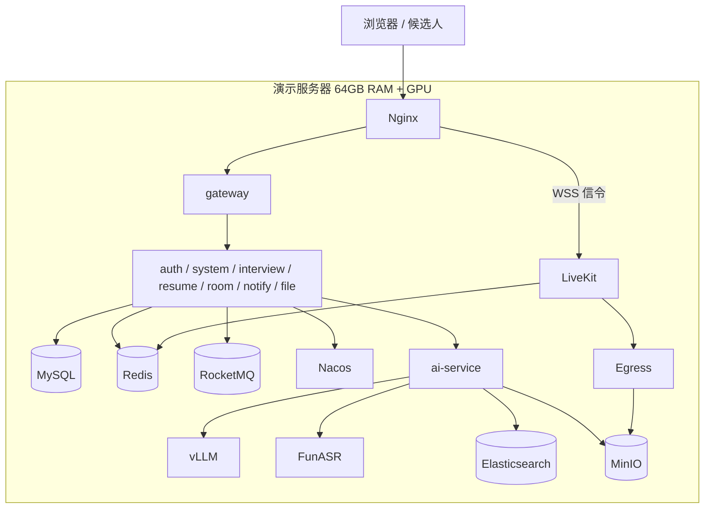
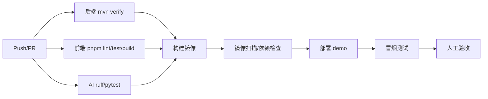

# 07 · 部署、测试、分工与进度

> 本文把设计落到「怎么跑起来、怎么验收、三个人怎么分工、论文怎么写」。  
> 以 16 周为例，可按学校日历压缩或拉长；关键是第 2 周冻结契约、每周有可演示增量。

---

## 1. 环境规划

### 1.1 三套环境

| 环境 | 用途 | 部署 | 数据 |
|---|---|---|---|
| 开发 `dev` | 日常开发、Mock AI | 本机 Docker Compose 基础设施 + IDE 启动 Java | 测试数据，可重置 |
| 联调/演示 `demo` | 三人联调、答辩演示 | 一台应用服务器 + GPU 节点 + 媒体节点 | 演示数据，定期快照 |
| 生产 `prod`（可选） | 论文中的部署验证 | 多节点 / K8s（可选） | 真实数据，需合规 |

### 1.2 推荐硬件

| 节点 | 配置 | 说明 |
|---|---|---|
| 应用节点 | 16C / 64GB / 500GB SSD | 8 个 Java 服务 + MySQL/Redis/Nacos/RocketMQ/ES/MinIO 演示可同机 |
| GPU 节点 | 24GB GPU + 16C / 64GB（推荐双卡：24GB + 16GB） | vLLM、ASR、MinerU、Embedding |
| 媒体节点 | 8C / 16GB / 1Gbps（推荐 10GbE） | LiveKit + Egress；Egress 很吃 CPU |
| 网络 | 公网 IP / 域名 / TLS 证书；UDP 50000-50100 可达 | 校园网需 UDP 或 TURN/TCP 443 |

最低演示配置：单台 32GB RAM + 24GB GPU + 公网 IP。注意：

- ES 至少 4GB 堆；MySQL 2GB；Nacos 1GB；RocketMQ 2GB；Java 服务合计 4~6GB；AI 2~4GB；LiveKit 2GB；Egress 2~4GB；系统 4GB → 32GB 很紧，建议 64GB。
- 如果只有 16GB RAM：把 MySQL/Redis/Nacos 放本机，ES/MinIO/媒体放另一台；或裁掉部分服务（不推荐答辩时裁）。
- 磁盘：录像是大头；500GB 只够演示，生产按 90 天保留估算。

### 1.3 端口规划

| 组件 | 端口 | 暴露 |
|---|---|---|
| Nginx | 80/443 | 公网 |
| Gateway | 8080 | 仅内网/Nginx |
| auth | 8081 | 内网 |
| system | 8082 | 内网 |
| interview | 8083 | 内网 |
| resume | 8084 | 内网 |
| room | 8085 | 内网 |
| notify | 8086 | 内网 |
| file | 8087 | 内网 |
| AI | 9010 | 内网（ASR WSS 由 Nginx 直达 AI） |
| vLLM | 8000 | 内网 |
| FunASR | 10095 | 内网 |
| LiveKit | 7880（HTTP/WS）、7881（TCP）、UDP 50000-50100 | 公网 |
| LiveKit Egress | 无对外端口 | 内网 |
| MySQL | 3306 | 内网 |
| Redis | 6379 | 内网 |
| Nacos | 8848/9848 | 内网 |
| RocketMQ | 9876/10909/10911 | 内网 |
| ES | 9200 | 内网 |
| MinIO | 9000/9001 | 9000 内网；控制台仅运维访问 |
| Prometheus/Grafana | 9090/3000 | 仅运维 |
| SkyWalking | 11800/12800 | 仅运维 |
| XXL-Job | 8088 | 仅运维/内网 |

> 公网只开 80/443 和 LiveKit UDP 段（或 TURN 443）。数据库/ES/MinIO/Nacos 绝不暴露公网。

---

## 2. 部署架构

### 2.1 单机演示（推荐起步）



所有组件用 Docker Compose 启动；Java 服务也可以本地 IDE 启动（连容器里的中间件）以便调试。

### 2.2 多节点演进（论文中描述）

| 节点 | 组件 |
|---|---|
| 接入 | Nginx × 2 + Keepalived/LB |
| 应用 | gateway/auth/system/interview/resume/room/notify/file 多副本 |
| 数据 | MySQL 主从、Redis Sentinel/Cluster、RocketMQ 集群、ES 3 节点 |
| 媒体 | LiveKit × 2 + Redis；Egress 独立节点池 |
| AI | vLLM 多副本/多卡；ASR 独立；MinerU Worker 池 |
| 存储 | MinIO 分布式 / 对象存储 |

> 毕设不需要真的搭多节点，但论文的「可扩展性」一节要能说明怎么扩、瓶颈在哪。

---

## 3. Docker Compose 规划

### 3.1 服务清单

| 服务 | 镜像/构建 | 说明 |
|---|---|---|
| `mysql` | `mysql:8.0` | 初始化 8 个 schema 与账号 |
| `redis` | `redis:7-alpine` | 密码 + AOF（可选） |
| `nacos` | `nacos/nacos-server:v2.4.x` | standalone；生产集群 |
| `rocketmq-namesrv` | `apache/rocketmq:5.x` | 内网 |
| `rocketmq-broker` | 同上 | 小堆内存；挂载 store |
| `elasticsearch` | `elasticsearch:8.15.x` + IK | 单节点演示；`xpack.security` 可开 |
| `minio` | `minio/minio` | 8 个 bucket |
| `livekit` | `livekit/livekit-server` | 配置文件 + Redis |
| `livekit-egress` | `livekit/egress` | Chrome + 编码；S3 配置 |
| `vllm` | 自定义/官方 CUDA 镜像 | 需 `--gpus all` |
| `funasr` | 自定义 | 流式 ASR Runtime |
| `ai` | `ai/Dockerfile` | FastAPI + Celery |
| `gateway` | `backend/recruit-gateway` | 8080 |
| `auth` / `system` / `interview` / `resume` / `room` / `notify` / `file` | 各 Dockerfile | 8081~8087 |
| `web-admin` | Nginx 静态 | 构建产物 |
| `web-candidate` | Nginx 静态 | 构建产物 |
| `nginx` | `nginx:alpine` | TLS、静态、反代、WSS |
| `prometheus` / `grafana` / `loki` / `skywalking` | 官方镜像 | 可观测（可选） |
| `xxl-job-admin` | `xuxueli/xxl-job-admin` | 定时任务 |

### 3.2 Compose profiles

```yaml
# deploy/docker-compose.yml（节选）
services:
  mysql:
    profiles: ["infra"]
    image: mysql:8.0
    env_file: .env
    volumes: ["mysql-data:/var/lib/mysql", "./sql/init:/docker-entrypoint-initdb.d:ro"]
    ports: ["3306:3306"]

  elasticsearch:
    profiles: ["infra"]
    image: elasticsearch:8.15.3
    environment:
      - discovery.type=single-node
      - xpack.security.enabled=false
      - ES_JAVA_OPTS=-Xms4g -Xmx4g
    volumes: ["es-data:/usr/share/elasticsearch/data"]
    ports: ["9200:9200"]

  vllm:
    profiles: ["ai", "gpu"]
    image: vllm/vllm-openai:latest
    command: >
      --model Qwen/Qwen2.5-7B-Instruct-AWQ
      --served-model-name qwen2.5-7b-instruct
      --api-key ${VLLM_API_KEY}
      --max-model-len 16384
      --gpu-memory-utilization 0.82
      --max-num-seqs 24
      --enable-prefix-caching
      --quantization awq
    environment:
      - VLLM_API_KEY=${VLLM_API_KEY}
    deploy:
      resources:
        reservations:
          devices: [{ driver: nvidia, count: 1, capabilities: [gpu] }]
    ports: ["8000:8000"]

  livekit:
    profiles: ["media"]
    image: livekit/livekit-server:latest
    command: --config /etc/livekit.yaml
    volumes: ["./livekit/livekit.yaml:/etc/livekit.yaml:ro"]
    ports:
      - "7880:7880"
      - "7881:7881"
      - "50000-50100:50000-50100/udp"
```

启动：

```bash
docker compose --profile infra up -d
docker compose --profile app up -d
docker compose --profile media up -d
docker compose --profile ai --profile gpu up -d
```

> 开发时可只起 `infra`，Java 服务用 IDE 启动；AI 用 `AI_MOCK=true` 不占 GPU。  
> 示例里的 `latest` 仅用于说明，落地必须锁定镜像 tag/digest；vLLM 与 CUDA 驱动版本不匹配是常见事故。

### 3.3 LiveKit 配置要点

```yaml
port: 7880
rtc:
  tcp_port: 7881
  port_range_start: 50000
  port_range_end: 50100
  use_external_ip: true
redis:
  address: redis:6379
keys:
  APIexample: ${LIVEKIT_API_SECRET}
turn:
  enabled: true
  domain: turn.example.com
  tls_port: 443
  udp_port: 3478
logging:
  level: info
```

- `use_external_ip` 在 NAT 环境必须正确；否则客户端拿到内网 ICE candidate。
- TURN/TLS 需要证书；校园网只开 443 时靠它。
- LiveKit 与 Egress 共享 Redis；Egress 的 `ws_url` 指向 LiveKit（内网 `ws://livekit:7880`）。
- Egress S3 配置：

```yaml
api_key: APIexample
api_secret: ${LIVEKIT_API_SECRET}
ws_url: ws://livekit:7880
redis:
  address: redis:6379
s3:
  access_key: ${MINIO_ACCESS_KEY}
  secret: ${MINIO_SECRET_KEY}
  region: us-east-1
  endpoint: http://minio:9000
  bucket: interview-recording
  force_path_style: true
```

### 3.4 Nginx

```nginx
server {
  listen 443 ssl http2;
  server_name recruit.example.com;

  location / {
    root /usr/share/nginx/html/admin;
    try_files $uri $uri/ /index.html;
  }

  location /api/ {
    proxy_pass http://gateway:8080;
    proxy_set_header Host $host;
    proxy_set_header X-Real-IP $remote_addr;
    proxy_set_header X-Forwarded-Proto $scheme;
    proxy_read_timeout 120s;
  }

  # ASR WebSocket
  location /api/ai/v1/asr/stream {
    proxy_pass http://ai:9010;
    proxy_http_version 1.1;
    proxy_set_header Upgrade $http_upgrade;
    proxy_set_header Connection "upgrade";
    proxy_read_timeout 3600s;
  }

  # 房间控制 WebSocket
  location /ws/ {
    proxy_pass http://room:8085;
    proxy_http_version 1.1;
    proxy_set_header Upgrade $http_upgrade;
    proxy_set_header Connection "upgrade";
    proxy_read_timeout 3600s;
  }

}

# LiveKit 信令：独立子域名，避免 /rtc 路径重写问题
server {
  listen 443 ssl http2;
  server_name livekit.example.com;

  location / {
    proxy_pass http://livekit:7880;
    proxy_http_version 1.1;
    proxy_set_header Upgrade $http_upgrade;
    proxy_set_header Connection "upgrade";
    proxy_set_header Host $host;
    proxy_read_timeout 3600s;
  }
}
```

- 候选人门户可用独立域名/路径；注意 Cookie `Path=/api/auth` 与同源策略。
- LiveKit 令牌返回 `wss://livekit.example.com`；room-service 服务端 API 用内网 `http://livekit:7880`。
- UDP 50000-50100 直接暴露给 LiveKit 节点，不能只靠 Nginx；Nginx 只代理信令/WSS。
- 大文件不经过 Nginx/网关，直接预签名到 MinIO。
- TLS 证书用 Let's Encrypt 或学校证书；本地开发用 mkcert。

### 3.5 初始化

1. 创建 8 个 schema 与服务账号（见 02 文档）。
2. Flyway 自动迁移；种子数据：角色、菜单、字典、流程模板、评价模板。
3. 创建 MinIO bucket 与生命周期规则。
4. 创建 Nacos namespace：`recruit-dev`、`recruit-demo`；导入各服务配置。
5. 创建 XXL-Job 执行器与任务：人才跟进提醒、Offer 过期、房间超时、ES 重建、Outbox 补偿。
6. 创建演示账号：`admin`、`hr01`、`interviewer01`、候选人手机号。

---

## 4. 配置与密钥

| 配置 | 位置 | 说明 |
|---|---|---|
| 数据库连接 | Nacos + 环境变量 | 每服务独立账号；密码不进 Git |
| JWT 私钥/公钥 | Nacos 加密配置/文件挂载 | 支持 `kid` 轮换 |
| LiveKit API Key/Secret | Nacos/环境变量 | room-service 与 Egress 使用 |
| MinIO Access/Secret | 环境变量/密钥管理 | 分服务账号，最小权限 |
| vLLM API Key | 环境变量 | 仅 AI 服务使用 |
| 短信/邮件凭证 | Nacos/环境变量 | 演示用 Mock 适配器 |
| AI 内部 HMAC | 环境变量 | 业务服务与 AI 共享，定期轮换 |
| CORS/域名 | Nacos | 只允许正式域名 |

原则：

- `.env` 只用于本地；`.env.example` 入库，真实密钥不入库。
- 生产用 Docker secrets/K8s Secret/云密钥管理。
- 日志不打印配置值；Nacos 控制台加认证。

---

## 5. 可观测性

### 5.1 指标

| 组件 | 采集 | 关键指标 |
|---|---|---|
| Java | Actuator + Micrometer | QPS、P95、错误率、JVM、连接池、Feign 超时 |
| FastAPI | prometheus-fastapi-instrumentator | 请求量、延迟、任务队列、LLM 延迟 |
| vLLM | 自带 `/metrics` | GPU、KV Cache、排队、tokens/s |
| LiveKit | 自带 Prometheus | 房间/参与者、RTT、丢包、TURN |
| Egress | 自带指标/日志 | 活跃任务、失败率、CPU |
| MySQL/Redis/ES | exporters | 连接、慢查询、内存、磁盘、集群状态 |
| 业务 | 自定义 | 房间创建/入会/录制成功率、AI 任务成功率、人才跟进到期数 |

### 5.2 日志与追踪

- 结构化 JSON：`timestamp, level, service, traceId, userId, roomNo, taskNo, message, errorCode`。
- 敏感字段脱敏（手机号、邮箱、令牌、密码、身份证）。
- SkyWalking/OTel：网关 → 业务 → AI 全链路；媒体链路用 LiveKit 指标补充。
- 日志保留 30~90 天；审计日志单独保留。

### 5.3 告警（示例）

| 告警 | 阈值 |
|---|---|
| 网关 5xx 比例 | > 2%（5 分钟） |
| 登录失败率 | > 30%（5 分钟，排除压测） |
| 房间创建失败 | > 1% |
| 入会失败 | > 2% |
| 录制失败 | > 5% |
| AI 队列积压 | `q.batch > 100` 或 `q.interactive > 30` |
| GPU 显存 | > 90% 持续 5 分钟 |
| ES 堆 | > 85% |
| MinIO 磁盘 | > 80% |
| MySQL 慢查询 | > 1s 且 QPS 异常 |

### 5.4 面板

- 业务总览：投递/面试/Offer 漏斗、今日面试、房间在线、AI 任务。
- 面试质量：入会成功率、RTT/丢包、录制成功率、转写延迟。
- AI：队列、成功率、P95、tokens、GPU、失败原因。
- 系统：QPS、错误率、JVM、DB/Redis/ES。

---

## 6. CI/CD

### 6.1 流水线



- 后端：编译 + 单测 + Testcontainers（MySQL/Redis/ES 可选）+ Flyway 校验。
- 前端：ESLint + TypeScript + Vitest + 构建；关键页面 Playwright（可选）。
- AI：ruff + mypy（可选）+ pytest；用 Mock 模型跑接口测试。
- 镜像：多阶段构建；Java 用 JRE 21 slim；前端 Nginx；AI 固定 CUDA/PyTorch 版本。
- 部署：`docker compose pull && up -d`；数据库迁移先执行；失败自动回滚镜像 tag。
- 冒烟：登录 → 菜单 → 创建排期 → 建房 → 获取 token → 健康检查。

### 6.2 分支与发布

| 分支 | 用途 |
|---|---|
| `main` | 可运行、可演示；保护分支 |
| `feat/a-*`、`feat/b-*`、`feat/c-*` | 三人各自功能 |
| `release/YYYYMMDD` | 演示/答辩冻结版本 |
| `hotfix/*` | 紧急修复 |

- PR 至少一人评审；数据库变更必须评审；接口变更同步 OpenAPI。
- 每周五打 `weekly-*` tag，生成变更记录与演示环境。
- 答辩前冻结 `release/defense`，只修 bug 不加功能。

---

## 7. 测试策略

### 7.1 测试层次

| 层次 | 范围 | 工具 |
|---|---|---|
| 单元测试 | 状态机、规则引擎、权限校验、工具类 | JUnit 5、Mockito、Vitest |
| 集成测试 | 服务 + MySQL/Redis/ES；Flyway | Testcontainers、Spring Boot Test |
| 契约测试 | OpenAPI 字段/错误码；Mock 一致性 | Apifox/Postman + CI |
| E2E | 登录 → 投递 → 排期 → 面试 → 评价 → Offer | Playwright |
| 媒体测试 | 1v1/1v5、弱网、录制、屏幕共享 | LiveKit load tester + Playwright 假设备 |
| 性能测试 | REST、媒体、AI | k6/JMeter、Locust、livekit-cli |
| 安全测试 | 越权、令牌、上传、注入、限流 | 手工 + OWASP ZAP（可选） |
| AI 评估 | 抽取/检索/匹配/ASR/摘要 | 固定数据集 + 指标脚本 |
| UAT | 三个角色走完整流程 | 演示脚本 |

### 7.2 验收指标

| 类别 | 指标 | 目标 |
|---|---|---|
| 功能 | MVP 清单 | 100% 可演示 |
| 鉴权 | 角色菜单/按钮/接口一致 | 抽查 20 个接口全部有权限码；越权返回 403 |
| 数据 | 候选人只能看自己 | 脚本验证 0 越权 |
| 性能 | 登录/列表/排期 P95 | ≤ 500/300/500ms |
| 并发 | 1v1 + 1v5 | 50 房间 / 200 人稳定；100 房间压测报告 |
| 媒体 | 入会成功率 | ≥ 99%（正常网络） |
| 媒体 | RTT / 丢包 | ≤ 200ms / < 1%（同区域） |
| 录制 | 成功率 / 可回放时间 | ≥ 95% / 结束后 ≤ 2 分钟 |
| AI | 简历抽取 F1 | ≥ 0.85（固定样本） |
| AI | 匹配 NDCG@10 | ≥ 0.75（人工标注） |
| AI | ASR CER | ≤ 10%（清晰普通话） |
| AI | 纪要事实错误率 | < 5% |
| 可靠性 | AI 宕机 | 面试/排期/评价不受阻 |
| 可靠性 | 录制失败 | 面试继续，可重试 |
| 安全 | 高危漏洞 | 0（越权/令牌/上传/注入） |
| 文档 | 部署/接口/数据库/演示 | 完整可复现 |

> 指标是设计目标，答辩时如实报告实测值与偏差，比伪装「全部达标」更可信。

### 7.3 关键测试用例

**鉴权**

- 未登录访问受保护接口 → 401。
- 候选人 token 访问 `/api/interview/jobs` → 403。
- HR 访问其他部门投递 → 403/空列表（按数据范围）。
- 面试官访问未分配给自己的房间 token → 403。
- 角色菜单取消后，旧 token 再请求 → 权限码校验失败（权限缓存版本更新）。
- 禁用用户后，旧 access token → 401（token version）。

**面试管理**

- 同一面试官时间重叠 → 40902。
- 同一候选人时间重叠 → 40902。
- 批量安排部分冲突 → 返回逐条结果。
- 评价未达必填人数就 PASS → 422。
- Offer 过期后接受 → 51005。

**简历**

- 同文件重复上传 → 幂等/去重提示。
- 扫描件/表格简历 → 表格内容可检索。
- 解析失败 → 状态失败、可重试、不阻塞投递。
- 合并候选人 → 活跃投递引用更新，历史记录保留。

**在线面试**

- 候选人未准入拿 token → 51004。
- 房间满 → 42201。
- 主持人踢人后，被踢者无法重连（token 失效/房间权限）。
- 弱网 → 视频降级/仅音频；音频不断。
- 录制停止 → 文件可播放；Egress 失败 → 状态 FAILED、可重试。
- 1v5 六人入会 → 布局正确、CPU/带宽在预算内。

**AI**

- 提示词注入样本 → 不改变评分/不泄露系统提示。
- vLLM 超时 → 任务失败/重试，业务不受阻。
- ASR 断流 → 重连后可继续；final 不重复。
- 无证据的维度 → 返回 insufficient_evidence，不硬打分。

---

## 8. 三人分工

### 8.1 角色

| 成员 | 主责子系统 | 平台职责 | 前端页面 |
|---|---|---|---|
| **A（你）** | 面试管理 | gateway、auth、system、notify；整体集成、CI、部署 | `web-admin` 公共壳、登录、动态路由、系统管理、面试管理页面 |
| **B** | 智能简历与人才 | resume、file；ES/MinIO 数据侧；AI 简历/检索/匹配模块 | 简历库、解析、匹配、筛选、人才库页面；候选人门户简历/投递 |
| **C** | 在线面试 | room、LiveKit/Egress、GPU 与 AI 服务运维；AI ASR/面试模块 | 面试房间、监控、录像、异步面试、题库页面；候选人门户面试页 |

### 8.2 代码所有权

| 目录 | Owner | 说明 |
|---|---|---|
| `backend/recruit-gateway`、`auth`、`system`、`notify` | A | 公共底座，改动需通知全员 |
| `backend/recruit-interview` | A | 面试业务流程 |
| `backend/recruit-resume`、`file` | B | 简历与文件 |
| `backend/recruit-room` | C | 房间与异步面试 |
| `ai/app/api/resume|search|match`、`services/parser|chunker|extractor|matcher` | B | 简历 AI |
| `ai/app/api/asr|interview|face`、`services/summarizer|suggester|async_evaluator` | C | 面试 AI |
| `ai/app/clients/vllm.py`、部署、Prompt 平台 | A | 公共 AI 底座 |
| `frontend/apps/admin` 公共壳 | A | 路由/权限/请求/布局 |
| `frontend/apps/candidate` | B + C | B：简历/投递；C：面试/异步 |
| `deploy/` | A 主导，B/C 补充 | Compose、Nginx、Nacos、CI |
| `docs/` | 全员 | 各自维护对应章节 |

### 8.3 协作节奏

| 时间 | 动作 |
|---|---|
| 周一 10:00 | 周会：上周完成、本周计划、阻塞、接口变更 |
| 每天 | 至少一次全链路冒烟；CI 必须绿 |
| 周三 | 联调日：B/C 对 A 的契约；C 对 A 的房间/排期；B 对 A 的投递 |
| 周五 | 合并 `main`、打 tag、部署 demo、录 3 分钟演示 |
| 每两周 | 回顾：范围/质量/风险；必要时砍增强项 |

### 8.4 契约冻结

第 2 周结束前必须冻结：

- 数据库表与枚举（02 文档）
- REST 接口与错误码（06 文档）
- 权限码与菜单种子（03 文档）
- 事件 Topic 与载荷（01 文档）
- AI 内部接口与任务状态（04 文档）

冻结后允许「加字段/加接口」，不允许「改名/删字段/改语义」；必须变更时走评审并同步三人。

---

## 9. 16 周进度计划

| 周 | A（面试管理 + 平台） | B（简历人才 + AI） | C（在线面试 + AI） | 里程碑 |
|---|---|---|---|---|
| 1 | 需求梳理、用例、角色矩阵；架构/DB/接口草案；仓库与 Compose | 简历需求/数据模型；MinerU 调研 | 在线面试需求；LiveKit 调研 | 开题材料、架构 v0.1 |
| 2 | 登录/网关/系统管理骨架；动态菜单 | 简历表/接口；AI Mock；ES 调研 | 房间表/接口；LiveKit 1v1 Demo | **契约冻结 v1** |
| 3 | 用户/角色/菜单页面；登录联调 | 简历上传 + MinerU 解析跑通 | 房间创建/令牌/1v1 入会 | 能登录、能上传、能视频 |
| 4 | 岗位/投递/流程模板 | 分块 + Embedding + ES 索引 | 候场/准入/聊天/结束 | 第一条业务链 |
| 5 | 排期/冲突/日历；通知 | 结构化抽取 + 人工校正 | 录制/Egress/回放 | 排期 → 建房 → 通知 |
| 6 | 评价模板/评价/聚合 | 查重/合并/标签 | 屏幕共享/设备检测/弱网 | 1v1 面试全流程 |
| 7 | Offer/审批；统计 | 混合检索/筛选规则 | 1v5 群面/Panel；防作弊基础 | 中期演示 |
| 8 | 端到端联调；数据范围/审计 | 匹配评分/批量筛选 | ASR 流式/实时建议 | **中期检查** |
| 9 | 面试评价 AI 草稿接入 | 人才库/跟进/画像 | 纪要/评价草稿；异步面试 | AI 赋能闭环 |
| 10 | 候选人门户 Offer/流程 | 多渠道接入/Mock；人才盘活 | 异步评分/复核；题库 | 三端完整 |
| 11 | 性能/安全修复；监控 | 检索/匹配指标调优 | 1v5 压测；录制容量 | 性能报告初稿 |
| 12 | 集成回归；演示数据 | AI 回归集/消融 | 弱网/故障演练 | 答辩候选版本 |
| 13 | 论文系统设计章节 | 论文算法/实验章节 | 论文测试/部署章节 | 论文初稿 |
| 14 | 部署冻结、演示视频 | 图表/实验结果 | 答辩 PPT 素材 | 预答辩 |
| 15 | 答辩演练、修复 | 答辩演练 | 答辩演练 | 答辩 |
| 16 | 缓冲/材料归档 | 缓冲 | 缓冲 | 最终提交 |

> 如果周期更短（如 12 周）：砍掉白板、协同编辑、虚拟背景、活体检测、微信通知、K8s；保留 1v1 + 1v5、录制、解析、匹配、RBAC、AI 纪要。先把主链路跑通。

### 9.1 每周 Definition of Done

- 代码合并 `main`，CI 绿；
- 接口文档/数据库迁移同步；
- 至少一条 E2E 或集成测试；
- 演示环境可访问；
- 有 1~3 分钟录屏或截图；
- 更新风险与下周计划。

---

## 10. 演示脚本（答辩 15~20 分钟）

1. **管理员登录**：展示动态菜单；进入「角色管理」，勾选/取消一个菜单，切换到对应角色账号验证菜单与接口权限。
2. **创建岗位**：填写 JD，发布；展示 AI 解析出的要求。
3. **候选人上传简历**：候选人门户登录（短信 Mock），上传 PDF；展示解析进度、结构化字段、表格内容。
4. **简历查重/匹配**：上传同一人多份简历，展示合并建议；触发人岗匹配，展示分数、证据、缺口。
5. **筛选与排期**：HR 执行筛选规则，选 Top 候选人；安排 1v1 线上面试，展示冲突校验、通知。
6. **候选人面试**：候选人收到邀约，进入候场；主持人准入；双方音视频、屏幕共享、聊天。
7. **AI 助手**：实时字幕、面试官侧关键问题提示；主持人结束。
8. **录制与纪要**：回放录像；展示 AI 纪要、评价草稿；面试官修改并提交评价。
9. **流程流转**：评价通过 → 自动进入下一阶段；Offer 审批 → 候选人接受。
10. **1v5 群面**：展示 6 人房间、网格布局、主持人静音/踢人（可提前录屏，节省现场时间）。
11. **异步面试**：候选人录播作答；HR 回看、转写、AI 评分、人工复核。
12. **人才库**：面试未通过但高分候选人入库；按新岗位盘活；跟进提醒。
13. **监控**：房间在线、录制状态、AI 任务、招聘漏斗。

> 现场网络不可控：准备 3 段录屏（1v5、录制回放、AI 纪要）作为兜底；演示数据提前准备好。

---

## 11. 论文与答辩素材

### 11.1 章节映射

| 论文章节 | 素材 |
|---|---|
| 第 1 章 绪论 | 招聘痛点、三子系统背景、国内外现状、本文工作 |
| 第 2 章 相关技术 | Vue、Spring Cloud、Nacos、MySQL、ES 向量检索、vLLM、MinerU、LiveKit、WebRTC |
| 第 3 章 需求分析 | 三类角色、用例图、功能/非功能需求、需求追踪矩阵 |
| 第 4 章 系统设计 | 总体架构、微服务划分、数据库/ER、鉴权 RBAC、AI 流水线、媒体面与容量模型 |
| 第 5 章 关键实现 | 统一鉴权与动态菜单、排期冲突、MinerU 分块与混合检索、匹配、1v5 房间、录制、ASR/纪要 |
| 第 6 章 系统测试 | 功能/鉴权/性能/弱网/AI 指标/消融实验 |
| 第 7 章 总结与展望 | 成果、不足、多租户/模型微调/更复杂调度 |

### 11.2 可写的「创新点/工作量」

1. **三平面解耦**：业务控制面、WebRTC 媒体面、AI 智能面分离，AI/媒体故障不阻断招聘流程；给出容量模型与压测。
2. **表格感知的简历解析与分块**：MinerU 保留表格/公式/图注，表格独立成块 + 上下文前缀 + 混合检索；可做消融实验（固定窗口 vs 结构分块；BM25 vs 向量 vs RRF）。
3. **菜单/按钮/接口三层一致的 RBAC**：权限注册表 + 动态路由 + 注解校验 + 数据范围；解决三人协作中的权限漂移。
4. **1v5 SFU 容量工程**：Simulcast/Dynacast/AdaptiveStream、候场、Egress 旁路、控制面与媒体面分离；给出带宽/CPU 估算与压测方法。
5. **人机协同的 AI 面试**：实时转写 + 问题建议 + 评价草稿 + 证据引用；AI 只做建议，人工确认；防提示词注入。
6. **事件驱动一致性**：Outbox + 幂等消费 + 状态机补偿，替代跨服务强事务；可对比 Seata。

### 11.3 实验建议

| 实验 | 变量 | 指标 |
|---|---|---|
| 分块策略 | 固定窗口 / 按标题 / 表格独立 + 前缀 | Recall@10、匹配 NDCG |
| 检索方式 | BM25 / 向量 / 混合 RRF | Recall、MRR、延迟 |
| 匹配 Prompt | v1 / v2 / few-shot | 与人工排序相关性 |
| ASR | 无热词 / 有热词 | CER、专有名词准确率 |
| 并发 | 1v1/1v5、Simulcast 开/关 | 带宽、RTT、卡顿、CPU |
| 录制 | 合成 / 单轨 | CPU、文件大小、可用性 |
| 鉴权 | 无缓存 / Redis 缓存 | 权限校验延迟、变更生效时间 |

### 11.4 答辩常见问题

1. **为什么拆微服务？会不会过度设计？**  
   三个子系统由三人并行开发、边界清晰；消息/媒体/AI 可独立扩容。承认代价：运维复杂、一致性难；用 Outbox/快照/契约控制。若规模很小，单体更合适。
2. **为什么用 ES 而不是 Milvus？**  
   需求指定 ES；简历检索需要关键词 + 语义 + 元数据过滤，ES 8 的 BM25 + kNN + RRF 一套搞定；数据量（几十万块）不需要专用向量库。规模再大再考虑 Milvus。
3. **1v5 为什么不用 Mesh？**  
   Mesh 每端上行 5 路，带宽/CPU 不可控；SFU 每端只上行 1 路，服务端转发，配合 Simulcast 出口可降一个数量级。
4. **AI 会不会误判/幻觉？**  
   结构化输出 + 证据引用 + 置信度 + 人工确认；AI 不自动淘汰；评价必须面试官提交；Prompt 注入防护与回归集。
5. **跨服务一致性怎么保证？**  
   本地事务 + Outbox + 幂等消费 + 状态机补偿；面试排期与建房用「ROOM_PENDING + 重试」；候选人合并用事件更新引用；不做分布式强事务。
6. **统一鉴权怎么做？**  
   auth 签发 RS256 JWT，网关验签并注入身份头，业务服务按权限码校验；权限缓存带版本；候选人/员工入口隔离；对象级校验防 IDOR。
7. **三个人怎么保证表/接口一致？**  
   第 2 周冻结契约；每服务独立 schema；逻辑外键 + 快照；权限注册表 + CI；每周集成。
8. **AI 服务为什么用 FastAPI 而不是 Java？**  
   Python 生态（MinerU、Transformers、FunASR、vLLM 客户端）成熟；FastAPI 异步与类型校验好；与 Java 通过内部 API/事件解耦。
9. **录制很吃资源，怎么扩展？**  
   Egress 独立节点池，按并发扩容；录制是旁路，可选择性开启；生命周期清理；1v5 合成码率可控。
10. **隐私与合规怎么考虑？**  
    录制/人脸/环境检测知情同意；最小化采集；私有桶 + 短签名 + 审计；保留期限；AI 不用敏感属性；不自动决策。

---

## 12. 风险与应对

| 风险 | 影响 | 概率 | 应对 |
|---|---|---|---|
| LiveKit/UDP 在校园网不通 | 无法视频 | 中 | 提前测 TURN/TCP 443；准备录屏兜底 |
| GPU 不足/驱动不兼容 | AI 跑不起来 | 中 | 锁定镜像/版本；Mock 模式；CPU 处理非实时任务 |
| 三人接口/表不一致 | 联调返工 | 高 | 契约冻结、每周集成、权限注册表 |
| 范围过大 | 做不完 | 高 | MVP 优先；增强项可砍；每周回顾 |
| AI 质量不达标 | 演示效果差 | 中 | 固定样本调 Prompt；规则兜底；人工校正 |
| Egress CPU/存储不够 | 录制失败/磁盘满 | 中 | 限制并发录制；生命周期；独立节点 |
| 安全漏洞（越权/上传） | 数据泄露 | 中 | 权限码 + 对象校验 + 文件校验 + 渗透测试 |
| 第三方短信/邮件不可用 | 通知失败 | 中 | 适配器 + Mock；站内信兜底 |
| 浏览器权限/兼容 | 候选人进不了房 | 中 | PreJoin 检测；Chrome/Edge 指引；仅音频兜底 |
| 时间不足 | 论文/答辩受影响 | 高 | 第 12 周冻结功能；留 2 周缓冲 |

---

## 13. 交付物清单

### 13.1 代码与部署

- [ ] 后端 8 个服务 + common 模块，Dockerfile、Compose、Nacos 配置
- [ ] FastAPI AI 服务 + Celery Worker + 模型部署脚本
- [ ] 两个 Vue 应用 + 共享包
- [ ] SQL/Flyway 迁移与种子数据
- [ ] Nginx/LiveKit/Egress/MinIO/ES 配置
- [ ] 一键启动脚本与 README

### 13.2 文档

- [ ] 需求与用例、角色权限矩阵
- [ ] 架构、数据库、接口、AI、在线面试、部署文档（本套）
- [ ] 测试报告（功能/性能/安全/AI 指标）
- [ ] 演示脚本与账号清单
- [ ] 论文与答辩 PPT

### 13.3 演示

- [ ] 演示数据：岗位、简历、候选人、面试、录像、异步面试
- [ ] 3 段兜底录屏：1v5、录制回放、AI 纪要
- [ ] 监控大屏截图/实时页面
- [ ] 备份演示环境快照

---

## 14. 最后建议

1. **先跑通主链路，再谈智能**：登录 → 岗位 → 投递 → 排期 → 1v1 → 评价 → Offer；简历解析/匹配/纪要在这个骨架上加。
2. **每周都要能演示**：哪怕功能不完整，也要有可点的页面；避免最后两周集成爆炸。
3. **AI 一定要有 Mock 和降级**：答辩现场 GPU/网络不可控，Mock 能保证流程演示；真实模型用于录制视频/截图。
4. **性能数据如实报告**：说明硬件、码率、并发、瓶颈；这比「万人在线」更有说服力。
5. **权限和安全是加分项**：菜单勾选、越权测试、令牌撤销、录像权限，答辩老师很爱问。
6. **论文写取舍**：为什么不用 Seata、为什么不用 Milvus、为什么不自研 SFU、为什么 AI 不自动决策；有取舍才有设计。
