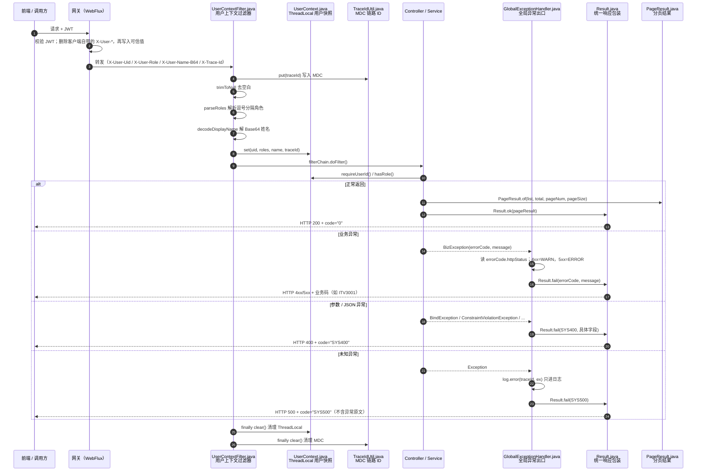
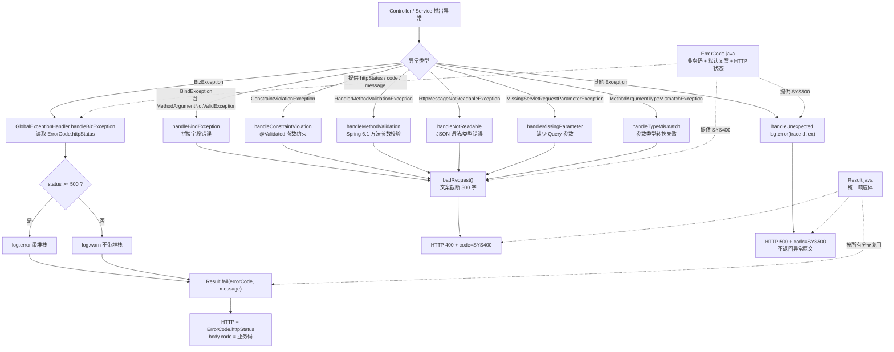
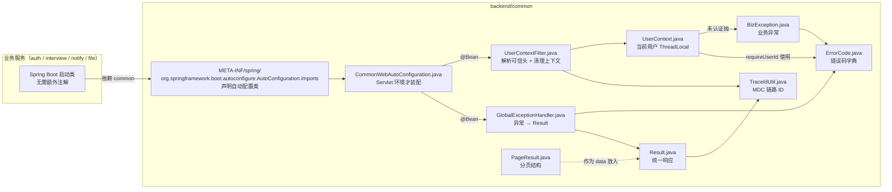

# P0-1 公共件流程图（成员 A）

> 对应任务：`docs/4.成员A开发文档-面试管理子系统.md` §13 P0-1
> 范围：`backend/common` 的分页、异常、用户上下文与自动装配。
> 图中的节点已标注对应代码文件，便于从流程定位到实现。

## 1. 一次请求的完整链路

**读图要点**

- 用户身份只在 `UserContextFilter` 里建立，业务代码不碰 Header；`UserContext` 只信任网关注入值。
- 成功与失败都经过 `Result`，前端只解析一套结构。
- 分页只是 `Result.data` 里的一种载荷，由 `PageResult` 负责结构，不参与异常流程。
- `finally` 的两步清理是防越权关键：Tomcat 线程复用时不清理会把上一个用户带给下一个请求。

## 2. 异常如何变成 HTTP 响应

**读图要点**

- `BindException` 是 `MethodArgumentNotValidException` 的父类，所以一个 handler 能覆盖请求体校验和表单绑定两种场景。
- Spring 6.1 起方法参数校验抛 `HandlerMethodValidationException`，必须单独映射，否则会掉进兜底分支变成 500。
- 只有 `BizException` 分支使用业务码；参数类错误统一 `SYS400`，未知异常统一 `SYS500`。
- 所有返回给客户端的 `message` 都经过截断和脱敏，堆栈只出现在服务端日志。

## 3. 自动装配与文件依赖

**装配条件（避免误加载）**

| 条件 | 作用 |
|---|---|
| `@ConditionalOnWebApplication(SERVLET)` | 网关是 WebFlux，不加载 Servlet 过滤器 |
| `@ConditionalOnClass("jakarta.servlet.Filter")` | 纯 Job / 单测环境没有 Servlet API 时跳过 |
| `@ConditionalOnMissingBean` | 业务服务可声明同类型 Bean 覆盖默认实现 |

## 4. 文件职责速查

| 文件 | 一句话用途 | 关键入口 | 主要被谁使用 |
|---|---|---|---|
| `PageResult.java` | 固定分页响应结构，计算总页数 | `of` / `empty` | Controller、Service |
| `BizException.java` | 可预期的业务失败，携带错误码 | 构造器 | Service、`UserContext` |
| `ErrorCode.java` | 错误码字典：业务码 + 文案 + HTTP 状态 | `getHttpStatus` | `BizException`、异常处理器 |
| `Result.java` | 统一响应体：code/message/data/traceId/timestamp | `ok` / `fail` | Controller、异常处理器 |
| `GlobalExceptionHandler.java` | 所有异常转统一 JSON 与 HTTP 状态 | `handleXxx` | Spring MVC（自动注册） |
| `UserContext.java` | 当前请求用户快照，ThreadLocal 存取 | `requireUserId` / `hasRole` | Service、Controller |
| `UserContextFilter.java` | 从可信头恢复用户，请求结束清理 | `doFilterInternal` | Servlet 容器 |
| `CommonWebAutoConfiguration.java` | 把过滤器与异常处理器自动装配进业务服务 | `userContextFilter` / `globalExceptionHandler` | Spring Boot 启动过程 |
| `TraceIdUtil.java`（已有） | traceId 写入/读取 MDC | `put` / `get` / `clear` | 过滤器、响应、日志 |
| `AutoConfiguration.imports` | 告诉 Spring Boot 要加载哪个自动配置类 | 文件内容一行 | Spring Boot |

## 5. 关键约定

1. **身份只信网关**：业务服务不解析 JWT，也不读 body/query 里的 uid。
2. **成功用 `code="0"` 判断**，不要用 HTTP 200 判断业务成功。
3. **业务码与 HTTP 状态分离**：body 里是 `ITV3001` 这类业务码，HTTP 状态由 `ErrorCode.httpStatus` 决定。
4. **5xx 不带原文**：未知异常只返回 `SYS500`，排查靠日志里的 traceId。
5. **线程变量必须清理**：`UserContextFilter` 的 `finally` 不能省；异步接口需显式传用户信息。
