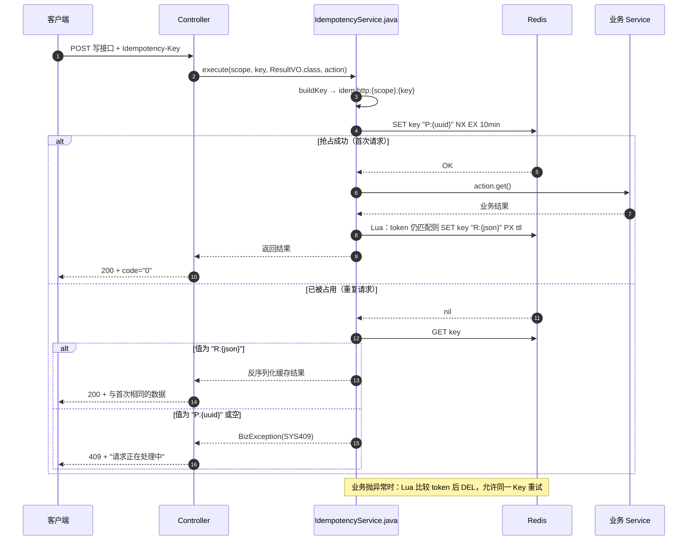

# P0-2 幂等流程（成员 A）

> 对应任务：`docs/4.成员A开发文档-面试管理子系统.md` §13 P0-2
> 代码：`backend/common` 的 `RedisKeys`、`IdempotencyService`、`CommonIdempotencyAutoConfiguration`。

## 1. 一次幂等请求的时序



## 2. 决策流程

```mermaid
flowchart TD
    A["Controller 收到 Idempotency-Key"] --> B{"scope / key 格式合法?"}
    B -->|"否"| B1["BizException SYS400"]
    B -->|"是"| C["IdempotencyService<br/>SET key P:token NX EX 10min"]

    C -->|"Redis 异常"| C1["WARN 降级：直接执行业务<br/>幂等失效，靠 DB 唯一索引/CAS 兜底"]
    C -->|"抢占成功"| D["执行业务 action"]
    C -->|"已被占用"| E["GET key"]

    D --> D1{"业务成功?"}
    D1 -->|"否"| D2["Lua 比较 token 后 DEL<br/>允许重试"]
    D1 -->|"是"| D3["Lua 比较 token 后写回<br/>R:json + TTL"]

    E --> E1{"内容类型"}
    E1 -->|"R:json"| E2["反序列化并直接返回"]
    E1 -->|"P:token"| E3["BizException SYS409"]
    E1 -->|"空 / 未知"| E3

    D3 --> F["返回业务结果"]
    E2 --> F
    C1 --> F
```



## 3. 文件职责

| 文件 | 用途 |
|---|---|
| `RedisKeys.java` | 统一 Key 契约：`auth:permver:{uid}`、`auth:rate:{scope}:{key}`、`idem:http:{scope}:{key}`；提供拼接方法并校验层级片段 |
| `IdempotencyService.java` | 幂等核心：SETNX 占位、结果缓存、重复请求回放、异常释放、Redis 故障降级 |
| `CommonIdempotencyAutoConfiguration.java` | 仅在服务同时具备 `StringRedisTemplate` 与 `ObjectMapper` 时注册幂等服务 |
| `AutoConfiguration.imports` | 声明加载上面的自动配置类 |
| `ErrorCode.java` | 新增 `SYS409`（请求处理中），HTTP 409 |
| `IdempotencyServiceTest.java` | 8 个用例：首次执行、命中缓存、处理中、异常释放、Redis 降级、参数校验、泛型、脏数据 |
| `RedisKeysTest.java` | 3 个用例：权限 Key、限流 Key（含 IPv6）、HTTP 幂等 Key |
| `CommonIdempotencyAutoConfigurationTest.java` | 3 个用例：正常装配、缺少 Redis Bean 跳过、缺少 Redis 类跳过 |

## 4. 使用约定

```java
String key = request.getHeader("Idempotency-Key");
return idempotencyService.execute(
        "interview.result",
        key,
        ResultVO.class,
        () -> interviewService.submitResult(interviewId, command));
```

- `scope` 用 `模块.动作`，例如 `interview.schedule`、`auth.register`，不同接口必须不同。
- `Idempotency-Key` 由客户端生成（建议 UUID），长度 ≤128；服务端不代生成。
- 默认窗口 10 分钟；同一 Key 在窗口内重复提交只执行一次。
- 业务失败请抛 `BizException`，占位会被释放，用户修正参数后可以重试。
- 重复请求若第一次仍在执行，返回 HTTP 409 + `SYS409`，客户端应退避重试。
- Redis 故障时降级为直接执行：可用性优先，但关键写操作仍必须有数据库唯一索引/状态 CAS 兜底。
