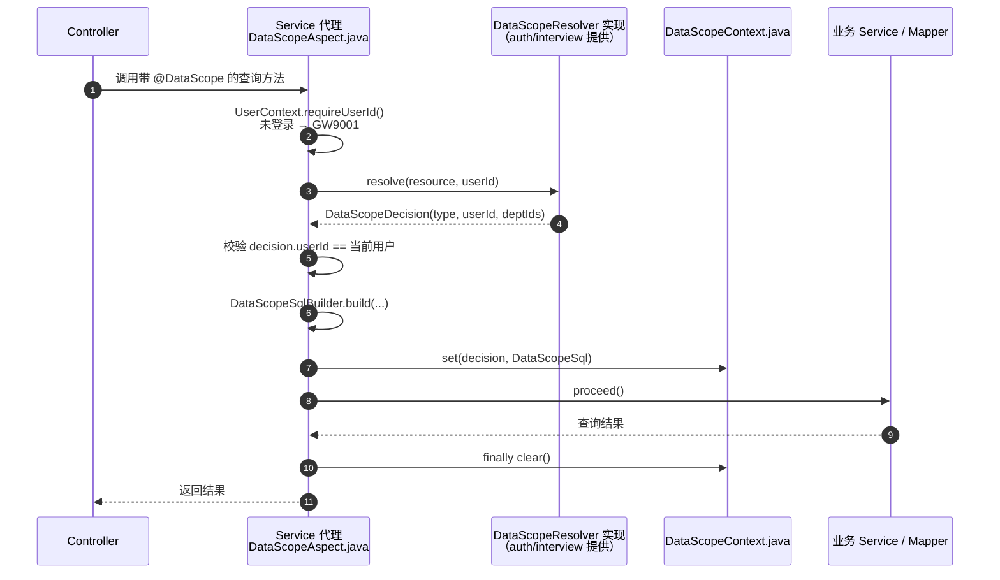
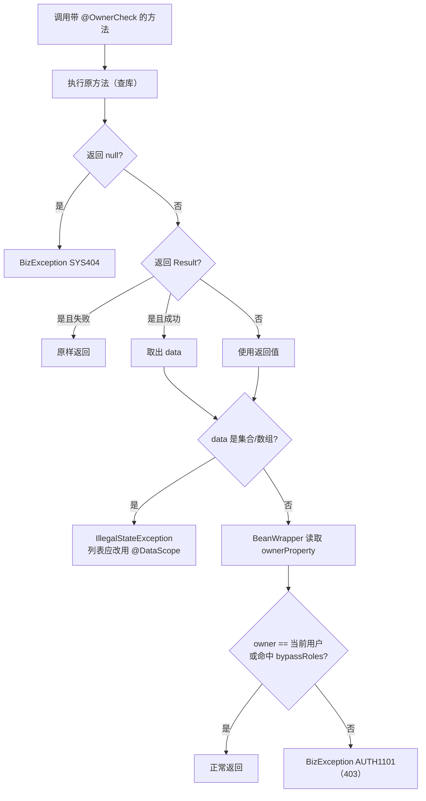

# P0-3 数据范围与归属校验流程（成员 A）

> 对应任务：`docs/4.成员A开发文档-面试管理子系统.md` §13 P0-3
> 代码：`backend/common/src/main/java/com/recruit/common/security/`

## 1. 数据范围 `@DataScope`

**范围与 SQL 片段**

| 范围 | 生成条件 | 参数 |
|---|---|---|
| `ALL` | 空字符串，不追加条件 | 无 |
| `DEPARTMENT` | `dept_id IN (?, ?)`；部门为空时 `1 = 0` | 部门 ID 列表 |
| `SELF` | `owner_hr_id = ?` | 当前用户 ID |
| `ASSIGNED` | `JSON_CONTAINS(interviewer_ids, CAST(? AS JSON))`；未配置列时回退 `owner_hr_id = ?` | 当前用户 ID |

> 现状：切面只负责“算条件 + 放上下文”。MyBatis 拦截器把片段拼进 SQL 的工作，等 P4 首次落 Mapper 时接入。**接入前注解不会自动过滤数据，不能当作已生效的安全边界。**

## 2. 归属校验 `@OwnerCheck`

## 3. 文件职责

| 文件 | 用途 |
|---|---|
| `DataScope.java` | 查询方法注解：resource、deptColumn、ownerColumn、assignedColumn |
| `OwnerCheck.java` | 单对象注解：ownerProperty、404/403 错误码、放行角色 |
| `DataScopeType.java` | ALL / DEPARTMENT / ASSIGNED / SELF |
| `DataScopeDecision.java` | 解析结果：范围类型、用户、可见部门集合 |
| `DataScopeSql.java` | SQL 片段 + 绑定参数 |
| `DataScopeContext.java` | 线程上下文，切面写、拦截器读、finally 清理 |
| `DataScopeResolver.java` | 业务服务实现的范围解析接口（禁止默认 ALL） |
| `DataScopeSqlBuilder.java` | 生成四种范围的 WHERE 片段，校验列名防注入 |
| `DataScopeAspect.java` | 解析范围、校验用户一致性、写上下文、清理 |
| `OwnerCheckAspect.java` | 方法返回后校验 owner；404/403；不支持列表 |
| `CommonSecurityAutoConfiguration.java` | 有 AOP 才装配；DataScopeAspect 还需要 Resolver Bean |

## 4. 接入清单（后续任务）

1. auth/interview 服务加 `spring-boot-starter-aop`。
2. 实现 `DataScopeResolver`：从角色/部门配置解析 `ALL/DEPARTMENT/ASSIGNED/SELF`，DEPARTMENT 必须含子部门。
3. P4 落 Mapper 时实现 MyBatis 拦截器：读 `DataScopeContext.sql()`，在 `ORDER BY/LIMIT` 之前追加 `AND (...)`，按顺序绑定参数。
4. 为每个查询写越权用例：候选人看他人投递、面试官看未分配场次、RECRUITER 看其他部门。
