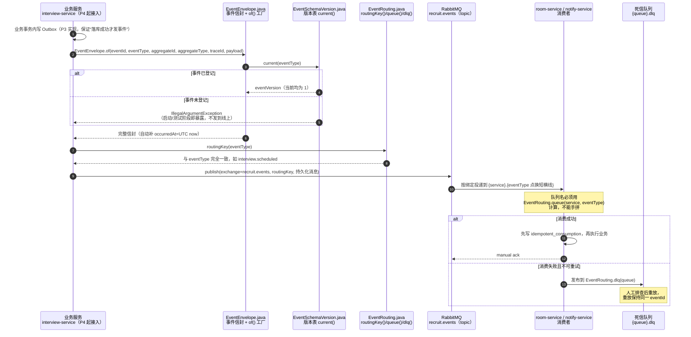
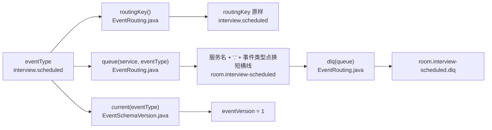
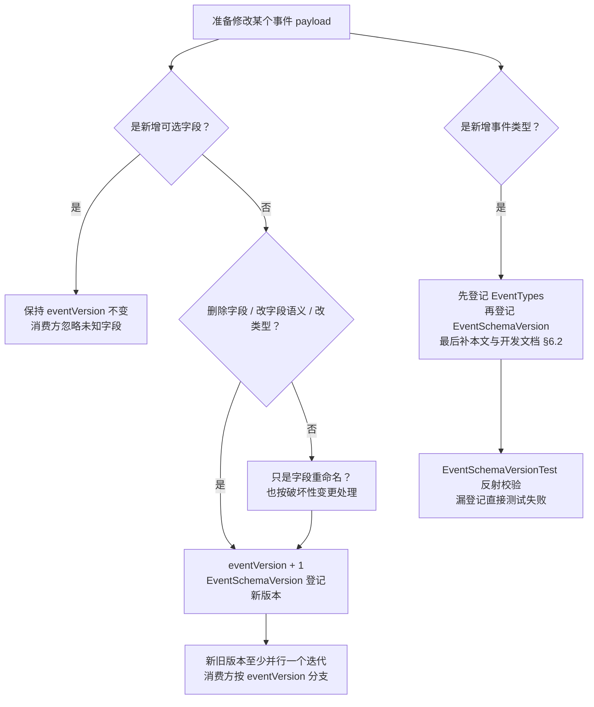

# P0-4 事件契约流程图（成员 A）

> 对应任务：`docs/4.成员A开发文档-面试管理子系统.md` §13 P0-4
> 范围：`backend/contracts/src/main/java/com/recruit/contracts/event/`
> 图中节点已标注对应代码文件，便于从流程定位到实现。

## 1. 一条事件从产生到消费的完整链路



## 2. 事件类型到队列名的转换规则



**示例对照**：

| eventType | routingKey | room 服务队列 | DLQ |
|---|---|---|---|
| `interview.scheduled` | `interview.scheduled` | `room.interview-scheduled` | `room.interview-scheduled.dlq` |
| `interview.rescheduled` | `interview.rescheduled` | `room.interview-rescheduled` | `room.interview-rescheduled.dlq` |
| `offer.declined` | `offer.declined` | `notify.offer-declined` | `notify.offer-declined.dlq` |
| `resume.parse.completed` | `resume.parse.completed` | `resume.resume-parse-completed` | `resume.resume-parse-completed.dlq` |

## 3. 版本升级判定



## 4. 代码文件用途

| 文件 | 用途 | 关键约束 |
|---|---|---|
| `EventEnvelope.java` | 跨服务事件信封；`of()` 统一填版本与发生时间 | 字段只增不改；时间统一 UTC |
| `EventTypes.java` | 全部事件类型常量 | 新增事件必须同时登记版本表 |
| `EventSchemaVersion.java` | 事件类型 → 当前版本 | 未登记直接抛错，不默认给 1 |
| `EventRouting.java` | exchange、延迟 exchange、DLQ 后缀、队列名计算 | 服务名/事件类型格式非法直接抛错 |
| `payload/JobPublishedPayload.java` | `job.published` 负载（岗位快照同步） | 只带快照，完整 JD 回查 |
| `payload/JobUpdatedPayload.java` | `job.updated` 负载 | `changedFields` 供 B 域决定重建索引 |
| `payload/InterviewScheduledPayload.java` | 排期成功，room 建房 + notify 邀约 | `roomId` 可为空，由建房回执回填 |
| `payload/InterviewCancelledPayload.java` | 取消面试 | room 关房、notify 取消通知 |
| `payload/InterviewRescheduledPayload.java` | 改期 | 带新旧时间，消费方按 interviewId 幂等更新 |
| `payload/InterviewResultSubmittedPayload.java` | 面试结果提交 | 单份评价提交不发，避免重复通知 |
| `payload/ApplicationStageChangedPayload.java` | 投递阶段变化 | 供 notify / resume 可选消费 |
| `payload/OfferSentPayload.java` | Offer 发送 | **禁止携带 token/confirmUrl** |
| `payload/OfferConfirmedPayload.java` | 候选人确认 Offer | 带入职日期 |
| `payload/OfferDeclinedPayload.java` | 候选人拒绝 Offer | 带拒绝原因，可为空 |
| `payload/OfferExpiredPayload.java` | Offer 过期 | 由延迟消息触发 |
| `payload/NotificationRequestedPayload.java` | 各服务请求 notify 发通知 | 禁止密码、令牌、完整手机号、简历全文 |
| `payload/ResumeParseFailedPayload.java` | 简历解析失败 → notify（HR 可见） | `receiverId` 为可选接收人；缺失时告警跳过 |
| `payload/CandidateDuplicatedPayload.java` | 候选人查重 → notify（HR 提醒） | `receiverId` 为可选接收人 |
| `payload/TalentFollowupDuePayload.java` | 人才回访到期 → notify | `hrId` 即接收人 |
| `EventRoutingTest.java` | 路由规则单测 | 队列名、DLQ 幂等、非法输入 |
| `EventSchemaVersionTest.java` | 版本登记完整性单测 | 反射遍历 `EventTypes`，漏登记即失败 |
| `EventEnvelopeTest.java` | 信封工厂单测 | 自动填版本/时间，未登记事件抛错 |

## 5. 验证方式

```powershell
cd backend
mvn -s "$env:TEMP\recruit-maven-settings.xml" -pl contracts test
mvn -s "$env:TEMP\recruit-maven-settings.xml" -pl interview-service -am -DskipTests package
```

预期：`contracts` 11 个单测全部通过；`interview-service` 打包成功。

## 6. 后续接入点

- **P3 Outbox**：业务事务内写 `outbox_event`，独立投递器读取后调用 `EventRouting.routingKey()` 发到 `recruit.events`；禁止在业务事务里直接 publish。
- **P4 interview-service**：排期/取消/改期/结果提交/Offer 状态变化时，用 `EventEnvelope.of()` 组装事件。
- **C 域 room-service**：用 `EventRouting.queue("room", eventType)` 声明队列与绑定；消费失败走 `EventRouting.dlq()`。
- **notify-service**：同理声明 `notify.*` 队列；通知去重使用 payload 中的 `dedupKey` 或 `(bizType,bizId,templateCode,receiverId)`。
