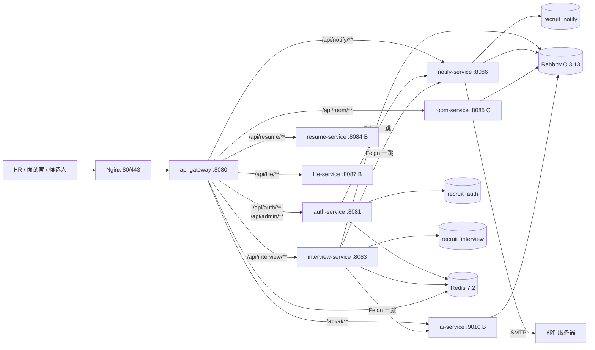
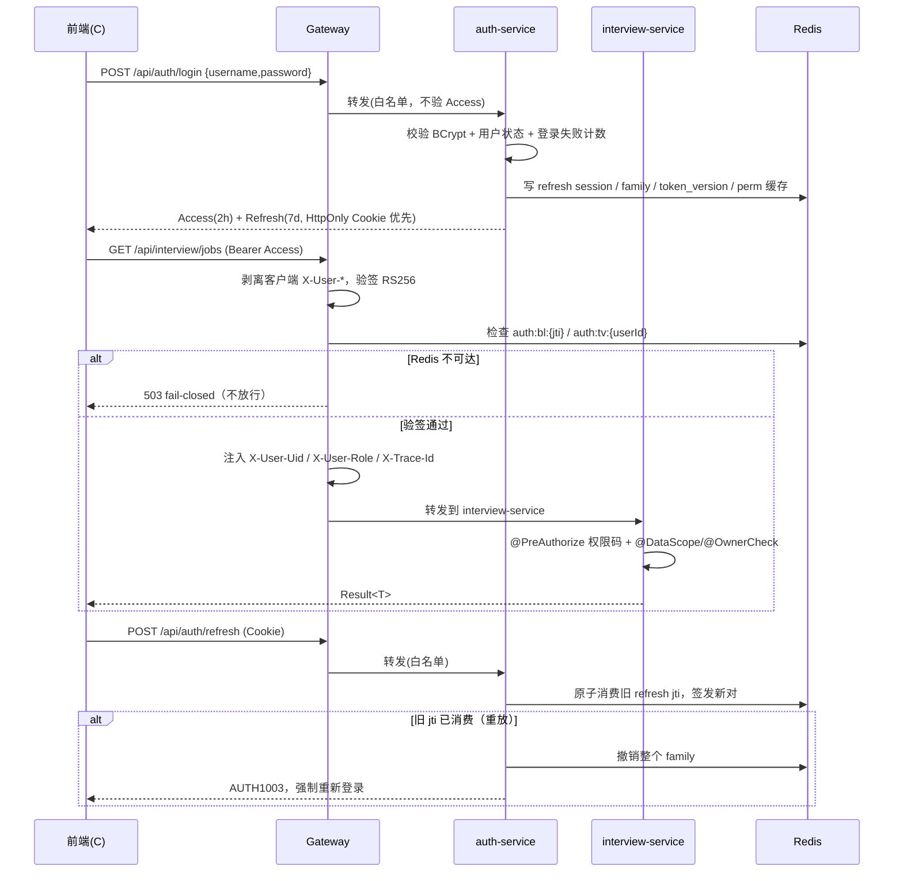
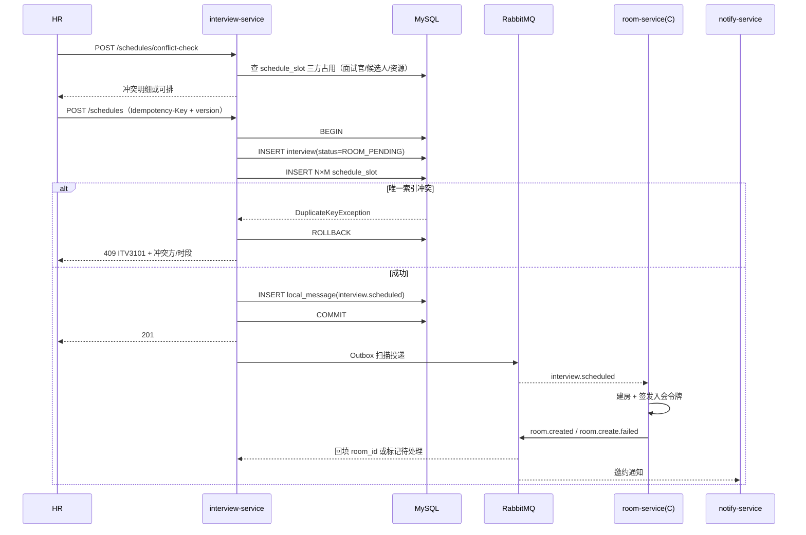
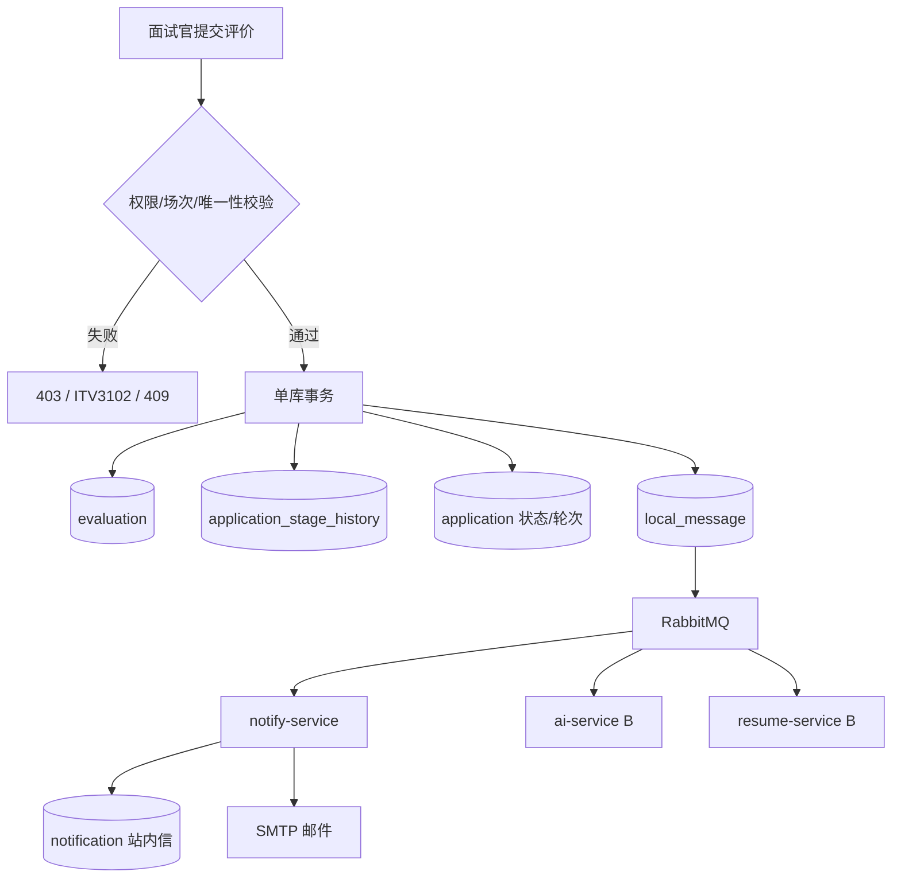

# 成员 A 开发文档（面试管理子系统 + 平台底座）

> 版本：v1.1（2026-10-20）  
> 变更：完成 32 项文档冲突裁决；补充错误码、内部接口/Outbox 管理、枚举字典、角色权限矩阵、接口-表映射、通知模板基线、定时任务与落地状态；同步修正 `docs/2`、`docs/3` 与 SQL 注释。  
> 适用范围：成员 A —— `api-gateway` / `auth-service` / `interview-service` / `notify-service`，兼集成负责人与应用节点部署负责人。  
> 依据：`docs/2.架构设计方案-招聘面试系统微服务架构.md`（v3.1）第 2.3、3、4、6、7、8、11 章；`docs/3.开发文档-招聘面试系统.md`（v3.1）第 1.3.1、2、3、4、5、6.6、9、10 节；`sql/01_recruit_auth.sql`、`sql/02_recruit_interview.sql`、`sql/05_recruit_notify.sql`；`docs/01-requirements/01-interview-management.md`。  
> 使用方式：本文是 A 的执行清单，不是替代契约。接口字段、事件 Schema、错误码在 W1 冻结后以 OpenAPI + `contracts` 为准；本文中的“启动契约”仅用于开发起步。

## 阅读指引

| 章节 | 内容 | 使用时机 |
|---|---|---|
| 0 | 交付边界、仓库现状、已裁决的关键口径 | 接手第一天 |
| 1 | 41 个端点组 + 内部接口/错误码/OpenAPI 约定 | 接口评审、前端联调 |
| 2~3 | 服务拓扑、时序图、四个服务的代码落点 | 搭骨架、分工 |
| 4 | 三库 32 张表、Flyway、Redis Key、seed、接口-表映射 | 建库、迁移 |
| 5 | 关键 DTO + 枚举字典 + 角色权限矩阵 | 写 Controller 前 |
| 6 | 事件信封、发布/消费清单、Outbox/幂等 | 跨服务联调 |
| 7 | JWT、RBAC、数据范围、状态机、排期冲突、Offer CAS、通知 | 核心逻辑实现 |
| 8 | 本地最小档/Mock/环境变量 | 本地开发、演示切换 |
| 9~10 | 16 周里程碑与验收指标 | 周会、验收 |
| 11~12 | 文档与骨架差异裁决、风险与裁决 | W1 评审 |
| 13 | P0~P12 任务清单与 DoD | 日常执行 |
| 附录 | 文件索引、权限码、W1 检查单 | 查阅 |

## 0. 结论先行

### 0.1 A 的交付边界

| 维度 | A 负责 | 不负责（但必须联调） |
|---|---|---|
| 服务 | gateway、auth(IAM)、interview、notify | resume、file、room、ai-service、ai-worker、mineru-worker |
| 数据 | `recruit_auth`（9 业务表 + 2 可靠性表）、`recruit_interview`（14 业务表 + 2 可靠性表）、`recruit_notify`（3 业务表 + 2 可靠性表） | `recruit_resume`、`recruit_file`、`recruit_room`、`recruit_ai` |
| 接口 | auth 15 组 + interview 22 组 + notify 4 组，共 41 个端点组 | room 8 端点 + WS、resume 14、file 3、ai 7 |
| 中间件 | Nacos、Gateway、Redis、RabbitMQ、MySQL/Flyway、Spring Mail | ES、MinIO、LiveKit/Egress、vLLM/FunASR/MinerU |
| 兼任 | CI/CD、契约仲裁、周五合并、应用节点部署、`scripts/smoke.sh` 维护 | GPU 节点、AI 底座、演示主讲 |
| 论文主线 | 面试管理子系统：流程配置、状态机、排期三方冲突、评价、Offer、通知、AI 纪要人工确认 | 简历解析/匹配、在线面试媒体面 |

### 0.2 当前仓库现状（2026-10-20）

| 模块 | 已有 | 缺口（A 必须补） |
|---|---|---|
| `api-gateway` | 启动类、`TraceIdGlobalFilter`、`InternalApiBlockFilter`、路由骨架 | `/api/admin/**` 路由缺失；JWT 验签/黑名单/token_version 未接；限流未接；`X-User-*` 注入/剥离未实现；CORS 仍是 `* + credentials`；Sentinel 未接 |
| `auth-service` | 启动类、`PingController`、MySQL/Redis/Flyway 配置骨架、`jjwt` 依赖 | 仅有 `spring-security-crypto`，无 `spring-boot-starter-security`；IAM 表/Flyway/登录/刷新/菜单/权限/数据范围/审计全部待开发 |
| `interview-service` | 启动类、`PingController`、MySQL/Redis/RabbitMQ/Flyway 配置骨架 | 无 Spring Security；岗位/投递/流程模板/排期/评价/Offer/异步/AI 纪要全部待开发；Flyway 关闭 |
| `notify-service` | 启动类、`PingController`、MySQL/RabbitMQ/Mail 配置骨架 | 通知/模板/发送日志/重试/站内信全部待开发；Flyway 关闭 |
| `common` | `Result`、`ErrorCode`、`TraceIdUtil`、`RedisKeys`、`IdWorker` | 缺 `PageResult`、`@DataScope`/`@OwnerCheck`、全局异常处理、MyBatis 数据范围拦截器、JWT 公共校验、审计切面 |
| `contracts` | `EventEnvelope`、`EventTypes` | 缺事件 payload DTO、事件版本、A 域内部 DTO、事件 Schema 校验 |

### 0.3 已裁决的关键口径（v1.1）

> 以下结论已同步 `docs/2`、`docs/3`、`sql/` 注释；代码/配置按 §13 落地。完整 32 项见 §11。

| # | 口径 | 裁决 |
|---|---|---|
| 1 | 成功码 | `code="0"`；`Result` 保持现状，文档/前端统一按 `"0"` |
| 2 | 端点计数 | 41 = 端点组（auth 15 / interview 22 / notify 4）；OpenAPI operation 另计并在 W1 冻结 |
| 3 | 表数量 | auth 9 + interview 14 + notify 3 = 26 业务表；另 6 张可靠性表 |
| 4 | schema | 3 个：`recruit_auth` / `recruit_interview` / `recruit_notify` |
| 5 | `ITV3301` | Offer 过期/状态不允许；HTTP 409/410；文档已登记，代码 P1 加枚举 |
| 6 | 纪要表 | 统一 `interview_minutes`，废弃 `ai_meeting_minutes` |
| 7 | 事件命名 | `interview.cancelled`（双 l）；补 `offer.sent/declined/expired`、`application.stage.changed`、`interview.rescheduled` |
| 8 | Refresh 传输 | HttpOnly + Secure + SameSite=Strict Cookie，`Path=/api/auth`；响应体仅 local |
| 9 | `auth:permver` | 补 Redis Key；权限变更递增并清理 `auth:perm:*`，不再“可选” |
| 10 | 管理路由 | 网关补 `/api/admin/** → auth-service`；Outbox 重放改 `/api/admin/outbox/{service}/{id}/replay` |
| 11 | CORS | 按环境白名单；禁止 `allowedOriginPatterns=*` + credentials |
| 12 | Flyway | 迁移脚本合并后三服务 `enabled=true`；本地首次可手工执行 SQL |

### 0.4 代码落点

```text
backend/
├── common/                         # A 维护：Result/PageResult/ErrorCode/traceId/@DataScope/@OwnerCheck/全局异常
├── contracts/                      # A 与 B/C 共同维护：事件信封、事件 payload、跨服务 DTO
├── api-gateway/
│   └── src/main/java/com/recruit/gateway/
│       ├── filter/                 # TraceId、JwtAuth、InternalApiBlock、RateLimit
│       ├── config/                 # 路由、CORS、Sentinel、Redis
│       └── support/                # 白名单、错误响应、Header 常量
├── auth-service/
│   └── src/main/java/com/recruit/auth/
│       ├── controller/             # AuthController、AdminUserController、AdminRoleController、AdminPermissionController
│       ├── service/                # AuthService、TokenService、PermissionService、DataScopeService、AuditService
│       ├── mapper/                 # IamUserMapper、IamRoleMapper、IamPermissionMapper...
│       ├── entity/                 # iam_* 实体
│       ├── dto/                    # LoginForm、RefreshForm、UserCreateForm、RoleUpdateForm...
│       └── config/                 # SecurityConfig、JwtConfig、PasswordConfig
├── interview-service/
│   └── src/main/java/com/recruit/interview/
│       ├── controller/             # Job、ProcessTemplate、Application、Schedule、Evaluation、Offer、Async、Stats
│       ├── service/                # 状态机、排期、评价、Offer、纪要
│       ├── mapper/                 # job/application/interview/schedule_slot/evaluation/offer...
│       ├── entity/
│       ├── dto/
│       ├── statemachine/           # 显式流转表与校验
│       └── config/                 # SecurityConfig、RabbitConfig、MybatisConfig
└── notify-service/
    └── src/main/java/com/recruit/notify/
        ├── controller/             # MessageController、TemplateController
        ├── service/                # NotificationService、TemplateService、MailSender、SmsMockSender
        ├── mapper/                 # notification/notification_template/notification_send_log
        ├── consumer/               # notification.requested、resume.parse.failed、candidate.duplicated、talent.followup.due
        └── config/                 # MailConfig、RabbitConfig
```

## 1. 接口清单（41 个端点组）

### 1.1 通用约定

- 前缀：`/api/auth`、`/api/interview`、`/api/notify`；管理端在 `/api/admin/**`（走 auth-service）；内部接口 `/internal/**` 不对外。
- 统一响应：`Result<T>`；当前代码 `code == "0"` 为成功（已裁决，见 §0.3 第 1 条）。
- 分页：`{list,total,pageNum,pageSize,pages}`，`pageSize ≤ 100`。
- ID 字符串；时间 UTC 存储、ISO 8601 输出；枚举用 `VARCHAR(32)` 代码值，不用 MySQL ENUM。
- 写操作支持 `Idempotency-Key`（Redis SETNX，10 分钟）；更新带 `version`；非幂等 POST 不自动重试。
- 每个非公开接口必须登记权限码；菜单/按钮/API 三态一致；前端隐藏按钮不是安全边界。
- 错误响应必须带 `traceId`；HTTP 状态与业务码同时表达（401/403/404/409/429/500）。

### 1.2 auth / IAM（15 组）

| # | 方法与路径 | 权限码 | 请求/响应要点 | 关键规则与错误 |
|---|---|---|---|---|
| A-01 | `POST /api/auth/login` | 公开 | 入：`username`、`password`、`userType?`；出：`accessToken`、`expiresIn`、用户摘要；Set-Cookie 写 Refresh（仅 local 可返回 `refreshToken`） | BCrypt 校验；失败计数+锁定；`AUTH1001`；登录限流 100；写审计 |
| A-02 | `POST /api/auth/register` | 公开 | 入：`username`、`password`、`displayName`、`phone?`、`email?`；出：用户 ID | 仅允许 `CANDIDATE` 自助注册；`username` 唯一；手机号 `phone_enc`+`phone_hash`；参数错误 `SYS400` |
| A-03 | `POST /api/auth/refresh` | 公开/Refresh | 入：Refresh Cookie（`Path=/api/auth`；仅 local 允许 body）；出：新 Access + 轮换 Refresh Cookie | 旋转 Refresh；旧 jti 重放 → 撤销整个 family，`AUTH1003`；无效/过期 `AUTH1002` |
| A-04 | `POST /api/auth/logout` | 登录 | 入：Bearer Access；出：`Result<Void>` | Access `jti` 进黑名单至过期；撤销 Refresh；幂等 |
| A-05 | `GET /api/auth/me` | 登录 | 出：用户、角色、权限码、数据范围、部门 | 禁用用户/`token_version` 不符 → 401；不返回密码/手机号明文 |
| A-06 | `GET /api/auth/menus` | 登录 | 出：菜单树 `[{id,parentId,name,path,component,type,children}]` | 只返回 `MENU` 且当前角色可见；按 `sort` 排序；按钮/API 权限单独下发或内嵌 |
| A-07 | `GET /api/admin/users` | `system:user:view` | 入：`pageNum`、`pageSize`、`keyword`、`status`、`deptId`；出：分页用户 | 数据范围过滤；手机号脱敏；`pageSize≤100` |
| A-08 | `POST /api/admin/users` | `system:user:create` | 入：`username`、`displayName`、`userType`、`deptId`、`roleIds`、初始密码；出：用户 ID | `username` 唯一；密码策略；角色存在性校验；写审计 |
| A-09 | `PUT /api/admin/users/{id}` | `system:user:update` | 入：`displayName`、`deptId`、`status`、`version` | 白名单字段；`version` 乐观锁；不允许改 `username`/密码；409 冲突 |
| A-10 | `DELETE /api/admin/users/{id}` | `system:user:delete` | 出：`Result<Void>` | 软删；不能删自己；不能删最后一个 `SUPER_ADMIN`；撤销会话 |
| A-11 | `PUT /api/admin/users/{id}/roles` | `system:user:assign-role` | 入：`roleIds`、`version?` | 全量替换 `iam_user_role`；角色存在性；权限版本+1；写审计 |
| A-12 | `GET/POST /api/admin/roles` | `system:role:view/create` | GET：分页；POST：`roleCode`、`roleName`、`dataScope`、`isSystemRole?` | `role_code` 唯一；`isSystemRole` 仅超管可设；写审计 |
| A-13 | `PUT/DELETE /api/admin/roles/{id}` | `system:role:update/delete` | PUT：`roleName`、`dataScope`、`version`；DELETE：`Result<Void>` | 系统内置角色不可删；仍有用户绑定时拒绝；写审计 |
| A-14 | `PUT /api/admin/roles/{id}/permissions`、`/menus` | `system:role:assign-menu` | 入：`permissionIds`、`version?` | 全量替换 `iam_role_permission`；三态一致性校验；`auth:permver`+1，权限即时生效 |
| A-15 | `GET /api/admin/permissions/tree`、`/api/admin/audit-logs`、`/api/admin/dicts` | `system:menu:view` / `system:log:oper:view` / `system:dict:view` | 权限树；审计分页（操作者/动作/资源/结果/IP/traceId）；字典列表 | 审计不记密码/令牌/简历全文；字典更新走 X-11 `PUT /api/admin/dicts/{id}`（`system:dict:update`） |

**扩展端点（不计入 15 组，按前端需要补，必须登记权限码）**：`GET /api/admin/users/{id}`、`GET /api/admin/roles/{id}`、`PUT /api/admin/dicts/{id}`、`POST /api/admin/users/{id}/reset-password`、`POST /api/admin/users/{id}/kick`。

### 1.3 interview（22 组）

| # | 方法与路径 | 权限码 | 请求/响应要点 | 关键规则与错误 |
|---|---|---|---|---|
| I-01 | `GET/POST /api/interview/jobs` | `interview:job:view/create` | GET：分页/`status`/`deptId`/`keyword`；POST：`jobCode`、`title`、`deptId`、`jdText`、`requirementsJson`、`ownerHrId` | `job_code` 唯一；创建为 `DRAFT`；数据范围；写审计 |
| I-02 | `GET/PUT/DELETE /api/interview/jobs/{id}` | `interview:job:view/update/delete` | GET：详情；PUT：白名单字段+`version`，发 `job.updated`；DELETE：软删 | `version` 乐观锁；有投递的岗位不可物理删；删除前校验状态 |
| I-03 | `POST /api/interview/jobs/{id}/publish`、`/close` | `interview:job:publish/close` | 出：`Result<Void>` | 状态机 `DRAFT→PUBLISHED→CLOSED`；发布写 `job.published`，更新写 `job.updated`；关闭停止推荐 |
| I-04 | `GET/POST/PUT/DELETE /api/interview/process-templates/**` | `interview:process:view/create/update/delete` | 模板：`stageFlow` JSON、`scoreDims` JSON、`version` | 模板版本化；已被岗位引用时只增不改；阶段顺序/去重校验 |
| I-05 | `GET/POST /api/interview/applications` | `interview:application:view/create` | GET：`jobId`/`status`/`currentStage`/分页；POST：`jobId`、`personId`、`matchScore?` | `(job_id, person_id)` 唯一；岗位必须 `PUBLISHED`；写 `application_stage_history` 首条 |
| I-06 | `GET /api/interview/applications/{id}` | `interview:application:view` | 出：投递、岗位快照、候选人快照、当前阶段、`matchScore` | 数据范围/对象级校验；候选人只能看自己 |
| I-07 | `GET /api/interview/applications/{id}/timeline` | `interview:application:view` | 出：按 `stage_no/round_no` 排序的流水 | 只读；包含操作者、结果、时间、备注 |
| I-08 | `POST /api/interview/applications/{id}/actions` | 按 `action` 校验 | 入：`action`（ADVANCE/PASS/REJECT/HOLD/TRANSFER/WITHDRAW/HIRE）、`remark`、`rejectReason?`、`targetStage?`、`version` | 显式状态机；非法流转 `ITV3102`；写历史并发布 `application.stage.changed`；结果提交另发 `interview.result.submitted`；`Idempotency-Key` |
| I-09 | `GET/POST /api/interview/portal/applications` | `portal:application:view/create` | GET：自己的投递；POST：`jobId`、`resumeId?`、`remark?` | 只允许 `CANDIDATE`；只能操作自己；岗位必须发布；防重复投递 |
| I-10 | `GET /api/interview/portal/jobs` | 公开/`portal:job:view` | 出：已发布岗位分页/详情 | 只返回 `PUBLISHED`；不暴露内部字段/HR 备注 |
| I-11 | `GET/POST /api/interview/schedules` | `interview:schedule:view/create` | GET：`dateFrom/dateTo`、`interviewerId`、`status`；POST：`applicationId`、`roundNo`、`interviewerIds`、`startTime`、`endTime`、`mode`、`roomType` | 起止对齐 30 分钟；三方槽位同事务；`version`；建房置 `ROOM_PENDING` |
| I-12 | `PUT/DELETE /api/interview/schedules/{id}` | `interview:schedule:update/cancel` | PUT：改期/改面试官/`version`；DELETE：取消 | 改期先删旧槽再插新槽；取消物理删 slot、interview 置 CANCELLED（不删行）；发 `interview.cancelled` |
| I-13 | `GET /api/interview/calendar` | `interview:schedule:view` | 入：`dateFrom/dateTo`、`interviewerId`、`deptId`；出：日历事件 | 数据范围；只读；时区统一 UTC→前端本地 |
| I-14 | `POST /api/interview/schedules/conflict-check` | `interview:schedule:view` | 入：`interviewerIds`、`candidateId`、`startTime`、`endTime`、`resourceId?`；出：冲突列表 | 仅预检，不写库；返回哪一方/哪一时段；与写接口同取整规则 |
| I-15 | `POST /api/interview/schedules/batch` | `interview:schedule:batch` | 入：`items[]`（每项同 I-11） | 整批事务（全部成功或全部失败）；单批 ≤50；唯一索引兜底；409 返回全部冲突明细 |
| I-16 | `GET/POST /api/interview/evaluation-templates` | `interview:evaluation-template:view/create` | 模板+维度：`code/name/weight/maxScore/vetoThreshold` | 权重/满分校验；模板版本化；写审计 |
| I-17 | `PUT/DELETE /api/interview/evaluation-templates/{id}` | `interview:evaluation-template:update/delete` | PUT：新版本；DELETE：仅未被引用可删 | 历史评价保留 `template_version`；不覆盖旧版本 |
| I-18 | `GET/POST /api/interview/schedules/{id}/evaluations` | `interview:evaluation:view/submit` | GET：场次评价；POST：`dimensionScores`、`comment`、`result`、`templateVersion` | `(interview_id,round_no,interviewer_id)` 唯一；面试官只能提交自己的；提交后不可改（或走更正流程） |
| I-19 | `GET /api/interview/evaluations/my` | `interview:evaluation:view` | 出：待提交/已提交评价 | 只返回当前用户被分配的场次；数据范围 ASSIGNED |
| I-20 | `GET /api/interview/schedules/{id}/evaluations/comparison` | `interview:evaluation:view` | 出：多面试官对比、均分、分歧、维度雷达数据 | 至少 1 份评价；权限校验；不暴露无关评价 |
| I-21 | `GET /api/interview/schedules/{id}/evaluations/ai-draft` | `interview:evaluation:view` | 出：AI 草稿（维度建议分、证据、风险） | 只读草稿；必须人工确认后才写正式评价；无转写返回 `INSUFFICIENT_TRANSCRIPT` |
| I-22 | Offer / 异步面试 / 统计（见 1.3.1 子表） | 见子表 | 见子表 | 见子表 |

#### 1.3.1 I-22 子表：Offer、异步面试、统计

| 子域 | 方法与路径 | 权限码 | 要点 |
|---|---|---|---|
| Offer | `GET/POST /api/interview/offers` | `interview:offer:view/create` | `applicationId` 唯一；`salary`、`onboardingDate`、`expireAt`、`onboardingJson`；状态 `DRAFT/PENDING_APPROVAL/SENT/CONFIRMED/DECLINED/EXPIRED/WITHDRAWN` |
| Offer | `GET /api/interview/offers/{id}` | `interview:offer:view` | 详情+审批记录+确认状态 |
| Offer | `POST /api/interview/offers/{id}/send`、`/approve`、`/withdraw` | `interview:offer:send/approve/withdraw` | 发送生成 `confirm_token` 哈希并发布 `offer.sent`；审批流简化版；撤回仅未确认可操作（`WITHDRAWN`） |
| Offer 门户 | `GET/POST /api/interview/portal/offers/{token}` | `portal:offer:view/respond` | 免登录；只暴露必要字段；接受 CAS `SENT→CONFIRMED` 并发布 `offer.confirmed`，拒绝 CAS `SENT→DECLINED` 并发布 `offer.declined`；过期 `ITV3301`/`offer.expired` |
| 异步面试 | `GET/POST /api/interview/async-interviews` | `interview:async:view/create` | `application_id` 唯一；`question_count`、`settings_json`；生成 `async_paper` |
| 异步面试 | `GET/PUT /api/interview/async-interviews/{id}`、`POST /{id}/publish` | `interview:async:view/update/publish` | 题目管理；发布后候选人可作答；状态机 |
| 异步邀请 | `GET /api/interview/portal/async-invites/{token}`、`POST /{token}/start`、`/submit` | `portal:async:view/start/submit` | 免登录/候选人；逐题录像上传；提交后 `AIS5102` 防重复 |
| 统计 | `GET /api/interview/stats/funnel`、`/workload`、`/time-to-hire` | `interview:stats:view` | 按岗位/时间范围；数据范围过滤；只读 |

**扩展端点（不计入 41 组，统一登记在 §1.6）**：AI 纪要回调、Offer 确认链接、评价重开、异步题目管理、Outbox 重放等；权限码与鉴权方式见 §1.6。

### 1.4 notify（4 组）

| # | 方法与路径 | 权限码 | 请求/响应要点 | 关键规则 |
|---|---|---|---|---|
| N-01 | `GET /api/notify/messages` | 登录 | 入：`pageNum/pageSize/read/status`；出：我的站内信分页 | 只能看自己；按 `created_at` 倒序；未读数可单独返回 |
| N-02 | `PUT /api/notify/messages/{id}/read` | 登录 | 出：`Result<Void>` | 只能标记自己的；幂等；更新 `read_at` |
| N-03 | `GET /api/notify/templates` | `system:notice:view` | 入：`templateCode/channel/status`；出：模板分页 | 模板 `(template_code,channel,version)` 唯一；只读列表 |
| N-04 | `PUT /api/notify/templates/{id}` | `system:notice:update` | 入：`titleTemplate`、`contentTemplate`、`variables`、`version` | 新版本不覆盖历史；变量白名单/占位符校验；写审计 |

**扩展端点**：`POST /api/notify/messages/{id}/resend`（失败通知重发，`system:notice:update`，幂等并写发送日志）。

### 1.5 端点计数与 OpenAPI 冻结

- 文档口径：**41 个端点组** = auth 15 + interview 22 + notify 4。本文严格按该口径组织；I-22 内含多个子动作。
- 实际 OpenAPI `operationId` 会明显多于 41（例如 auth 的 GET/POST/DELETE 拆开、Offer 的 send/approve/withdraw 拆开）。**W1 冻结时以 OpenAPI 的 operation 数为准**，并把本表作为任务分解表，而不是接口上限。
- W1 必须冻结的 OpenAPI：`/api/auth/login|refresh|menus`、`/api/admin/users|roles|permissions`、`/api/interview/schedules|conflict-check|batch`、`/api/interview/offers`、`/api/notify/messages|templates`。
- 每个 operation 必须写：`summary`、`operationId`、权限码、请求/响应 Schema、错误码、`Idempotency-Key`/`version` 参数、示例。

---

### 1.6 内部接口与扩展端点

> `/internal/**` 在网关一律 403；服务间调用使用 `X-Internal-Token`（Nacos 配置、30 天轮换）或 Feign 内网直连。内部接口不返回敏感原文，不写业务库以外的数据。

| # | 方法与路径 | 调用方 → 提供方 | 鉴权 | 说明 |
|---|---|---|---|---|
| X-01 | `POST /internal/offers/{id}/confirm-link` | notify → interview | `X-Internal-Token` | 生成/复用 Offer 确认链接；返回 `{url,expiresAt}`；Redis `offer:confirm:{offerId}` 缓存 10min，明文不落日志 |
| X-02 | `POST /internal/interviews/{id}/minutes` | ai-service → interview | `X-Internal-Token` | 回写 AI 纪要/评价草稿；按 `taskId` 幂等；只写草稿，人工确认后才生效 |
| X-03 | `POST /api/admin/outbox/{service}/{id}/replay` | 管理员 → auth/interview/notify | `system:config:update` | Outbox 死信重放；`service ∈ auth/interview/notify`；网关按 `service` 路径前缀路由（三条 outbox 路由必须排在 `auth-admin` 之前） |
| X-04 | `GET /api/interview/schedules/{id}/minutes` | 前端 → interview | `interview:minutes:view` | 纪要详情；仅 HR/本场面试官 |
| X-05 | `PUT /api/interview/minutes/{id}/confirm` | 前端 → interview | `interview:minutes:confirm` | 确认/驳回；`version` 乐观锁；写审计 |
| X-06 | `POST /api/interview/async-interviews/{id}/questions` | 前端 → interview | `interview:async:update` | 新增题目；仅 DRAFT 可改；`(paper_id,seq_no)` 唯一 |
| X-07 | `PUT /api/interview/evaluations/{id}/reopen` | HR → interview | `interview:evaluation:reopen` | 重开已提交评价；仅 HR_ADMIN；记录原因与审计，不删除历史 |
| X-08 | `POST /api/notify/messages/{id}/resend` | 管理员 → notify | `system:notice:update` | 失败通知重发；幂等，写发送日志 |
| X-09 | `GET /api/admin/users/{id}`、`GET /api/admin/roles/{id}` | 管理员 → auth | `system:user:view` / `system:role:view` | 详情；手机号脱敏 |
| X-10 | `POST /api/admin/users/{id}/reset-password`、`POST /api/admin/users/{id}/kick` | 管理员 → auth | `system:user:reset-password` / `system:user:kick` | 重置密码返回一次性临时密码；踢下线递增 `token_version` |
| X-11 | `PUT /api/admin/dicts/{id}` | 管理员 → auth | `system:dict:update` | 字典维护；写审计 |
| X-12 | `GET /api/admin/outbox/{service}/messages` | 管理员 → auth/interview/notify | `system:config:update` | Outbox 管理页列表；分页 + `status`/时间过滤；只读，路由与 X-03 一致 |

### 1.7 错误码（A 域）

| code | HTTP | 场景 | 处理建议 |
|---|---:|---|---|
| `0` | 200 | 成功 | 前端按成功处理 |
| `SYS400` | 400 | 参数/时间粒度/枚举非法 | 返回字段级错误 |
| `SYS500` | 500 | 未预期异常 | 记录 traceId，不暴露堆栈 |
| `AUTH1001` | 401 | 账密错误/账号锁定 | 统一提示，不区分用户是否存在 |
| `AUTH1002` | 401 | Refresh 无效/过期 | 前端跳登录 |
| `AUTH1003` | 401 | Refresh 重放/整族撤销 | 清空本地会话，强制重登 |
| `AUTH1101` | 403 | 权限不足/账号禁用 | 前端提示无权限 |
| `ITV3001` | 404 | 投递不存在 | 不泄露是否存在 |
| `ITV3101` | 409 | 排期三方冲突 | 返回冲突方/时段明细 |
| `ITV3102` | 409 | 状态流转非法/重复提交 | 返回当前状态与允许动作 |
| `ITV3301` | 409/410 | Offer 已过期/状态不允许 | 门户展示过期或已处理；代码 P1 登记 |
| `NTF6001` | 400/404 | 模板不存在/变量缺失/渲染失败 | 不发送半成品；记录模板版本 |
| `NTF6002` | 502/500 | 邮件/渠道发送失败 | 保留原文，重试 3 次后置 FAILED |
| `GW9001` | 401 | 未认证/令牌无效 | 清除本地 Access |
| `GW9003` | 429 | 限流 | 带 `Retry-After`，前端退避 |
| `GW9005` | 403 | 公网访问 `/internal/**` | 直接拒绝，不转发 |

> `NTF6001/6002` 为本文登记的码，P8 实现时加入 `ErrorCode`；其余已存在或 P1 登记。

### 1.8 OpenAPI 冻结约定

| 项 | 约定 |
|---|---|
| Tag | `auth`、`admin`、`interview-job`、`interview-application`、`interview-schedule`、`interview-evaluation`、`interview-offer`、`interview-async`、`interview-minutes`、`interview-stats`、`notify` |
| operationId | `{domain}_{resource}_{action}`，如 `interview_schedule_create`、`interview_offer_confirm`；同一 operation 不重复 |
| 安全 | 默认 `bearerAuth`；公开门户接口显式 `security: []`；内部接口不进入公开 OpenAPI |
| 错误 | 统一 `Result` + `code`；每个 operation 列出至少 1 个成功、1 个 400/403/409 示例 |
| 幂等 | 写接口声明 `Idempotency-Key`；更新声明 `version`；分页声明 `pageNum/pageSize` |
| 示例 | 请求/响应必须有真实字段示例；枚举值引用 §5.9 |
| 冻结 | W1 冻结 operation 清单、权限码、错误码；后续新增走 PR + 版本记录 |

## 2. 总体架构与数据流

### 2.1 服务拓扑



**A 的四个服务只写自己的库**：

| 服务 | 端口 | schema | 说明 |
|---|---:|---|---|
| `api-gateway` | 8080 | 无 | 只做路由、JWT 前置、限流、Header 清洗/注入、`/internal/**` 屏蔽 |
| `auth-service` | 8081 | `recruit_auth` | 五角色、动态菜单、权限码、数据范围、刷新会话、审计 |
| `interview-service` | 8083 | `recruit_interview` | 岗位、流程模板、投递、状态机、排期、评价、Offer、异步面试、纪要落库、统计 |
| `notify-service` | 8086 | `recruit_notify` | 站内信、邮件、模板、发送日志、失败重试 |

### 2.2 登录与鉴权数据流



**网关职责边界**：

- 网关只做“是否登录 + 粗粒度角色”判断，**不做业务权限码与数据范围判断**；细粒度在服务内完成。
- 网关必须剥离客户端传入的 `X-User-*`、`X-Internal-Token`、`X-Trace-Id` 等可信头，再注入自己的值。
- `/internal/**` 在网关层直接 403（`GW9005`），不依赖下游是否暴露。
- 白名单只放行：`POST /api/auth/login`、`POST /api/auth/register`、`POST /api/auth/refresh`、`GET /api/interview/portal/jobs`、`/api/interview/portal/**` 中明确公开的读取、`/api/interview/portal/offers/{token}`、`/api/interview/portal/async-invites/{token}`、`/actuator/health`。

### 2.3 排期与建房数据流



**关键点**：

- `conflict-check` 只是体验优化，**不构成并发安全保证**；最终以 `schedule_slot` 唯一索引为准。
- 排期写入与 Outbox 写入必须同一本地事务；MQ 发送失败不回滚业务，由扫描器补发。
- 房间创建失败不阻塞面试记录，面试状态标记为“房间待处理”，HR 可手动重试。
- 取消面试：同一事务物理删除 `schedule_slot`、更新 `interview.status=CANCELLED`、写 `interview.cancelled` 事件。

### 2.4 面试结果、评价与通知数据流



**通知统一入口**：业务服务不直接发邮件/站内信，只发布 `notification.requested`（或由 interview 发布业务事件、notify 订阅后转换），由 notify 统一模板渲染、渠道选择、重试与发送日志。

### 2.5 数据所有权与跨域约束

| 数据 | Owner | A 的读写方式 |
|---|---|---|
| `iam_*` | auth | 只由 auth 写；其他服务信任网关注入的 `X-User-*`，需要用户详情时 Feign 查 auth 或使用快照 |
| `job/application/interview/evaluation/offer/async_*` | interview | 只由 interview 写 |
| `notification*` | notify | 只由 notify 写 |
| `person/resume` | resume(B) | interview 只存 `person_id` + 姓名快照；需要最新简历时 Feign 查 resume |
| `room/recording` | room(C) | interview 只存 `room_id`；通过事件回填 |
| `file_meta` | file(B) | 只存 `file_id`；通过 file 服务取签名 URL |
| AI 结果 | ai(B) | 只存 AI 草稿结果/版本号，正式状态由 A 人工确认后写 |

**禁止**：跨库 JOIN、跨库写、在 A 的库中保存其他域的完整业务实体。

---

## 3. 服务拆解

### 3.1 api-gateway（8080）

#### 3.1.1 现有骨架

- `GatewayApplication`
- `TraceIdGlobalFilter`：生成/透传 traceId
- `InternalApiBlockFilter`：`/internal/**` 403
- `application.yml`：路由骨架、CORS、Nacos、Redis

#### 3.1.2 必须补齐的类

| 类 | 职责 | 关键点 |
|---|---|---|
| `JwtAuthGlobalFilter` | 白名单判断、Bearer 解析、RS256 验签、黑名单/token_version 校验 | 失败返回统一 JSON；Redis 异常 fail-closed |
| `UserHeaderFilter` | 剥离客户端伪造头，注入 `X-User-Uid`、`X-User-Role`（逗号分隔）、`X-Trace-Id` | 中文姓名不放普通 Header；需要时用 `X-User-Name-B64`（UTF-8 Base64）或服务回查 auth |
| `RateLimitFilter` / `RateLimitConfig` | Redis 令牌桶：全局 200 QPS、单 IP 50、登录 100/分钟 | 返回 `GW9003` + `Retry-After` |
| `GatewayErrorHandler` | 统一 401/403/429/503 响应 | 响应体与 `Result` 对齐 |
| `RouteConfig` | 增加 `/api/admin/**`、`/api/notify/**` 等路由 | `/api/admin/**` 路由到 auth-service |
| `CorsConfig` | 收敛 CORS | 禁止 `*` + `allowCredentials=true`；按环境配置白名单 |
| `JwtProperties` | 公钥、issuer、clock skew | 公钥从环境变量/Nacos 注入 |

#### 3.1.3 路由表（W2 目标）

| 路由 id | Path | 目标 | 备注 |
|---|---|---|---|
| `auth-service` | `/api/auth/**` | `lb://auth-service` | 登录/刷新/菜单/me |
| `auth-admin` | `/api/admin/**` | `lb://auth-service` | 当前骨架缺失，必须补 |
| `auth-outbox` | `/api/admin/outbox/auth/**` | `lb://auth-service` | Outbox 重放，必须在 `auth-admin` 之前 |
| `interview-outbox` | `/api/admin/outbox/interview/**` | `lb://interview-service` | Outbox 重放，必须在 `auth-admin` 之前 |
| `notify-outbox` | `/api/admin/outbox/notify/**` | `lb://notify-service` | Outbox 重放，必须在 `auth-admin` 之前 |
| `interview-service` | `/api/interview/**` | `lb://interview-service` | 含 portal 子路径 |
| `notify-service` | `/api/notify/**` | `lb://notify-service` | 站内信/模板 |
| `resume-service` | `/api/resume/**` | `lb://resume-service` | B |
| `room-service` | `/api/room/**` | `lb://room-service` | C |
| `file-service` | `/api/file/**` | `lb://file-service` | B |
| `ai-service` | `/api/ai/**` | `${AI_SERVICE_URI}` | B |
| 兜底 | `/internal/**` | 403 | 优先级高于业务路由 |

#### 3.1.4 过滤器顺序

1. `TraceIdGlobalFilter`（最高优先级）
2. `InternalApiBlockFilter`
3. `JwtAuthGlobalFilter`
4. `UserHeaderFilter`
5. `RateLimitFilter`
6. 下游路由

> 顺序错误会导致 traceId 丢失、限流拿不到用户、内部接口被误放行。

### 3.2 auth-service（8081）

#### 3.2.1 代码结构

```text
com.recruit.auth
├── AuthServiceApplication
├── config/            SecurityConfig, JwtConfig, PasswordConfig, MybatisConfig
├── controller/        AuthController, AdminUserController, AdminRoleController,
│                      AdminPermissionController, AdminDeptController,
│                      AdminAuditController, AdminDictController
├── service/           AuthService, TokenService, RefreshSessionService,
│                      PermissionService, MenuService, DataScopeService,
│                      UserService, RoleService, AuditService
├── mapper/            IamUserMapper, IamRoleMapper, IamPermissionMapper,
│                      IamUserRoleMapper, IamRolePermissionMapper,
│                      IamDataScopeMapper, IamDepartmentMapper,
│                      IamRefreshSessionMapper, IamAuditLogMapper
├── entity/            IamUser, IamRole, IamPermission, ...
├── dto/               LoginForm, RefreshForm, MenuNode, UserForm, RoleForm, ...
├── security/          JwtTokenProvider, PermissionEvaluator, UserPrincipal
└── support/           PasswordHasher, TokenHash, IpUtil
```

#### 3.2.2 依赖补齐

- 当前只有 `spring-security-crypto`，**必须加** `spring-boot-starter-security`（方法级 `@PreAuthorize`、SecurityFilterChain）。
- 加 `spring-boot-starter-aop`（审计切面/数据范围切面）。
- `jjwt` 已在父 pom 管理；RS256 需要 `jjwt-api/impl/jackson`。
- 不需要 Spring Authorization Server；本系统是自建登录 + JWT，不引入 OAuth2 授权码流程。

#### 3.2.3 关键配置

```yaml
recruit:
  jwt:
    issuer: recruit-auth
    access-token-ttl-minutes: 120
    refresh-token-ttl-days: 7
    private-key-path: ${JWT_PRIVATE_KEY_PATH}
    public-key-path: ${JWT_PUBLIC_KEY_PATH}
    clock-skew-seconds: 30
  security:
    refresh-cookie:
      name: recruit_rt
      http-only: true
      secure: ${COOKIE_SECURE:true}
      same-site: Strict
      path: /api/auth
    login:
      max-failures: 5
      lock-minutes: 15
```

#### 3.2.4 控制器与端点映射

| 控制器 | 端点组 | 说明 |
|---|---|---|
| `AuthController` | A-01~A-07 | 登录、注册、刷新、登出、me、menus、修改密码 |
| `AdminUserController` | A-08~A-12 | 用户分页/详情/新增/更新/删除/重置密码/分配角色/踢下线 |
| `AdminRoleController` | A-13~A-14 | 角色 CRUD、分配权限/菜单、数据范围 |
| `AdminPermissionController` | A-15 | 权限树、权限 CRUD |
| `AdminDeptController` | 扩展 | 部门树（菜单与数据范围依赖） |
| `AdminAuditController` | 扩展 | 登录日志/操作日志分页 |
| `AdminDictController` | 扩展 | 字典（前端下拉） |

> 扩展端点在 W2 登记权限码；不计入 41 组口径，但属于 A 的实际交付。

### 3.3 interview-service（8083）

#### 3.3.1 代码结构

```text
com.recruit.interview
├── InterviewServiceApplication
├── config/            SecurityConfig, MybatisConfig, RabbitConfig, FeignConfig
├── controller/        JobController, ProcessTemplateController, ApplicationController,
│                      PortalApplicationController, ScheduleController,
│                      EvaluationController, EvaluationTemplateController,
│                      OfferController, OfferPortalController, AsyncInterviewController,
│                      AsyncPortalController, MinutesController, StatsController
├── service/           JobService, ProcessTemplateService, ApplicationService,
│                      ApplicationStateMachine, ScheduleService, SlotService,
│                      EvaluationService, OfferService, AsyncInterviewService,
│                      MinutesService, StatsService
├── mapper/            JobMapper, JobStageTemplateMapper, ApplicationMapper,
│                      ApplicationStageHistoryMapper, InterviewMapper,
│                      ScheduleSlotMapper, EvaluationMapper,
│                      EvaluationDimensionMapper, InterviewMinutesMapper,
│                      OfferMapper, AsyncPaperMapper, AsyncQuestionMapper,
│                      AsyncAnswerMapper, AsyncAnswerScoreMapper
├── entity/            Job, Application, Interview, ScheduleSlot, Evaluation, Offer, ...
├── dto/               各请求/响应 DTO
├── statemachine/      ApplicationState, ApplicationEvent, TransitionTable
├── event/             OutboxPublisher, DomainEventBuilder
├── consumer/          RoomEventConsumer, AiTaskEventConsumer
└── client/            AiServiceClient, ResumeServiceClient, FileServiceClient
```

#### 3.3.2 依赖补齐

- 加 `spring-boot-starter-security`（`@EnableMethodSecurity` + `@PreAuthorize`）。
- 加 `spring-boot-starter-aop`（`@DataScope`/`@OwnerCheck`）。
- `spring-boot-starter-amqp` 已有；需确认 `spring.rabbitmq.publisher-confirm-type=correlated` 与 `publisher-returns=true` 已配置（已有）。
- `springdoc` 已有。
- 不引入 `spring-retry`：重试用 Outbox 扫描器显式实现，便于状态可观测。

#### 3.3.3 领域服务边界

| 服务 | 职责 | 不做什么 |
|---|---|---|
| `JobService` | 岗位 CRUD、发布/关闭、岗位快照 | 不做简历匹配 |
| `ProcessTemplateService` | 阶段模板版本化、评分维度 | 不做面试排期 |
| `ApplicationService` | 投递、状态流转、历史流水、转岗/淘汰 | 不直接发通知 |
| `ScheduleService` | 冲突预检、批量排期、取消、日历 | 不创建 LiveKit 房间 |
| `EvaluationService` | 评价模板、评价提交、对比、AI 草稿 | 不做 AI 推理 |
| `OfferService` | Offer 创建、发送、审批、确认、过期 | 不直接发邮件 |
| `AsyncInterviewService` | 试卷、题目、发布、作答、评分状态 | 不做视频存储 |
| `MinutesService` | 纪要草稿落库、人工确认 | 不生成 AI 内容 |
| `StatsService` | 漏斗、工作量、招聘周期 | 不做复杂 BI |

### 3.4 notify-service（8086）

#### 3.4.1 代码结构

```text
com.recruit.notify
├── NotifyServiceApplication
├── config/            RabbitConfig, MailConfig, TemplateConfig
├── controller/        MessageController, TemplateController, AdminMessageController
├── service/           NotificationService, TemplateService,
│                      ChannelRouter, MailSender, InAppSender, SmsMockSender,
│                      RetryService
├── mapper/            NotificationMapper, NotificationTemplateMapper,
│                      NotificationSendLogMapper
├── consumer/          NotificationRequestedConsumer, ResumeParseFailedConsumer,
│                      CandidateDuplicatedConsumer, TalentFollowupDueConsumer
├── entity/            Notification, NotificationTemplate, NotificationSendLog
└── dto/               NotificationPageQuery, TemplateUpdateForm
```

#### 3.4.2 渠道策略

| 渠道 | 实现 | 说明 |
|---|---|---|
| `INAPP` | 写 `notification` 表，`status=QUEUED→SENT` | 前端轮询/WebSocket 可选；必须支持已读 |
| `EMAIL` | Spring Mail + SMTP | 模板渲染后发送；失败重试 3 次，指数退避 |
| `SMS_MOCK` | 日志 + `notification_send_log(provider=SMS_MOCK)` | 不接真实短信，答辩说明“预留适配器” |

#### 3.4.3 鉴权与依赖

- notify 当前无 Spring Security；必须加 `spring-boot-starter-security` 或等价的 `HeaderAuthFilter`，只信任网关注入的 `X-User-*`，直接访问服务端口时拒绝。
- 模板管理接口按 `system:notice:view/update` 校验；站内信只允许 `receiver_id = 当前用户`。
- 如需 Redis 去重/限流，显式加 `spring-boot-starter-data-redis` 并更新架构文档中间件矩阵；否则保持无 Redis。

#### 3.4.4 通知可靠性

- 消费 `notification.requested` 先写 `idempotent_consumption`，再建 `notification`。
- 同一 `(biz_type, biz_id, template_code, receiver_id)` 做业务去重：优先查 `notification` 最近记录（或加唯一约束），不强制引入 Redis（notify 中间件矩阵无 Redis）。
- 发送失败写 `notification_send_log(FAIL)`，更新 `notification.status=FAILED`、`error_msg`；重试由定时任务扫描。
- 邮件发送超时不影响业务主流程；通知状态可查询、可人工重发。

### 3.5 common 与 contracts 补齐

| 模块 | 新增 | 说明 |
|---|---|---|
| `common` | `PageResult<T>` | 统一 `{list,total,pageNum,pageSize,pages}` |
| `common` | `BizException` + `GlobalExceptionHandler` | 业务异常/参数校验/403/409 统一映射 |
| `common` | `@DataScope`、`@OwnerCheck` | 注解 + 拦截器/切面 |
| `common` | `UserContext` | 从 `X-User-*` 读取当前用户，禁止从请求体取 uid |
| `common` | `IdempotencyService` | Redis SETNX + 结果缓存（10min） |
| `common` | `AuditEvent` | 审计事件 DTO（auth 落库，其他服务可发事件） |
| `contracts` | 事件 payload DTO | `InterviewScheduledPayload`、`OfferSentPayload` 等 |
| `contracts` | `EventRouting` | exchange/routingKey 常量，避免散落字符串 |
| `contracts` | `EventSchemaVersion` | 事件版本常量 |

---

## 4. 数据、迁移与缓存

### 4.1 表清单与数量口径

| schema | 业务表 | 公共表 | 合计 |
|---|---:|---:|---:|
| `recruit_auth` | 9（iam_user/role/permission/user_role/role_permission/data_scope/department/refresh_session/audit_log） | 2（local_message/idempotent_consumption） | 11 |
| `recruit_interview` | 14（job/job_stage_template/application/application_stage_history/interview/schedule_slot/evaluation/evaluation_dimension/interview_minutes/offer/async_paper/async_question/async_answer/async_answer_score） | 2 | 16 |
| `recruit_notify` | 3（notification/notification_template/notification_send_log） | 2 | 5 |
| **A 合计** | **26** | **6** | **32** |

> `docs/3 §1.3.1` 原写“auth 8 表、interview 13 表 / 2 个 schema”；v1.1 已修正为 9/14/3，以 DDL 为准。

### 4.2 Flyway 迁移

| 服务 | 迁移目录 | 文件 | 说明 |
|---|---|---|---|
| auth | `src/main/resources/db/migration` | `V1_0__init.sql` | 复制 `sql/01_recruit_auth.sql`（去掉 `USE`/建库语句） |
| auth | 同上 | `V1_1__seed.sql` | 五角色、权限码、部门、管理员账号 |
| interview | 同上 | `V1_0__init.sql` | 复制 `sql/02_recruit_interview.sql` |
| interview | 同上 | `V1_1__seed.sql` | 演示岗位/流程模板（仅 dev/demo） |
| notify | 同上 | `V1_0__init.sql` | 复制 `sql/05_recruit_notify.sql` |
| notify | 同上 | `V1_1__seed.sql` | 通知模板（面试邀约/Offer/阶段变更/回访） |

**规则**：

- 生产/演示环境 `spring.flyway.enabled=true`；本地首次可先执行 `sql/00_create_databases.sql`。
- Flyway 只向前，不修改已执行脚本；修正用 `V1_2__fix_xxx.sql`。
- 脚本内不使用 `CREATE DATABASE`/`USE`（由连接串指定 schema）。
- 每个脚本必须能在空库重复执行成功；CI 增加“空库迁移 + 启动”验证。
- `baseline-on-migrate=true` 仅用于已有库；新库不要依赖 baseline 掩盖脚本缺失。

### 4.3 Redis Key 契约

| Key | 类型 | TTL | 用途 | 现状 |
|---|---|---|---|---|
| `auth:refresh:{sha256(token)}` | String(JSON) | 7d | Refresh 会话（userId/familyId/jti/status） | 已有常量 |
| `auth:refresh:family:{familyId}` | Set/String | 7d | 令牌族，重放时整族撤销 | 已有常量 |
| `auth:bl:{jti}` | String | Access 剩余 TTL | Access 黑名单（登出/踢线） | 已有常量 |
| `auth:tv:{userId}` | String(int) | 永久/长 TTL | 用户 token_version | 已有常量 |
| `auth:permver:{userId}` | String(int) | 永久 | 权限版本，角色变更递增 | **缺失，必须补** |
| `auth:perm:{userId}:{ver}` | String(JSON) | 30min | 角色+权限码缓存 | 已有常量 |
| `auth:rate:{scope}:{key}` | String/ZSet | 窗口 | 限流计数 | **缺失，必须补** |
| `idem:{consumerGroup}:{eventId}` | String | 24h | 消费短兜底（DB 幂等表为准） | 已有常量 |
| `lock:schedule:{participantType}:{id}:{date}:{slotNo}` | String | 10s | 可选：预检/重试锁，不能替代唯一索引 | 可选 |
| `notify:dedup:{bizType}:{bizId}:{receiverId}` | String | 24h | 通知去重（**可选**） | notify 当前无 Redis 依赖；优先用 DB 查询/唯一约束，引入 Redis 需加依赖并更新中间件矩阵 |

### 4.4 DDL 约定

- 主键：`BIGINT UNSIGNED`，应用层雪花 ID，接口输出字符串。
- 时间：`DATETIME(3)`，JDBC `serverTimezone=UTC`；接口 ISO 8601（UTC）。
- 枚举：`VARCHAR(16/24/32)` 存代码，不用 MySQL `ENUM`。
- 金额/分数：`DECIMAL(5,2)`；JSON 字段用 `JSON` 类型。
- 关键状态表：`version INT NOT NULL DEFAULT 0` 乐观锁。
- 取消：`interview.status=CANCELLED`（不删行）；`schedule_slot` 取消物理删行，保证唯一索引。
- 索引：唯一约束优先于应用层查重；高频查询列建普通索引。
- 字符集：`utf8mb4`；排序规则统一 `utf8mb4_0900_ai_ci`。

### 4.5 种子数据（W1/W2）

| 数据 | 内容 | 说明 |
|---|---|---|
| 角色 | `SUPER_ADMIN/HR_ADMIN/RECRUITER/INTERVIEWER/CANDIDATE` | `is_system_role=1` |
| 权限 | `system:*`、`interview:*`、`portal:*`、`room:*`、`resume:*`、`ai:*`、`file:*` | 一行一码，`type` 取 MENU/BUTTON/API |
| 管理员 | `admin` / 初始密码从环境变量读取 | 首次登录强制改密 |
| 部门 | 总公司 → 招聘部/技术部/产品部 | 用于 DEPARTMENT 数据范围 |
| 流程模板 | 初筛→笔试→一面→二面→HR面→Offer | 演示岗位使用 |
| 通知模板 | `interview_invite`、`interview_reschedule`、`interview_cancelled`、`offer_send`、`offer_expired`、`offer_declined`、`stage_change`、`followup_due` | 与 §5.8 模板基线一致；EMAIL + INAPP |
| 演示岗位 | 2~3 个岗位 + 5 个候选人 | 仅 dev/demo，禁止真实数据 |


---

### 4.6 接口与表映射

| 域 | 主要端点 | 主要表 | 事务/一致性 |
|---|---|---|---|
| auth/IAM | A-01~A-15 | `iam_user/role/permission/user_role/role_permission/data_scope/department/refresh_session/audit_log` | 用户/角色变更单库事务 + 权限缓存失效；审计同事务 |
| 岗位/流程 | I-01~I-10 | `job/job_stage_template` | 模板版本化；发布/更新同事务写 `local_message` |
| 投递 | I-11~I-13 | `application/application_stage_history` | 状态机 + `version` 乐观锁 + 历史只增 |
| 排期 | I-14~I-17 | `interview/schedule_slot` | 单事务写 interview + N×M slot + Outbox；唯一索引兜底 |
| 评价 | I-16~I-21 | `evaluation/evaluation_dimension/application_stage_history` | 评价唯一键 + 模板版本；提交后写历史/事件 |
| Offer | I-22 | `offer` | CAS `SENT→CONFIRMED/DECLINED/EXPIRED` + Outbox |
| 异步面试 | I-22 | `async_paper/async_question/async_answer/async_answer_score` | 试卷发布状态机；提交幂等；评分异步 |
| 纪要 | X-04/X-05 | `interview_minutes` | AI 草稿 + 人工确认；`version` 乐观锁 |
| 通知 | N-01~N-04 | `notification/notification_template/notification_send_log` | 消费幂等 + 发送日志；模板版本只增 |
| 可靠性 | 全部写接口 | `local_message/idempotent_consumption` | 业务与 Outbox 同事务；消费先占位 |

> 禁止跨 schema JOIN；跨域只存 ID + 快照，详情通过 Feign 回查。

## 5. 关键 DTO 草案

> 以下为**启动契约**，W1 冻结时以 OpenAPI 为准。字段命名统一 camelCase；ID 一律字符串；时间 ISO 8601（UTC）；金额使用字符串或数值需在 OpenAPI 明确。

### 5.1 通用响应与分页

```json
{
  "code": "0",
  "message": "成功",
  "data": {},
  "traceId": "01JABCDEF...",
  "timestamp": 1760000000000
}
```

```json
{
  "list": [],
  "total": 0,
  "pageNum": 1,
  "pageSize": 20,
  "pages": 0
}
```

约定：

- `code="0"` 成功（与现有 `Result` 一致）；非 0 为错误码。
- HTTP 状态码：参数 400、未认证 401、无权限 403、不存在 404、冲突 409、限流 429、系统 500/503。
- 写接口支持 `Idempotency-Key`；更新接口必须带 `version`。
- 分页参数统一 `pageNum`（从 1 开始）、`pageSize`（默认 20，最大 100）。

### 5.2 认证与 IAM

#### 5.2.1 登录

```json
// POST /api/auth/login
{
  "username": "hr01",
  "password": "********",
  "captcha": "optional",
  "rememberMe": false
}
```

```json
// 200
{
  "code": "0",
  "data": {
    "accessToken": "eyJ...",
    "tokenType": "Bearer",
    "expiresIn": 7200,
    "refreshToken": "仅 local profile 的响应体模式返回；生产不返回",
    "user": {
      "id": "10001",
      "username": "hr01",
      "displayName": "招聘专员",
      "userType": "EMPLOYEE",
      "avatar": null,
      "deptId": "20001",
      "deptName": "招聘部"
    },
    "roles": ["RECRUITER"],
    "permissions": ["interview:job:view", "interview:schedule:create"],
    "tokenVersion": 0
  }
}
```

规则：

- 密码错误统一返回 `AUTH1001`，不区分“用户不存在/密码错误”。
- 连续失败 5 次锁定 15 分钟（Redis 计数）；锁定期间统一返回 `AUTH1001`。
- 用户 `status != ACTIVE` 返回 `AUTH1101`，不签发令牌。
- `token_version` 写入 Access claims，网关/服务校验 Redis `auth:tv:{userId}`。
- 刷新 Cookie 模式：响应体不返回 `refreshToken`，`Set-Cookie: recruit_rt=...; HttpOnly; Secure; SameSite=Strict; Path=/api/auth`。

#### 5.2.2 刷新与登出

```json
// POST /api/auth/refresh（Cookie 模式无 body；仅 local 可用响应体模式）
{ "refreshToken": "..." }
```

```json
// 200
{
  "code": "0",
  "data": {
    "accessToken": "eyJ...",
    "expiresIn": 7200,
    "refreshToken": "轮换后的新 token（仅 local 响应体模式）"
  }
}
```

```json
// POST /api/auth/logout
{ "allDevices": false }
```

规则：

- Refresh 一次性消费；旧 jti 再次出现 → `AUTH1003`，撤销整个 family。
- 登出当前设备：删 Redis 会话 + Access jti 入黑名单；`allDevices=true`：递增 `token_version` 并撤销该用户全部 family。
- 刷新失败不得回退到“仅验签 Access”，必须重新登录。

#### 5.2.3 当前用户与菜单

```json
// GET /api/auth/me
{
  "id": "10001",
  "username": "hr01",
  "displayName": "招聘专员",
  "userType": "EMPLOYEE",
  "deptId": "20001",
  "roles": [{ "code": "RECRUITER", "name": "招聘专员" }],
  "permissions": ["interview:job:view", "..."],
  "dataScope": "DEPARTMENT"
}
```

```json
// GET /api/auth/menus
[
  {
    "id": "30001",
    "code": "interview",
    "name": "面试管理",
    "type": "MENU",
    "path": "/interview",
    "component": "Layout",
    "icon": "interview",
    "sort": 10,
    "children": [
      {
        "id": "30002",
        "code": "interview:job:view",
        "name": "岗位管理",
        "type": "MENU",
        "path": "/interview/jobs",
        "component": "interview/jobs/index",
        "sort": 1,
        "children": []
      }
    ]
  }
]
```

规则：

- 只返回当前用户有权限的 MENU 节点；BUTTON/API 不进入菜单树。
- 菜单变更后递增 `auth:permver:{userId}` 或删除 `auth:perm:*`，下次请求即时生效。
- 前端动态路由使用 `path/component`；无权限路由不注册。

#### 5.2.4 用户管理

```json
// POST /api/admin/users
{
  "username": "hr02",
  "displayName": "招聘专员2",
  "userType": "EMPLOYEE",
  "deptId": "20001",
  "phone": "13800000000",
  "email": "hr02@example.com",
  "roleIds": ["40002"],
  "status": "ACTIVE",
  "initialPassword": "由后端生成或管理员输入"
}
```

```json
// PUT /api/admin/users/{id}
{
  "displayName": "招聘专员2",
  "deptId": "20001",
  "status": "ACTIVE",
  "version": 3
}
```

```json
// PUT /api/admin/users/{id}/roles
{ "roleIds": ["40002", "40004"], "version": 3 }
```

规则：

- `username` 唯一；手机号加密存储 + 哈希盲索引。
- 不允许删除最后一个 `SUPER_ADMIN`；系统角色不可删。
- 修改角色/状态/密码后：递增 `token_version`、踢下线、写审计。
- 管理员重置密码返回一次性临时密码，首次登录强制修改。

#### 5.2.5 角色与权限

```json
// POST /api/admin/roles
{
  "roleCode": "RECRUITER",
  "roleName": "招聘专员",
  "dataScope": "DEPARTMENT",
  "remark": "..."
}
```

```json
// PUT /api/admin/roles/{id}/permissions
{
  "permissionIds": ["30001", "30002", "30010"],
  "version": 2
}
```

```json
// PUT /api/admin/roles/{id}/data-scope
{
  "scopeType": "DEPARTMENT",
  "bizRule": { "deptIds": ["20001"] }
}
```

```json
// GET /api/admin/permissions/tree
[
  {
    "id": "30001",
    "permissionCode": "interview",
    "name": "面试管理",
    "type": "MENU",
    "children": [
      { "id": "30002", "permissionCode": "interview:job:view", "name": "岗位查看", "type": "MENU" },
      { "id": "30003", "permissionCode": "interview:job:create", "name": "岗位新增", "type": "BUTTON", "apiPattern": "POST /api/interview/jobs" }
    ]
  }
]
```

规则：

- 权限码全局唯一（`iam_permission.permission_code` 唯一）：**一个权限码一行**，`type` 表示主要形态；BUTTON 行可同时携带 `api_pattern` 供 API 校验，不要为同一动作重复建 BUTTON/API 两行。若确需区分，W1 改为 `(permission_code, type)` 唯一并迁移。
- 角色权限变更后，所有关联用户的权限缓存失效（递增 `permver`）。
- `SUPER_ADMIN` 默认拥有全部权限，但仍需在代码中显式判断，不能依赖“角色名等于 SUPER_ADMIN”散落各处。

### 5.3 岗位、流程模板与投递

#### 5.3.1 岗位

```json
// POST /api/interview/jobs
{
  "jobCode": "JOB-2026-001",
  "title": "Java 开发工程师",
  "deptId": "20001",
  "jdText": "岗位描述...",
  "requirements": {
    "education": "BACHELOR",
    "minYears": 3,
    "skills": ["Java", "Spring Boot", "MySQL"]
  },
  "headcount": 2,
  "salaryRange": "15k-25k",
  "ownerHrId": "10001"
}
```

```json
// GET /api/interview/jobs/{id}
{
  "id": "50001",
  "jobCode": "JOB-2026-001",
  "title": "Java 开发工程师",
  "deptId": "20001",
  "deptName": "招聘部",
  "status": "PUBLISHED",
  "headcount": 2,
  "ownerHrId": "10001",
  "publishedAt": "2026-10-19T02:00:00Z",
  "version": 3,
  "applicationCount": 12
}
```

```json
// POST /api/interview/jobs/{id}/publish
{ "version": 3 }
```

规则：

- 状态：`DRAFT → PUBLISHED → PAUSED/CLOSED`；`CLOSED` 不可再投递。
- 发布/更新发布 `job.published` / `job.updated`（payload 带 `jobId/version/status`）。
- 删除仅 `DRAFT` 且无投递；否则用 `CLOSED`。
- `jobCode` 唯一；`ownerHrId` 默认当前用户。

#### 5.3.2 流程模板

```json
// POST /api/interview/process-templates
{
  "jobId": "50001",
  "stageFlow": [
    { "stageNo": "SCREEN", "stageName": "初筛", "mode": "INTERNAL", "rounds": 0 },
    { "stageNo": "WRITTEN", "stageName": "笔试", "mode": "ASYNC", "rounds": 1 },
    { "stageNo": "FIRST", "stageName": "一面", "mode": "ONLINE", "rounds": 1 },
    { "stageNo": "SECOND", "stageName": "二面", "mode": "ONLINE", "rounds": 1 },
    { "stageNo": "HR", "stageName": "HR 面", "mode": "ONLINE", "rounds": 1 },
    { "stageNo": "OFFER", "stageName": "Offer", "mode": "OFFER", "rounds": 0 }
  ],
  "scoreDims": [
    { "dimCode": "PROFESSIONAL", "dimName": "专业能力", "weight": 0.5, "fullScore": 100, "vetoThreshold": 60 },
    { "dimCode": "COMMUNICATION", "dimName": "沟通表达", "weight": 0.3, "fullScore": 100, "vetoThreshold": 50 },
    { "dimCode": "STABILITY", "dimName": "稳定性", "weight": 0.2, "fullScore": 100, "vetoThreshold": 50 }
  ]
}
```

规则：

- 模板按 `job_id + template_ver` 版本化；修改生成新版本，旧版本只读。
- 权重合计必须为 1.0（允许 0.99~1.01 浮点误差）；`vetoThreshold` 可为空。
- 投递创建时复制 `stage_flow` 到 `application.stage_flow`，后续岗位模板变更不影响在途投递（或提供“同步新版本”显式操作）。

#### 5.3.3 投递与动作

```json
// POST /api/interview/applications
{
  "jobId": "50001",
  "personId": "60001",
  "source": "PORTAL",
  "matchScore": 82.5,
  "resumeId": "70001"
}
```

```json
// POST /api/interview/applications/{id}/actions
{
  "action": "ADVANCE",
  "comment": "一面通过，进入二面",
  "targetStage": "SECOND",
  "targetOwnerId": "10002",
  "version": 4
}
```

`action` 枚举：

| action | 含义 | 目标状态/阶段 | 权限 |
|---|---|---|---|
| `ADVANCE` | 进入下一阶段 | 下一 stage/round | `interview:application:update` |
| `PASS` | 当前阶段通过 | 待定下一阶段 | `interview:application:update` |
| `REJECT` | 淘汰 | `REJECTED` + reason | `interview:application:reject` |
| `HOLD` | 待定/复面 | 保持阶段，记录 PENDING | `interview:application:update` |
| `TRANSFER` | 转岗 | 新建目标岗位 application；原投递 `TRANSFERRED` | `interview:application:transfer` |
| `WITHDRAW` | 候选人撤回 | `WITHDRAWN` | `portal:application:withdraw` |
| `HIRE` | 录用 | `OFFERED/HIRED` | `interview:offer:create` |

```json
// GET /api/interview/applications/{id}/timeline
[
  {
    "stageNo": "FIRST",
    "stageName": "一面",
    "roundNo": 1,
    "status": "COMPLETED",
    "result": "PASS",
    "operatorId": "10002",
    "operatorName": "面试官A",
    "comment": "技术基础扎实",
    "operatedAt": "2026-10-19T03:00:00Z"
  }
]
```

规则：

- 每次动作必须校验 `version`；冲突返回 409 `ITV3102`，message 区分“版本冲突/流转非法”。
- 动作与 `application_stage_history`、Outbox 事件同一事务。
- `TRANSFER` 必须校验目标岗位 `(job_id, person_id)` 唯一；新建目标岗位 application（新 ID），原投递置 `TRANSFERRED`，历史保留。
- `REJECT` 必须记录 `reject_reason`；淘汰后不可再推进，除非走“恢复”显式动作。

### 5.4 排期

```json
// POST /api/interview/schedules/conflict-check
{
  "candidateId": "60001",
  "interviewerIds": ["10002", "10003"],
  "resourceId": "80001",
  "startTime": "2026-10-20T01:00:00Z",
  "endTime": "2026-10-20T02:00:00Z"
}
```

```json
// 200 可排
{ "conflict": false, "conflicts": [] }
```

```json
// 200 有冲突
{
  "conflict": true,
  "conflicts": [
    {
      "participantType": "INTERVIEWER",
      "participantId": "10002",
      "participantName": "面试官A",
      "slotDate": "2026-10-20",
      "slotNo": 18,
      "existingInterviewId": "90001",
      "startTime": "2026-10-20T01:00:00Z",
      "endTime": "2026-10-20T02:00:00Z"
    }
  ]
}
```

```json
// POST /api/interview/schedules
{
  "applicationId": "51001",
  "roundNo": 1,
  "interviewerIds": ["10002", "10003"],
  "candidateId": "60001",
  "resourceId": null,
  "startTime": "2026-10-20T01:00:00Z",
  "endTime": "2026-10-20T02:00:00Z",
  "mode": "ONLINE",
  "roomType": "ONE_TO_ONE",
  "note": "请提前 10 分钟进房"
}
```

```json
// 201
{
  "id": "90001",
  "applicationId": "51001",
  "roundNo": 1,
  "status": "ROOM_PENDING",
  "roomId": null,
  "startTime": "2026-10-20T01:00:00Z",
  "endTime": "2026-10-20T02:00:00Z",
  "version": 0
}
```

规则：

- `startTime/endTime` 必须对齐 30 分钟；否则 400 `SYS400`，不做自动取整。
- 参与者槽位 = `(INTERVIEWER, 每个面试官)` + `(CANDIDATE, candidateId)` + `(RESOURCE, resourceId)`；每 30 分钟一格。
- 同一事务插入 `interview` + 所有 slot；`DuplicateKeyException` 回滚并返回 409 `ITV3101`，尽量带冲突明细。
- 批量排期 `POST /schedules/batch`：整批全成功或全失败，单批 ≤50；失败返回 409 + 全部冲突明细，不产生半成品。
- 取消 `DELETE /schedules/{id}`：校验 `version`，物理删 slot，`interview.status=CANCELLED`，发 `interview.cancelled`。

### 5.5 评价

```json
// POST /api/interview/schedules/{id}/evaluations
{
  "dimensionScores": {
    "PROFESSIONAL": 85,
    "COMMUNICATION": 78,
    "STABILITY": 80
  },
  "comment": "技术基础扎实，表达清晰",
  "result": "PASS",
  "templateVersion": 2,
  "version": 0
}
```

```json
// GET /api/interview/schedules/{id}/evaluations/comparison
{
  "interviewId": "90001",
  "roundNo": 1,
  "templateVersion": 2,
  "dimensions": [
    { "dimCode": "PROFESSIONAL", "dimName": "专业能力", "weight": 0.5, "average": 84.5, "scores": [85, 84] }
  ],
  "evaluations": [
    {
      "interviewerId": "10002",
      "interviewerName": "面试官A",
      "totalScore": 82.4,
      "result": "PASS",
      "comment": "...",
      "submittedAt": "2026-10-20T03:00:00Z"
    }
  ],
  "divergence": 1.5,
  "suggestion": "PASS"
}
```

规则：

- 唯一键 `(interview_id, round_no, interviewer_id)`；重复提交 409。
- 面试官只能提交自己的评价；HR_ADMIN 可查看全部，但不能代替面试官提交；需要更正时走 `PUT /evaluations/{id}/reopen`。
- 维度必须与 `template_version` 对应；未知维度/超满分返回 400。
- 提交后不可修改；更正只能由 HR_ADMIN 通过 `PUT /evaluations/{id}/reopen`（X-07）重开，禁止代录，必须留痕。
- 总分计算：`Σ(score * weight)`；任一项 `< vetoThreshold` 则 `result=FAIL`（否决规则可配置）。
- `INSUFFICIENT_TRANSCRIPT` 仅用于 AI 草稿接口，不影响人工评价。

### 5.6 Offer

```json
// POST /api/interview/offers
{
  "applicationId": "51001",
  "salary": { "base": 20000, "bonus": "2个月", "currency": "CNY" },
  "entryDate": "2026-11-01",
  "expireAt": "2026-10-25T12:00:00Z",
  "onboarding": {
    "contact": "HR 王女士",
    "documents": ["身份证", "学历证明", "离职证明"]
  }
}
```

```json
// POST /api/interview/offers/{id}/send
{ "channel": ["EMAIL", "INAPP"], "templateCode": "offer_send", "version": 1 }
```

```json
// POST /api/interview/offers/{id}/approve
{ "approved": true, "comment": "同意", "version": 2 }
```

```json
// GET /api/interview/portal/offers/{token}
{
  "offerNo": "OFFER-2026-001",
  "positionTitle": "Java 开发工程师",
  "salary": { "base": 20000, "bonus": "2个月", "currency": "CNY" },
  "entryDate": "2026-11-01",
  "expireAt": "2026-10-25T12:00:00Z",
  "status": "SENT",
  "candidateName": "张三",
  "companyName": "示例公司"
}
```

```json
// POST /api/interview/portal/offers/{token}
{ "decision": "ACCEPT", "comment": "接受", "name": "张三" }
```

规则：

- `offer.application_id` 唯一；一个投递一份 Offer，重新发需先撤回/作废。
- `confirm_token` 明文只出现在邮件链接；库中仅存 `sha256(token)`。
- 状态：`DRAFT → PENDING_APPROVAL → SENT → CONFIRMED/DECLINED/EXPIRED/WITHDRAWN`；统一使用 `DECLINED`，不再使用 `REJECTED`。
- 确认使用 CAS：`UPDATE offer SET status='CONFIRMED' WHERE id=? AND status='SENT' AND version=?`；影响行数 0 → 409/`ITV3301`。
- 过期：延迟消息或定时扫描 `expire_at < now AND status='SENT'` → `EXPIRED`，并发布 `offer.expired`（已登记）。
- 拒绝：门户 `decision=DECLINE` 时 CAS `SENT→DECLINED`，并发布 `offer.declined`；投递回 `IN_PROGRESS` 并生成 HR 待办。
- 发送/确认/拒绝/过期/撤回均写审计与 `notification.requested`。

### 5.7 异步面试

```json
// POST /api/interview/async-interviews
{
  "applicationId": "51001",
  "questionCount": 3,
  "durationLimitSec": 3600,
  "settings": {
    "prepareSec": 60,
    "answerSec": 180,
    "recordVideo": true,
    "antiCheat": { "tabSwitch": true, "faceVerify": false }
  }
}
```

```json
// POST /api/interview/async-interviews/{id}/questions
{
  "seqNo": 1,
  "questionText": "请介绍一次你主导的性能优化。",
  "prepareSec": 60,
  "answerSec": 180,
  "weight": 1.0
}
```

```json
// POST /api/interview/portal/async-invites/{token}/submit
{
  "answers": [
    { "questionId": "A1", "videoFileId": "F1", "audioFileId": "F2", "answerSec": 176 }
  ]
}
```

规则：

- 一份投递一份试卷（`application_id` 唯一）；发布后题目不可改（或生成新版本）。
- 提交幂等：`AIS5102`；重复提交返回已提交结果，不重复写。
- 视频/音频先走 file-service 预签名上传，提交时只传 `file_id`。
- 评分由 B 的 ai-service 异步完成；A 只保存 `ai_score/manual_score/score` 与状态。

### 5.8 通知与统计

```json
// GET /api/notify/messages?pageNum=1&pageSize=20&read=false
{
  "list": [
    {
      "id": "N1",
      "msgNo": "MSG-20261019-001",
      "channel": "INAPP",
      "bizType": "INTERVIEW_INVITE",
      "bizId": "90001",
      "title": "面试邀约",
      "content": "您有一场面试安排在 2026-10-20 09:00",
      "status": "SENT",
      "readAt": null,
      "createdAt": "2026-10-19T02:00:00Z"
    }
  ],
  "total": 1,
  "pageNum": 1,
  "pageSize": 20,
  "pages": 1,
  "unreadCount": 1
}
```

```json
// PUT /api/notify/templates/{id}
{
  "titleTemplate": "【面试邀约】{{jobTitle}}",
  "contentTemplate": "{{candidateName}} 您好，面试时间：{{startTime}}，方式：{{mode}}。",
  "variables": ["candidateName", "jobTitle", "startTime", "mode"],
  "version": 1
}
```

```json
// GET /api/interview/stats/funnel?jobId=50001&from=2026-10-01&to=2026-10-31
{
  "stages": [
    { "stageNo": "APPLIED", "stageName": "投递", "count": 120 },
    { "stageNo": "SCREEN", "stageName": "初筛", "count": 80 },
    { "stageNo": "FIRST", "stageName": "一面", "count": 40 },
    { "stageNo": "OFFER", "stageName": "Offer", "count": 8 },
    { "stageNo": "HIRED", "stageName": "入职", "count": 5 }
  ],
  "conversionRates": { "APPLIED_TO_SCREEN": 0.67, "SCREEN_TO_FIRST": 0.5 }
}
```

规则：

- 统计必须应用数据范围（HR_ADMIN ALL / RECRUITER DEPARTMENT / INTERVIEWER ASSIGNED）。
- 大范围统计加时间范围限制（默认近 30 天，最大 1 年）。
- 只读接口，不写库；可加 60s 缓存。

**通知模板基线（W1 seed）**：

| template_code | 渠道 | 必填变量 | 触发 |
|---|---|---|---|
| `interview_invite` | EMAIL + INAPP | candidateName, jobTitle, startTime, mode, joinUrl | `interview.scheduled` |
| `interview_reschedule` | EMAIL + INAPP | candidateName, jobTitle, oldStartTime, newStartTime, joinUrl | `interview.rescheduled` |
| `interview_cancelled` | EMAIL + INAPP | candidateName, jobTitle, startTime, reason | `interview.cancelled` |
| `offer_send` | EMAIL + INAPP | candidateName, positionTitle, salaryText, entryDate, expireAt, confirmUrl | `offer.sent` |
| `offer_expired` | EMAIL + INAPP | candidateName, positionTitle, expiredAt | `offer.expired` |
| `offer_declined` | INAPP | candidateName, positionTitle, reason | `offer.declined` |
| `stage_change` | INAPP | candidateName, jobTitle, fromStage, toStage | `application.stage.changed` |
| `followup_due` | INAPP | candidateName, nextFollowupAt | `talent.followup.due` |

> 缺任一必填变量 → `NTF6001`，不发送半成品；模板版本只增不改；`offer_send.confirmUrl` 由 notify 调 X-01 现取后注入，事件/Outbox 中不含 token，渲染日志需脱敏。


---

### 5.9 枚举与状态字典

| 域/字段 | 允许值 | 说明 |
|---|---|---|
| `iam_user.status` | `ACTIVE/LOCKED/DISABLED` | 禁用/锁定不可登录 |
| `iam_refresh_session.status` | `ACTIVE/REVOKED/REPLAYED` | 重放整族置 `REPLAYED` |
| `iam_permission.type` | `MENU/BUTTON/API` | 一行一码，`type` 为主形态 |
| `iam_role.data_scope` / `iam_data_scope.scope_type` | `ALL/DEPARTMENT/ASSIGNED/SELF` | 用户级覆盖角色级 |
| `job.status` | `DRAFT/PUBLISHED/PAUSED/CLOSED` | `CLOSED` 不可投递 |
| `job_stage_template.status` | `DRAFT/ACTIVE` | 同一 job 仅一个 ACTIVE |
| `application.status` | `IN_PROGRESS/PASSED/REJECTED/WITHDRAWN/TRANSFERRED/OFFERED/HIRED` | 终态：REJECTED/WITHDRAWN/TRANSFERRED/HIRED |
| `application_stage_history.result` | `PASS/FAIL/PENDING` | 只增不改 |
| `interview.status` | `ROOM_PENDING/SCHEDULED/IN_PROGRESS/COMPLETED/CANCELLED/NO_SHOW` | `ROOM_PENDING` 建房中；`NO_SHOW` 未到 |
| `interview.mode` | `ONLINE/ASYNC` | 线上/异步 |
| `interview.room_type` | `ONE_TO_ONE/ONE_TO_MANY` | 1v1 / 1v5 |
| `evaluation.result` | `PASS/FAIL/PENDING` | 分项否决则 FAIL |
| `interview_minutes.review_status` | `PENDING/CONFIRMED/REJECTED/INSUFFICIENT_TRANSCRIPT` | 人工确认后才参与决策 |
| `offer.status` | `DRAFT/PENDING_APPROVAL/SENT/CONFIRMED/DECLINED/EXPIRED/WITHDRAWN` | `DECLINED` 统一替代 `REJECTED` |
| `async_paper.status` | `DRAFT/RELEASED/IN_PROGRESS/SUBMITTED/SCORED` | 发布后题目只读 |
| `async_answer.status` | `PENDING/SUBMITTED/TRANSCRIBED/AI_SCORED/REVIEWED` | 提交后不可重答 |
| `notification.status` | `QUEUED/SENT/READ/FAILED` | READ 同时写 `read_at` |
| `notification.channel` | `EMAIL/INAPP` | `SMS_MOCK` 只写发送日志 |
| `local_message.status` | `PENDING/SENT/CONFIRMED/FAILED/DEAD` | 不新增 SENDING |
| `idempotent_consumption` | `(consumer_group,event_id)` 唯一 | 先占位后执行 |

### 5.10 角色-权限矩阵（seed 基线）

| 能力 | SUPER_ADMIN | HR_ADMIN | RECRUITER | INTERVIEWER | CANDIDATE |
|---|---|---|---|---|---|
| 用户/角色/菜单/部门/字典 | 写 | 只读 | — | — | — |
| 审计日志 | 写/查 | 查 | — | — | — |
| 岗位/流程模板 | 写 | 写 | 写（本部门） | 只读 | 门户只读 |
| 投递管理 | 写 | 写 | 写（本部门） | 只读（ assigned） | 本人 |
| 排期 | 写 | 写 | 写（本部门） | 只读（ assigned） | 本人 |
| 评价模板 | 写 | 写 | 只读 | — | — |
| 评价提交 | 写 | 写/重开 | 提交（ assigned） | 提交（ assigned） | — |
| 纪要 | 写/确认 | 写/确认 | 查看（本部门） | 查看（assigned） | — |
| Offer | 写 | 写/审批 | 创建/发送（不可审批） | — | 本人确认 |
| 通知/模板 | 写 | 模板只读 | 本人站内信 | 本人站内信 | 本人站内信 |
| 统计 | 全部 | 全部 | 本部门 | — | — |
| 数据范围 | ALL | ALL | DEPARTMENT | ASSIGNED | SELF |

> `写` 表示 create/update/delete 的集合，实际以权限码为准；`—` 表示无权限。面试官/招聘专员的数据范围通过 `@DataScope` 落实，不能只看菜单。

## 6. 事件契约

### 6.1 信封与路由

统一使用 `contracts` 中的 `EventEnvelope<T>`：

```json
{
  "eventId": "01JABCDEF...",
  "eventType": "interview.scheduled",
  "eventVersion": 1,
  "aggregateId": "90001",
  "aggregateType": "interview",
  "traceId": "01JTRACE...",
  "occurredAt": "2026-10-19T02:00:00Z",
  "payload": {}
}
```

**路由约定**：

| 项 | 规则 |
|---|---|
| exchange | `recruit.events`（topic） |
| routingKey | 与 `eventType` 一致，如 `interview.scheduled` |
| queue | `{service}.{eventType}`，如 `room.interview-scheduled`、`notify.interview-scheduled` |
| DLQ | `{queue}.dlq` |
| 延迟 | `recruit.delay` + 延迟插件，统一使用 `x-delay` header（毫秒） |
| 持久化 | 消息持久化 + 队列持久化 + 手动 ack |
| 顺序 | 同一 `aggregateId` 尽量单队列/单消费者；不承诺全局顺序 |

**事件注册纪律**：

- 新增事件先改 `EventTypes` 与本文 6.2/6.3，再写代码。
- 字段只增不改；删除/改语义 → `eventVersion+1`，新旧版本并行至少一个迭代。
- payload 只带 ID + 必要快照，消费方需要详情时回查 API（避免事件膨胀与数据不一致）。
- 事件中禁止出现密码、令牌、完整手机号、简历全文、转写全文。

### 6.2 A 发布的事件

| 事件 | 触发 | 订阅方 | payload 关键字段 |
|---|---|---|---|
| `job.published` | 岗位发布 | resume(B) | `jobId, jobCode, title, deptId, version, status, publishedAt` |
| `job.updated` | 岗位更新/暂停/关闭 | resume(B) | `jobId, version, status, changedFields` |
| `interview.scheduled` | 排期成功 | room(C)、notify | `interviewId, applicationId, roundNo, interviewerIds, candidateId, startTime, endTime, mode, roomType, roomId?` |
| `interview.cancelled` | 取消面试 | room(C)、notify | `interviewId, applicationId, roomId, reason, cancelledAt` |
| `interview.rescheduled` | 改期 | room(C)、notify | `interviewId, applicationId, oldStartTime, newStartTime, roomId, rescheduledAt` |
| `interview.result.submitted` | 所有必填评价提交完成或 HR 确认结果 | notify、ai(B) | `interviewId, applicationId, roundNo, result, totalScore, submittedAt` |
| `application.stage.changed` | 投递阶段变化 | notify、resume(B)（可选） | `applicationId, fromStage, toStage, roundNo, result, operatorId` |
| `offer.sent` | Offer 发送 | notify、resume(B) | `offerId, applicationId, candidateId, offerNo, expireAt`；**不含 token/confirmUrl** |
| `offer.confirmed` | 候选人确认 | notify、resume(B) | `offerId, applicationId, candidateId, entryDate, confirmedAt` |
| `offer.declined` | 候选人拒绝 | notify、resume(B) | `offerId, applicationId, candidateId, reason, declinedAt` |
| `offer.expired` | Offer 过期 | notify、resume(B) | `offerId, applicationId, candidateId, expiredAt` |
| `notification.requested` | 需要发通知 | notify | `templateCode, receiverId, receiverEmail?, channel, bizType, bizId, variables, dedupKey?` |

> 单份评价提交不直接发 `interview.result.submitted`，避免多面试官重复通知；如需实时事件，另登记 `evaluation.submitted`（仅内部消费）。

> `offer.sent` / `offer.declined` / `offer.expired` / `application.stage.changed` / `interview.rescheduled` 已在 `docs/3 §5.2` 登记（v1.1）；`EventTypes` 仍缺后三个常量，P0-4 补齐，避免“文档有、代码无”。

**Offer 邮件链接的口径**：`offer.sent` 事件不带确认 token。notify 消费到 Offer 通知时，调用 interview 内部接口 `POST /internal/offers/{id}/confirm-link` 现取一次性确认链接（X-Internal-Token，返回后不落日志）；interview 用 Redis `offer:confirm:{offerId}` 缓存明文链接 10min，重复调用返回同一链接。禁止把 token 放进 MQ/Outbox。

#### 6.2.1 `interview.scheduled` payload

```json
{
  "interviewId": "90001",
  "applicationId": "51001",
  "roundNo": 1,
  "interviewerIds": ["10002", "10003"],
  "candidateId": "60001",
  "candidateName": "张三",
  "startTime": "2026-10-20T01:00:00Z",
  "endTime": "2026-10-20T02:00:00Z",
  "mode": "ONLINE",
  "roomType": "ONE_TO_ONE",
  "roomId": null,
  "jobTitle": "Java 开发工程师"
}
```

#### 6.2.2 `notification.requested` payload

```json
{
  "templateCode": "interview_invite",
  "receiverId": "60001",
  "receiverEmail": "candidate@example.com",
  "channel": ["EMAIL", "INAPP"],
  "bizType": "INTERVIEW_INVITE",
  "bizId": "90001",
  "variables": {
    "candidateName": "张三",
    "jobTitle": "Java 开发工程师",
    "startTime": "2026-10-20 09:00",
    "mode": "线上面试",
    "joinUrl": "https://example.com/room/xxx"
  },
  "dedupKey": "interview_invite:90001:60001"
}
```

### 6.3 A 消费的事件

| 事件 | 来源 | 消费方 | 处理 | 幂等键 |
|---|---|---|---|---|
| `room.created` | room(C) | interview | 回填 `interview.room_id`，状态 `ROOM_PENDING→SCHEDULED` | `eventId` + `interviewId` |
| `room.create.failed` | room(C) | interview | 标记“房间待处理”，记录失败原因，触发告警/人工重试 | `eventId` |
| `room.finished` | room(C) | interview | 更新面试状态 `COMPLETED`，触发纪要/评价草稿 | `eventId` + `interviewId` |
| `recording.completed` | room(C) | interview | 登记录像资产（`room_id/file_key/duration`），可选补转写 | `eventId` + `recordId` |
| `resume.parse.failed` | resume(B) | notify | 通知 HR 解析失败 | `eventId` |
| `candidate.duplicated` | resume(B) | notify | 通知 HR 查重 | `eventId` |
| `talent.followup.due` | resume(B) | notify | 回访提醒 | `eventId` |
| `ai.task.completed` | ai(B) | interview | 回写纪要/评价草稿结果 | `eventId` + `taskId` |
| `ai.task.failed` | ai(B) | interview/notify | 标记失败可重试，通知相关人员 | `eventId` + `taskId` |
| `notification.requested` | 各服务 | notify | 建通知并发送 | `eventId` + `dedupKey` |

> `interview` 消费 `room.*` 时必须容忍乱序：`room.created` 晚于 `room.finished` 时，以状态机允许的终态为准，不把 `COMPLETED` 回退为 `SCHEDULED`。

### 6.4 Outbox 状态机

```text
PENDING ──扫描(5s, SKIP LOCKED)──> 投递中 ──confirm ack──> SENT ──consumer ack?──> CONFIRMED
   ^                                  │
   │                                  └──nack/timeout──> PENDING（retry_count+1，指数退避）
   │
   └──retry_count > 5──> DEAD（死信队列 + 管理页人工重放）
```

> 不新增 `SENDING` 状态：DDL 状态枚举为 `PENDING/SENT/CONFIRMED/FAILED/DEAD`；扫描器用行锁/状态 CAS 防止重复投递。若需要可视化“投递中”，用日志/指标表达，不改状态机。

实现要求：

- 业务写库与 `local_message` 插入同一 `@Transactional`。
- 扫描器多实例部署时使用 `SELECT ... FOR UPDATE SKIP LOCKED` 或状态 CAS，避免重复投递。
- 投递前设置 `publisher confirm` 回调；confirm 成功才置 `SENT`，否则保持 `PENDING` 并退避。
- `payload` 存完整信封（含 eventId/traceId），重投不重新生成 eventId。
- 人工重放：`POST /api/admin/messages/{id}/replay`，仅 `DEAD/FAILED`，权限 `system:config:update`，重放后 `retry_count` 重置或保留审计。
- 监控指标：`outbox_pending`、`outbox_dead`、`confirm_fail_total`、`oldest_pending_age`；>0 告警。

### 6.5 消费幂等与重试

```java
@Transactional
public void onInterviewScheduled(EventEnvelope<InterviewScheduledPayload> event) {
    int inserted = idempotentMapper.tryInsert("room.interview-scheduled", event.getEventId());
    if (inserted == 0) {
        return; // 已消费
    }
    // 业务处理
}
```

- 唯一键 `(consumer_group, event_id)`；先占位后执行，失败回滚占位（同一事务）。
- 业务处理必须幂等：状态 CAS、`INSERT ... ON DUPLICATE KEY UPDATE`、或先查后写 + 唯一约束兜底。
- 消费失败：有限重试（如 3 次，指数退避）→ DLQ；DLQ 有监控与人工重放。
- 不自动重试非幂等 POST 的外部调用；先落库再调用，失败标记待重试。

### 6.6 事件与同步调用的边界

| 场景 | 选择 | 理由 |
|---|---|---|
| 排期 → 建房 | 事件 | room 是独立服务，允许最终一致 |
| 排期 → 通知 | 事件 | 通知失败不影响排期 |
| 评价 → 结果通知 | 事件 | 同上 |
| 创建 Offer 前校验投递状态 | 同步 Feign/本地查询 | 需要即时失败 |
| 面试详情展示候选人简历摘要 | 同步 Feign（一跳） | 需要即时结果；失败降级为快照 |
| AI 生成纪要 | 事件（异步） | 长耗时，允许最终一致 |
| 权限校验 | 本地缓存/网关 | 高频，不能每次 Feign |

---

## 7. 核心规则与算法

### 7.1 JWT 双令牌

#### 7.1.1 Claims

```json
{
  "iss": "recruit-auth",
  "sub": "10001",
  "uid": "10001",
  "uname": "hr01",
  "roles": ["RECRUITER"],
  "tv": 3,
  "jti": "01J...",
  "iat": 1760000000,
  "exp": 1760007200,
  "typ": "access"
}
```

- `roles` 只放角色码，权限码不入 Access（避免令牌过大）；权限在服务端缓存读取。
- `tv` 与 Redis `auth:tv:{userId}` 比较；不一致即失效。**Key 缺失不能默认 0**：网关回源 auth 校验或直接 401，避免 Redis 被清空后旧令牌复活。
- Access 2h；Refresh 7d；Refresh 只用于 `/api/auth/refresh`。
- 时钟偏移容忍 30s；`exp/nbf` 必须校验。

#### 7.1.2 密钥管理

- RS256；私钥只存在 auth-service（文件挂载/Secret），公钥分发给 gateway 与各业务服务。
- 密钥轮换：`kid` 头 + 多公钥并存；新令牌用新 `kid`，旧公钥保留至少一个 Access TTL。
- 私钥不得入库、入仓、入日志；启动时校验文件权限。
- 本地开发可用固定测试密钥，但必须在 `.gitignore` 中，`.env.example` 只写路径。

#### 7.1.3 Refresh 轮换与 family 重放检测

```text
登录：
  familyId = uuid
  refreshJti = uuid
  Redis: auth:refresh:{hash} = {userId, familyId, jti, status:ACTIVE}
  Redis: auth:refresh:family:{familyId} = Set(refreshJti...)
  DB: iam_refresh_session 登记

刷新（原子）：
  GETDEL auth:refresh:{oldHash} → 若不存在：
      若 family 仍存在 → 判定重放 → 撤销 family + 该用户所有会话 → AUTH1003
      否则 → AUTH1002
  校验 userId/jti/expires/status
  生成新 refreshJti，写新 key，加入 family
  旧 jti 标记 CONSUMED（保留到 family 过期）

登出/改密/禁用：
  删除该用户所有 auth:refresh:*（或按 family）
  递增 auth:tv:{userId}
  Access jti 入黑名单（可选，按 jti）
```

**注意**：

- `GETDEL` 必须原子；不要“先 GET 再 DEL”。
- 并发刷新同一 token：只有一个成功，另一个按重放处理；前端应做刷新队列，避免并发刷新。
- family 撤销要同时清理 DB `iam_refresh_session`（`status=REVOKED/REPLAYED`）并写审计。
- 重放检测不能误伤“网络超时后客户端重试”：前端只重试一次，且服务端对同一旧 token 的第二次请求返回 `AUTH1003` 是预期安全行为。

### 7.2 RBAC、菜单与权限缓存

#### 7.2.1 权限模型

```text
iam_user ──< iam_user_role >── iam_role ──< iam_role_permission >── iam_permission
                                                   │
                                                   └── type: MENU/BUTTON/API
iam_role.data_scope / iam_data_scope ──> 数据范围
```

- 五角色 seed；`SUPER_ADMIN` 受保护。
- 权限码命名：`{domain}:{resource}:{action}`，动作使用 `view/create/update/delete/...`。
- 同一接口只登记一个权限码；菜单/按钮/API 三态通过 `type` 区分，不重复造码。
- 服务端鉴权：`@PreAuthorize("hasAuthority('interview:job:create')")` 或自定义 `PermissionEvaluator`。
- 网关只做登录校验；业务服务必须再次校验权限码（防止内网直连/网关漏洞）。

#### 7.2.2 权限缓存与即时生效

```text
读：
  ver = Redis GET auth:permver:{uid}（null 则 0）
  cache = Redis GET auth:perm:{uid}:{ver}
  命中 → 使用
  未命中 → 查 DB（用户角色 + 角色权限）→ 写缓存（30min）

写（角色权限/用户角色变更）：
  DB 事务提交
  Redis INCR auth:permver:{uid}（所有受影响用户；key 不存在时 SET 1）
  DEL auth:perm:{uid}:*（必须，防止 permver 被淘汰后回退到旧版本缓存）
  写审计
```

- 角色变更影响多个用户：先查 `iam_user_role` 得到用户列表，逐个递增；大批量用 pipeline。
- 权限定义本身变更（菜单名称/路由/API pattern）时，清空全部 `auth:perm:*` 或引入全局版本，避免各用户缓存不一致。
- 缓存不可用时降级查 DB，但必须限流；不能因为 Redis 挂了就放行全部权限。
- 权限缓存只缓存“权限码集合”，不缓存数据范围结果（数据范围每次按当前用户/部门计算）。

### 7.3 数据范围与对象级校验

#### 7.3.1 四种范围

| scope | 含义 | 典型 SQL |
|---|---|---|
| `ALL` | 全部 | 无附加条件 |
| `DEPARTMENT` | 本部门及子部门 | `dept_id IN (当前部门 + 子部门)` |
| `ASSIGNED` | 仅与我相关 | `EXISTS (interviewer_ids 包含我)` 或负责人字段 |
| `SELF` | 仅本人 | `person_id = 当前用户` / `owner_id = 当前用户` |

#### 7.3.2 实现方式

- `@DataScope(resource = "application", deptColumn = "dept_id", ownerColumn = "owner_hr_id")` 标注 Service/Mapper 方法。
- MyBatis 拦截器在 SQL 末尾注入 `AND (...)`；只允许白名单表/列，禁止拼接用户输入。
- 复杂场景（面试官 ASSIGNED）用 EXISTS 子查询或先查 ID 列表再 `IN`（注意大列表分批）。
- `@OwnerCheck` 用于单对象接口：对象不存在返回 404；存在但无权访问返回 403；列表接口不泄露总数。
- 候选人门户只允许 `SELF`，且必须在 Controller/Service 双重校验 `person_id` 与当前用户绑定关系。

#### 7.3.3 必测越权

- 候选人 A 访问候选人 B 的投递/评价/Offer → 403/404。
- 面试官访问未分配场次 → 403。
- RECRUITER 访问其他部门岗位/投递 → 空列表或 403（按接口语义）。
- 直接调用 API 绕过前端隐藏按钮 → 403。
- 修改请求体中的 `userId/personId` 冒充他人 → 403。

### 7.4 状态机

#### 7.4.1 投递状态

`application.status`：

```text
IN_PROGRESS ──OFFER_CONFIRMED──> HIRED
     │
     ├──REJECT──> REJECTED
     ├──WITHDRAW──> WITHDRAWN
     ├──TRANSFER──> TRANSFERRED
     ├──ALL_STAGES_PASSED──> PASSED
     └──OFFER_SENT──> OFFERED ──OFFER_CONFIRMED──> HIRED
```

流转表（事件 → 目标状态）：

| 当前 | 事件 | 目标 | 前置条件 |
|---|---|---|---|
| `IN_PROGRESS` | `ADVANCE/PASS` | `IN_PROGRESS` | 还有下一阶段；写 history |
| `IN_PROGRESS` | `ADVANCE/PASS`（最后阶段） | `PASSED` | 所有阶段通过 |
| `IN_PROGRESS` | `REJECT` | `REJECTED` | 记录原因 |
| `IN_PROGRESS` | `WITHDRAW` | `WITHDRAWN` | 候选人/HR |
| `IN_PROGRESS` | `OFFER_SENT` | `OFFERED` | Offer 进入 SENT |
| `OFFERED` | `OFFER_CONFIRMED` | `HIRED` | Offer CAS 成功 |
| `IN_PROGRESS` | `TRANSFER` | `TRANSFERRED` | 新建目标岗位投递，原投递历史保留 |
| `OFFERED` | `OFFER_DECLINED/EXPIRED` | `IN_PROGRESS` | 回到 IN_PROGRESS，`current_stage=OFFER`，生成 HR 待办 |
| 终态 `REJECTED/WITHDRAWN/HIRED` | 任何推进 | 拒绝 | `ITV3102` |

规则：

- 状态与阶段（`current_stage/round_no`）必须一起更新；禁止只改 `status`。
- 每次流转写 `application_stage_history`（只增不改）。
- 使用 `version` 乐观锁：`UPDATE ... WHERE id=? AND version=?`；影响行数 0 → 409。
- 状态机用显式 `Map<状态, Map<事件, 目标态>>`，禁止 Controller 直接写 status 字符串。

#### 7.4.2 面试状态

```text
ROOM_PENDING ──room.created──> SCHEDULED ──开始/进房──> IN_PROGRESS ──room.finished/评价完成──> COMPLETED
      │                              │
      └──room.create.failed──> ROOM_PENDING（重试）
                                     └──CANCEL──> CANCELLED
```

- `ROOM_PENDING` 为正式扩展状态；SQL 注释已列（v1.1），以 §5.9 与 OpenAPI 为准。
- 取消仅允许 `ROOM_PENDING/SCHEDULED`；`IN_PROGRESS` 取消需 `interview:schedule:cancel` 且记录原因。
- `NO_SHOW` 纳入正式状态（候选人未到），由 HR 手动标记。

#### 7.4.3 Offer 状态

```text
DRAFT ──SUBMIT_APPROVAL──> PENDING_APPROVAL ──APPROVE──> SENT ──CONFIRM──> CONFIRMED
  │                              │                         │
  └──WITHDRAW──> WITHDRAWN        └──REJECT──> DRAFT      ├──DECLINE──> DECLINED
                                                           └──EXPIRE──> EXPIRED
```

- 简化审批：`DRAFT → PENDING_APPROVAL → SENT`；`approve` 可由 `HR_ADMIN` 一步完成（W12）。
- 发送前必须 `PENDING_APPROVAL` 且审批通过；发送后不可改薪资/入职日期。
- `SENT → CONFIRMED` 用 CAS；`SENT → DECLINED/EXPIRED` 同样 CAS。
- 撤回仅 `DRAFT/PENDING_APPROVAL/SENT` 且未确认。

#### 7.4.4 异步试卷状态

```text
DRAFT ──PUBLISH──> RELEASED ──START──> IN_PROGRESS ──SUBMIT──> SUBMITTED ──AI_SCORE──> SCORED
```

- 发布后题目只读；重新编辑生成新版本或仅 DRAFT 可改。
- 提交幂等 `AIS5102`；提交后不可重答（除非 HR 重置，需审计）。

### 7.5 排期冲突算法

#### 7.5.1 时间槽

- 30 分钟一格，`slot_no = hour*2 + (minute>=30 ? 1 : 0)`，范围 0~47。
- `slot_date` 为业务时区日期，统一按 Asia/Shanghai 计算；时间戳仍存 UTC。
- 面试 `[start, end)` 覆盖的槽位：从 `start` 到 `end-1ms` 的每个 30 分钟格。

#### 7.5.2 预检

```sql
SELECT participant_type, participant_id, slot_date, slot_no, interview_id
FROM schedule_slot
WHERE slot_date = ?
  AND slot_no IN (...)
  AND (participant_type, participant_id) IN ((...),(...));
```

- 返回按参与者分组，带已有面试时间，前端展示“谁/哪一时段”。
- 预检不锁行、不写库；允许与写操作之间存在竞态。

#### 7.5.3 写入

```text
BEGIN
  INSERT interview (status=ROOM_PENDING, version=0)
  for each participant in (interviewers + candidate + resource):
    for each slot in coveredSlots:
      INSERT schedule_slot (...)
  INSERT local_message (interview.scheduled)
COMMIT
```

- 捕获 `DuplicateKeyException`：回滚，重新查询冲突槽位，返回 409 `ITV3101` + 明细。
- 同一请求重试：`Idempotency-Key` 命中直接返回首次结果；否则可能因唯一索引返回冲突，需前端提示“可能已创建”。
- 批量：整批事务；失败回滚并返回全部冲突项。

#### 7.5.4 取消与改期

- 取消：删 slot + `interview.status=CANCELLED` + 事件；已开始的面试不允许取消。
- 改期：先删旧 slot，再插新 slot，同一事务；若新 slot 冲突则回滚，旧排期保留。必须校验 `version`。
- 改期发 `interview.rescheduled`（已登记），不使用 `cancelled + scheduled` 双事件；不要静默改时间。

### 7.6 评价与模板版本化

- 模板：`job_stage_template(template_ver)` + `evaluation_dimension(template_id, dim_code)`。
- `job_stage_template.score_dims` 是模板快照，`evaluation_dimension` 是渲染/校验用的明细；同事务双写，读取以 `evaluation_dimension` 为准，禁止只改一处。
- 评价：`evaluation.template_version` 记录提交时版本；模板后续修改不影响历史。
- 唯一：`(interview_id, round_no, interviewer_id)`；同一面试官同一轮只能一份。
- 提交校验：
  1. 场次存在且当前用户是面试官（或 HR 代录权限）。
  2. `templateVersion` 与场次绑定的模板版本一致。
  3. 维度齐全、分数在 `[0, full_score]`、权重合法。
  4. `version` 匹配（新增时 0）。
- 汇总：
  - 单份总分 = `Σ(score * weight)`，保留 1 位小数。
  - 任一分项 `< veto_threshold` → 该份 `FAIL`。
  - 多人汇总：均分/中位数/分歧度（max-min）；默认 2/3 PASS，阈值放 Nacos 可配。
- AI 草稿：只读，返回 `dimensionSuggestions/evidence/risks`；人工确认后由前端调用正式提交接口，AI 不直接写 `evaluation`。

### 7.7 Offer 闭环

1. 创建：校验投递处于可 Offer 阶段；生成 `offer_no`；状态 `DRAFT`。
2. 提交审批：`DRAFT → PENDING_APPROVAL`；记录审批人/意见。
3. 审批通过：`PENDING_APPROVAL → SENT`（简化版可审批即发送）；生成随机 token（32 bytes），存 `sha256`，明文只进邮件链接。邮件发送方拿 token 的方式固定为 notify 调 `POST /internal/offers/{id}/confirm-link` 现取（见 §6.2），不再保留第二种方案。
4. 发送：发 `offer.sent` + `notification.requested`；状态 `SENT`；设置过期延迟消息。
5. 候选人确认：`GET /portal/offers/{token}` 校验 hash/过期/状态；`POST respond` CAS `SENT→CONFIRMED`；发 `offer.confirmed`；投递 `HIRED`。
6. 过期：延迟消息/定时扫描；`SENT→EXPIRED`；通知 HR。
7. 撤回：未确认可 `WITHDRAWN`；已确认不可撤回，需走线下流程。

**安全**：

- token 足够随机（≥256 bit），只存 hash；日志/事件不输出明文。
- 门户接口限流（按 IP + token），防枚举。
- 响应只返回候选人必要字段，不返回内部备注/审批意见。
- 确认接口要求二次确认（前端），服务端幂等：重复确认返回已确认结果，不报错。

### 7.8 Outbox 与一致性

- 业务表 + `local_message` 同事务；`message_id = eventId`。
- 扫描周期 5s；批量 100；`FOR UPDATE SKIP LOCKED`。
- 退避：1/2/4/8/16 分钟；最大 5 次；超过置 `DEAD`。
- `SENT` 表示 broker confirm；A 域使用 `PENDING→SENT→CONFIRMED`，`CONFIRMED` 由消费方 ack 事件或人工确认。
- MQ 不可用：扫描器只重试，不阻塞业务；监控 `oldest_pending_age`。
- 消费幂等表与业务同库同事务；Redis 幂等仅作短兜底。

### 7.9 通知规则

- 模板：`(template_code, channel, version)`；发送取 `status=ACTIVE` 的最新版本。
- 变量白名单：模板声明 `variables_json`；渲染时缺变量 → 失败并告警，不发送半成品。
- 渠道：`EMAIL`（SMTP）、`INAPP`（落库）；`SMS_MOCK` 只记录。
- 去重：`dedupKey` 或 `(biz_type,biz_id,receiver_id,template_code)` 24h。
- 重试：SMTP 失败 3 次（1/5/15 分钟）；仍失败置 `FAILED`，保留错误。
- 60s SLA：从 `notification.requested` 到 `SENT/FAILED` 落库 ≤60s（P95）。
- 站内信已读：只能本人；幂等；更新 `read_at`。

### 7.10 traceId、审计与日志

- 网关生成 `traceId`，放入 MDC 与 `X-Trace-Id`；Feign 拦截器透传；Outbox 信封携带；消费端恢复 MDC。
- 日志格式：JSON，字段 `timestamp/level/service/traceId/userId/action/errorCode`；不打印密码/令牌/完整手机号。
- 审计：登录、登出、改密、角色/权限变更、用户启停、Offer 发送/确认/拒绝/过期、排期取消/改期、评价重开、纪要确认、数据导出。
- 审计表只增不改；保留 180 天（毕设可配置）。
- Actuator 暴露 `health,info,metrics,prometheus`；Prometheus 指标：`http_server_requests`、`outbox_*`、`auth_login_fail_total`、`schedule_conflict_total`、`notification_send_*`。

### 7.11 定时任务与清理

| 任务 | 频率 | 条件/批量 | 幂等与失败处理 |
|---|---|---|---|
| Outbox 扫描 | 5s | `status=PENDING AND next_retry_at<=now`，100 条，`SKIP LOCKED` | 退避 1/2/4/8/16 分钟；5 次后 `DEAD` |
| Offer 过期 | 1min | `status='SENT' AND expire_at < now` | CAS 更新；发 `offer.expired`；失败下轮重试 |
| 通知重试 | 1min | `status='FAILED' AND retry_count<3` | 1/5/15 分钟；仍失败保持 `FAILED` |
| 幂等消费清理 | 每日 03:00 | `created_at < now-7d` | 分批删除，失败告警 |
| 审计日志清理 | 每日 03:30 | `created_at < now-180d` | 保留期可配置 |
| 统计缓存 | 60s TTL | 按 `jobId+range` 缓存 | 只缓存只读结果，不落库 |

> 多实例安全：DB 行锁/状态 CAS；禁止依赖单实例内存状态。Offer 过期可由延迟插件加速，最终以扫描器兜底；两条路径都走 CAS，重复触发无害。


---

## 8. 本地可切换模式

### 8.1 能力矩阵

| 能力 | 真实档 | 本地最简档 | 说明 |
|---|---|---|---|
| 注册/配置 | Nacos | `optional:nacos` + 本地 yml | 无 Nacos 也能启动（已有 `optional`） |
| 数据库 | MySQL 8 | MySQL 8（Docker） | 不建议 H2：JSON/DDL 差异大 |
| 会话/限流 | Redis 7.2 | Redis（Docker） | 单测可用内存实现；集成必须 Redis |
| 消息 | RabbitMQ 3.13 | `MQ_ENABLED=false` | 关闭后 Outbox 只落库不投递，便于单服务开发 |
| 邮件 | SMTP | `MAIL_ENABLED=false` + 日志 | 站内信仍写库；邮件只打印 |
| 房间 | room-service(C) | Mock 回执 | 无 C 时用 `ROOM_MOCK=true` 直接回填假 roomId |
| AI | ai-service(B) | Mock 草稿 | 无 B 时返回固定草稿/`INSUFFICIENT_TRANSCRIPT` |
| JWT | RS256 文件 | 本地测试密钥 | 测试密钥不入仓；启动校验 |
| 限流 | Redis Lua | 关闭或内存 | 仅本地 profile 可关；集成/演示必须开 |

### 8.2 三档基础设施

| 档位 | 启动内容 | 适用 | 命令 |
|---|---|---|---|
| 最小档 | MySQL + Redis | 单服务开发、单测 | `docker compose -f infra/docker-compose.base.yml up -d mysql redis` |
| 标准档 | base 全部（Nacos/MySQL/Redis/RabbitMQ） | 联调、集成 | `docker compose -f infra/docker-compose.base.yml up -d` |
| 全量档 | base + app + ai/gpu | 演示、压测 | `docker compose -f infra/docker-compose.base.yml -f infra/docker-compose.app.yml up -d` |

### 8.3 环境变量

| 变量 | 默认 | 说明 |
|---|---|---|
| `NACOS_ADDR` | `127.0.0.1:8848` | Nacos 地址 |
| `MYSQL_HOST/PORT/USER/PASSWORD` | `127.0.0.1/3306/root/root` | 三库需提前创建 |
| `REDIS_HOST/PORT/PASSWORD` | `127.0.0.1/6379/空` | 会话/限流/缓存 |
| `RABBITMQ_HOST/PORT/USER/PASSWORD` | `127.0.0.1/5672/guest/guest` | Outbox 投递 |
| `MQ_ENABLED` | `true` | false 时只写 Outbox，不投递 |
| `MAIL_ENABLED` | `true` | false 时邮件走日志 |
| `SMTP_HOST/PORT/USER/PASSWORD` | `smtp.qq.com/465/空/空` | 邮件通道 |
| `JWT_PRIVATE_KEY_PATH` | 空 | auth 私钥 |
| `JWT_PUBLIC_KEY_PATH` | 空 | gateway/业务公钥 |
| `COOKIE_SECURE` | `true` | 本地 HTTP 可设 false |
| `ROOM_MOCK` | `false` | true 时排期直接回填假 roomId |
| `AI_MOCK` | `false` | true 时 AI 草稿返回固定内容 |
| `FLYWAY_ENABLED` | `true` | 本地首次可 false（手工执行 SQL） |

### 8.4 本地启动顺序

```bash
# 1. 建库（首次）
mysql -uroot -p < sql/00_create_databases.sql

# 2. 中间件
docker compose -f infra/docker-compose.base.yml up -d mysql redis nacos rabbitmq

# 3. 服务（另开终端）
cd backend
mvn -q -DskipTests -pl auth-service -am spring-boot:run
mvn -q -DskipTests -pl interview-service -am spring-boot:run
mvn -q -DskipTests -pl notify-service -am spring-boot:run
mvn -q -DskipTests -pl api-gateway -am spring-boot:run

# 4. 健康检查
curl http://127.0.0.1:8080/actuator/health
curl http://127.0.0.1:8081/actuator/health
curl http://127.0.0.1:8083/actuator/health
curl http://127.0.0.1:8086/actuator/health
```

### 8.5 Mock 与降级纪律

- Mock 只在 `local`/`test` profile 生效；`integration`/`demo` 禁止 `ROOM_MOCK/AI_MOCK/MAIL_ENABLED=false`。
- `MQ_ENABLED=false` 时，接口必须仍能完成本地事务，但要在响应/日志中标注“消息未投递”，避免误以为闭环。
- 降级不是跳过鉴权：Redis 不可用时网关 fail-closed；业务服务权限缓存不可用时查 DB，不能默认放行。
- 演示前用 `scripts/smoke.sh` 验证真实档，不用 Mock 结果充当验收。

---

## 9. 里程碑（A）

| 周次 | 主题 | A 的交付 | 验收（可展示） |
|---|---|---|---|
| W1 | 需求冻结 + spike + 仓库骨架 | 4 个服务可启动；Compose base 可起；CI 骨架；OpenAPI 目录；8 个 ADR 定稿；四 spike 记录（A 负责集成侧） | 干净环境按 README 起 4 服务；`/actuator/health` 全绿；ADR 一页 |
| W2 | IAM + 网关 | 五角色/权限/菜单/用户/角色/部门；登录/刷新/登出；JWT 验签；`/api/admin/**` 路由；限流骨架；数据范围注解 | 五角色登录；菜单随权限变化；越权 403；Refresh 轮换/重放拦截；网关 Redis 故障 fail-closed |
| W3~4 | 岗位/投递/流程模板 | 岗位 CRUD/发布/关闭；流程模板版本化；投递创建/列表/详情/时间线；权限联调 | 建岗→发布→投递→时间线；模板版本不影响历史；岗位事件可被 B 消费（联调） |
| W5~6 | 面试闭环 | 状态机；排期预检/写入/取消/批量；评价模板/提交/对比；Offer 创建/发送；notify 站内信+邮件；Outbox | 投递→一面→评价→下一阶段；三方并发冲突 409；通知 60s 内达；Offer 可发送 |
| W7~8 | 异步 + 房间联调 | `async_*` 四表/题目管理/发布；`interview.scheduled`→room 联调；`room.created/failed` 回填；邀约提醒 | 排期后房间回执回填；建房失败可重试；异步试卷可发布；未邀请者进房被拒（C 侧） |
| W9~10 | 会后 + Offer 收口 | `interview_minutes` 落库/人工确认；`room.finished` 消费；评价草稿展示；Offer 确认页/过期；审批简化 | 纪要草稿可确认/驳回；AI 故障不阻塞主流程；Offer 确认 CAS 幂等；过期 `ITV3301` |
| W11 | 异步评分后端 | 回看打分 API；`async_answer_score` 落库；人工复核状态 | 出题→作答→回看打分闭环（与 C/B 联调） |
| W12 | Offer 审批 + 通知深化 | 简化审批流；通知模板版本/重试/去重；回访提醒消费 | 审批→发送→确认；模板改版不影响历史；失败可重试 |
| W13 | 标注集与评测支撑 | 面试评价/纪要要点标注集；导出脚本；统计口径 | 标注集 ≥ 约定规模；统计报表可复现 |
| W14 | 压测与安全 | 排期并发/状态机/网关限流压测；权限越权/令牌重放/Prompt Injection 测试 | 压测报告；冲突无超卖；限流生效；越权全拦截 |
| W15 | 演示数据与演练 | seed 脚本；smoke 扩展；演示脚本（A 主线） | 干净环境一键起；演示主线 8 分钟走通 |
| W16 | 冻结与答辩 | 缺陷修复；文档收口；`demo-frozen` | 全链路回归通过；答辩材料定稿 |

**关键依赖**：

- W2 的 JWT 公钥/权限码是 B/C 的前置；W1 必须先把公钥分发方式与权限码注册表定下来。
- W3~4 的 `job.published/job.updated` 是 B 匹配的前置；事件 payload 必须先冻结。
- W5~6 的 `interview.scheduled` 是 C 建房的前置；room 回执字段必须先对齐。
- W9~10 的 `room.finished` / `ai.task.completed` 依赖 B/C；A 侧先做 Mock 与人工确认界面，避免阻塞。

---

## 10. 验收指标

### 10.1 功能验收

| # | 场景 | 通过标准 |
|---|---|---|
| F1 | 五角色登录 | 五种角色均可登录；菜单/按钮/接口权限一致 |
| F2 | 动态菜单 | 管理员取消角色菜单后，用户下次请求菜单不再返回；无需重启 |
| F3 | 岗位闭环 | 创建→发布→投递→关闭；关闭后不可投递 |
| F4 | 流程模板 | 自定义阶段/评分维度；版本化；历史评价不受影响 |
| F5 | 状态流转 | 投递→初筛→一面→二面→Offer；非法流转返回 `ITV3102` |
| F6 | 排期冲突 | 面试官/候选人/资源任一方冲突均拦截；并发下仅一个成功 |
| F7 | 批量排期 | 整批事务；成功/失败明细清晰；失败不产生半成品 |
| F8 | 评价 | 多面试官提交/对比/分歧；重复提交 409；越权 403 |
| F9 | Offer | 创建→审批→发送→确认/拒绝/过期；重复确认幂等 |
| F10 | 通知 | 站内信可查/已读；邮件 Mock/真实可切换；60s 内达 |
| F11 | 异步面试 | 出题→发布→作答→提交→回看打分；重复提交 `AIS5102` |
| F12 | 纪要 | 草稿→人工确认/驳回；无转写 `INSUFFICIENT_TRANSCRIPT` |
| F13 | 统计 | 漏斗/工作量/招聘周期按数据范围过滤 |

### 10.2 安全验收

| # | 场景 | 通过标准 |
|---|---|---|
| S1 | 未登录访问 | 401 `GW9001` |
| S2 | 越权 API | 403 `AUTH1101` |
| S3 | 候选人水平越权 | 他人投递/评价/Offer 一律 403/404 |
| S4 | 面试官未分配场次 | 403 |
| S5 | Refresh 重放 | 旧 token 二次使用 → `AUTH1003`，整族失效 |
| S6 | 禁用/改密 | 旧 Access 在 token_version 失效后不可用 |
| S7 | 网关伪造头 | 客户端传 `X-User-*` 被剥离，不能冒充 |
| S8 | 内部接口 | 公网访问 `/internal/**` → 403 `GW9005` |
| S9 | 限流 | 超过阈值 → 429 `GW9003`，带 `Retry-After` |
| S10 | 密码/令牌 | 日志、审计、事件中无明文密码/Refresh/confirm token |
| S11 | Offer token | 枚举/过期/已确认 token 均不可用；响应最小化 |
| S12 | SQL 注入 | 数据范围/查询参数使用绑定变量；注入用例无效 |

### 10.3 性能与可靠性

| # | 指标 | 目标 | 说明 |
|---|---|---|---|
| P1 | 网关全局 QPS | 200 | 压测目标，非硬承诺 |
| P2 | 单 IP QPS | 50 | 防止单点刷接口 |
| P3 | 登录 | 100/min | 含失败计数 |
| P4 | 排期写入 P95 | ≤300ms | 不含网络/建房 |
| P5 | 列表查询 P95 | ≤300ms | 1 万投递量级 |
| P6 | 通知时延 P95 | ≤60s | 从事件到 SENT/FAILED |
| P7 | Outbox 积压 | 0（稳态） | `oldest_pending_age < 60s` |
| P8 | 并发排期 | 100 并发同一时段仅 1 成功 | 唯一索引兜底 |
| P9 | 网关 Redis 故障 | 100% fail-closed | 不降级放行 |
| P10 | 服务重启 | 无消息丢失 | Outbox + 手动 ack |

### 10.4 质量门禁

- 核心模块单测覆盖率 ≥60%（auth/interview 状态机/排期/Offer）。
- 每个 P0/P1 接口至少 1 个成功 + 1 个失败用例。
- OpenAPI 与实现一致：CI 跑 `springdoc` 生成并 diff（或契约测试）。
- Checkstyle/Spotless 通过；无硬编码密钥/URL；`.env.example` 更新。
- 每个 PR 至少 1 名非作者评审；周五合并 tag。


---

## 11. 文档与骨架差异裁决

> 本节是 v1.1 的**已定裁决**，不再保留“建议/待定”。文档与 SQL 注释已同步；代码/配置的落地状态见 §11.2。

| # | 差异 | 原现状 | 裁决（v1.1 已定） | 影响 |
| P0-1 `common` ??? | ??? | `PageResult`/`BizException`/`GlobalExceptionHandler`/`UserContext` + AutoConfiguration?11 ????? |
|---|---|---|---|---|
| D1 | 成功码 | 文档 `code:"OK"`；`Result` 为 `"0"` | 统一 `code="0"`；改文档与前端拦截器 | 所有接口 |
| D2 | 端点计数 | 文档 41；实际 operation 更多 | 41 = 端点组；OpenAPI operation 另计，W1 冻结 | 任务/验收 |
| D3 | 表数量 | 文档 auth 8/interview 13 | auth 9 + interview 14 + notify 3 = 26 业务表；另 6 张可靠性表 | Flyway/评审 |
| D4 | schema 数量 | 文档写“2 个 schema” | 3 个：auth/interview/notify | 部署/权限 |
| D5 | `ITV3301` | 文档提到；代码未登记 | Offer 过期/状态不允许；HTTP 409/410；P1 加枚举 | Offer 门户 |
| D6 | 纪要表名 | `interview_minutes` / `ai_meeting_minutes` 混用 | 统一 `interview_minutes`；docs/2 已改 | 映射/文档 |
| D7 | 取消事件 | 文档/代码命名不一致 | 统一 `interview.cancelled`（双 l） | MQ/room |
| D8 | Refresh 传输 | Cookie 或响应体未定 | Cookie（HttpOnly/Secure/SameSite=Strict，Path=/api/auth）；响应体仅 local | C 前端/CORS |
| D9 | `auth:permver` | 文档有，`RedisKeys` 无 | P0 补常量；权限变更 INCR + 清理 `auth:perm:*` | 权限即时生效 |
| D10 | 管理路由 | 网关缺 `/api/admin/**` | 补 `auth-admin` 路由；Outbox 重放走 `/api/admin/outbox/{service}/{id}/replay` | 管理端/运维 |
| D11 | auth 依赖 | 只有 `spring-security-crypto` | P1 加 `spring-boot-starter-security` + `@EnableMethodSecurity` | `@PreAuthorize` |
| D12 | Flyway | 三服务 `enabled=false` | 迁移脚本合并后改 true；本地首次可手工 SQL | 启动建表 |
| D13 | CORS | `*` + credentials | 按环境白名单；禁止 `*`+credentials | 安全/浏览器 |
| D14 | Offer 状态 | 文档 `DECLINED`；DDL 注释 `REJECTED` | 统一 `DECLINED`；SQL 注释已改 | 状态机/前端 |
| D15 | 面试状态 | DDL 注释无 `ROOM_PENDING` | 增加 `ROOM_PENDING`/`NO_SHOW`；SQL 注释已改 | 建房闭环 |
| D16 | 数据范围唯一键 | `(role_id,user_id)` 可空，NULL 不唯一 | 应用层强制二选一且非空；同一用户同一角色只写一行 | 数据范围 |
| D17 | 分页参数 | `pageNum/pageSize` 与 `page/size` 混用 | 统一 `pageNum/pageSize`，最大 100 | 前端 |
| D18 | HTTP 状态 | 只有业务码 | 401/403/404/409/429/503 语义化；业务码仍在 body | 前端拦截器 |
| D19 | trace header | 大小写不一 | 统一 `X-Trace-Id`；MDC key `traceId` | 链路追踪 |
| D20 | 时间存储 | `DATETIME(3)` 无时区 | 存 UTC；接口 ISO 8601；`slot_date` 按 Asia/Shanghai | 排期 |
| D21 | 通知状态 | `READ` 与 `read_at` 并存 | 保留 `READ` 终态，同时写 `read_at` | 查询/统计 |
| D22 | 事件清单 | 部分事件未入文档 | 补 `offer.sent/declined/expired`、`application.stage.changed`、`interview.rescheduled` | 契约 |
| D23 | `job.published` 负载 | 只有 `jobId/version/status` | 增加 `jobCode/title/deptId`，便于 B 建快照 | B 匹配 |
| D24 | 密码哈希 | `VARCHAR(100)` | 选 BCrypt（60 字符）；不引 Argon2 | 安全/兼容 |
| D25 | 排期删除 | “interview 软删”表述模糊 | `interview.status=CANCELLED` + 物理删 slot；不删 interview | 历史可查 |
| D26 | 权限三态 | `permission_code` 唯一与三态冲突 | 一行一码；`type` 为主形态，BUTTON 可带 `api_pattern` | 权限 seed |
| D27 | Offer 邮件 token | 只存 hash；notify 需明文链接 | notify 调 `POST /internal/offers/{id}/confirm-link` 现取；Redis 缓存 10min | Offer 安全 |
| D28 | 评分维度双写 | `score_dims` 与 `evaluation_dimension` 并存 | 同事务双写；读取以 `evaluation_dimension` 为准 | 评价表单 |
| D29 | Outbox 重放 | 单路径无法路由多服务 | `/api/admin/outbox/{service}/{id}/replay`；网关按 service 路由 | 运维 |
| D30 | 通知去重 | 曾建议 Redis | 优先 DB 查询/唯一约束；notify 不强制引入 Redis | 依赖矩阵 |
| D31 | 内部接口鉴权 | 仅靠网关 | 网关 403 + `X-Internal-Token` + 服务内过滤 | 安全 |
| D32 | 状态枚举 | 分散在文档/SQL | 以 §5.9 为唯一字典；代码枚举与 seed 对齐 | 全链路 |

### 11.1 W1 决策记录模板

每个决策用 ADR 一页：

```markdown
# ADR-00X: <决策标题>
- 日期/决策人：
- 背景：
- 选项：
- 结论：
- 影响（代码/数据/接口/文档）：
- 回滚方式：
```

W1 按 D1/D8/D14/D15/D20/D26/D29/D30 产出 8 个 ADR（`ADR-001~008`）；裁决已定，ADR 只记录背景与回滚，不重开结论。

### 11.2 本轮落地状态（v1.1）

| 项 | 状态 | 说明/下一步 |
|---|---|---|
| `docs/3` 表数、schema、响应码、错误码、Refresh、权限三态、事件 | 已改 | 本轮已同步 |
| `docs/2` 纪要表名 | 已改 | `ai_meeting_minutes` → `interview_minutes` |
| `sql/01`、`sql/02` 状态/权限注释 | 已改 | 仅注释，无结构变更 |
| 成员 A 文档 v1.1 | 已改 | 新增 §1.6~1.8、§4.6、§5.8 模板表、§5.9/5.10、§7.11、§11.2 |
| `ErrorCode` 的 `ITV3301/NTF6001/NTF6002` | 待代码 | P1/P8 加枚举并补单测 |
| `EventTypes` 常量与旧注释 | 待代码 | P0-4 补 `interview.rescheduled`/`offer.declined`/`offer.expired`，清理“canceled 单 l”历史注释 |
| `RedisKeys` 的 `auth:permver`/`auth:rate` | 待代码 | P0 补常量 |
| 网关 `/api/admin/**` 与 Outbox 路由 | 待配置 | P3 改 `application.yml` + 路由测试 |
| auth/notify 的 Spring Security | 待代码 | P1/P8 加 starter 与 Header 过滤 |
| Flyway `V1_0/V1_1` | 待代码 | P1/P4/P8 落迁移脚本 |
| CORS 白名单 | 待配置 | P3 按环境改 |
| OpenAPI 冻结 | 待 W1 | operationId/权限码/错误码一次性评审 |

---

## 12. 风险与裁决

### 12.1 风险

| 风险 | 概率 | 影响 | 应对 |
|---|---|---|---|
| JWT 私钥管理不当/泄露 | 中 | 高 | 私钥只挂 auth；权限 600；轮换 `kid`；日志脱敏；演示前检查 |
| Refresh 重放误判导致用户被踢 | 中 | 中 | 前端单飞刷新队列；服务端原子 GETDEL；监控 `AUTH1003` 比例 |
| 网关 Redis 故障导致全站不可用 | 中 | 高 | fail-closed 是安全选择；Redis 主从/哨兵或快速重启；健康检查/告警 |
| 数据范围拦截器漏表/漏条件 | 中 | 高 | 白名单表/列；每个查询写单测；越权用例进 CI |
| 排期并发超卖 | 低 | 高 | 唯一索引兜底；并发测试；捕获 DuplicateKey 返回明细 |
| Outbox 积压/重复投递 | 中 | 中 | SKIP LOCKED；confirm；幂等消费；监控 oldest_pending_age |
| 通知进垃圾箱/邮件限流 | 高 | 中 | 站内信为主；SMTP 限额；失败重试；演示用固定收件人 |
| Flyway 与手工 SQL 漂移 | 高 | 中 | 以 Flyway 为准；CI 空库迁移；禁止手改已执行脚本 |
| OpenAPI 与实现不一致 | 高 | 中 | 契约先行；CI diff；PR 检查 |
| 权限码遗漏导致 403/越权 | 中 | 高 | seed 全量权限；启动校验接口权限注解；扫描未登记端点 |
| 时间/时区导致排期错位 | 中 | 中 | 统一 UTC 存储；slot_date 业务时区；契约写清 |
| 与 C 的房间回执联调阻塞 | 中 | 中 | Mock 回执；事件契约先冻结；W7 前完成字段对齐 |
| 与 B 的 AI 回写联调阻塞 | 中 | 中 | `AI_MOCK`；先做人工确认界面；事件 payload 冻结 |
| 16 周进度 | 中 | 高 | Must 优先；W11/W12 可压缩；每周五可演示 |

### 12.2 已裁决事项（v1.1）

| # | 事项 | 裁决 |
|---|---|---|
| 1 | Refresh 传输 | Cookie 优先并固定；响应体仅 local 调试 |
| 2 | 面试时间粒度 | 必须对齐 30 分钟；非对齐返回 `SYS400`，不做自动取整 |
| 3 | 批量排期 | 整批全成功或全失败；单批 ≤50；失败返回冲突明细 |
| 4 | Offer 拒绝/过期 | 投递回 `IN_PROGRESS`，`current_stage=OFFER`，生成 HR 待办；可重新发 Offer 或淘汰 |
| 5 | `TRANSFER` | 新建目标岗位投递；原投递置 `TRANSFERRED`，历史保留 |
| 6 | 评价更正 | 面试官只能提交本人评价；HR_ADMIN 可通过 `PUT /evaluations/{id}/reopen` 重开，禁止代录 |
| 7 | 面试状态 | `ROOM_PENDING`/`NO_SHOW` 纳入正式状态机 |
| 8 | 通知渠道 | 本期 EMAIL + INAPP + SMS_MOCK；不接微信 |
| 9 | 漏斗口径 | 按“曾到达该阶段的去重投递数”统计（以 `application_stage_history` 为准），不按当前停留 |
| 10 | Offer 链接 | notify 调 interview 内部接口现取；Redis 缓存 10min，明文不入日志/事件 |
| 11 | 权限三态 | 一行一码；`type` 为主形态，BUTTON 可带 `api_pattern` |
| 12 | 演示数据 | 8 用户（五角色）、3 岗位、12 候选人、6 场面试、2 份 Offer；与 C 的演示脚本对齐 |

---

## 13. 任务清单

> 用法：每个任务一个 PR/一次提交；完成后勾选并在周五集成验证。`P0` 最高优先级。估时为有效开发时间（小时），不含联调等待。

### P0 · 公共件与契约（W1，约 16h）

- [x] P0-1 `common`：`PageResult`、`BizException`、`GlobalExceptionHandler`、`UserContext`
- [ ] P0-2 `common`：`RedisKeys` 补 `auth:permver`、`auth:rate`；新增 `IdempotencyService`
- [ ] P0-3 `common`：`@DataScope`、`@OwnerCheck` 注解与拦截器/切面骨架
- [ ] P0-4 `contracts`：事件 payload DTO + `EventRouting` + 版本常量；补 `interview.rescheduled`/`offer.declined`/`offer.expired`，清理 `canceled` 旧注释
- [ ] P0-5 OpenAPI 目录与 8 个 ADR；权限码注册表初版
- [ ] P0-6 CI：Java compile + 单测 + Flyway 空库迁移；PR 模板
- [ ] P0-7 `infra`：base compose 健康检查；`.env.example` 补 A 的变量
- [ ] P0-8 `scripts/smoke.sh` 扩展：4 服务 health + 登录 + 菜单

### P1 · auth 基础（W2，约 24h）

- [ ] P1-1 加 `spring-boot-starter-security`；`SecurityConfig`（无状态、白名单、401/403 JSON）
- [ ] P1-2 `JwtTokenProvider`：RS256 签发/验签、`kid`、`tv/jti`、时钟偏移
- [ ] P1-3 登录：BCrypt、失败计数/锁定、状态校验、审计
- [ ] P1-4 Refresh：原子轮换、family、重放检测、Cookie 固定（仅 local 允许响应体）
- [ ] P1-5 登出/全端登出/改密/禁用：token_version + 黑名单
- [ ] P1-6 `iam_*` 实体/Mapper/Flyway `V1_0`
- [ ] P1-7 五角色/权限/管理员 seed `V1_1`
- [ ] P1-8 `ErrorCode` 登记 `ITV3301/NTF6001/NTF6002`；补错误码单测

### P2 · IAM 管理（W2~3，约 28h）

- [ ] P2-1 用户分页/详情/新增/更新/删除/重置密码
- [ ] P2-2 用户分配角色/启停/踢下线；保护最后一个 SUPER_ADMIN
- [ ] P2-3 角色 CRUD/分配权限/数据范围
- [ ] P2-4 权限树/CRUD；`/api/auth/menus` 动态菜单
- [ ] P2-5 部门树/字典/审计日志查询
- [ ] P2-6 权限缓存与 `permver` 失效；并发变更测试
- [ ] P2-7 必测鉴权用例（S1~S6）

### P3 · 网关（W2，约 20h）

- [ ] P3-1 `JwtAuthGlobalFilter`：白名单/验签/黑名单/tv/fail-closed
- [ ] P3-2 `UserHeaderFilter`：剥离伪造头 + 注入
- [ ] P3-3 路由补 `/api/admin/**`；`/internal/**` 403 优先级
- [ ] P3-4 限流：全局/IP/登录；Redis Lua；429 响应
- [ ] P3-5 CORS 白名单；错误响应统一
- [ ] P3-6 网关单测/集成测试；Redis 故障演练
- [ ] P3-7 Outbox 重放路由 `/api/admin/outbox/{service}/{id}/replay`；按 service 转发

### P4 · 岗位与流程（W3~4，约 32h）

- [ ] P4-1 岗位 CRUD/分页/详情/发布/关闭；`job_code` 唯一
- [ ] P4-2 `job.published/job.updated` Outbox 事件
- [ ] P4-3 流程模板版本化 + 评分维度
- [ ] P4-4 投递创建/分页/详情/时间线；`(job_id,person_id)` 唯一
- [ ] P4-5 投递动作 `ADVANCE/PASS/REJECT/HOLD/TRANSFER/WITHDRAW`
- [ ] P4-6 状态机显式表 + version 乐观锁 + history
- [ ] P4-7 岗位/投递权限与数据范围

### P5 · 排期（W5，约 28h）

- [ ] P5-1 `schedule_slot` 枚举/取整/覆盖算法
- [ ] P5-2 `conflict-check` 三方预检 + 冲突明细
- [ ] P5-3 排期事务：interview + slots + Outbox；DuplicateKey→409
- [ ] P5-4 批量排期；失败明细/回滚策略
- [ ] P5-5 取消/改期；slot 物理删除；`interview.cancelled`/`interview.rescheduled`
- [ ] P5-6 日历查询/我的日程
- [ ] P5-7 并发测试（100 并发同时段）

### P6 · 评价（W5~6，约 24h）

- [ ] P6-1 评价模板 CRUD/版本化/维度校验
- [ ] P6-2 评价提交：权限/唯一/版本/分数校验
- [ ] P6-3 我的待提交/已提交列表（ASSIGNED）
- [ ] P6-4 多面试官对比/均分/分歧/雷达数据
- [ ] P6-5 AI 草稿接口（Mock + 真实联调；人工确认）
- [ ] P6-6 评价提交事件 `interview.result.submitted`
- [ ] P6-7 评价重开 `PUT /evaluations/{id}/reopen`（HR_ADMIN，审计）

### P7 · Offer（W6/W9~10/W12，约 28h）

- [ ] P7-1 Offer 创建/详情/列表；状态机
- [ ] P7-2 发送：token 生成/哈希、邮件链接、`offer.sent`
- [ ] P7-3 门户查看/确认/拒绝；CAS；`ITV3301`；`offer.declined`
- [ ] P7-4 过期延迟消息/定时扫描；`offer.expired`
- [ ] P7-5 简化审批（提交/通过/驳回/撤回）
- [ ] P7-6 投递状态联动 `OFFERED/HIRED`；`offer.confirmed`
- [ ] P7-7 安全测试：token 枚举/重复确认/越权

### P8 · notify（W5~6，约 24h）

- [ ] P8-1 三表实体/Mapper/Flyway
- [ ] P8-2 `notification.requested` 消费 + 幂等 + 建件
- [ ] P8-3 模板渲染（变量白名单/缺变量失败）
- [ ] P8-4 站内信分页/已读；只能本人
- [ ] P8-5 邮件发送/日志/重试/失败状态
- [ ] P8-6 模板管理（版本化/权限/审计）
- [ ] P8-7 解析失败/查重/回访提醒消费
- [ ] P8-8 60s 时延测试
- [ ] P8-9 notify 鉴权（HeaderAuth/Security）与 `NTF6001/6002` 错误码

### P9 · 异步面试（W7~8/W11，约 24h）

- [ ] P9-1 `async_paper/question/answer/score` 实体与迁移
- [ ] P9-2 试卷创建/题目管理/发布
- [ ] P9-3 门户邀请/开始/提交；`AIS5102`
- [ ] P9-4 回看打分/人工复核/状态流转
- [ ] P9-5 与 file-service（视频/音频）联调
- [ ] P9-6 与 ai-service（逐题转写/评分）联调
- [ ] P9-7 题目新增端点 `POST /async-interviews/{id}/questions`（仅 DRAFT）

### P10 · 房间与纪要联调（W7~10，约 24h）

- [ ] P10-1 `interview.scheduled/cancelled/rescheduled` 与 room 联调
- [ ] P10-2 `room.created/failed` 回填/重试
- [ ] P10-3 `room.finished` 消费 → 面试完成
- [ ] P10-4 `interview_minutes` 落库/查询/确认/驳回
- [ ] P10-5 `recording.completed` 登记
- [ ] P10-6 邀约提醒/进房预检对接
- [ ] P10-7 Mock 档与真实档切换验证
- [ ] P10-8 纪要查询/确认端点与 `interview:minutes:view/confirm` 权限

### P11 · 统计与运营（W10~13，约 16h）

- [ ] P11-1 漏斗/工作量/招聘周期
- [ ] P11-2 数据范围过滤 + 时间范围限制
- [ ] P11-3 Outbox 管理页（列表/重放）
- [ ] P11-4 审计日志查询
- [ ] P11-5 导出（如需要，单独权限与脱敏）

### P12 · 测试、压测与交付（W14~16，约 32h）

- [ ] P12-1 单测：状态机/排期/Offer/权限
- [ ] P12-2 集成测试：登录→投递→排期→评价→Offer→通知
- [ ] P12-3 并发压测：排期/状态机/网关限流
- [ ] P12-4 安全测试：越权/重放/注入/头伪造
- [ ] P12-5 OpenAPI 与实现 diff
- [ ] P12-6 `seed` 演示数据 + `smoke.sh`
- [ ] P12-7 部署/回滚演练；`demo-frozen`
- [ ] P12-8 答辩材料：架构图/时序图/压测报告/演示脚本

### 13.1 Definition of Done（每个任务）

- [ ] 接口/事件契约已更新（OpenAPI/事件清单）
- [ ] 权限码已登记并 seed；数据范围已落实
- [ ] 成功/失败/超时/重试路径处理
- [ ] 日志带 traceId；关键操作有审计
- [ ] 至少 1 个单测 + 1 个集成/接口用例
- [ ] 无硬编码 URL/密钥；`.env.example` 更新
- [ ] PR 至少 1 名非作者评审；CI 绿
- [ ] 文档/ADR 更新（如涉及口径）

---

## 附录 A：关键文件索引

| 文件 | 用途 |
|---|---|
| `docs/2.架构设计方案-招聘面试系统微服务架构.md` | 架构基线（服务/数据/一致性/部署/里程碑） |
| `docs/3.开发文档-招聘面试系统.md` | 自包含开发文档（接口/表/事件/鉴权/错误码） |
| `docs/4.成员B开发文档-智能简历与人才管理子系统.md` | B 的边界与契约，联调必读 |
| `sql/00_create_databases.sql` | 7 库创建 |
| `sql/01_recruit_auth.sql` | auth DDL 母版（9+2 表） |
| `sql/02_recruit_interview.sql` | interview DDL 母版（14+2 表） |
| `sql/05_recruit_notify.sql` | notify DDL 母版（3+2 表） |
| `backend/common/` | Result/ErrorCode/RedisKeys/IdWorker/TraceId |
| `backend/contracts/` | EventEnvelope/EventTypes |
| `backend/api-gateway/src/main/resources/application.yml` | 路由/CORS/Nacos |
| `backend/auth-service/src/main/resources/application.yml` | JWT/DB/Redis/Flyway |
| `backend/interview-service/src/main/resources/application.yml` | DB/Redis/MQ/Flyway |
| `backend/notify-service/src/main/resources/application.yml` | DB/MQ/Mail/Flyway |
| `infra/docker-compose.base.yml` | 中间件 |
| `infra/docker-compose.app.yml` | 业务服务 |
| `scripts/smoke.sh` | 冒烟 |
| `scripts/deploy.sh` / `rollback.sh` | 部署/回滚 |

## 附录 B：本文与 v3.1 文档的关系

- **不重写** `docs/2`、`docs/3` 的架构基线；仅修正可验证的事实口径（表数/schema/响应码/事件名/状态枚举），本文是 A 的执行视图与差异清单。
- 当本文与 `docs/2/docs/3` 冲突时：
  1. 接口字段/事件 Schema：以 W1 冻结的 OpenAPI/事件清单为准；
  2. 表结构：以 `sql/` DDL 为准；
  3. 业务规则：以 `docs/2` 架构约束 + 本文第 7 章为准；
  4. 文档间冲突：按第 11 章裁决并回写文档。
- v1.1 已把原“建议/待确认”收敛为明确裁决；若后续评审推翻，按 ADR 变更并同步 `docs/2`、`docs/3`、SQL 与本文。

## 附录 C：A 域权限码清单（seed 基线）

| 域 | 权限码 |
|---|---|
| IAM | `system:user:view/create/update/delete/reset-password/assign-role/kick`、`system:role:view/create/update/delete/assign-menu`、`system:menu:view/create/update/delete`、`system:dept:view/create/update/delete`、`system:dict:view/update`、`system:config:view/update`、`system:log:login:view`、`system:log:oper:view`、`system:notice:view/update` |
| 岗位 | `interview:job:view/create/update/delete/publish/close` |
| 流程 | `interview:process:view/create/update/delete` |
| 投递 | `interview:application:view/create/update/withdraw/reject/transfer` |
| 排期 | `interview:schedule:view/create/update/cancel/batch` |
| 评价 | `interview:evaluation-template:view/create/update/delete`、`interview:evaluation:view/submit/reopen`、`interview:minutes:view/confirm` |
| Offer | `interview:offer:view/create/approve/send/withdraw` |
| 异步 | `interview:async:view/create/update/publish` |
| 统计 | `interview:stats:view` |
| 门户 | `portal:job:view`、`portal:application:view/create/withdraw`、`portal:interview:view/join`、`portal:async:view/start/submit`、`portal:offer:view/respond`、`portal:message:view` |

> 一行一码：`type` 取主形态（MENU/BUTTON/API），BUTTON 行可携带 `api_pattern` 供服务端校验；不重复建 BUTTON/API 两行。服务端以权限码为准，前端隐藏按钮只影响体验。

## 附录 D：W1 交付检查单

- [ ] `docs/4.成员A开发文档-面试管理子系统.md` 评审通过（本文）
- [ ] 8 个 ADR 定稿（D1/D8/D14/D15/D20/D26/D29/D30）
- [ ] OpenAPI 骨架：auth/interview/notify 三组，operationId/权限码/错误码齐全
- [ ] 权限码注册表 CSV/JSON（供 auth seed 与前端共用）
- [ ] 事件清单 v1（A 发布/消费，payload Schema）
- [ ] Flyway `V1_0` 三库空库迁移成功
- [ ] `common/contracts` 编译通过；4 服务启动
- [ ] `smoke.sh`：health + 登录 + 菜单 + 一次排期 Mock
- [ ] CI 跑通；周五 tag `dev-w1`

