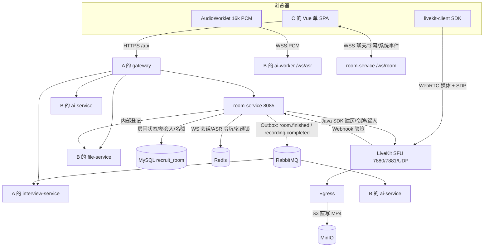
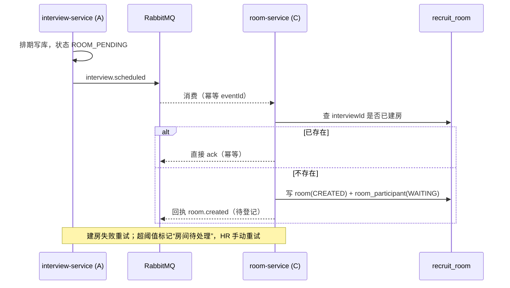
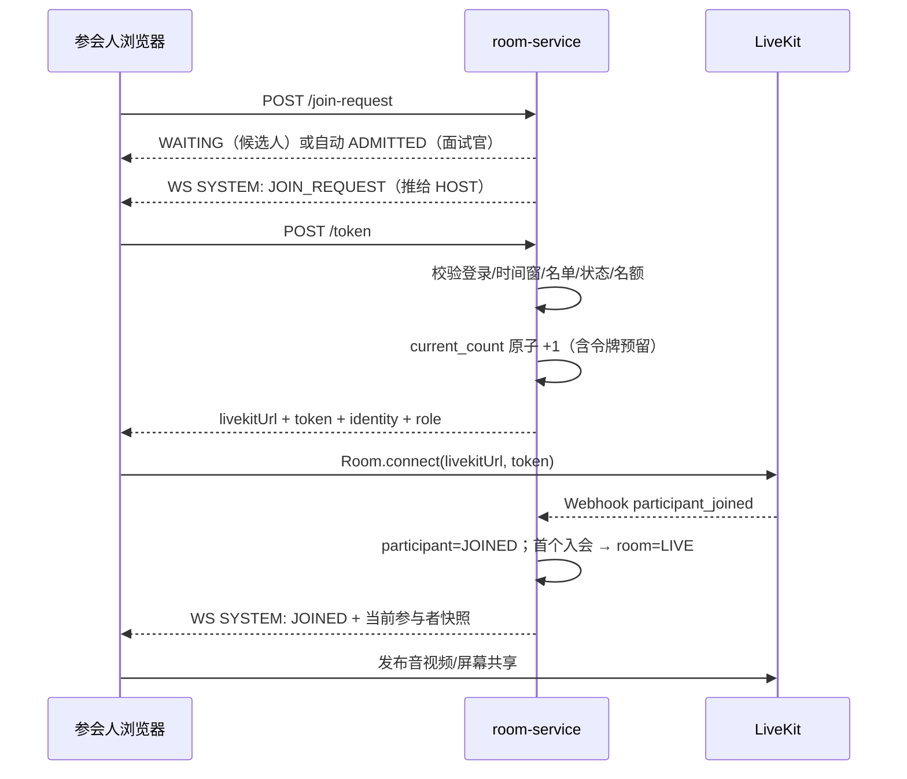
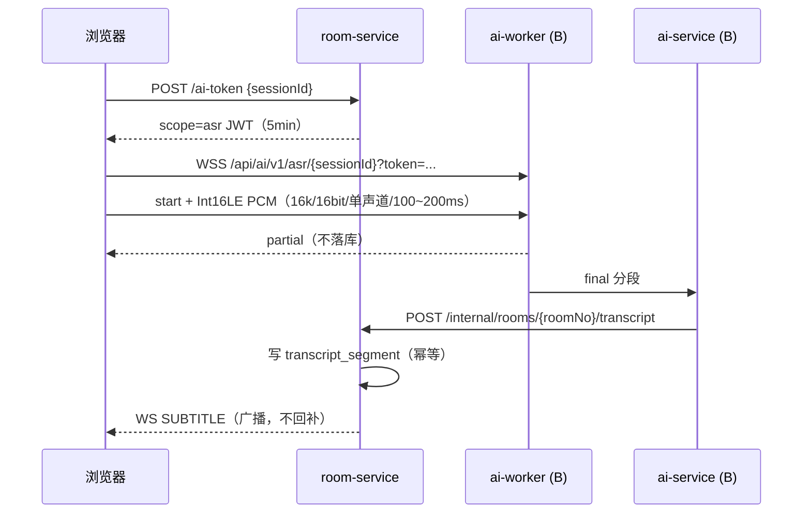
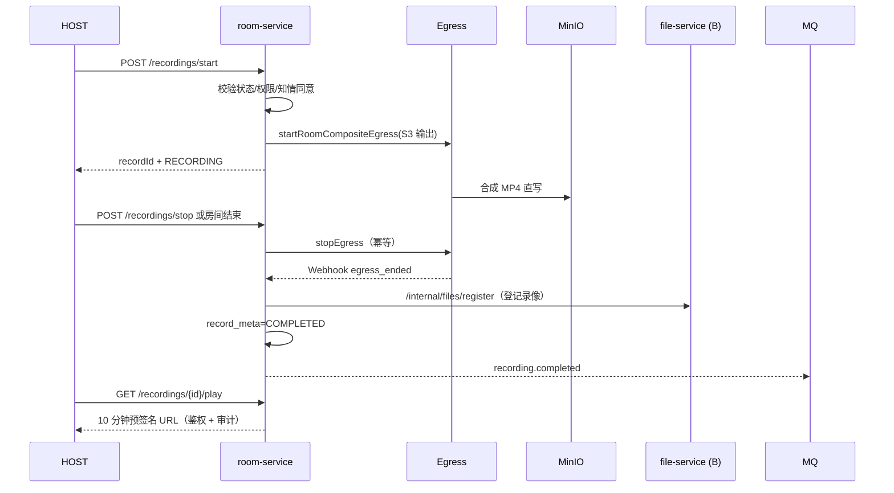

# 在线面试子系统（C）开发文档

> 版本：v1.0（2026-10-19）  
> 负责人：C（在线面试子系统 `room-service` + 全部前端 + LiveKit/Egress 媒体面 + 演示）  
> 配套文档：[2.架构设计方案-招聘面试系统微服务架构.md](2.架构设计方案-招聘面试系统微服务架构.md)、[3.开发文档-招聘面试系统.md](3.开发文档-招聘面试系统.md)  
> 配套 DDL：[sql/03_recruit_room.sql](../sql/03_recruit_room.sql)  
> 配套代码：[backend/room-service](../backend/room-service)、[frontend](../frontend)、[infra](../infra)  
> 定位：C 的实现基线。本文把 v3.1 文档中 C 的范围、契约、状态机、媒体链路、前端页面与里程碑单独抽出并细化，**不替代**原文档；冲突处以第 11 节裁决为准。

---

## 0. 当前阶段与实施约束

### 0.1 骨架现状

| 资产 | 现状 | 差距 |
|---|---|---|
| `room-service` | 仅 `RoomServiceApplication` + `PingController`；`pom.xml` 已含 `spring-boot-starter-websocket`、`io.livekit:livekit-server`、`common`、`contracts` | 无实体/Mapper/Service/Controller；Flyway 关闭 |
| `recruit_room` | `sql/03_recruit_room.sql` 已定义 **8 张业务表 + 2 张公共表** | `application.yml` 中 `flyway.enabled: false`，未落地迁移 |
| LiveKit | `docker-compose.base.yml` 有 `livekit/livekit-server:v1.6`（`--dev`） | 无 `config.yaml`、无 keys、无 TURN/TLS；**Egress 尚未加入 compose** |
| 前端 | 登录/首页/房间三个骨架页；`vite.config.ts` 已配 `/api`、`/ws/room`、`/api/ai/v1/asr`、`/livekit` 代理 | 动态路由、401 刷新队列、36 页、`rtc/`、`ws/` 均未实现 |
| Nginx | `infra/nginx/nginx.conf` 已有四段反代（API/房间 WS/ASR WS/LiveKit） | 未与 `docker-compose.app.yml` 联通；前端镜像缺少 `frontend/nginx.conf` |
| 契约 | `EventTypes` 已有 `ROOM_FINISHED`、`RECORDING_COMPLETED`、`INTERVIEW_SCHEDULED`、`INTERVIEW_CANCELLED`；`RedisKeys` 已有 `ROOM_LOCK`、`ASR_TOKEN` | 缺 `room.created` 回执、`interview.canceled` 拼写不一致、`room:*` 细粒度 Key |

### 0.2 实施约束

1. 本文先作为 **C 的开发计划/实现契约**，确认后再按第 13 节任务清单推进。
2. **W1 必须完成的 spike**（未通过则触发备选）：
   - LiveKit 2 人 / 6 人通话，含手机热点跨网；
   - Egress 房间合成录制 → MinIO → 浏览器回放；
   - `getUserMedia` 在 HTTPS / localhost 下的权限与设备枚举；
   - `livekit-client` 的 1v5 网格、Simulcast 低轨订阅、屏幕共享、断线重连。
   - 任一项不通过：先按 5.2 的备选边界降级（仅 1v1 / 关闭录制 / 回退 SRS），**不阻塞其他页面**。
3. 以下事项在 W1 评审前**不冻结、不投入大量实现**：1v5 人数口径、Egress 部署形态、录制知情同意落地方式、异步面试归属（第 11 节）。
4. 本地默认开发档：`LIVEKIT_MODE=dev`、`RECORDING_MODE=off`、`MQ_ENABLED=false`、ASR 用 B 的 `ASR_MOCK=true`；不依赖 GPU。
5. C 在 W7~10 是全项目峰值：**W7 前必须完成前端框架与 36 页中的非房间页**，房间页只留 W7~8 实现。

---

## 1. 职责与边界

### 1.1 C 的范围

| 类型 | 工程 | 端口 | schema | 职责 |
|---|---|---:|---|---|
| Java | `room-service` | 8085 | `recruit_room` | 房间状态机、入会授权、LiveKit 令牌、名额、Webhook、WS 聊天/字幕/系统事件、录制编排、笔记、防作弊采集 |
| 前端 | `frontend` | 5173（dev）/80（容器） | — | 单 SPA 全角色页面 36 页 + LiveKit 房间页；动态菜单、权限指令、任务轮询、上传 |
| 媒体 | LiveKit SFU | 7880/7881 + UDP 50000-50100 | — | 1v1/1v5 音视频、屏幕共享、Simulcast、TURN 兜底 |
| 媒体 | LiveKit Egress | 无固定对外端口 | — | 房间合成录制 → MP4 → MinIO（S3 直写） |
| 接入 | Nginx | 80/443 | — | 静态资源、`/api`、`/ws/room`、`/api/ai/v1/asr`、`/livekit` 或独立子域名 |

- **1 个 schema**：`recruit_room`（8 业务表 + `local_message` / `idempotent_consumption`）。
- **端点口径**：v3.1 文档 §1.3.3 的“8 端点”是汇总口径；实际方法+路径见本文 §5.2（约 30 个方法，含内部接口），以 §5.2 为准。
- **前端口径**：候选人 11 / 面试官 7 / HR 14 / 管理员 4 = **36 页**，另加 LiveKit 房间页（路由 `/room/:roomNo`，不占菜单）。
- **C 兼任**：演示负责人（runbook、演示脚本、答辩演练）、在线面试主线答辩。

### 1.2 与 A / B 的边界

| 对方 | 边界 |
|---|---|
| A（gateway/auth/interview/notify） | A 负责登录、JWT、权限码、动态菜单、排期与面试状态机、通知。C **不实现**鉴权与通知；room 只信任网关注入的 `X-User-*`，或自校验 JWT。排期由 A 发布 `interview.scheduled` 驱动建房。 |
| B（resume/file/ai-service/ai-worker/mineru） | B 提供 ASR WSS（`/ws/asr/{sessionId}`）、LLM 纪要/评价草稿、file-service 预签名与文件登记。C **不实现** ASR 模型、纪要生成、对象存储 SDK 直连（录制文件登记走 file-service）。 |
| interview 域 | `interview` / `application` 归 A；room 只存 `interview_id` 快照。异步面试表归属见 §11 裁决 2。 |
| AI 域 | 实时问题提示（`/api/ai/interviews/{id}/hints`）与录播评分归 B 的 ai-service；C 只做前端展示与调用。 |
| 前端 | 全部前端归 C；A/B 只提供 OpenAPI 与页面所需数据接口，不写 Vue 页面。 |

### 1.3 数据所有权

- room 只能写 `recruit_room`；跨服务只传 ID + 必要快照，**禁止跨库 JOIN / 跨库写**。
- `interview_id`、`ref_id`、`ref_name` 为快照；A 修改面试信息不反写 room。
- **媒体流不落库**：音视频在 LiveKit，录像在 MinIO，room 只存元数据。
- `transcript_segment` 归 room；AI 纪要/评价草稿归 interview（A）存储，room 不写正式评价。
- AI 输出一律 **草稿**，人工确认后才进入正式业务状态；room 不因 AI 结果自动改面试结论。
- `cheat_event` 只采集、只展示，**不自动判定**。

---

## 2. 总体架构与数据流

### 2.1 子系统架构



### 2.2 排期建房（A → C）



- 幂等键：`interviewId + eventId`；同一 `interviewId` 只允许一个有效房间。
- 当前 DDL 只有 `idx_interview`，**建议补 `UNIQUE KEY uk_interview (interview_id)`**，或在服务层用分布式锁 + 查重（§11 裁决 4）。
- `interview.scheduled` 的载荷是否携带 `roomId` 语义不清（room 由谁生成尚无定论），见 §11 裁决 4。

### 2.3 入会



- 校验顺序固定：登录 → 房间存在 → 状态可入 → 时间窗 → 名单 → 准入状态 → 名额 → 签发。
- `current_count` 是**已占名额（含已发令牌未入会）**，不是在线人数；在线人数以 LiveKit `ListParticipants` 对账为准。
- 同一 `identity` 重连会顶掉旧连接（LiveKit 行为），服务端记 `SYSTEM: RECONNECTED`，不重复占名额。

### 2.4 实时字幕



- 每位参会人一条音频流（1v1=2 路，1v5=6 路）；不抓 LiveKit 混音轨。
- 超容量：ai-worker 返回 `ASR_OVERLOAD`，前端暂停字幕并提示“会后补转写”，面试/聊天/录制不受影响。
- 断线重连带 `lastSegmentId` 续传；partial 不补发。

### 2.5 录制与回放



- 录制失败**不阻塞**面试结束；`record_meta.status=FAILED`，可重试。
- 回放只允许 `COMPLETED`，下载另需 `room:recording:download` 权限并写审计。

### 2.6 异步录播面试（Should，归属待裁决）

```
A/HR 创建试卷（题目、准备/作答时长、权重）
  → 候选人收到邀请链接（portal token）
  → 逐题录制（浏览器 MediaRecorder 或 LiveKit 单人房间）
  → 分片/断点续传 → file-service 预签名 → MinIO
  → 提交作答 → B 的 ai-service 逐题 ASR + 评分草稿
  → 面试官回看录像 + 人工打分/覆盖 → interview 结果
```

> 当前 `async_paper/async_question/async_answer/async_answer_score` 在 **`recruit_interview`**（A 的 schema），而端点清单把 `/api/room/async-interviews/**` 放在 room 域。本文暂按“业务表与评分归 A，C 只做作答前端与媒体上传/回放组件”落笔；若 W1 评审确认异步属于 C 的论文范围，需把四表迁入 `recruit_room` 并补全契约（§11 裁决 2）。

---

## 3. 服务拆解

### 3.1 room-service（Java，8085）

**职责**：房间业务状态与媒体控制面。媒体流本身由 LiveKit 转发，room 不转发音视频。

#### 3.1.1 表（`recruit_room`，8 + 2）

| 表 | 关键约束 | 用途 |
|---|---|---|
| `room` | `room_no` 唯一、`livekit_room_name` 唯一、`idx_interview`、`version` | 房间状态机、名额、录制状态快照 |
| `room_participant` | `(room_id, ref_id)` 唯一 | 受邀名单、准入与在场状态、LiveKit identity |
| `room_event` | `webhook_event_id` 唯一、`idx_room_time` | Webhook 与系统事件留痕 |
| `record_meta` | `egress_id` 唯一 | Egress 录制元数据 |
| `interview_note` | `idx_room_time` | 人工笔记（AI 纪要只作补充） |
| `chat_message` | `msg_no` 唯一 | 聊天落库后广播 |
| `transcript_segment` | `(room_id, speaker_id, segment_no)` 唯一 | 实时/会后转写片段 |
| `cheat_event` | `idx_room_time`、`idx_candidate` | 防作弊事件（只采集） |
| `local_message` | `message_id` 唯一 | Outbox |
| `idempotent_consumption` | `(consumer_group, event_id)` 唯一 | 消费幂等 |

> v3.1 开发文档 §1.3.3 写“7 表”，§2.2 列 7 张（漏 `room_event`）；DDL 实际 8 张。以 DDL 为准（§11 裁决 1）。

#### 3.1.2 模块划分

| 模块 | 职责 |
|---|---|
| `RoomService` | 建房、查询、打开、结束、取消；状态机唯一入口 |
| `RoomStateMachine` | 显式流转表 + 前置条件 + 乐观锁；禁 Controller 直接写 status |
| `ParticipantService` | 名单、join-request、admit/reject、kick、mute、离会归还名额 |
| `LiveKitTokenService` | 签发入会令牌、`scope=asr` 短时令牌、`ws-ticket` |
| `CapacityService` | `current_count` 原子扣减/归还、令牌预留 TTL、`ListParticipants` 对账 |
| `LiveKitWebhookService` | 验签、`event.id` 幂等、事件落库、状态推进 |
| `RecordingService` | Egress start/stop、`record_meta` 状态、文件登记、回放鉴权 |
| `ChatService` | 消息落库、`msg_no` 幂等、WS 广播、离线拉取 |
| `NoteService` | 笔记 CRUD、可见范围 |
| `TranscriptService` | final 段幂等写入、按序查询 |
| `CheatEventService` | 批量上报合并去重、证据文件、只采集不判定 |
| `WsRoomHandler` | 首帧 AUTH、心跳、seq、广播、连接管理 |
| `OutboxService` / `RoomEventPublisher` | `room.finished`、`recording.completed` 同事务写 Outbox + 定时投递 |
| `InterviewEventConsumer` | `interview.scheduled` / `interview.canceled` 消费 |

#### 3.1.3 依赖与 Feign

- `FileServiceClient`：`/internal/files/register`、`/internal/files/{id}/meta`、`/internal/files/presign/download`；连接 2s / 读 3s；traceId 透传。
- `AiServiceClient`（可选）：仅用于查询转写/触发补转写；实时字幕不经过 room 同步调用。
- **不直连 MinIO**：Egress 的 S3 直写由部署配置完成，录像登记走 file-service。
- `common`：`Result`、`ErrorCode`、`RedisKeys`、`IdWorker`、`TraceIdUtil`。
- `contracts`：`EventEnvelope`、`EventTypes`。

#### 3.1.4 LiveKit 客户端封装

- `AccessToken`：只授予指定 `room` + `identity`，TTL 60 分钟（配置 `token-ttl-minutes`，文档上限 2h）。
- `RoomServiceClient`：`listParticipants`（对账）、`removeParticipant`（kick）、`mutePublishedTrack`（mute）。
- `EgressClient`：`startRoomCompositeEgress`、`stopEgress`、`listEgress`。
- `WebhookReceiver`：校验 `Authorization` 中的签名 JWT，解析事件。
- 所有 LiveKit 密钥只从环境变量注入（`LIVEKIT_API_KEY` / `LIVEKIT_API_SECRET`），**禁止入库/入仓**。

### 3.2 WebSocket 协议（`/ws/room/{roomNo}`）

**连接与鉴权**

1. 客户端建立 WS，10 秒内发送首帧：
   ```json
   {"type":"AUTH","token":"<Access Token>","lastSeq":123}
   ```
2. 服务端校验 JWT、房间、名单、房间状态；失败关闭并返回关闭码。
3. 成功回 `AUTH_OK`，携带参与者快照与当前 `seq`。
4. 心跳：服务端每 15s `PING`，30s 无 `PONG` 判离线；客户端指数退避重连（1s→30s）。

**消息信封**

```json
{
  "type": "CHAT | SUBTITLE | SYSTEM | PING | PONG | AUTH | AUTH_OK | ERROR",
  "seq": 123,
  "roomNo": "R20261102001",
  "ts": "2026-11-02T02:00:00Z",
  "sender": {"userId":"10086","name":"张三","role":"CANDIDATE"},
  "payload": {}
}
```

- `seq`：房间级单调递增（Redis `INCR room:seq:{roomNo}`），客户端按 `seq` 去重、保序；重连可带 `lastSeq` 拉缺口。
- `CHAT`：先落库（`msg_no` 幂等）再广播；离线聊天用 `GET /messages?afterSeq=` 拉取。
- `SUBTITLE`：只广播不落库；`partial` 不回补，`final` 由 room 落 `transcript_segment` 后再广播。
- `SYSTEM`：`JOIN_REQUEST` / `JOINED` / `LEFT` / `KICKED` / `MUTED` / `RECORD_STARTED` / `RECORD_STOPPED` / `ROOM_ENDED`。
- 关闭码：`4001` AUTH 超时、`4002` 未授权/不在名单、`4003` 房间已结束、`4004` 同账号新连接顶替、`4005` 服务过载。

### 3.3 前端工程

#### 3.3.1 目录规划

```
frontend/src/
├── api/
│   ├── request.ts          # 已有：axios 单例 + 401 刷新队列（W2 补 refresh）
│   ├── auth.ts             # 登录/刷新/菜单
│   ├── interview.ts        # A 的 interview API
│   ├── resume.ts           # B 的 resume/file API
│   ├── room.ts             # C 的 room API
│   └── ai.ts               # B 的 ai API（提示/纪要/转写）
├── router/
│   ├── index.ts            # 已有：静态路由
│   └── dynamic.ts          # W2：/api/auth/menus → addRoute + import.meta.glob
├── stores/
│   ├── user.ts             # 已有：用户/角色/权限/菜单
│   ├── room.ts             # 房间状态、参与者、聊天、字幕、设备
│   ├── task.ts             # 解析/导出等异步任务轮询
│   └── notify.ts           # 站内信未读数
├── rtc/
│   ├── livekit.ts          # Room.connect、订阅策略、发布控制、重连
│   ├── devices.ts          # 枚举/预览/权限引导
│   ├── layout.ts           # 1v1 / 1v5 网格与主视图切换
│   └── audio-worklet.ts    # 48k → 16k 重采样 + Int16LE 分帧
├── ws/
│   ├── room-socket.ts      # 首帧 AUTH、心跳、seq 去重、重连
│   └── asr-socket.ts       # ASR WSS、PCM 发送、令牌轮换、lastSegmentId
├── components/room/
│   ├── DeviceCheck.vue     # 摄像头/麦克风/扬声器预检
│   ├── ParticipantGrid.vue # 1v1 / 1v5 自适应网格
│   ├── VideoTile.vue       # 视频/音频/共享/网络状态
│   ├── ChatPanel.vue
│   ├── SubtitlePanel.vue   # 环形缓冲 200 条 + 虚拟滚动
│   ├── NotePanel.vue
│   ├── RecordingBar.vue    # 录制状态 + 知情同意
│   ├── NetworkBanner.vue   # RTT>300ms 黄条
│   └── CheatMonitor.vue    # 候选人切屏提示
├── views/                  # 36 页 + room 页
└── utils/permission.ts     # 已有：v-permission 指令（注意与文档 v-perm 的命名差异）
```

> 文档 §1.3.3 写作 `v-perm`，骨架实现为 `v-permission`（`main.ts` 已注册）。以骨架为准，或在 W2 统一改名；不要两套并存。

#### 3.3.2 页面清单（36 页规划，W2 与 IAM 菜单树 seed 对齐后冻结）

| 角色 | 页数 | 页面 |
|---|---:|---|
| 候选人 | 11 | 岗位列表、岗位详情、投递表单、我的投递/进度、简历上传与解析状态、面试邀约/日程、**在线面试房间**、**异步面试作答**、Offer 确认、消息中心、个人资料 |
| 面试官 | 7 | 我的面试日程、**面试房间**、候选人摘要、评价填写、我的评价、面试回放、AI 纪要复核 |
| HR | 14 | 招聘看板、岗位管理、流程模板、投递管理、候选人详情（简历/匹配）、排期日历、排期详情/冲突处理、评价汇总、评价对比、Offer 管理、人才库、人才详情/跟进、查重合并、统计报表 |
| 管理员 | 4 | 用户管理、角色管理、权限/菜单管理、审计日志 |

- 每页必须有**加载 / 空态 / 失败 / 重试**四态（Definition of Done）。
- 房间页不计入 36 页菜单。

#### 3.3.3 房间页（`views/room/index.vue`，W7~8 实现）

**页面状态机**：`PREJOIN（设备预检）→ WAITING（等待准入/开场）→ LIVE（通话）→ ENDED（结束/回放入口）`。

**布局**

- 1v1：对方大画面 + 本地小窗（画中画）。
- 1v5：≤4 人等分网格；>4 人“缩略图侧栏 + 主视图”，点击/固定切换主视图。
- 屏幕共享：共享流替换主视图，摄像头流降为缩略图；同房间并发共享限 1 人。

**媒体策略**

- 发布：摄像头默认 720p/24fps，开启 Simulcast；群面订阅低轨（360p/540p）。
- 放大某个参与者时调用 `setVideoQuality` 升轨；缩略图回落低轨。
- 设备预检：`enumerateDevices` + 预览 + 权限引导；无设备/被拒绝时给出可操作提示。
- 断线：LiveKit 媒体层自动重连；业务 WS 独立重连；重连后拉离线聊天，字幕不回补。
- 弱网：连接质量/RTT 采样，RTT>300ms 显示黄条；持续恶化提示关闭摄像头或切音频。
- 清理：`onBeforeUnmount` 停止本地轨道、关闭 WS、释放设备。

**采集**

- 仅在“麦克风未静音且房间 LIVE”时启动 AudioWorklet；静音停止发送 PCM。
- AudioWorklet 输出 16kHz/16bit/单声道，100ms/帧（1600 samples / 3200 bytes）。
- ASR 令牌 5 分钟轮换；过期/断线用 `lastSegmentId` 续传。

**防作弊**

- 候选人角色 + 房间 LIVE 时监听 `visibilitychange`、`blur`、全屏退出、设备变更。
- 事件本地合并去重（2s 窗口）后批量上报；只展示，不自动判定、不弹阻断。

**录制**

- HOST 开始录制前展示知情同意；候选人确认结果随事件落库（当前 DDL 缺字段，见 §11 裁决 9）。
- 页面常驻录制指示条；录制失败显示“未录制成功，可重试”，不影响通话。

### 3.4 媒体与接入基础设施

| 组件 | 配置要点 |
|---|---|
| LiveKit | `--dev` 仅本地；生产 `config.yaml` + 环境变量 keys；7880 信令、7881 TCP 兜底、UDP 50000-50100 直暴露；TURN/TLS 443 按答辩网络验证结果 |
| Egress | S3 输出指向 MinIO（`endpoint`、`bucket=recruit`、`forcePathStyle=true`）；CPU/带宽单独计入；版本与 LiveKit 对齐，W1 锁定 |
| Nginx | `/api → gateway`（`read_timeout 40s`）、`/ws/room/ → room`（Upgrade，300s）、`/api/ai/v1/asr/ → ai-worker /ws/asr/`（Upgrade，3600s）、`/livekit → /rtc` rewrite；生产优先 `livekit.<domain>` |
| 前端镜像 | 构建产物由 Nginx 托管；`frontend/Dockerfile` 当前 `COPY nginx.conf` 但仓库无该文件，需补 `frontend/nginx.conf` 或改为 `infra/nginx/nginx.conf` |

---

## 4. 数据、缓存、迁移与存储

### 4.1 Flyway

| schema | 归属 | 迁移方式 | 说明 |
|---|---|---|---|
| `recruit_room` | room-service | Flyway `V1_0__init.sql` | 复制 `sql/03_recruit_room.sql`，移除 `USE recruit_room;` |

- `application.yml` 的 `spring.flyway.enabled` 在 W1 改 `true`，`locations: classpath:db/migration`。
- 迁移只向前；字段变更走新版本脚本，不改已执行脚本。

### 4.2 Redis Key

| Key | 用途 | 现状 |
|---|---|---|
| `room:lock:{roomId}` | 建房/名额临界区分布式锁 | `RedisKeys.ROOM_LOCK` 已有 |
| `asr:token:{sessionId}` | ASR 短时令牌登记/撤销 | `RedisKeys.ASR_TOKEN` 已有 |
| `room:seq:{roomNo}` | WS 房间级 seq | 待补 |
| `room:token:{roomNo}:{refId}` | 入会令牌幂等（避免重复占名额） | 待补 |
| `room:state:{roomNo}` | 房间状态/在线人数缓存（可选） | 待补 |
| `room:seat:{roomNo}:{refId}` | 名额预留 TTL（令牌未入会） | 待补 |
| `idem:{consumerGroup}:{eventId}` | 消费短兜底 | `RedisKeys.IDEMPOTENT` 已有 |

### 4.3 MinIO 对象布局

```
recruit/
├── recording/{roomNo}/{recordId}/{recordId}.mp4
├── recording/{roomNo}/{recordId}/thumb.jpg        # 可选
└── cheat/{roomNo}/{candidateId}/{timestamp}.png   # 防作弊证据（P2）
```

- 桶 `recruit` 私有；Egress 直写路径由 room 生成；对外只发 10 分钟预签名 URL。
- 录像保留 90 天（文档 §7.3）；到期由 MinIO 生命周期或定时任务清理。

### 4.4 DDL 缺口（本期需决策）

| # | 缺口 | 建议 |
|---|---|---|
| 1 | `room` 无 `interview_id` 唯一约束 | 补 `UNIQUE KEY uk_interview (interview_id)` 或服务层幂等 |
| 2 | `room_participant.ref_id` 注释为 `iam_user.id`，文档 §2.1 说 room 存 `person_id` | `ref_id` 继续用 `iam_user.id`（鉴权/identity 需要），另加可空 `person_id` 关联简历域 |
| 3 | 录制知情同意无落库字段 | 加 `room_participant.consent_flags JSON` 或 `room_event` 专用事件 |
| 4 | 无 `room.created` 回执事件 | 登记新事件或改为同步回执 |
| 5 | 无 `open_at` / `end_at` 列 | 时间窗目前只能依赖 event 载荷；建议加列或存 Redis |

---

## 5. API 契约

### 5.1 通用约定

- 响应：`{"code":"0","message":"success","data":{},"traceId":"...","timestamp":...}`（沿用骨架 `0`，与 A 统一；文档 §3.1 的 `"OK"` 为待统一项）。
- 分页：`{list,total,pageNum,pageSize,pages}`，`pageSize ≤100`。
- ID 字符串；时间 UTC、ISO-8601；更新带 `version`；写操作支持 `Idempotency-Key`。
- 路径参数 `{roomNo}` 为业务房间号（不是数据库主键）。
- 每个非公开接口登记权限码；前端隐藏按钮不是安全边界。
- 参会人接口同时校验 **对象级归属**（是否在本房间名单内）。

### 5.2 端点总表

> P0=房间主线，P1=录制/字幕/笔记，P2=增强。

#### 房间与参会人

| # | 方法 | 路径 | 权限 | 优先级 |
|---|---|---|---|---|
| 1 | POST | `/internal/rooms` | 内部鉴权（A→C） | P0 |
| 2 | GET | `/api/room/rooms` | `room:room:view` | P0 |
| 3 | GET | `/api/room/rooms/{roomNo}` | `room:room:view` / 参会人 | P0 |
| 4 | GET | `/api/room/rooms/{roomNo}/participants` | `room:room:view` / 参会人 | P0 |
| 5 | POST | `/api/room/rooms/{roomNo}/open` | HOST / `room:room:update` | P0 |
| 6 | POST | `/api/room/rooms/{roomNo}/join-request` | 参会人 | P0 |
| 7 | POST | `/api/room/rooms/{roomNo}/token` | 参会人 | P0 |
| 8 | POST | `/api/room/rooms/{roomNo}/ws-ticket` | 参会人 | P1 |
| 9 | POST | `/api/room/rooms/{roomNo}/ai-token` | 参会人 | P1 |
| 10 | POST | `/api/room/rooms/{roomNo}/admit` | HOST / `room:room:admit` | P0 |
| 11 | POST | `/api/room/rooms/{roomNo}/reject` | HOST / `room:room:admit` | P0 |
| 12 | POST | `/api/room/rooms/{roomNo}/mute` | HOST / `room:room:mute` | P1 |
| 13 | POST | `/api/room/rooms/{roomNo}/kick` | HOST / `room:room:kick` | P1 |
| 14 | POST | `/api/room/rooms/{roomNo}/end` | HOST / `room:room:end` | P0 |
| 15 | POST | `/api/room/rooms/{roomNo}/cancel` | `room:room:cancel` | P1 |

#### 聊天 / 笔记 / 转写

| # | 方法 | 路径 | 权限 | 优先级 |
|---|---|---|---|---|
| 16 | GET | `/api/room/rooms/{roomNo}/messages` | 参会人 | P1 |
| 17 | POST | `/api/room/rooms/{roomNo}/messages` | 参会人 | P1 |
| 18 | GET | `/api/room/rooms/{roomNo}/notes` | `room:note:view` | P1 |
| 19 | POST | `/api/room/rooms/{roomNo}/notes` | `room:note:create` | P1 |
| 20 | PUT | `/api/room/rooms/{roomNo}/notes/{noteId}` | `room:note:create` | P2 |
| 21 | GET | `/api/room/rooms/{roomNo}/transcript` | `room:transcript:view` | P1 |
| 22 | POST | `/internal/rooms/{roomNo}/transcript` | 内部鉴权（B→C） | P1 |
| 23 | POST | `/internal/rooms/{roomNo}/ai-callback` | 内部鉴权（B→C） | P2 |

#### 录制

| # | 方法 | 路径 | 权限 | 优先级 |
|---|---|---|---|---|
| 24 | POST | `/api/room/rooms/{roomNo}/recordings/start` | `room:recording:start` | P1 |
| 25 | POST | `/api/room/rooms/{roomNo}/recordings/stop` | `room:recording:stop` | P1 |
| 26 | GET | `/api/room/rooms/{roomNo}/recordings` | `room:recording:view` | P1 |
| 27 | GET | `/api/room/rooms/{roomNo}/recordings/{id}/play` | `room:recording:play` | P1 |
| 28 | GET | `/api/room/rooms/{roomNo}/recordings/{id}/download` | `room:recording:download` | P2 |

#### 防作弊 / 异步 / 内部

| # | 方法 | 路径 | 权限 | 优先级 |
|---|---|---|---|---|
| 29 | POST | `/api/room/rooms/{roomNo}/cheat-events` | 候选人 / 参会人 | P1 |
| 30 | POST | `/api/room/rooms/{roomNo}/face-verify` | 候选人 | P2（预留） |
| 31 | POST | `/api/room/rooms/{roomNo}/snapshot` | 候选人 | P2（预留） |
| 32 | POST | `/internal/livekit/webhook` | LiveKit 签名 JWT | P0 |
| 33 | GET/POST | `/api/room/async-interviews/**` | `room:async:*` | P2（归属待裁决） |
| 34 | GET/POST | `/api/room/portal/async-invites/**` | `portal:async:*` | P2（归属待裁决） |
| 35 | GET/POST | `/api/room/questions/**` | `room:question:*` | P2（归属待裁决） |

> `ws-ticket` 的定位：避免把 Access Token 放进 WS URL query，由服务端换一次性 60s ticket。本期可直接用首帧 Access Token；`ws-ticket` 列为 P1 可选（§11 裁决 8）。

### 5.3 关键 DTO

**建房 `POST /internal/rooms`**

```json
{
  "interviewId": "90001",
  "roomType": "ONE_TO_ONE | ONE_TO_MANY",
  "startTime": "2026-11-02T02:00:00Z",
  "endTime": "2026-11-02T03:00:00Z",
  "recordingEnabled": true,
  "autoAdmit": false,
  "participants": [
    {"refId": "10001", "refName": "面试官·李四", "role": "INTERVIEWER"},
    {"refId": "20002", "refName": "候选人·张三", "role": "CANDIDATE"}
  ]
}
```

响应：

```json
{
  "roomNo": "R20261102001",
  "livekitRoomName": "room-90001",
  "status": "CREATED",
  "maxParticipants": 6,
  "createdAt": "2026-11-02T01:40:00Z"
}
```

**入会令牌 `POST /api/room/rooms/{roomNo}/token`**

```json
{
  "roomNo": "R20261102001",
  "livekitUrl": "wss://livekit.example.com",
  "token": "eyJhbGciOi...",
  "identity": "20002",
  "role": "CANDIDATE",
  "expiresAt": "2026-11-02T03:00:00Z",
  "recordingEnabled": true
}
```

**WS ticket `POST /api/room/rooms/{roomNo}/ws-ticket`**

```json
{"ticket": "one-time-60s", "wsUrl": "wss://example.com/ws/room/R20261102001", "expiresAt": "..."}
```

**ASR 令牌 `POST /api/room/rooms/{roomNo}/ai-token`**

```json
{"sessionId": "uuid", "token": "scope-asr-jwt", "asrUrl": "wss://example.com/api/ai/v1/asr/uuid", "expiresAt": "..."}
```

**转写回调 `POST /internal/rooms/{roomNo}/transcript`**

```json
{
  "speakerId": "20002",
  "speakerName": "张三",
  "segmentNo": 12,
  "segmentId": "uuid",
  "startMs": 12000,
  "endMs": 15000,
  "text": "我做过三年 Java 后端……",
  "confidence": 0.91,
  "source": "ASR_LIVE",
  "occurredAt": "2026-11-02T02:12:15Z"
}
```

**聊天消息 `POST /messages`**

```json
{"clientMsgId":"uuid","content":"请共享一下代码","type":"TEXT","visibility":"ALL"}
```

**防作弊批量上报 `POST /cheat-events`**

```json
{
  "events": [
    {"clientEventId":"uuid","type":"TAB_SWITCH","severity":"WARN","occurredAt":"2026-11-02T02:10:00Z","detail":{"hiddenMs":3200}}
  ]
}
```

### 5.4 内部接口鉴权

- 文档口径：`/internal/**` 网关对外 403；服务间用 HMAC。
- 骨架/ B 域口径：`X-Internal-Token`。
- **统一建议**：`X-Internal-Token` + `X-Timestamp` + `X-Signature`（HMAC-SHA256(body+timestamp)），时间戳 ±5 分钟；由 A 的 gateway 屏蔽 `/internal/**`。W1 与 A/B 对齐后写进 OpenAPI（§11 裁决 7）。

### 5.5 错误码（`ROM4xxx`）

| 码 | 含义 | 现状 |
|---|---|---|
| `ROM4001` | 房间不存在 | 已有 |
| `ROM4002` | 房间状态不允许该操作 | 待补 |
| `ROM4003` | 未到进场时间/已过时间窗 | 已有 |
| `ROM4004` | 房间名额已满 | 已有 |
| `ROM4005` | 不在受邀名单 | 已有 |
| `ROM4006` | 已被移出/已离会 | 待补 |
| `ROM4007` | 入会令牌无效或过期 | 待补 |
| `ROM4008` | 录制状态冲突 | 待补 |
| `ROM4009` | Webhook 验签失败 | 待补 |
| `ROM4010` | 请求重复（幂等返回成功，可不抛错） | 待补 |
| `ROM4011` | 时间窗未开启 | 待补 |
| `ROM4012` | 异步邀请无效/过期 | 待补 |
| `ROM4013` | 作答已提交（或复用 `AIS5102`） | 待补 |
| `ROM4014` | 房间已结束 | 待补 |

### 5.6 权限码（来自开发文档 §4.4）

`room:room:view/create/update/cancel/end/admit/kick/mute`、`room:recording:view/start/stop/play/download`、`room:note:view/create`、`room:transcript:view`、`room:cheat:view`、`room:monitor:view`、`room:async:view/create/update/publish/delete`、`room:async-invite:view/create/cancel`、`room:async-review:view/submit`、`room:question:view/create/update/delete`、`portal:async:view/start/submit`、`portal:interview:join`。

> 新增端点必须先登记权限码到 auth-service 的 seed；C 的前端 `v-permission` 与后端 `@PreAuthorize` 使用同一份编码。

---

## 6. 事件契约

### 6.1 信封

沿用 `contracts/EventEnvelope`：

```json
{
  "eventId": "uuid",
  "eventType": "room.finished",
  "eventVersion": 1,
  "occurredAt": "2026-11-02T03:00:00Z",
  "traceId": "…",
  "aggregateId": "roomNo",
  "aggregateType": "ROOM",
  "payload": {}
}
```

### 6.2 C 发布的事件

| 事件 | 载荷 | 消费方 | 现状 |
|---|---|---|---|
| `room.finished` | roomId, roomNo, interviewId, transcriptStatus, recordingStatus, startedAt, endedAt, durationSec, participantCount | ai-service（纪要/评价草稿）、interview（更新面试记录） | `EventTypes.ROOM_FINISHED` 已有 |
| `recording.completed` | roomId, roomNo, interviewId, recordId, fileId, fileKey, durationSec, egressId | interview（录像登记）、ai-service（可选补转写） | `EventTypes.RECORDING_COMPLETED` 已有 |
| `notification.requested` | templateCode, receiverId, bizType, bizId, variables | notify（A） | 已有；录制完成/房间结束通知可选 |
| `room.created` | roomId, roomNo, interviewId, livekitRoomName | interview（回执） | **缺失，待登记** |
| `room.create.failed` | interviewId, reason, attempt | interview / notify | **缺失，待登记** |
| `asr.overload` | roomNo, sessionId, at | 监控/可选 | `EventTypes.ASR_OVERLOAD` 已有，但 ai-worker 无 MQ；暂作监控口径，不由 room 发布 |

### 6.3 C 消费的事件

| 事件 | 发布方 | 处理 |
|---|---|---|
| `interview.scheduled` | interview（A） | 幂等建房；写 room + 参会人；状态 CREATED |
| `interview.canceled` / `interview.cancelled` | interview（A） | 取消房间：CREATED/WAITING → CANCELED；LIVE → 先结束再取消；通知参会人 |
| `offer.confirmed` | interview（A） | 不处理（room 无此职责） |

> `EventTypes.INTERVIEW_CANCELLED = "interview.cancelled"` 与开发文档 §5.2 的 `interview.canceled` 不一致。**建议统一为 `interview.canceled`**（文档口径），常量保留兼容别名（§11 裁决 3）。

### 6.4 一致性

- 业务表与 `local_message` 同事务写入；`OutboxPublisher` 每 5s 扫描 PENDING；publisher confirms；失败退避 1/2/4/8/16 分钟，5 次 DEAD。
- 消费端先插 `idempotent_consumption(consumer_group, event_id)`，重复即跳过；手动 ack；失败进死信。
- `MQ_ENABLED=false` 时只落 Outbox，不投递；房间主流程不受影响。
- 事件字段只增不改；新增事件先登记本文与 `EventTypes`，再写代码。

### 6.5 WS 系统事件（非 MQ）

| SYSTEM 事件 | 触发 |
|---|---|
| `JOIN_REQUEST` | 候选人申请入会 |
| `JOINED` / `LEFT` | LiveKit Webhook 转换 |
| `KICKED` / `MUTED` | HOST 操作 |
| `RECORD_STARTED` / `RECORD_STOPPED` | Egress 编排结果 |
| `ROOM_ENDED` | 房间结束 |
| `SUBTITLE_PAUSED` | 收到 `ASR_OVERLOAD` 时由前端本地提示，或服务端广播 |

---

## 7. 核心算法与规则

### 7.1 房间状态机

| 当前态 | 事件 | 目标态 | 前置条件 |
|---|---|---|---|
| CREATED | `open` / 到达 `startTime-15min` | WAITING | HOST 或定时任务 |
| CREATED | `cancel` | CANCELED | HR/HOST |
| WAITING | 首个 `participant_joined` | LIVE | Webhook 验签通过 |
| WAITING | `end` | FINISHED | HOST；无人入会也允许结束 |
| WAITING | `cancel` | CANCELED | HR/HOST |
| LIVE | `end` / `room_finished` Webhook | FINISHED | 停止录制、发布 `room.finished` |
| LIVE | `cancel` | FINISHED → CANCELED | 先结束再取消，保留录像 |
| LIVE | LiveKit 不可恢复 | FAILED | 人工确认，记录原因 |
| FINISHED / CANCELED / FAILED | 任意写操作 | 拒绝 | 返回 `ROM4002` / `ROM4014` |

- 所有流转走 `RoomStateMachine` + `version` 乐观锁；重复 `end`/`cancel` 幂等返回当前态。
- 结束房间时：停止 Egress（幂等）→ 更新 `record_meta` → 发布 `room.finished` → WS 广播 `ROOM_ENDED` → 关闭连接。
- 限员：`ONE_TO_ONE=2`，`ONE_TO_MANY=6`（1v5 = 1 面试官 + 5 候选人）。1v5 口径待 W1 需求评审确认。

### 7.2 入会校验顺序

1. 登录态与权限码；
2. 房间存在且未结束/未取消（`ROM4001` / `ROM4002` / `ROM4014`）；
3. 时间窗：`startTime - 15min ≤ now ≤ endTime + 15min`（可配置，`ROM4003` / `ROM4011`）；
4. 名单：`room_participant(room_id, ref_id)` 存在（`ROM4005`）；
5. 准入：候选人 `ADMITTED` 才能签发；面试官/HOST 自动 `ADMITTED`（`autoAdmit=true` 时候选人自动准入）；
6. 名额：原子占位（`ROM4004`）；
7. 状态：`KICKED` 拒绝（`ROM4006`）；
8. 签发 LiveKit 令牌，写 `room_participant.livekit_identity`，状态 `ADMITTED`。

### 7.3 令牌与名额

**LiveKit 令牌能力矩阵**

| 角色 | 入会 | 发布音视频 | 屏幕共享 | 数据通道 | 订阅 |
|---|:-:|:-:|:-:|:-:|:-:|
| HOST / INTERVIEWER | ● | ● | ● | ● | ● |
| CANDIDATE | ● | ● | ● | ● | ● |
| OBSERVER | ● | — | — | — | ● |

- 令牌只授予指定 `room` + `identity`；TTL 60 分钟；密钥仅环境变量。
- 同一 `identity` 重连顶掉旧连接；新连接不重复扣名额。

**名额原子扣减**

```sql
UPDATE room
   SET current_count = current_count + 1
 WHERE id = ? AND current_count < max_participants;
-- 影响行数 = 0 → ROM4004
```

- 令牌幂等：`room:token:{roomNo}:{refId}` 缓存已签令牌；重复请求返回同一令牌，不重复加名额。
- 归还：`participant_left` / `kick` / 房间结束 → `current_count = GREATEST(current_count - 1, 0)`。
- 令牌预留：未入会的令牌占位设 TTL（建议 10 分钟，与时间窗一致）；过期由对账任务归还。
- 对账：每 60s 调 LiveKit `listParticipants`，以实际在线修正 `current_count` 与 participant 状态；只告警不自动踢人（可配置）。

### 7.4 Webhook

- **验签**：LiveKit Webhook 的 `Authorization` 是签名 JWT（用 API Secret 校验），不是裸 HMAC。骨架 `webhook-secret` 应配置为 API Secret；文档中的“HMAC 验签”按 JWT 签名验签实现（§11 裁决 5）。
- **幂等**：`event.id` 写入 `room_event.webhook_event_id`（唯一键）；重复事件直接 200。
- **处理**：验签 → 落 `room_event` → 按类型推进状态/写参与者 → 200 快速返回；未知类型只落库。
- 关键事件：`participant_joined` / `participant_left` / `room_finished` / `track_published` / `track_unpublished` / `egress_started` / `egress_updated` / `egress_ended`。
- 丢失补偿：定时对账 `ListParticipants` + `ListEgress`；`room_finished` 丢失时由定时任务按 `endTime + 缓冲` 结束房间。

### 7.5 录制

- 仅 `LIVE` 可开始；同一房间同时只允许一个 `RECORDING` 任务（`ROM4008`）。
- 开始前校验 `room:recording:start` 与知情同意；Egress 使用 `RoomComposite` 合成布局，S3 输出到 MinIO。
- `record_meta`：`PENDING → RECORDING → COMPLETED / FAILED`；`egress_id` 唯一。
- 失败/超时：`FAILED` + `error_msg`，可重试；不阻塞结束。
- 结束：主动 stop + 房间结束兜底 stop；以 `egress_ended` Webhook 为准更新时长与文件。
- 登记：Egress 产物通过 file-service `/internal/files/register` 登记，拿到 `file_id` 后发布 `recording.completed`。
- 回放/下载：校验房间归属 + `room:recording:*`；预签名 10 分钟；下载写审计。

### 7.6 实时字幕与降级

- 音频来源：参会人本地麦克风，16kHz/16bit/单声道 PCM，100~200ms/帧；不抓混音轨。
- 容量契约（B 提供）：单 ai-worker 实例目标 ≥20 路；1v1=2 路、1v5=6 路；超限 `ASR_OVERLOAD`。
- 降级：前端停止 ASR WSS、显示“实时字幕暂停，会后自动补转写”；**面试、聊天、录制、评价不阻断**。
- final 段：经 ai-service → room 写入 `transcript_segment`；按 `(room_id, speaker_id, segment_no)` 幂等；`source=ASR_LIVE`。
- 会后补转写：`recording.completed` 后由 B 可选执行，写 `source=ASR_OFFLINE`。
- 前端字幕侧栏环形缓冲 200 条 + 虚拟滚动；重连不回补 partial。

### 7.7 聊天与笔记

- 聊天：`msg_no` 服务端生成（雪花/ULID）唯一；先落库后广播；`visibility=HOST_ONLY` 只推 HOST。
- 离线拉取：按 `afterSeq`/`beforeSeq` 分页；断线重连不丢已落库消息。
- 笔记：`PRIVATE`（仅作者）与 `SHARED`（面试官可见）；支持实时新增/编辑/查询；AI 纪要只作补充，不覆盖人工笔记。
- 笔记编辑/删除端点当前清单缺失，本文补 `PUT /notes/{noteId}`（P2）。

### 7.8 防作弊

- 采集：`visibilitychange`、`blur`、全屏退出、设备变更；记录隐藏时长与发生时间。
- 上报：前端 2s 合并去重，批量 POST；`clientEventId` 幂等。
- 存储：`cheat_event`；证据截图存 MinIO（P2）。
- 原则：**只采集、只展示、不自动判定**；不作为淘汰依据；UI 提示候选人“检测到切屏”。
- 人脸核验/虚拟背景/白板：P2，接口与埋点预留，不进入 Must。

### 7.9 前端媒体策略

| 项 | 规则 |
|---|---|
| 1v5 网格 | ≤4 人等分；>4 人缩略图 + 主视图；HOST 可固定/放大 |
| Simulcast | 发布 720p 多层；缩略图订阅低轨（360p/540p）；放大升轨 |
| 屏幕共享 | `setScreenShareEnabled`；同房限 1 人；冲突时提示并拒绝第二人 |
| 断线重连 | LiveKit 自动重连；业务 WS 指数退避；重连后拉离线聊天 |
| 弱网 | RTT>300ms 黄条；持续恶化建议关摄像头/切音频 |
| 设备预检 | 枚举 + 预览 + 权限引导；失败给可操作文案 |
| 清理 | 离开页面停止轨道、关闭 WS、释放设备；防后台占用摄像头 |
| 安全上下文 | `getUserMedia` 仅 HTTPS/localhost；答辩环境必须 HTTPS 或 localhost |

### 7.10 异步录播（P2，归属待裁决）

- 若保留在 C：试卷/题目/作答/评分四表迁入 `recruit_room`，端点按 §5.2；作答视频经 file-service 预签名直传；逐题 ASR + 评分由 B 的 ai-service 编排；面试官回看打分。
- 若归 A：C 只做作答页与上传/回放组件，调用 A 的异步面试 API；room 不建 async 表。
- 共同约束：断点续传、提交幂等（`AIS5102`/`ROM4013`）、超时自动交卷、录像保留与回放鉴权。

### 7.11 安全与合规

- 录像/转写属敏感个人信息：最小权限、私有桶、短期签名 URL、下载审计、保留 90 天。
- 录制前必须知情同意；候选人拒绝时仍可面试，只是不录制。
- Webhook 验签 + 幂等；`/internal/**` 网关屏蔽；密钥不入库/入仓。
- 日志脱敏：不记录令牌、密钥、完整转写全文；traceId 贯穿 HTTP/WS/Webhook/MQ。
- AI 输出只作草稿，不作为唯一决策依据。

---

## 8. 本地可切换模式

### 8.1 能力矩阵

| 能力 | 环境变量 | 可选值 | 默认 | 真实档依赖 |
|---|---|---|---|---|
| 媒体 | `LIVEKIT_MODE` | `dev/real/off` | `dev` | LiveKit 服务 |
| 录制 | `RECORDING_MODE` | `off/egress` | `off` | Egress + MinIO |
| ASR | `ASR_MODE`（B） | `mock/funasr` | `mock` | ai-worker + GPU |
| MQ | `MQ_ENABLED` | `true/false` | `false` | RabbitMQ |
| 存储 | `STORAGE_MODE`（B） | `minio/local` | `local` | MinIO |
| 基础设施 | `INFRA_MODE` | `full/slim/minimal` | `minimal` | Docker |

- `LIVEKIT_MODE=off`：房间 API 可创建/查询/聊天（ASR mock），但 `/token` 返回“媒体未启用”，房间页显示降级提示；仅用于无 Docker 的纯前端开发。
- `RECORDING_MODE=off`：录制端点返回“录制未启用”，其余流程正常。

### 8.2 三档基础设施（对齐 B 档位）

| 档位 | 启动内容 | 适用 |
|---|---|---|
| `full` | MySQL + Redis + RabbitMQ + MinIO + ES + LiveKit + Egress + ai-worker（ASR） | 联调/答辩 |
| `slim` | MySQL + Redis + LiveKit；MQ/录制关闭 | C 的日常开发 |
| `minimal` | 仅 MySQL（或 H2/无库）+ 前端 mock | 快速起步/纯页面开发 |

### 8.3 切档命令

```bash
# 本地最小：只起 MySQL + LiveKit（dev）
docker compose -f infra/docker-compose.base.yml up -d mysql redis livekit

# 后端
cd backend && mvn -pl room-service -am spring-boot:run

# 前端
cd frontend && npm run dev

# 完整联调（含 Egress 与 ASR）
LIVEKIT_MODE=real RECORDING_MODE=egress MQ_ENABLED=true \
docker compose -f infra/docker-compose.base.yml \
               -f infra/docker-compose.app.yml \
               -f infra/docker-compose.ai.yml up -d
```

> 当前 `docker-compose.app.yml` **没有 LiveKit/Egress/Nginx 服务**，LiveKit 在 `base.yml`，Egress 待补。W1 spike 后统一编排。

---

## 9. 里程碑（C）

| 周次 | C 的任务 | 阶段验收 |
|---|---|---|
| W1 | LiveKit 2/6 人通话 + 录制 spike（手机热点跨网）；Vue 工程初始化；本文定稿 | spike 记录与设备/版本；1v5 口径确认；ADR 一页 |
| W2 | 登录页、动态路由菜单框架、axios 401 刷新队列、`v-permission` 联调 | 五角色登录；菜单即时生效；越权 API 403 |
| W3~4 | 上传页 + 解析状态轮询 + 检索列表页（调用 B 接口） | 三格式上传/解析状态可见；失败可重试 |
| W5~6 | 岗位配置、状态机看板、排期日历、评价表单（调用 A 接口） | 申请→一面→评价→下一阶段页面走通 |
| **W7~8** | **room 后端**（状态机/令牌/名额/Webhook 验签+幂等）+ **房间页**（1v1/1v5/聊天/共享/重连/预检） | 2 人与 6 人房间稳定 10 分钟；未邀请/超员被拒；字幕 ≤5s |
| W9~10 | Egress 录制编排 + 回放权限 + 回放页 + 纪要人工确认界面 | 结束后 ≤2 分钟可回放；鉴权；纪要可回溯转写 |
| W11 | 异步作答页（倒计时/录像上传/失败续传） | 出题→作答→回看打分闭环（归属按裁决 2） |
| W12 | 查重提示/合并确认/人才库检索页 | 同人 3 份合并；异人不误合并 |
| W13 | 对比图表页（命中率/NDCG 曲线） | 评测图表可展示 |
| W14 | WebRTC 基线压测（5+5 房间）+ 真实浏览器多端压测 | 容量报告；瓶颈如实记录 |
| W15 | 演示脚本/runbook 排练；离线包检查 | 干净环境一键启动；拔网线演练 |
| W16 | 缺陷修复 + 彩排 | demo-frozen tag；演示脚本定稿 |

**关键路径**：W1 LiveKit/Egress spike → W7~8 房间 → W9~10 录制回放 → W14 压测。
**缓冲**：W11 异步若延期，压缩 W12 深化页；Must 层（1v1/1v5、共享、聊天、录制回放、字幕）不动。

---

## 10. 验收指标

| 项 | 口径 |
|---|---|
| 在线面试 | 2×1v1 + 1×1v5 稳定 10 分钟；未邀请/超员/时间窗外被拒；断线可重连 |
| 房间状态 | CREATED→WAITING→LIVE→FINISHED 可演示；重复 end/cancel 幂等 |
| 录制 | 结束后 ≤2 分钟可回放；鉴权；失败可重试；录制失败不阻塞面试 |
| 实时字幕 | 冒烟 10 路全量；基线 40 路按 20 路契约；超限降级不阻断 |
| 聊天/笔记 | 落库后广播；断线重连可拉离线聊天；笔记可见范围正确 |
| 防作弊 | 切屏事件 2s 内批量上报；只展示不判定 |
| 前端 | 36 页按角色菜单可见；加载/空态/失败/重试四态；隐藏按钮直调 API 403 |
| 媒体质量 | 1v5 默认 360p/540p；屏幕共享同房限 1 人；RTT>300ms 有提示 |
| 性能 | HTTP P95 <300~500ms；WebRTC 基线 5+5；扩展 10+10 如实报告 |
| 演示 | 双屏 + 三 profile：1v1 → 1v5 → 屏幕共享 → 字幕 → 录制回放 → 纪要复核 |
| 故障 | 停 ai-worker 主业务不受影响；ASR 过载字幕暂停；Egress 失败不阻塞结束 |

---

## 11. 文档与骨架差异裁决

| # | 问题 | 裁决 |
|---|---|---|
| 1 | C 表数量：文档 §1.3.3 写 7 表，DDL 实际 8 业务表 | **以 DDL 为准 = 8 + 2**；`room_event` 是 Webhook 幂等与追溯的必需表，不删 |
| 2 | 异步面试归属：`async_*` 四表在 `recruit_interview`，端点却在 `/api/room/**` | **推荐归 A（interview）**：四表留在 `recruit_interview`，C 只做作答前端 + 录制上传/回放组件；若需求评审确认异步属于 C 的论文主线，则四表迁入 `recruit_room` 并补本文件端点。W1 前必须拍板 |
| 3 | `interview.canceled`（文档） vs `interview.cancelled`（`EventTypes`） | 统一 **`interview.canceled`**；`INTERVIEW_CANCELLED` 保留兼容常量，新代码用 `INTERVIEW_CANCELED` |
| 4 | 建房回执事件未登记；`interview.scheduled` 是否携带 `roomId` 不明 | 建议 room 生成 `roomNo`，发布 **`room.created` / `room.create.failed`**；interview 保存 `room_id`。W1 登记事件 Schema |
| 5 | 文档写 Webhook “HMAC 验签”，LiveKit 实际是签名 JWT | 按 **JWT 验签**实现；`webhook-secret` = API Secret；若未来加自建中转再引入 HMAC |
| 6 | Egress 未在 compose；LiveKit 在 base | W1 spike 补 `egress` 服务到 `docker-compose.app.yml`，S3 指向 MinIO；版本与 LiveKit 对齐 |
| 7 | 内部鉴权不统一：文档 HMAC，B 域 `X-Internal-Token` | 统一 `X-Internal-Token` + `X-Timestamp` + `X-Signature`；A 的网关屏蔽 `/internal/**` |
| 8 | `ws-ticket` 端点语义未定义 | 定义为一次性 60s ticket（避免 Token 进 URL）；本期可直接首帧 Access Token，`ws-ticket` P1 可选 |
| 9 | 录制知情同意无落库字段 | 补 `room_participant.consent_flags JSON` 或 `room_event` 专用事件；W1 定 |
| 10 | `ref_id` 注释为 `iam_user.id`，文档说存 `person_id` | `ref_id` 保持 `iam_user.id`（identity/鉴权），新增可空 `person_id` 关联简历域 |
| 11 | 成功码：文档 `"OK"` vs 骨架 `"0"` | 沿用骨架 **`"0"`**，与 A 统一后再改 |
| 12 | 文档 `v-perm` vs 骨架 `v-permission` | 以骨架为准；W2 统一，不并存两套 |
| 13 | `frontend/Dockerfile` 引用不存在的 `frontend/nginx.conf` | 补 `frontend/nginx.conf` 或改 COPY 路径；否则镜像构建失败 |
| 14 | 文档“8 端点”与 §5.2 实际方法数不一致 | 8 为汇总口径；**以 §5.2 方法+路径为准** |
| 15 | 1v5 口径未定（1 面试官 + 5 候选人 vs 总 5 人） | 暂按 **6 人**（2/6 上限）；W1 需求评审确认 |

---

## 12. 风险与待确认

### 12.1 风险

| 风险 | 影响 | 应对 |
|---|---|---|
| 校园网/NAT 导致 WebRTC 连不通 | 高 | W1 手机热点跨网 spike；TURN/TCP 443 兜底；备选 SRS |
| Egress 录制 CPU/带宽超预算 | 中 | 单房间录制；W1 实测；失败可重试、不阻塞 |
| 1v5 群面带宽/画质不达标 | 中 | Simulcast 低轨 360p/540p；W14 真实浏览器压测；如实报告瓶颈 |
| ASR 20 路容量不足（B 提供） | 中 | 超限 `ASR_OVERLOAD` 降级；会后补转写；扩容需重测 |
| C 同时承担 room + 全部前端，W7~10 峰值 | 高 | W7 前完成非房间页；A/B 支援通用组件；异步后置 |
| 36 页范围膨胀 | 中 | P0 主线优先；非核心页用通用列表/表单模板；W2 冻结页面清单 |
| 浏览器权限/自动播放/HTTPS | 中 | 设备预检 + 用户手势 + 部署 HTTPS；Chrome/Edge 主测，Safari 记录差异 |
| 录制知情同意/隐私合规 | 中 | 录制前弹窗 + 落库；拒绝时不录制；90 天保留 |
| 异步归属反复 | 中 | W1 拍板；未定前只做作答页 UI，不建表 |
| LiveKit/Egress 密钥泄露 | 低 | 环境变量注入；`.env` 不入库；密钥轮换 |

### 12.2 待确认

1. 1v5 人数口径（6 人 vs 总 5 人）。
2. 异步面试归属（A 的 interview vs C 的 room）。
3. LiveKit 部署：独立子域名/同域 `/livekit`、UDP 放行、TURN 是否启用。
4. Egress 部署形态、MinIO 桶与凭据、录像保留策略。
5. 录制知情同意的落库方式与候选人拒绝后的流程。
6. `room.created` / `room.create.failed` 事件是否登记，以及 `interview.scheduled` 载荷最终字段。
7. 内部鉴权头统一方案（与 A/B 对齐）。
8. `ref_id` 与 `person_id` 的映射关系。
9. 同房间屏幕共享限 1 人的服务端强制方式（令牌能力 vs Webhook 检测）。
10. 36 页清单与 IAM 菜单树 seed 的最终对齐。
11. ASR 20/40 路容量与答辩网络下的实际表现。

---

## 13. 任务清单

### P0 · 契约与骨架
- [ ] 分支 `feat/room-online-interview`
- [ ] `common`：`ErrorCode` 补 `ROM4002/4006~4014`；`RedisKeys` 补 room 键
- [ ] `contracts`：登记 `room.created` / `room.create.failed`；统一 `interview.canceled`
- [ ] OpenAPI：建房、入会、token、Webhook、录制、聊天、笔记、字幕
- [ ] 内部鉴权方案与 A/B 对齐
- [ ] 本文第 11 节裁决项在 W1 评审确认

### P1 · room-service 核心
- [ ] Flyway `V1_0__init.sql`（复制 DDL，移除 `USE`）
- [ ] 8 表实体/Mapper
- [ ] `RoomStateMachine` + 乐观锁
- [ ] `interview.scheduled` / `interview.canceled` 消费 + 幂等
- [ ] 建房幂等 + `room.created` 回执
- [ ] 查询/打开/结束/取消

### P2 · 入会与媒体
- [ ] LiveKit `AccessToken` 签发（能力矩阵）
- [ ] 入会校验链 + 时间窗 + 名单
- [ ] `current_count` 原子扣减/归还 + 令牌幂等
- [ ] `ListParticipants` 对账
- [ ] Webhook 验签 + `event.id` 幂等 + 状态推进
- [ ] admit/reject/mute/kick

### P3 · WebSocket
- [ ] `/ws/room/{roomNo}` 首帧 AUTH / 10s 超时
- [ ] 心跳 15s/30s、seq、重连
- [ ] CHAT 落库后广播 + 离线拉取
- [ ] SUBTITLE 广播 + final 落库
- [ ] SYSTEM 事件（JOIN/LEAVE/KICK/RECORD/END）

### P4 · 录制与回放
- [ ] Egress compose + S3/MinIO 配置
- [ ] start/stop/状态机/失败重试
- [ ] file-service 登记 + `recording.completed`
- [ ] 回放/下载鉴权 + 预签名 + 审计
- [ ] 知情同意与 90 天保留

### P5 · 前端框架
- [ ] 动态菜单路由 + `import.meta.glob`
- [ ] axios 401 刷新队列 + Refresh 轮换
- [ ] Pinia stores（user/room/task/notify）
- [ ] `v-permission` 联调
- [ ] 36 页骨架 + 四态

### P6 · 房间页
- [ ] `rtc/livekit.ts`（connect/订阅/发布/重连）
- [ ] 1v1 / 1v5 网格 + 主视图
- [ ] 设备预检
- [ ] 屏幕共享（同房 1 人）
- [ ] 弱网提示 + 断线重连
- [ ] 聊天 / 笔记 / 字幕侧栏
- [ ] 录制指示 + 防作弊埋点
- [ ] 离开清理

### P7 · 字幕链路
- [ ] `audio-worklet.ts`（48k→16k、Int16LE、100ms）
- [ ] `asr-socket.ts`（令牌轮换、`lastSegmentId`）
- [ ] `ASR_OVERLOAD` 降级 UI
- [ ] 与 B 联调 10 路冒烟

### P8 · 异步（按裁决 2）
- [ ] 作答页（倒计时、录制、续传、提交）
- [ ] 回看/打分页（若归 C）
- [ ] 超时自动交卷、幂等提交

### P9 · 测试与演示
- [ ] 单测：状态机、名额、Webhook 幂等、权限
- [ ] 集成：建房→入会→聊天→录制→结束→回放
- [ ] 压测：2×1v1 + 1×1v5；5+5 基线
- [ ] 演示脚本 / runbook / 三 profile
- [ ] 离线包与拔网线演练

---

## 附录 A：关键文件索引

- 范围与分工：`docs/3.开发文档-招聘面试系统.md` §1.3.3、§7、§8、§9.2；`docs/2.架构设计方案-招聘面试系统微服务架构.md` §2.3、§3.3、§5.2、§5.4、§7
- 题目：`docs/01-requirements/02-online-interview.md`
- 表结构：`sql/03_recruit_room.sql`
- 服务骨架：`backend/room-service`（`pom.xml` 已含 LiveKit/WebSocket）
- 前端骨架：`frontend/src/{router,api,stores,views/room}`
- 基础设施：`infra/docker-compose.base.yml`、`infra/docker-compose.app.yml`、`infra/docker-compose.ai.yml`、`infra/nginx/nginx.conf`
- 公共件：`backend/common`（`ErrorCode` / `RedisKeys`）、`backend/contracts`（`EventTypes` / `EventEnvelope`）

## 附录 B：本文与 v3.1 文档的关系

本文是 C 的实施细化，不替代 v3.1 开发文档。若两者冲突，以本文第 11 节裁决为准；未裁决部分回到 v3.1 文档。后续实现中新增端点/事件/字段，先更新本文与 OpenAPI/事件 Schema，再改代码。
