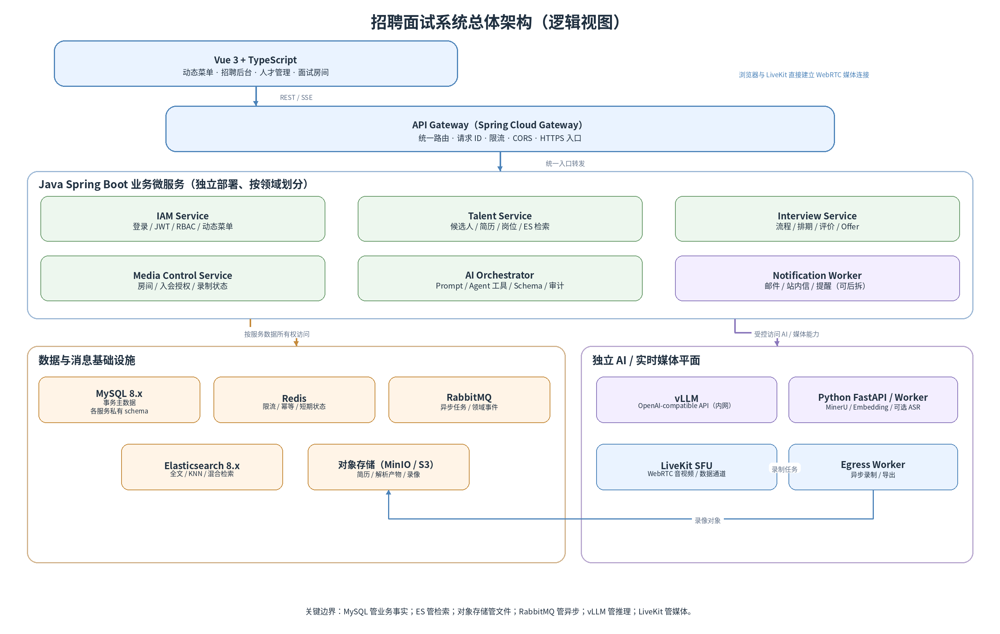

# 招聘面试系统技术架构与开发路线指导书

**版本：** V1.0  
**制定日期：** 2026-10-17  
**适用范围：** 招聘面试系统毕业设计；前端 Vue 3；后端以 Java 为主，按需使用 Python/FastAPI；MySQL + Elasticsearch；vLLM 推理；支持 1 对 1 与 1 对多（最多 1 对 5）在线面试。

> 本方案以团队提供的三个子系统题目为需求基线。文中涉及的并发数量、延迟指标均为建议的阶段性验收目标，必须通过指定硬件、网络和模型配置下的压测验证，不代表未经测试即可达到的性能承诺。

## 0. 先给结论：统一技术决策

| 领域 | 建议选型 | 选择理由与边界 |
|---|---|---|
| 前端 | Vue 3 + TypeScript + Vite + Pinia + Vue Router + Element Plus | 适合业务后台、动态菜单、表单和状态管理；视频面试房间单独设计页面与状态机。 |
| Java 后端 | Java 21 + Spring Boot 3.5.x（或团队验证过的兼容稳定版本） | 业务事务、权限、状态流转、排期与数据一致性由熟悉 Java 的同学主导；通过 BOM 锁定兼容版本。 |
| 微服务入口 | Spring Cloud Gateway | 统一入口、路由、跨域、限流和请求 ID；网关不承载业务规则，也不替代服务端鉴权。 |
| 登录与授权 | Spring Security + JWT/刷新令牌 + 数据库 RBAC + 数据范围校验 | 菜单、按钮和 API 权限统一建模；前端隐藏按钮只是体验，不是安全边界。 |
| 业务数据库 | MySQL 8.x（部署时锁定具体小版本） | 关系数据、事务、排期、评分、流程和权限的主数据源。各服务逻辑上独立 schema/表所有权。 |
| 向量与全文检索 | Elasticsearch 8.x | 保存简历文本块、元数据和向量，支持关键词检索、向量 KNN 和混合检索；向量维度必须与 embedding 模型一致。 |
| 缓存/短期状态 | Redis 7.x | 限流、幂等键、验证码、临时在线状态、短期缓存；不能取代 MySQL 成为业务事实来源。 |
| 异步任务 | RabbitMQ | 简历解析、embedding、通知、录制后处理、AI 纪要等耗时任务异步执行。关键消息配置持久化、确认、重试、死信和幂等。 |
| 文件/录像 | S3 兼容对象存储（开发阶段可用 MinIO） | 简历原件、解析产物、录像、音频、导出文件与数据库分离；MySQL 保存元数据和对象 key。 |
| 在线音视频 | LiveKit（WebRTC SFU）+ 独立 Egress 录制服务 | SFU 负责媒体转发、房间与参与者连接；Java 只负责业务房间、入会凭证、权限和生命周期，不自行实现媒体服务器。 |
| 模型推理 | vLLM 提供 OpenAI-compatible API | Java/Python 使用统一 HTTP 接口调用，模型服务只在内网开放；模型与业务服务独立部署、独立限流。 |
| AI 编排 | Java AI Orchestrator（优先 Spring AI；也可用标准 HTTP 客户端） | 统一提示词、任务类型、模型参数、结构化输出、超时、限流、审计和人工复核，不允许各业务 Controller 直接随意调模型。 |
| Python 能力服务 | FastAPI + Worker，仅承接 Python 生态明显占优的任务 | 首先用于 MinerU 文档解析、BGE/FlagEmbedding embedding、可选 ASR；不承载用户、面试流程等核心事务。 |
| 本地部署 | Docker Compose + profiles + healthcheck | 所有同学通过同一份 compose 启动依赖；有 GPU 的机器再启动 vLLM profile。毕业设计阶段通常不需要 Kubernetes。 |
| 可观测性 | Spring Actuator/Micrometer + Prometheus/Grafana（按团队资源简化）+ 统一结构化日志 | 必须能追踪一次请求从网关、业务服务到 RabbitMQ、Python worker、vLLM 的全过程。 |

**最重要的边界：** Java 是业务事实与权限的最终责任方；Python 是可替换的算法/文档处理工作进程；vLLM 是推理引擎而不是业务服务；LiveKit 是媒体平面而不是面试流程数据库；MySQL 是事务主库，Elasticsearch 是可重建的检索索引。

## 1. 需求范围与优先级

### 1.1 三个题目映射成业务域

| 业务域 | 题目中的核心功能 | 第一阶段必须可演示的闭环 |
|---|---|---|
| 智能简历与人才管理 | PDF/Word/图片解析、结构化入库、标签、查重/去重、人岗匹配、硬条件筛选、人才库、跟进记录、人才画像 | 上传简历 → 异步解析 → 人工确认/修正结构化字段 → 保存 MySQL → 文本块与向量写入 ES → 按关键词/语义检索 → 对指定 JD 计算匹配结果。 |
| 面试管理 | 自定义流程、候选人阶段流水线、排期冲突、通知、面试官协同、评价表、结果流转、Offer 审批、AI 纪要 | 候选人进入岗位流程 → 安排面试 → 面试官评分 → 通过/待定/淘汰 → 自动产生下一阶段待办并保留操作审计。 |
| 在线面试 | WebRTC 音视频、屏幕共享、聊天、笔记、录制回放、1 对 1/1 对多、异步录播、AI 转写与评价、可选防作弊 | 面试管理创建场次 → 有权限者取得入会令牌 → 2 人和 1+最多 5 人加入 → 音视频/屏幕共享/聊天 → 结束会议 → 录制对象入库 → 生成转写/摘要草稿 → 面试官复核。 |
| 平台治理 | 统一登录、用户角色、管理员分配角色、按角色配置菜单、API 鉴权、审计 | 不同角色登录看到不同菜单；直接调用无权 API 也必须被拒绝；管理员调整角色后权限生效，并有审计记录。 |

### 1.2 分级做，不要第一版全做

- **P0（项目主线）：** 登录、RBAC/动态菜单、简历上传与结构化解析、MySQL 主数据、ES 检索与匹配、面试流程与排期、LiveKit 1 对 1 与 1 对多、基础录制、AI 面试摘要/评价草稿、Docker Compose 一键启动和压测报告。
- **P1（完成主线后）：** 录播异步面试、邮件通知、实时字幕或面试助手、简历查重、人才跟进提醒、混合检索与可解释匹配分数、录像权限与下载审计。
- **P2（有余力再做）：** 虚拟背景/美颜、复杂白板、强防作弊/人脸核验、招聘网站深度自动采集、跨地域多活、高可用集群。防作弊功能涉及隐私和误报，需明确告知、最小化收集并由人工复核。

**范围控制规则：** P0 闭环未完成之前，不以“多 Agent”“复杂工作流框架”“Kubernetes”“自研 WebRTC 服务”“全自动人事决策”为优先开发目标。

## 2. 总体架构



### 2.1 请求与数据链路

1. Vue 3 只访问 API Gateway；只有 LiveKit 的媒体连接由浏览器直接建立 WebRTC 连接。浏览器不得直连 MySQL、Elasticsearch、RabbitMQ、vLLM 或 Python worker。
2. Gateway 统一路由、处理跨域与限流，并传递/生成 `X-Request-Id`。各业务服务仍需完成 JWT 校验、权限判断和数据范围检查。
3. IAM 维护用户、角色、菜单、按钮/API 权限及数据范围；Talent 服务负责候选人、简历、岗位 JD、人才库及人岗匹配；Interview 服务负责流程、阶段、排期、评价和 Offer；Media Control 负责面试房间生命周期、入会授权与录制编排；AI Orchestrator 负责模型任务编排。
4. RabbitMQ 用于耗时或可重试的任务。事件里传业务 ID、任务 ID、对象存储 key 和版本号，不传大文件/大段音视频；消费者必须幂等。
5. MySQL 保存事务主数据；ES 保存可重建的全文/向量索引；对象存储保存二进制文件；Redis 保存短期状态和限流信息。一个服务不允许绕过另一个服务去读写其私有表。
6. vLLM 和 Python worker 与公共业务 API 隔离部署。模型繁忙或停止时，登录、排期、聊天、评分等非 AI 主流程必须仍可用；AI 任务显示排队/失败/可重试状态。

### 2.2 推荐的逻辑服务拆分

| 服务 | 语言/责任 | 主要数据责任 | 暴露接口/事件示例 |
|---|---|---|---|
| `api-gateway` | Java；路由、限流、统一入口、请求 ID | 无业务表 | `/api/iam/**`、`/api/talent/**`、`/api/interviews/**`、`/api/ai/**` |
| `iam-service` | Java；登录/刷新令牌、用户、角色、权限、菜单、操作审计 | `iam_*` | `GET /api/iam/me`、`GET /api/iam/menus`、角色授权 API |
| `talent-service` | Java；候选人、简历元数据、岗位/JD、标签、人才库、筛选、匹配结果、ES 检索 API | `talent_*`；管理自己的 ES index | `ResumeParseRequested`、`ResumeParseCompleted`、`EmbeddingRequested` |
| `interview-service` | Java；面试流程模板、阶段流转、排期冲突、评价表、结果、Offer | `interview_*` | `InterviewScheduled`、`InterviewStageChanged`、`EvaluationSubmitted` |
| `media-control-service` | Java；会议房间、参与者、入会权限、会议事件、录制状态、转写关联 | `media_*` | LiveKit token / webhook 处理；会议结束事件 |
| `ai-orchestrator-service` | Java；AI 任务、Prompt 版本、模型路由、结构化输出、工具白名单、人工复核状态、调用审计 | `ai_*` | `POST /api/ai/resume-match`、`POST /api/ai/interview-summary`、SSE 流式草稿 |
| `ai-worker` | Python/FastAPI + RabbitMQ worker；MinerU、文本清洗、分块、embedding、可选 ASR | 原则上不持有招聘业务主表 | 内网健康检查、解析/向量/转写任务；结果通过事件或内部回调返回 |
| `notification-worker`（可先作为模块） | Java；邮件/站内信/提醒和重试 | `notification_*` | 消费面试安排、结果流转等事件；后期可独立部署 |

**服务数量建议：** 逻辑上按上表划分边界；第一版可将通知 worker 暂留在 Interview 服务进程或单独消费者中，不要为了“微服务数量”增加无业务边界的小服务。Media Control 应尽早独立，因为媒体会话与普通 CRUD 的资源和故障特征不同。

### 2.3 同步调用与异步事件怎么选

- **同步 REST：** 登录、查询菜单、候选人详情、排期校验、获取入会令牌等用户等待结果且需要即时响应的操作。
- **异步 RabbitMQ：** PDF 解析、embedding、批量匹配、邮件发送、录像后处理、录音转写、AI 纪要生成等秒级到分钟级任务。
- **实时双向通信：** 面试房间内聊天/状态提示可通过 LiveKit Data Channel 或经授权的 WebSocket；聊天记录需按产品要求持久化，不能只保留在客户端内存。不要把音视频媒体流转发到普通 WebSocket 后端。
- **状态通知：** 异步任务初始返回 `taskId`，前端轮询或通过 SSE 收到 `PENDING/RUNNING/SUCCEEDED/FAILED`；不要让 HTTP 请求长时间阻塞等待 MinerU 或大模型完成。

### 2.4 微服务通信与数据一致性规则

1. 每个服务拥有自己的业务表；开发阶段可共用一个 MySQL 实例，但按 `iam_db`、`talent_db`、`interview_db`、`media_db`、`ai_db` 等 schema 逻辑隔离。
2. 禁止跨服务直接 SQL JOIN，禁止从另一个服务的表直接更新。需要摘要数据时通过 API 或领域事件获得本地快照。
3. 服务内的多表变更使用本地事务；跨服务流程采用事件驱动的最终一致性，不设计跨数据库大事务。必要时采用 Saga/补偿操作。
4. 事件生产端应采用 Outbox 或等效可靠发布方案；消费者以 `eventId`/业务唯一键去重；配置有限重试、指数退避、死信队列和人工重放入口。RabbitMQ 的 publisher confirms 与 consumer acknowledgements 是可靠交付设计的一部分。
5. 数据迁移通过 Flyway/Liquibase 版本化脚本执行；生产运行时不依靠 Hibernate 自动改表。

## 3. 代码仓库、目录与团队协作

### 3.1 推荐 monorepo

```text
recruitment-interview-platform/
├─ frontend/                         # Vue 3 + TS
├─ backend/
│  ├─ pom.xml                        # Maven parent，统一版本与插件
│  ├─ common/                        # 通用错误码、日志、RequestId；禁止放业务实体
│  ├─ contracts/                     # 跨服务 DTO/事件契约（向后兼容）
│  ├─ api-gateway/
│  ├─ iam-service/
│  ├─ talent-service/
│  ├─ interview-service/
│  ├─ media-control-service/
│  ├─ ai-orchestrator-service/
│  └─ notification-worker/           # 可以后建/先作为模块
├─ ai-worker/                        # Python + FastAPI + RabbitMQ consumer
├─ infra/
│  ├─ compose.yaml
│  ├─ compose.ai.yaml                # 仅需要时启用 GPU/vLLM
│  ├─ mysql/ migrations/ es/ livekit/
│  └─ prometheus/ grafana/
├─ docs/
│  ├─ architecture/ ADR/ API/ events/ runbook/
└─ scripts/                          # 初始化、压测、开发辅助脚本
```

`contracts` 只保存跨服务协议 DTO、事件 schema 和版本，不放 JPA Entity、Repository 或业务逻辑；否则会导致服务之间高度耦合。所有接口用 OpenAPI 描述，事件 schema 也要进入代码评审。

### 3.2 分支与合并规则

- 主干：`main` 保持可运行、可演示；短分支 `feat/<domain>-<short-name>`、`fix/<issue>`，通过 Pull Request 合并。
- 一个 PR 尽量只改一个业务目标；至少一名非作者同学评审；新增 API、数据库字段、消息事件必须同步更新契约与测试。
- 每个功能关联 Issue/任务卡，写清楚输入、输出、权限、失败处理、验收条件和负责人。
- CI 最低门禁：前端 lint/typecheck/build；Java compile + unit tests；Python lint/typecheck/tests；Docker 镜像构建；Flyway migration 验证。关键接口加集成测试。
- 不提交 `.env`、模型权重、简历样本中的真实个人信息、录像文件、访问密钥。用 `.env.example` 给变量名与示例值。

### 3.3 API 规范

- 统一前缀 `/api/<domain>/v1/...`；统一 JSON 响应结构，例如 `{ "code": "OK", "message": "success", "data": {}, "traceId": "..." }`。分页、错误码和时间格式统一；时间传 ISO-8601 或明确时区的格式。
- 用 DTO 做输入输出校验，不能直接把 JPA Entity 暴露给前端；敏感字段（手机号、邮箱、简历全文、录像 URL）按最小权限返回。
- `POST` 创建/发送通知/创建房间等可能被重试的操作支持 `Idempotency-Key` 或业务唯一键；更新状态需校验当前状态和版本。
- 错误响应使用统一错误码：参数错误、未登录、无权限、资源不存在、状态冲突、频率限制、下游超时、AI 任务失败等；返回 `traceId` 便于排查。
- 同步请求必须有连接/读取超时；调用下游设置超时、有限重试和熔断。对非幂等操作不能盲目重试。

## 4. 统一身份认证与角色/菜单权限设计

### 4.1 模型：RBAC + 数据范围控制

建议内置角色：`SUPER_ADMIN`（系统维护）、`HR_ADMIN`（招聘管理员）、`RECRUITER`（招聘专员）、`INTERVIEWER`（面试官）、`CANDIDATE`（候选人）。团队可以调整命名，但必须区分系统管理权限和招聘业务权限。

| 表 | 关键字段/说明 |
|---|---|
| `iam_user` | `id`、`username`、`password_hash`、`status`、`display_name`、`token_version`、创建/更新时间 |
| `iam_role` | `id`、`role_code`、`role_name`、`is_system_role`、状态 |
| `iam_permission` | `id`、`permission_code`、`permission_name`、`type`（`MENU/BUTTON/API`）、`parent_id`、路由/组件元数据或 API pattern、状态 |
| `iam_user_role` | `user_id`、`role_id`，唯一约束防重复 |
| `iam_role_permission` | `role_id`、`permission_id`，管理员勾选角色可见菜单及可操作权限 |
| `iam_data_scope`（或角色/用户字段） | `ALL/DEPARTMENT/ASSIGNED/SELF` 等业务数据范围，按业务复杂度逐步实现 |
| `iam_refresh_session` | 刷新令牌摘要、到期时间、撤销时间、设备/会话信息；不要明文存储长寿命令牌 |
| `iam_audit_log` | 操作者、动作、资源、结果、时间、IP/请求 ID；避免记录密码、令牌或完整简历内容 |

**菜单和操作权限可以在同一张权限表中统一管理，但含义必须不同。** 菜单权限控制“能否在导航看到某入口”；API 权限控制“能否调用接口”；数据范围控制“能看到哪些候选人/岗位/评价”。三者不能互相替代。

### 4.2 登录与请求流程

1. 用户提交账号密码，IAM 使用 BCrypt/Argon2 这类合适的密码哈希校验；成功后发短期 Access Token 与可轮换 Refresh Token。
2. Access Token 内只放稳定且必要的声明，如 `sub`、`roles` 或权限版本、`iss`、`aud`、`exp`；不要把全部菜单树塞进 JWT。Token 签名密钥通过环境变量/密钥管理提供，不进 Git。
3. 前端启动后调用 `/api/iam/me` 与 `/api/iam/menus` 获取当前用户资料和可用菜单。Vue Router 根据菜单构造可访问路由；按钮根据权限码控制显示。
4. 每个 Java 业务服务验证 JWT 签名、发行方、受众和过期时间，并在 Service/方法层做权限判断（如 `@PreAuthorize` 或等效授权器）；访问候选人、简历、评价、录像等资源时，还要校验所有权/分配关系/数据范围。
5. 退出登录或管理员禁用账号时撤销 Refresh Token 会话，递增 `token_version` 或使用 Redis 撤销策略；需要即时失效的高风险操作不能只依赖长有效期 JWT。
6. 管理员在“角色管理”中勾选菜单、按钮/API 权限并保存；后端写权限关系并审计。保护 `SUPER_ADMIN` 角色，防止普通管理员授予自己超级权限或误删最后一个系统管理员。

### 4.3 必测鉴权用例

- 候选人不能查看其他候选人的简历、面试结果和录像。
- 面试官只能访问被分配的场次及允许的候选人资料；未经授权不能导出全库。
- 前端隐藏按钮后，直接调用对应 API 仍返回 `403`。
- 管理员取消角色授权后，在约定的刷新/失效策略内权限被撤销。
- 禁用用户、过期令牌、被撤销刷新令牌都不能继续建立新会话。
- 下载简历和录像使用短期签名 URL 或经过鉴权的下载接口，不能把永久公共 URL 暴露给前端。

## 5. MySQL 与 Elasticsearch 数据设计

### 5.1 数据所有权建议

- MySQL 是业务记录的事实来源：用户、候选人、简历元信息、岗位、面试流程、排期、评分、Offer、房间与录制状态、AI 任务状态等。
- Elasticsearch 是检索投影：简历分块文本、向量、技能/教育/职位等可检索字段。索引可从 MySQL 业务数据与对象存储解析产物重建，不能成为唯一的业务数据来源。
- 对象存储保存原始简历、MinerU 输出文件、向量计算中间产物、录像与音频。数据库记录 `object_key`、文件 hash、大小、MIME、上传者、权限标签和生命周期状态。

### 5.2 建议的核心实体

- Talent：`candidate`、`resume`、`resume_version`、`resume_parse_task`、`candidate_skill`、`candidate_tag`、`job_posting`、`job_requirement`、`application`、`screening_rule`、`match_result`、`talent_followup`。
- Interview：`process_template`、`process_stage`、`application_stage_history`、`interview_schedule`、`interviewer_assignment`、`evaluation_template`、`evaluation_dimension`、`evaluation_record`、`evaluation_score`、`offer_record`。
- Media：`interview_room`、`room_participant`、`room_event`、`recording_asset`、`transcript_segment`、`interview_note`、`chat_message`（如要求持久化）。
- AI：`ai_task`、`prompt_version`、`model_config`（只记录配置引用，不存密钥）、`ai_result`、`agent_trace`、`ai_tool_audit`、`human_review`。

重要约束：手机号/邮箱可用于候选人去重，但需要规范化、脱敏和严格授权。简历版本不可覆盖式丢失；每次重新解析需记录 `resume_version`、解析器版本、模型版本、解析状态和人工修改来源。

### 5.3 简历解析与检索链路

1. 浏览器上传文件到后端或通过短期签名上传到对象存储；后端校验扩展名、真实 MIME、文件大小、病毒/恶意内容策略和访问权限，保存文件 hash 与对象 key。
2. Talent 服务创建 `resume_parse_task`，状态为 `PENDING`，发布 `ResumeParseRequested`。
3. Python worker 调用 MinerU 解析 PDF/图片/Word 等支持的输入，产出 Markdown/JSON 和结构化文件，保存到对象存储。CPU/GPU 资源不足时解析排队，不能占住用户的 HTTP 线程。
4. 解析结果返回 Talent 服务后进行 JSON Schema/Pydantic/Bean Validation 校验；将姓名、教育、工作经历、技能等规范化字段持久化到 MySQL，保留原始解析结果供追溯；低置信字段标注为“待人工确认”，不要把模型猜测当事实。
5. 采用语义分块：普通段落按标题/语义切分，工作经历尽量保持公司、职位、时间、职责在同块；表格单独分块并保留标题/列名/来源页码；每个 chunk 记录 `candidateId`、`resumeId`、`resumeVersion`、`chunkId`、`sectionType`、`text`、`modelVersion`、访问控制元数据。
6. Python worker 生成 embedding；由 Talent 服务的索引模块校验版本并写入 ES 8.x。向量维度必须和索引 mapping 与 embedding 模型输出维度严格一致；切换 embedding 模型时采用新索引重建/别名切换，不混存不同维度/语义空间。
7. 查询先执行硬性条件筛选（如岗位必须条件），再进行关键词/向量混合检索、候选重排或 LLM 解释；把评分分项和证据片段展示给招聘人员，AI 分数不能直接自动决定录用/淘汰。

### 5.4 ES 检索建议

- 第一版采用 `text` 字段用于 BM25/全文搜索，`dense_vector` 用于 KNN；通过 `candidateId`、`resumeId`、`resumeVersion`、可见范围、技能、地点、教育等过滤条件隔离结果。
- 对中文简历，先对比 ICU/IK 或经验证的中文 analyzer，使用固定样例集合评估分词效果；不要因为“向量搜索”而放弃关键词召回，技能名、证书名、公司名经常依赖精确匹配。
- 初始可采用“关键词召回 + 向量召回 + 简单融合/重排”的混合检索；保存检索参数、模型版本、分数和人工反馈，方便毕业设计报告解释效果。
- ES 的索引 mapping、settings、alias 和重建脚本入库管理；业务写入失败可通过事件或定时任务重试；避免 MySQL 已成功而 ES 暂时失败时数据永久缺失。

## 6. Java、Python 与 vLLM 的 AI 统一方案

### 6.1 两种可行方式与推荐

| 方案 | 做法 | 优点 | 成本/风险 | 适用场景 |
|---|---|---|---|---|
| A. Java 主导（推荐默认） | Java AI Orchestrator 用 Spring AI 的 OpenAI 兼容客户端，或使用标准 HTTP 客户端，调用内网 vLLM `/v1/chat/completions`；任务与权限在 Java 内实现。 | 大部分同学用熟悉的语言；事务、权限、审计、流式接口和主业务更容易统一；vLLM 更换模型时业务层改动少。 | MinerU、Embedding、ASR 等 Python 生态功能仍要接入；Spring AI 版本与 vLLM 的参数兼容性需做冒烟测试。 | 简历摘要、面试纪要、评价建议、匹配解释、结构化抽取、受控 Agent。 |
| B. Python AI 服务 | FastAPI + LangChain/LangGraph 或轻量自建流程，调用 vLLM；Java 通过 HTTP/事件调用。 | Python 的文档解析、embedding、ASR、实验和模型评测更自然；算法开发迭代快。 | 多出一套语言、部署、日志、类型、测试和权限边界；团队对 Python 不熟时会增加协作成本。 | 解析流水线、向量/ASR、复杂检索实验，或团队确实有人负责 AI 算法。 |
| C. 混合方案（最终推荐） | Java 控制业务与 Agent/工具权限；Python 只提供 MinerU、Embedding、ASR 等能力接口/异步 Worker；所有大语言模型推理统一走 vLLM。 | 保留 Java 为主的团队工作方式，又能复用 Python 生态；避免每个服务自行选择模型 SDK。 | 要制定清晰的 DTO、任务事件和版本规则。 | 最符合当前团队结构。 |

**结论：** 不必为了调用模型就把整个后端改写成 Python。vLLM 提供兼容 OpenAI 的 HTTP 服务，Java 通过 Spring AI 或普通 HTTP 客户端就能完成聊天补全和流式输出。只有需要 MinerU、BGE/FlagEmbedding、ASR 等 Python 工具时，才把它们放在独立 `ai-worker` 中。

### 6.2 统一 AI 调用链

```text
业务服务/前端
    -> ai-orchestrator-service（鉴权、配额、任务类型、traceId）
        -> 短任务：vLLM OpenAI-compatible API（受控并发、超时、流式输出）
        -> 长任务：RabbitMQ -> Python AI Worker（MinerU/Embedding/ASR）
        -> 需要检索：Talent Search API / ES（先做权限过滤，再取上下文）
    -> Schema 校验 -> 规则校验/安全检查 -> AI 草稿/评分解释
    -> 人工复核与确认 -> 写入正式业务状态
```

### 6.3 vLLM 接入配置要点

- vLLM 部署在有兼容 GPU/驱动的 Linux 机器或团队管理的推理节点；开发者电脑不必人人本地运行模型，只需访问开发环境的内网 endpoint。不要把 vLLM 端口直接暴露到公网。
- vLLM 启动后使用其 OpenAI-compatible HTTP API；在 Spring AI 中把 `base-url` 指向服务地址，并验证实际部署版本的 endpoint 路径、模型名、流式响应、结构化输出参数和错误格式。模型支持能力取决于所选模型与 vLLM 版本。
- 将 `modelName`、上下文长度、最大输出 token、温度、超时、并发上限等写入环境配置或模型配置表；按任务类型设置不同模板和 token 上限，避免摘要类请求被超长简历拖垮。
- 对 429/5xx/超时做有限重试和熔断；排队任务采用重试与退避；实时交互任务快速返回可理解的错误。避免所有服务在模型恢复时同时重试造成雪崩。
- 监控 vLLM `/metrics`、队列长度、请求量、首 token 延迟、生成 tokens/s、错误率、请求等待时间与 GPU 显存。模型推理有独立的并发/令牌预算，不与 WebRTC 媒体连接共享资源池。

示例（概念配置，具体属性以锁定的 Spring AI 版本为准）：

```yaml
spring:
  ai:
    openai:
      base-url: ${VLLM_BASE_URL:http://vllm:8000}
      api-key: ${VLLM_API_KEY}
      chat:
        completions-path: /v1/chat/completions
        options:
          model: ${VLLM_MODEL_NAME}
          temperature: 0.2
```

注意：若客户端会把 `/v1/chat/completions` 自动拼接到 `base-url`，那么 `base-url` 应是 `http://vllm:8000`，不要重复写成 `http://vllm:8000/v1`；最终以实际客户端版本的路径规则为准。API key 即使是本地自建服务的内部 key，也应放在环境变量或密钥系统中。

### 6.4 Agent 开发统一规约

**所有 Agent 都按同一套“输入契约—检索—工具—模型—校验—人工复核—审计”流程实现。** 不允许同学各自直接在 Controller 里写一段 Prompt、调模型后就把结果写入数据库。

每个 Agent 必须登记：

- `agentCode`、负责人、版本、用途、输入 DTO、输出 JSON Schema、调用模型和版本、Prompt 版本、允许调用的工具列表、最大执行时间、最大 token、重试策略、异常处理和人工复核条件。
- 明确哪些字段是原始事实、哪些是模型推断、哪些需要用户确认；产出应附来源/证据片段，不能编造工作经历、技能或面试回答。
- 工具通过显式白名单注册，参数经过 schema 校验；工具层重复做服务端权限和数据范围检查。模型生成的工具调用仅是请求建议，不是安全授权。
- 读取数据可以按用户权限受限检索；发送通知、修改候选人阶段、淘汰、发 Offer、批量导出等有副作用的工具必须由服务端规则控制，关键操作要求人工确认。
- 记录 `traceId`、`taskId`、prompt/model 版本、检索引用、工具名、校验结果、运行时延与错误码；日志中对手机号、邮箱、简历全文、面试音频等敏感内容做脱敏或不记录。
- 提示词和模型版本变更进入 PR；使用固定评测集对结构正确率、事实准确率、证据引用、延迟和成本进行回归。模型输出不符合 Schema 时最多做受控修复/重试，失败必须返回可追踪的任务失败状态。

### 6.5 建议首先实现的 Agent/AI 能力

| 能力 | 输入与输出 | 实现建议 | 质量控制 |
|---|---|---|---|
| 简历结构化抽取 | 解析 Markdown/文本 → `education[]/experience[]/skills[]` 等 JSON | MinerU 负责版面/文档结构；LLM 仅做字段归一化、实体抽取和缺失字段标记 | Schema 验证；保留页码/段落证据；人工可编辑；低置信度标记。 |
| 人岗匹配 | 候选人结构化字段 + JD → 分项评分、命中/缺口、证据 | 规则硬过滤 + ES 混合检索 + embedding 相似度 + LLM 解释；分层打分而非单一“玄学分数” | 展示评分依据；硬条件与语义相似度区分；禁止模型单独作出最终录用决策。 |
| 面试纪要 | 转写段落/面试笔记 → 摘要、问答、待确认项 | 结束后异步生成，实时版本后置；引用 transcript segment ID/时间戳 | 必须能点回来源；讲话人识别不确定时标注未知；面试官确认后才归档。 |
| 面试评价建议 | 评价维度 + 经授权的问答片段 → 维度草稿/证据/待补充项 | 按固定评分 rubric 生成草稿，不自动提交正式评分 | 面试官必须审阅、修改和确认；避免推断年龄、性别、健康等与岗位无关的属性。 |
| 实时面试助手（P1） | ASR 流式文本 + 当前面试阶段 → 关键词提示/待追问建议 | 单独的低延迟队列和较短上下文，AI 不得阻塞媒体连接 | 提示仅给面试官；不向候选人泄漏隐藏评价/系统提示；高延迟时自动降级。 |

## 7. 在线面试与 1 对 1 / 1 对 5 并发设计

### 7.1 为什么采用 SFU，而不是自己用纯 Mesh

- 1 对 1 时点对点或 SFU 都能工作，但未来要支持面试官 1 对最多 5 名候选人、屏幕共享、录制和稳定扩展，建议从第一版采用 SFU 架构。
- 在 Mesh 中，每个浏览器通常需要向其他参与者分别上传媒体；参与者增多后客户端上行、编码和网络消耗快速增加。SFU 接收每位参与者的媒体流，再按订阅规则转发给其他参与者，更适合小型多人会议和服务端录制集成。
- 用 LiveKit 等成熟 SFU 实现媒体平面；Java `media-control-service` 用服务端 API 创建房间、生成短期 participant token、校验候选人/面试官身份、处理 webhook 和维护业务状态。

### 7.2 房间容量和角色规则

建议把“1 对 5”明确解释为 **1 名主面试官 + 最多 5 名候选人/参与者**，因此一个群面房间最多 6 人。如果题目实际定义为总人数最多 5 人，应在需求评审时调整配置，不能在代码里写死。

- `ONE_TO_ONE`：参与者上限 2；`ONE_TO_MANY`：主面试官 1 人，受邀候选人最多 5 人，上限 6。
- 房间业务状态：`CREATED → WAITING → LIVE → FINISHED`；异常可进入 `CANCELED/FAILED`。状态切换由 Media Control 校验并记录事件，不由前端直接改库。
- 入会流程：前端请求 `POST /api/media/rooms/{roomId}/join-token`；后端校验登录身份、预约时间窗口、参会人名单、房间状态和名额后生成短期 LiveKit token；token 只授予指定 room、identity 和允许能力，不授予管理员权限。
- 并发创建/入会需幂等：房间创建加业务唯一键；名额检查用数据库锁/原子更新/可靠的房间状态策略避免同时请求超员；以 LiveKit webhook 作为参与者进入/离开事件来源之一，但要验证 webhook 签名且做重复事件幂等。
- 媒体房间状态与招聘面试业务状态不同：面试预约是 `SCHEDULED`，房间连接是 `LIVE`；断网重连不应该自动把面试流程改成失败或淘汰。

### 7.3 1 对 5 带来的带宽和资源考虑

一个 6 人群面中，若每位参会者订阅其余 5 人的视频，则 SFU 可能需要转发约 6 × 5 = 30 条“接收端订阅流”（实际流量取决于分辨率、帧率、Simulcast/SVC、订阅策略和网络情况）。举例：如果每条被转发的视频流平均 0.8 Mbps，单个群面房间的媒体下行转发量量级约 24 Mbps，另有音频、协议和屏幕共享流量；这只是容量估算示例，不是固定码率或性能保证。

优化原则：

1. 使用 Simulcast/SVC（具体取决于客户端/服务端配置）并根据布局订阅合适质量；群面默认可使用 360p/540p、15-24 fps 等保守档，面试官放大某候选人时再提升画质，最终参数以设备与网络测试为准。
2. 摄像头视频、屏幕共享和录制是不同的资源项；限制同房间并发屏幕共享者，提供网络状态提示，支持断线重连。
3. 音视频媒体连接由 LiveKit 承载，Java 业务服务只处理信令/令牌/状态，避免把视频数据经过普通 Spring MVC 进程。
4. 录制采用独立 Egress 服务/worker；录制失败与面试业务结束分离，记录状态并重试，面试结束不能无限等待转码。
5. AI 转写从音轨或录制后文件进入单独 ASR 流程；不要把每个音视频帧送入 LLM。实时 ASR 应有独立资源上限，负载高时优先降级为会后转写。
6. 开放网络环境必须验证 STUN/TURN 与 UDP 端口、防火墙、HTTPS/WSS、NAT 穿透；本地同网段演示成功不代表跨校园网/手机热点可以成功。

### 7.4 初步容量目标与压测方法

建议先把以下目标写入验收标准，由团队在确定的服务器、GPU、网络和客户端设备上验证：

| 阶段 | 建议测试负载 | 通过标准（建议值，需实测校准） |
|---|---|---|
| 冒烟 | 2 个 1 对 1 房间 + 1 个 1 对 5 房间，通话至少 10 分钟 | 能入会、互相收发音视频、屏幕共享/聊天可用，断线重连后可恢复，房间结束状态正确。 |
| 基线并发 | 5 个 1 对 1 + 5 个 1 对 5 房间；约 40 个参与者 | 10 分钟以上稳定通话；无持续性音视频中断；房间名额不超限；录制和 AI 后处理不拖垮业务 API。 |
| 扩展目标 | 10 个 1 对 1 + 10 个 1 对 5 房间；约 80 个参与者 | 作为项目的扩展验证目标；若硬件/带宽达不到，应报告瓶颈、测得容量与优化结果，不应伪造通过。 |
| API 压测 | 登录、候选人列表、日程查询、入会令牌等 HTTP 接口，按真实业务比例压测 | 非 AI 业务 API 建议目标：P95 < 300-500 ms（排除冷启动/跨网因素）；错误率、CPU、GC、连接池与 DB 慢查询均记录。 |
| AI 压测 | 并发提交简历解析/纪要任务，并发在线生成 | 记录任务吞吐、队列等待、首 token 延迟、完成延迟、错误率和 GPU 显存；确认 AI 积压不影响登录、面试通话和评分。 |

**压测工具分层：** k6/JMeter 测 HTTP 和任务提交；浏览器自动化或真实客户端做 WebRTC 多人音视频测试；Prometheus/Grafana 采集服务、MySQL、RabbitMQ、ES、LiveKit/Egress 和 vLLM 指标。仅用 JMeter 压接口不能证明音视频并发能力。

### 7.5 在线面试相关 API 草案

- `POST /api/interviews/{interviewId}/rooms`：由有权限的面试管理用户创建房间，需幂等。
- `POST /api/media/rooms/{roomId}/join-token`：返回短期入会 token 与 LiveKit URL；只允许白名单参会者。
- `POST /api/media/rooms/{roomId}/finish`：请求结束房间/会议，校验状态与权限。
- `POST /internal/media/livekit/webhook`：服务端处理已签名的入会、离会、录制事件。
- `GET /api/media/rooms/{roomId}/recordings`：鉴权后返回录制状态和短期可访问地址。
- `POST /api/ai/interviews/{interviewId}/summary-tasks`：创建纪要任务，返回 `taskId`；`GET /api/ai/tasks/{taskId}` 查询状态。

## 8. 关键业务流程设计

### 8.1 简历到人才库

```text
上传简历 -> 文件校验/对象存储 -> 创建解析任务 -> RabbitMQ
    -> Python MinerU -> 结构化结果/Markdown -> Talent 校验与人工纠错
    -> MySQL 保存版本 -> 分块/Embedding -> Elasticsearch 索引
    -> 硬条件筛选 -> 关键词/向量混合检索 -> 匹配解释与证据 -> HR 复核
```

需要处理：重复上传 hash 去重；同一个人多份简历合并应提供候选人合并审核；语义查重只作为候选提示，不能单凭向量分数自动删除记录；解析失败支持重试与重新解析，且保留旧版本。

### 8.2 面试流程与日程

```text
岗位/候选人申请 -> 流程模板实例化 -> 当前阶段待办
    -> HR/面试官排期（检查双方日历和时间冲突） -> 通知任务
    -> 面试完成 -> 评价表提交（维度/评分/证据）
    -> 业务规则校验 -> 通过/待定/淘汰/转岗
    -> 产生下一阶段待办或 Offer 审批 -> 审计与通知
```

- 状态流转使用显式状态机/领域方法，不允许 Controller 任意写 `status` 字符串。
- 排期冲突检查要同时验证面试官、候选人和资源（如有会议室）；对并发预约使用数据库事务、唯一/排它约束或锁策略，避免“先查无冲突，随后两人同时预约成功”。
- 评分模板需要版本化；评分结果记录模板版本、评分维度、评语、提交人和时间，避免后续修改模板影响历史结果。
- 自动流转必须有明确规则；淘汰原因、待定原因和转岗信息必填字段可配置；高影响决策要人工确认。

### 8.3 会议结束后的录制与 AI 处理

```text
LiveKit room finished
  -> Egress 录制任务/录制完成 webhook
  -> 对象存储写入视频/音频 + MySQL 更新 recording status
  -> 异步 ASR/转写（可选）
  -> AI 纪要/评价建议任务
  -> Schema 与权限校验 + 人工修改/确认
  -> 存档并关联面试场次
```

处理好失败补偿：录制正在进行时服务重启、Egress 失败、对象存储上传失败、ASR 任务失败、AI 结果格式不合法、面试官重复点击“生成摘要”等都必须有明确状态与幂等策略。

## 9. 工程质量、安全和运维规则

### 9.1 安全底线

- 简历、候选人资料、面试录像和转写属于敏感个人信息场景；最小权限访问、传输加密、对象存储私有桶、短期签名链接、审计下载和设定保留期限。
- 上传文件检查 MIME/大小/内容，不将用户文件名直接作为服务器路径；防止路径穿越、压缩包炸弹、恶意文件和任意 URL 解析。
- 不把简历原文、手机号、邮箱、完整转写默认写入应用日志；开发测试使用虚构或去标识化数据。
- AI Prompt 中把简历/转写当作不可信数据，防范 Prompt Injection；检索到的文档文本不得自动变成指令。Agent 不得接受简历内容中“调用某工具/输出系统提示”等指令。
- AI 输出的招聘评分/纪要需要证据、人工审查和可追溯；不采集/推断与岗位无关的敏感属性，不把 AI 分数作为唯一招聘决策。
- API 设置用户/角色/接口级速率限制；AI 接口额外设置每用户/每岗位配额、最大 token 和并发信号量，避免高成本请求滥用。

### 9.2 可观测性与故障降级

- 每个 HTTP 请求、消息事件和 AI 任务贯穿 `traceId`/`taskId`/`eventId`；日志记录服务、耗时、下游调用和错误码，不输出密钥与原始敏感文本。
- 监控接口延迟和错误率、JVM heap/GC、线程池、连接池、MySQL 慢查询、ES search/index latency、RabbitMQ 队列堆积/重投递/死信、Redis 命中率、对象存储错误、LiveKit participants/packet loss/recording jobs、vLLM waiting/running requests 与 GPU 显存。
- 依赖异常要可降级：ES 不可用时允许登录与面试主流程工作；vLLM 不可用时保留人工填写评价；Python worker 不可用时任务进入队列或失败可重试；Egress 失败标记录制未完成但不阻止手动完成面试流程。
- 先用健康检查、结构化日志、基础指标和 Docker Compose healthcheck；不要一开始就引入完整 Kubernetes、服务网格或分布式追踪平台，除非团队已有经验。

### 9.3 测试金字塔

1. **单元测试：** 状态机转换、权限判断、排期冲突、评分计算、匹配规则、AI 输出 Schema 校验。
2. **集成测试：** MySQL/Flyway、ES mapping 与检索、RabbitMQ 重试/幂等、MinIO 上传/下载、vLLM mock/真实冒烟、Python worker 结果回传。
3. **端到端测试：** 不同角色登录、简历上传到检索、安排面试到评分流转、创建房间到录制回放、AI 草稿到人工确认。
4. **性能测试：** HTTP API、事件处理吞吐、ES 混合检索、vLLM 排队、真实 WebRTC 房间并发和录制压力要分别测试。
5. **故障注入：** 关闭 vLLM、Python worker、ES、RabbitMQ 或 Egress，检查状态是否可恢复、消息是否丢失、主业务是否可用。

## 10. 十周落地路线与阶段验收

> 下面按 10 周规划，AI/媒体两个高风险点在第一周就做技术验证。若团队人数较少，可延长周数，但不要把前置验证推迟到最后。

| 周次 | 主目标 | 主要任务 | 阶段验收（必须可展示） |
|---|---|---|---|
| 第 1 周：需求冻结与技术验证 | 先验证最大风险 | 明确“1 对 5”是 6 人含面试官；定义角色/菜单/API 权限；选择版本；搭仓库与 Compose；分别做 vLLM HTTP 冒烟、ES KNN 冒烟、MinerU 样例解析、LiveKit 1+5 浏览器通话 spike。 | 一页架构决策 ADR；本地依赖一键启动；四个 spike 结果与设备/版本记录；不确定项和备选方案清单。 |
| 第 2 周：工程骨架与权限 | 把协作规范跑通 | Vue 3 工程、Gateway、IAM、MySQL migration、JWT、动态菜单、角色/权限管理、统一异常、日志与 traceId、PR/CI。 | 管理员/HR/面试官/候选人登录；管理员勾选角色菜单；越权 API 测试通过；其他服务能独立启动。 |
| 第 3 周：候选人/岗位基础 | 业务主数据可用 | Talent API、候选人和岗位 CRUD、简历上传、MinIO、文件权限、解析任务状态、基础标签/硬筛选。 | 上传文件能查到元数据与任务状态；未经授权不能访问文件；失败任务可重试。 |
| 第 4 周：解析与 ES 检索 | 完成 AI 简历链路 | Python worker/MinerU；结构化 JSON 校验；MySQL 结构化字段；chunk 规则；embedding；ES mapping、关键词与 KNN 检索、索引重建。 | PDF/复杂排版样例至少覆盖正常/失败/表格三类；解析结果人工可修正；可检索到简历并看到来源证据。 |
| 第 5 周：面试流程与排期 | 建立招聘业务闭环 | 流程模板、阶段实例/历史、日程冲突、评价模板、多人打分、通过/待定/淘汰、站内通知事件。 | 从候选人申请到一面评价和下一阶段待办走通；并发预约不会重复占用同一面试官时段。 |
| 第 6 周：AI 编排与匹配 | AI 能力标准化 | Java AI Orchestrator + vLLM；Prompt 版本、任务表、Schema 校验、限流/超时、简历匹配分项和证据、AI 纪要草稿。 | AI 故障不影响业务主流程；结果可追踪、可重试、可人工修改；同学不得自行绕开编排层直连模型。 |
| 第 7 周：在线面试核心 | 先实现稳定通话 | Media Control、LiveKit token、房间权限与状态、1 对 1、1+5、聊天、屏幕共享、断线重连、结束会议。 | 2 人与 6 人房间能稳定测试；未邀请者无法入会；超过房间上限被拒绝；入会/离会事件幂等。 |
| 第 8 周：录制、通知与转写 | 打通会后流程 | Egress 录制、对象存储、回放权限；邮件/站内通知；会后 ASR（若资源不足先实现上传音频转写）；AI 摘要/评价复核。 | 结束面试后录制状态明确；录像只对授权用户可用；AI 结果可回溯至转写片段。 |
| 第 9 周：压测、安全与异常恢复 | 以数据证明工程质量 | 基线和扩展 WebRTC 压测；HTTP/API 压测；消息堆积与重试；ES/vLLM/worker/Egress 故障测试；权限、文件与 Prompt Injection 测试。 | 输出真实容量、瓶颈、P95、错误率、GPU/内存/带宽、队列等待等报告；所有 P0 缺陷有处理结论。 |
| 第 10 周：冻结与答辩材料 | 可部署、可解释、可演示 | 修复集成缺陷；数据库初始化与演示数据；部署文档、架构图、接口文档、测试用例、AI 评估样例、答辩脚本和已知限制。 | 新电脑按 README 能启动；全链路演示不依赖开发者本机状态；报告与系统行为一致。 |

### 10.1 可并行的责任分工（按能力而不是按人名）

- **平台/后端负责人：** Gateway、IAM、数据库 migration、服务契约、CI、代码评审与集成分支。
- **人才与检索负责人：** Talent 领域、上传/MinIO、MySQL 实体、ES 检索、匹配规则与样例评测。
- **面试业务负责人：** 流程状态机、排期冲突、评价表、Offer/通知、权限用例。
- **实时媒体负责人：** LiveKit 部署、房间授权、前端面试房间、录制 Egress、真实网络/并发验证。
- **AI 负责人：** vLLM 运行验证、AI Orchestrator 契约、Prompt/Schema、MinerU/embedding worker、AI 评测集。
- **前端负责人：** 后台布局、动态路由/菜单、候选人/人才/面试管理页面、视频面试交互和任务状态展示。

如果团队人数少，同学可以兼任，但**每个微服务必须有唯一明确的代码 Owner**，另有一名集成负责人。音视频与 AI 的高风险技术验证不能都拖到后期。

### 10.2 每阶段 Definition of Done

- API/事件/数据库变更有文档和 migration；权限校验由后端落实；错误路径和超时有处理；日志带 `traceId`。
- 至少一个单元测试和一个关键集成测试；关键 UI 有加载、空态、失败、重试状态。
- 功能可在 Compose 开发环境运行；没有硬编码 URL、账号密钥和本机路径；`.env.example` 已更新。
- PR 经评审通过；主分支能构建、关键 smoke test 通过；需求卡的验收标准可重复验证。

## 11. 部署拓扑与环境策略

### 11.1 开发与演示环境

- 用一个 `compose.yaml` 启动 MySQL、Redis、RabbitMQ、Elasticsearch、MinIO、LiveKit、Egress 和 Java/Python 服务；每个服务配置 healthcheck、资源限制和持久化卷。开发者没有 GPU 时，可通过 `ai` profile 连接团队共享 vLLM 服务或切换 mock 模型，不必本地下载大模型。
- 使用环境变量保存服务连接信息。开发、测试、答辩环境分别使用不同 `.env`；密钥不可提交 Git。给 MySQL/ES/RabbitMQ 的账号做最小权限，而不是所有服务都用 root/admin。
- Elasticsearch、RabbitMQ、vLLM 和 LiveKit 管理端口只开放给内网/本机；只有 HTTPS 入口及所需的 WebRTC UDP/TURN 端口对客户端开放。
- 数据卷需有初始化与备份脚本；答辩前用“干净环境启动”验证 README，避免依赖开发者本地残留容器、缓存和模型文件。

### 11.2 环境分层

| 环境 | 目的 | AI/媒体策略 |
|---|---|---|
| Local | 每位同学开发 | Compose 依赖；vLLM 可 mock 或连共享推理机；Media 可先本机/内网测试。 |
| Integration | 日常合并验证 | 使用固定测试数据、真实 MySQL/ES/RabbitMQ、共享 vLLM 和 LiveKit；禁止真实候选人数据。 |
| Demo/Defense | 答辩演示 | 固定部署版本与模型；使用准备好的虚构简历和面试数据；预跑媒体检查与录制检查。 |

## 12. 创新点如何做得有工程价值、如何在答辩中证明

| 创新点 | 工程实现 | 可展示的证据/指标 |
|---|---|---|
| 可解释的人岗匹配 | 硬条件筛选 + 关键词/向量混合召回 + LLM 解释；给出命中项、缺口、证据片段 | 自建 30-100 组虚构 JD/简历样例，比较纯关键词、纯向量和混合方法的 Recall@K/人工相关性；展示分项评分。 |
| 文档解析质量闭环 | MinerU 解析 + Schema 校验 + 人工纠错 + 解析版本管理 + 失败重试 | 报告字段准确率/可解析率、表格场景通过率、人工修正比例与平均耗时。 |
| 受控 Agent，而非简单套壳聊天 | 工具白名单、RBAC 再校验、结构化输出、审计、人工确认、高风险动作拦截 | 演示模型提出越权工具调用时服务端拒绝；Prompt Injection 样例不改变权限；结果能追踪 prompt/model 版本。 |
| 音视频与业务解耦 | Java 管理房间授权，LiveKit 负责 SFU，Egress 异步录制，AI 会后处理 | 展示 1 对 1/1+5、离会 webhook、录制重试；提交真实并发测试报告及瓶颈分析。 |
| 微服务可靠性 | RabbitMQ 异步任务、幂等消费、Outbox/重试/死信、链路追踪与故障降级 | 停掉 Python worker 或 vLLM 后主业务继续工作；恢复后任务可处理；重复事件不重复发通知/重复改状态。 |

## 13. 主要风险和决策门槛

| 风险 | 早期验证/应对 |
|---|---|
| GPU 或模型资源不足 | 第 1 周做 vLLM 冒烟和显存评估；无可用 GPU 时明确采用共享推理服务/小模型/mock 的开发策略，答辩报告真实硬件。 |
| MinerU/embedding 依赖安装复杂 | 独立 Python worker/容器，不污染 Java 环境；固定 Python 版本与依赖锁；CPU/GPU 解析结果分别验收。 |
| LiveKit 跨网连接失败 | 先验证 HTTPS、UDP、防火墙、TURN 和手机热点/校园网；不要只测本机局域网。 |
| 权限只做前端菜单 | 把越权 API 与数据隔离加入 CI/验收；服务端每次访问资源都鉴权。 |
| 微服务拆分过度 | 初期只拆清晰领域；通知可暂时作为 worker 模块；不引入无必要的注册中心、服务网格与 K8s。 |
| AI 幻觉/评分偏差 | 结果结构化、带证据、人工确认；保留失败状态和模型版本；建立固定评测集。 |
| 消息重复或丢失 | Event ID、Outbox/确认机制、幂等消费者、重试与死信监控；不要假设消息只会投递一次。 |
| 数据泄露 | 虚构测试数据；对象存储私有；短期签名 URL；敏感日志脱敏；最小化保留与下载审计。 |

## 14. 第一周必须完成的具体任务清单

- [ ] 全组评审本文件；确认 1 对 5 的人数口径、角色定义、P0/P1/P2 功能边界。
- [ ] 创建 Git monorepo、目录骨架、分支规范、PR 模板、Issue 模板、`.env.example`。
- [ ] 确认 Java/Spring Boot/Spring Cloud/Spring AI 兼容版本矩阵；提交依赖锁定，不允许每名同学随意升级。
- [ ] Compose 启动 MySQL、Redis、RabbitMQ、Elasticsearch、MinIO；补 healthcheck、持久化卷和初始化脚本。
- [ ] 用 curl/Java 客户端完成 vLLM OpenAI-compatible API 一次普通和一次流式调用；记录模型名、耗时、硬件和错误处理。
- [ ] 使用一份带表格/多栏的虚构简历跑通 MinerU，确认 Markdown/JSON 结果与 CPU/GPU 运行方式。
- [ ] 创建 ES 8.x index mapping，写入一条向量并执行一次 KNN 与一次全文查询；记录 embedding 模型与维度。
- [ ] LiveKit 完成两人和六人浏览器入会、音频/视频、屏幕共享、断线重连和一个录制样例；记录网络/端口限制。
- [ ] 确定每项任务 Owner、联调时间、代码评审人和验收人；把未知项登记到 ADR/风险清单。

## 15. 官方技术资料（实现时以锁定版本对应文档为准）

以下资料用于验证选型和 API 细节。不要混用不同主版本的配置示例；正式开发前固定版本号并按对应版本文档进行冒烟测试。

1. vLLM OpenAI-compatible server：<https://docs.vllm.ai/en/latest/serving/openai_compatible_server/>
2. vLLM production metrics：<https://docs.vllm.ai/en/latest/serving/metrics/>
3. Spring AI ChatClient、工具调用与 Advisor：<https://docs.spring.io/spring-ai/reference/api/chatclient.html>
4. Spring AI OpenAI-compatible client configuration：<https://docs.spring.io/spring-ai/reference/api/chat/openai-chat.html>
5. Spring Security OAuth2 Resource Server / JWT：<https://docs.spring.io/spring-security/reference/servlet/oauth2/resource-server/jwt.html>
6. Spring Cloud Gateway RequestRateLimiter：<https://docs.spring.io/spring-cloud-gateway/reference/spring-cloud-gateway-server-webflux/gatewayfilter-factories/requestratelimiter-factory.html>
7. Elasticsearch vector search：<https://www.elastic.co/docs/solutions/search/vector>
8. Elasticsearch dense_vector：<https://www.elastic.co/docs/solutions/search/vector/dense-vector>
9. LiveKit self-hosting：<https://docs.livekit.io/transport/self-hosting/>
10. LiveKit Egress recording/self-hosting：<https://docs.livekit.io/transport/self-hosting/egress/>
11. MinerU project and supported document formats：<https://github.com/opendatalab/MinerU>
12. RabbitMQ publisher confirms and consumer acknowledgements：<https://www.rabbitmq.com/docs/confirms>
13. Docker Compose startup order and health checks：<https://docs.docker.com/compose/how-tos/startup-order/>

---

## 最终执行原则

**先打通纵向闭环，再扩展横向功能；先隔离边界，再增加服务；先测通媒体与模型，再对外承诺并发；业务权限必须服务端校验；MySQL 管事实、ES 管检索、对象存储管文件、RabbitMQ 管异步、vLLM 管推理、LiveKit 管媒体；所有 AI 输出默认是建议草稿，所有跨服务任务必须能追踪、重试和审计。**
