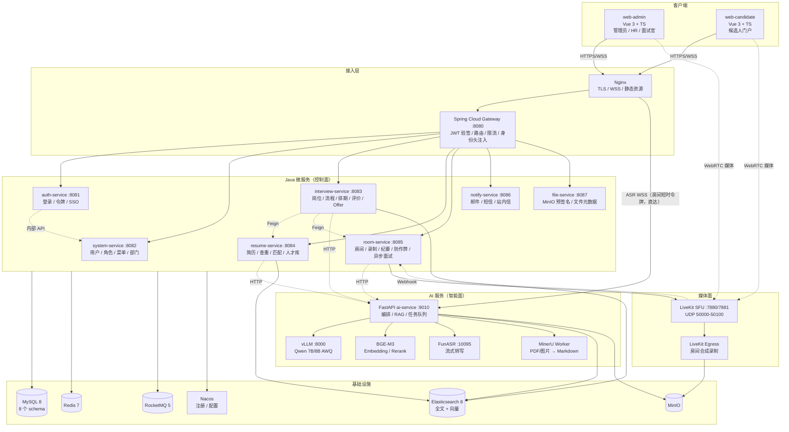
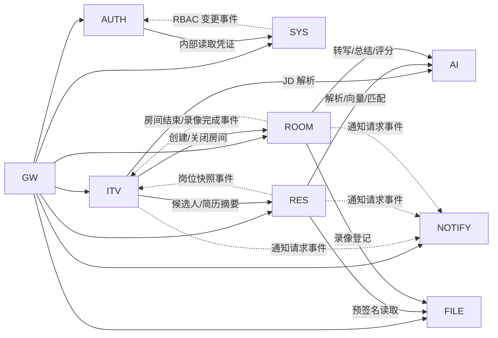
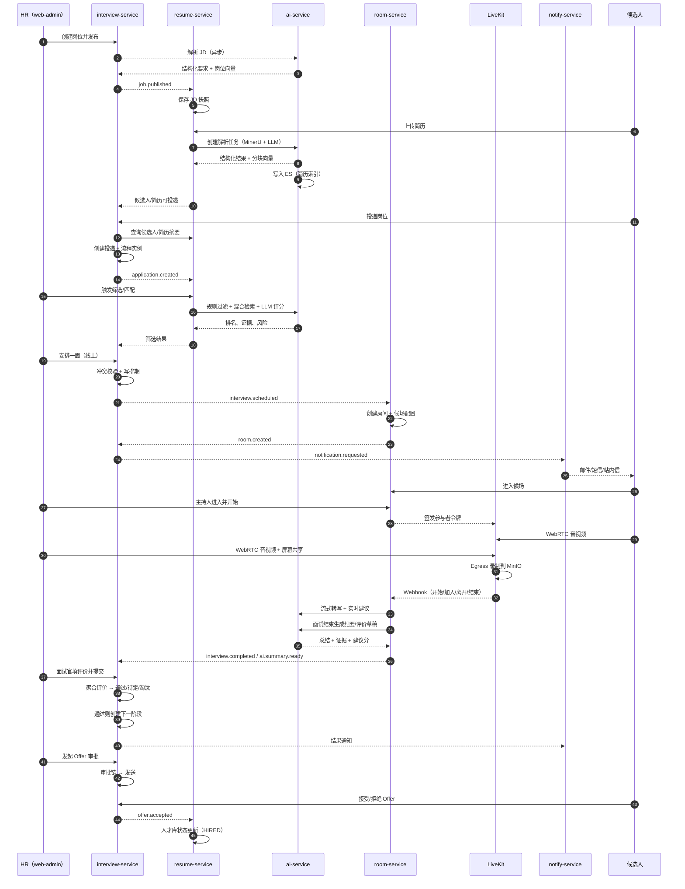
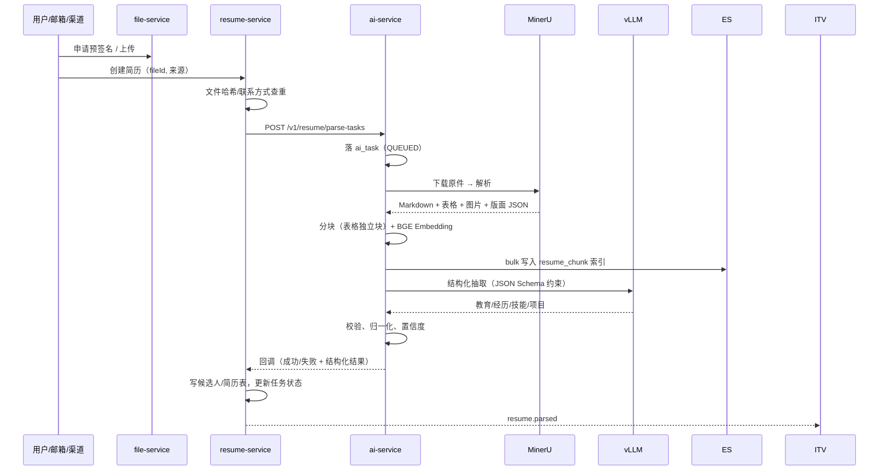
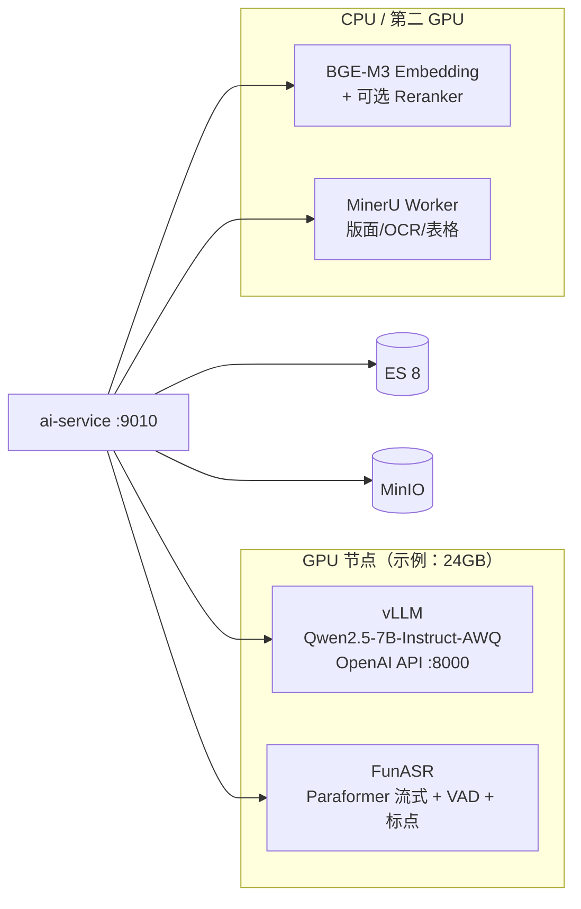
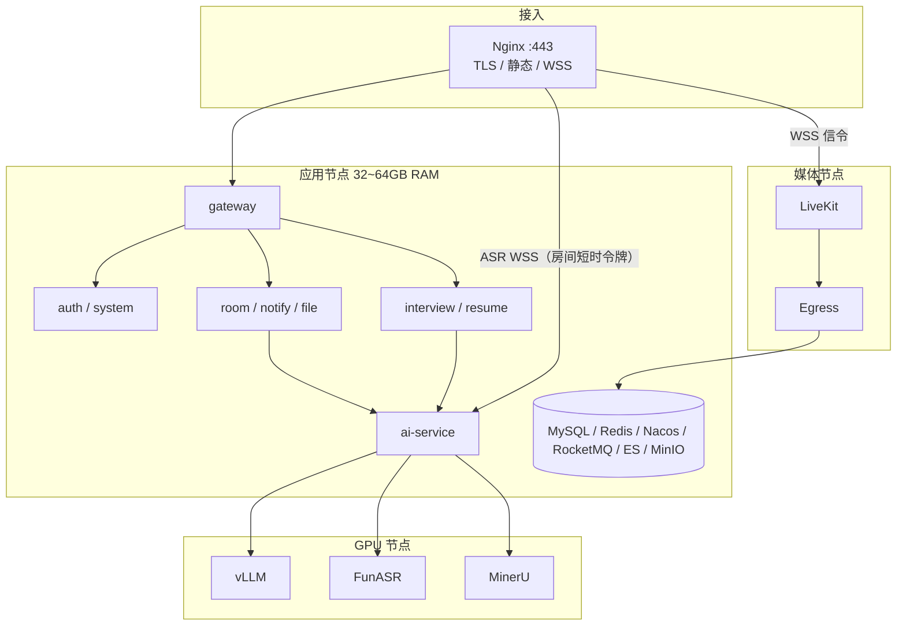

# 01 · 总体架构与微服务设计

> 本文回答：系统由哪些服务组成、边界在哪、如何通信、如何保证一致、三人如何并行开发。  
> 阅读顺序建议：总体图 → 服务清单 → 数据所有权 → 事件 → 关键流程 → 技术栈。

---

## 1. 设计目标与约束

### 1.1 目标

1. 三个子系统共用账号、权限、字典、文件、通知、AI 能力，避免三套用户体系。
2. 后端按业务域拆微服务，每个服务可独立开发、部署、扩容。
3. 统一登录鉴权，管理员能配置角色，并勾选角色可访问的菜单与按钮。
4. 在线面试支持 1v1 与 1v5（单房间最多 6 人），控制面与媒体面解耦。
5. AI 能力（解析、匹配、转写、总结、评价）可异步、可降级，不阻断核心招聘流程。
6. 数据表设计在三人之间保持一致：ID 语义统一、状态枚举统一、跨服务引用规则统一。

### 1.2 约束

| 约束 | 说明 | 应对 |
|---|---|---|
| 三人并行开发 | 需求三份、进度不同 | 契约先行、数据所有权隔离、每周集成 |
| 毕设周期 | 以 16 周为例 | MVP 优先，增强功能可裁剪 |
| 演示硬件有限 | 1 台应用机 + 1 张 GPU | Docker Compose；模型量化；AI 可 Mock |
| 校园网络 NAT | WebRTC 可能连不通 | LiveKit TURN/TCP 443 兜底；音频降级 |
| 毕设评价 | 需要体现设计深度 | 微服务一致性、混合检索、1v5 容量模型与压测、AI 人机协同 |

---

## 2. 总体架构

### 2.1 逻辑架构图



### 2.2 控制面 / 媒体面 / 智能面

| 平面 | 组成 | 职责 | 故障影响 |
|---|---|---|---|
| 控制面 | Gateway + 8 个 Java 服务 + MySQL/Redis/MQ | 账号、权限、流程、排期、房间元数据、文件、通知 | 登录、排期、进入房间受影响；已建立的音视频仍可继续 |
| 媒体面 | LiveKit SFU + Egress + TURN | 音视频转发、屏幕共享、录制 | 面试中断；业务数据和 AI 不受影响 |
| 智能面 | FastAPI + vLLM + BGE + ASR + MinerU + ES | 解析、检索、匹配、转写、总结、评价草稿 | 核心流程可继续；AI 任务排队或标记失败 |

> 答辩强调：三层解耦，AI 或媒体故障不会拖垮招聘流程。所有 AI 结果都是「建议/草稿」，人工可修改；面试录制不依赖 LLM。

---

## 3. 微服务清单

### 3.1 服务职责表

| 服务 | 核心职责 | 明确不负责 | 主要依赖 |
|---|---|---|---|
| **gateway** | 路由、JWT 验签、身份头注入、限流、CORS、访问日志、内部接口屏蔽 | 业务逻辑、权限判断（只做认证） | Redis、Nacos、auth 公钥 |
| **auth** | 密码/短信登录、验证码、令牌签发/刷新/注销、SSO、登录日志、强制下线 | 用户 CRUD、角色配置 | system（凭证查询）、Redis、MQ |
| **system** | 用户、角色、菜单、按钮权限、部门、字典、参数、操作日志；RBAC 管理 API；权限缓存 | 业务数据、登录令牌 | MySQL、Redis、MQ |
| **interview** | 岗位 JD、投递、流程模板与实例、排期与冲突、评价模板/评价、Offer 与审批、招聘统计 | 简历解析、房间媒体、消息发送 | resume、room、AI、file、notify（事件） |
| **resume** | 候选人主数据、简历版本、渠道接入、解析任务、结构化数据、标签、查重去重、筛选规则、匹配记录、人才库/跟进 | 岗位主数据、面试评价、媒体 | AI、ES、file、MQ |
| **room** | 房间生命周期、LiveKit 令牌、候场/踢人/静音、聊天、笔记、转写归档、录制、防作弊事件、异步面试、题库 | 媒体转发（LiveKit 做）、排期主数据 | LiveKit、AI、file、MQ |
| **notify** | 模板渲染、站内信、邮件/SMS 适配器、重试、发送日志、未读数 | 业务触发条件 | MQ、第三方通道 |
| **file** | 预签名上传、分片上传、文件元数据、下载 URL、校验、生命周期 | 文件内容解析 | MinIO、MySQL |
| **AI** | 文档解析、分块、Embedding、ES 索引、RAG、匹配评分、ASR、总结、评价草稿、人脸比对、AI 任务管理 | 业务状态、权限、排期 | vLLM、FunASR、MinerU、ES、MinIO、Redis、MQ |

> 如果 12 周内做不完，可把 `file` 合并进 `system`、`notify` 合并进 `interview`，但**数据表归属和 API 契约不要变**；微服务的边界比进程数量更重要。

### 3.2 服务端口与 schema

| 服务 | HTTP 端口 | schema | Flyway 目录 |
|---|---|---|---|
| gateway | 8080 | — | — |
| auth | 8081 | `recruit_auth` | `db/migration/auth` |
| system | 8082 | `recruit_system` | `db/migration/system` |
| interview | 8083 | `recruit_interview` | `db/migration/interview` |
| resume | 8084 | `recruit_resume` | `db/migration/resume` |
| room | 8085 | `recruit_room` | `db/migration/room` |
| notify | 8086 | `recruit_notify` | `db/migration/notify` |
| file | 8087 | `recruit_file` | `db/migration/file` |
| AI | 9010 | `recruit_ai` | `ai/migrations` |
| vLLM | 8000 | — | — |
| FunASR Runtime | 10095 | — | — |
| LiveKit | 7880/7881 | — | — |

> 所有服务共用一个 MySQL 实例也可以，但**逻辑 schema 必须隔离**；服务账号只授予自己 schema 的读写权限。生产可拆实例，代码不变。

### 3.3 公共 Maven 模块

```
recruit-parent                 版本与依赖管理
recruit-common
├── common-core                统一响应、错误码、异常、雪花 ID、工具
├── common-web                 MVC 配置、全局异常、请求日志、Jackson（Long→String）
├── common-security            登录用户上下文、权限校验器、数据范围注解、Feign 透传
├── common-mybatis             MyBatis-Plus 配置、自动填充、逻辑删除、乐观锁、数据范围拦截
├── common-redis               RedisTemplate、缓存 Key 规范、分布式锁
├── common-event               Outbox、RocketMQ 生产者/消费者、事件常量、幂等
├── common-ai                  AI 服务客户端、任务回调签名、超时/重试/熔断
└── common-log                 操作日志、TraceId、脱敏
```

三个人的业务服务只依赖 common 模块，不复制粘贴鉴权代码。

---

## 4. 服务调用规则

### 4.1 同步调用

适用场景：

- 用户请求路径上的读操作（如投递详情需要候选人摘要）。
- 必须立即得到结果的校验（如排期前查询候选人是否已有冲突面试）。
- 创建房间、获取录制播放地址等控制面操作。

规则：

1. 只允许 **一跳** 业务 Feign；禁止 A→B→C 的同步链（读多服务数据用快照或聚合接口）。
2. 超时：GET 800ms，写操作 1500ms；仅 GET 允许重试 1 次。
3. 熔断：Sentinel/Resilience4j；失败返回可解释的降级数据（如「候选人信息加载失败」而不是整页 500）。
4. 内部接口统一 `/internal/**`，网关禁止外部访问；Feign 携带 `X-Internal-Token` 与用户令牌透传。
5. 服务间不共享数据库连接，不跨 schema 写。

### 4.2 异步事件

适用场景：

- 状态变化通知（排期成功 → 发通知、建房）。
- 跨服务数据同步（岗位发布 → 简历服务保存 JD 快照）。
- 耗时任务（解析、匹配、总结、异步评分、录制完成处理）。

规则：

1. 本地事务 + Outbox 表，事务提交后由 Relay 投递 RocketMQ。
2. 事件带 `eventId`、`eventType`、`occurredAt`、`aggregateId`、`version`；消费端按 `eventId` 幂等。
3. 同一聚合根用 `aggregateId` 作为消息 Key，保证分区内有序。
4. 消费失败重试 3 次（指数退避），仍失败进入死信表并告警，人工补偿。
5. 事件 Schema 版本化，新增字段向后兼容，不删除旧字段。

### 4.3 依赖方向



> 说明：箭头不代表数据库依赖；所有跨服务读写都走 API 或事件。

---

## 5. 数据所有权与统一契约

### 5.1 主数据归属

| 实体 | 归属服务 | 其他服务持有方式 |
|---|---|---|
| 账号 `sys_user` | system | 只存 `user_id`；显示名用登录态或快照 |
| 角色/菜单/权限 | system | 只存权限码；运行时从缓存读取 |
| 候选人 `candidate` | resume | interview/room 存 `candidate_id` + 姓名/手机号快照 |
| 简历 `resume` | resume | interview 存 `resume_id` + 版本号；展示时按需读取 |
| 岗位 `job` | interview | resume 存 `job_id` + `cand_job_snapshot` 快照 |
| 投递 `application` | interview | room 存 `application_id`；通知事件带业务 ID |
| 排期 `schedule` | interview | room 存 `schedule_id`；AI 不感知排期 |
| 房间 `room` | room | interview 存 `room_id` / `room_no` 快照 |
| 评价 `evaluation` | interview | 其他服务不持有；统计通过 API/事件 |
| 文件 `file` | file | 各服务只存 `file_id` |
| AI 任务 `ai_task` | AI | 业务服务存 `ai_task_no`，本地维护对用户展示的状态 |
| 消息 `message` | notify | 业务服务只发事件，不直接写消息表 |

### 5.2 统一 ID 规则

- 所有主键使用 **雪花 ID（BIGINT）**，由各服务本地生成，WorkerId 从 Nacos/环境变量分配。
- Java 序列化为字符串，前端 TypeScript 用 `string`；禁止用 JS `number` 承载 ID。
- 跨服务引用只存 ID，不建物理外键；服务内部也建议只建索引，不建外键（便于拆库与数据迁移）。
- 业务编号（如 `application_no`、`room_no`）单独生成，面向用户展示，不能替代主键。

### 5.3 统一时间与状态

- 数据库存 UTC（`DATETIME(3)`），应用写入使用 `Instant`；API 返回 ISO 8601（如 `2026-11-02T10:00:00+08:00`）。
- 枚举用 `VARCHAR(32)` 存代码，不用 MySQL `ENUM`；所有枚举在 `docs/02-database.md` 维护字典。
- 状态流转必须在服务端校验，不能只靠前端；关键状态表加 `version` 乐观锁。

### 5.4 展示快照

为避免跨服务 JOIN 和 N+1：

- `itv_application` 冗余 `candidate_name`、`job_title`、`resume_version`。
- `room_room` 冗余 `candidate_name`、`job_title`；`room_participant` 冗余 `display_name`。
- 快照只用于展示；候选人改名后通过事件异步刷新，历史面试保留当时快照。

---

## 6. 领域事件设计

### 6.1 Topic 规划

| Topic | 生产者 | 主要事件 |
|---|---|---|
| `recruit-system-topic` | system/auth | `user.created`、`user.disabled`、`role.changed`、`menu.changed`、`permission.changed` |
| `recruit-interview-topic` | interview | `job.published`、`job.closed`、`application.created`、`application.stage.changed`、`interview.scheduled`、`interview.canceled`、`interview.completed`、`evaluation.submitted`、`offer.sent`、`offer.accepted` |
| `recruit-resume-topic` | resume | `resume.uploaded`、`resume.parsed`、`resume.parse.failed`、`candidate.merged`、`screening.completed`、`talent.entered`、`talent.follow.due` |
| `recruit-room-topic` | room | `room.created`、`room.started`、`room.ended`、`recording.completed`、`transcript.ready`、`ai.summary.ready`、`async.submitted`、`cheat.alert` |
| `recruit-ai-topic` | AI | `ai.task.succeeded`、`ai.task.failed`、`ai.summary.generated` |
| `recruit-notify-topic` | 各服务 | `notification.requested`（统一通知请求） |

### 6.2 关键事件载荷

```json
{
  "eventId": "uuid",
  "eventType": "interview.scheduled",
  "eventVersion": 1,
  "occurredAt": "2026-10-17T12:00:00Z",
  "traceId": "…",
  "aggregateId": "applicationId",
  "payload": {
    "scheduleId": "…",
    "applicationId": "…",
    "candidateId": "…",
    "jobId": "…",
    "mode": "ONLINE",
    "startTime": "2026-11-02T02:00:00Z",
    "endTime": "2026-11-02T03:00:00Z",
    "interviewerIds": ["…"],
    "roomId": null
  }
}
```

> 载荷只带 ID 和必要快照；消费方需要更多数据时回查 API，避免事件变成「大数据传输」。

### 6.3 主要消费关系

| 事件 | 消费方 | 动作 |
|---|---|---|
| `role.changed` / `menu.changed` | auth、各服务 | 递增权限版本，清缓存；令牌校验可选递增 token version |
| `job.published` | resume | 写入/更新 JD 快照，解析要求，触发岗位 Embedding |
| `job.closed` | resume | 停止匹配/推荐，标记快照关闭 |
| `application.created` | resume、notify | 更新候选人活跃度；发送投递确认 |
| `interview.scheduled` | room、notify | 创建房间（线上）；发送邀约（邮件/短信/站内信） |
| `interview.canceled` | room、notify | 关闭房间；发送取消通知 |
| `interview.completed` | resume、AI、notify | 更新人才画像输入；生成总结；通知 HR |
| `recording.completed` | file、interview | 登记录像文件；更新面试记录 |
| `candidate.merged` | interview、room、system | 刷新活跃引用；历史记录保留原 ID；必要时禁用次要登录账号 |
| `talent.follow.due` | notify | 发送跟进提醒 |
| `ai.task.failed` | 对应业务服务 | 标记任务失败；UI 提示重试 |

### 6.4 一致性场景

| 场景 | 一致性方案 |
|---|---|
| 创建排期 + 建房 | interview 本地事务写排期，状态 `ROOM_PENDING`；Outbox 发 `interview.scheduled`；room 消费建房并回发 `room.created`；失败重试，超过阈值标记「房间待处理」，HR 可手动重试 |
| 取消排期 | interview 先置取消，事件通知 room 关闭房间；房间关闭失败由补偿任务扫描（排期已取消但房间仍活跃） |
| 候选人合并 | resume 选主、迁移简历/标签、写合并记录，发 `candidate.merged`；interview/room 更新活跃引用；历史投递不删除，展示按 canonical 归并 |
| Offer 审批 | 单服务本地事务 + 审批任务表；审批通过后发 `offer.approved`，通知服务发 Offer；不在微服务间开分布式事务 |
| 简历解析失败 | 本地记录失败原因，AI 任务重试；人工可重新触发；不阻塞上传 |
| ES 与 MySQL 不一致 | 以 MySQL 为准；索引写入失败进重试表/事件；提供按 `resume_id` 重建索引的管理接口 |

> 不引入 Seata 的理由：本系统跨服务写操作少且均可补偿；Outbox + 状态机更轻，也更容易在论文中解释。若答辩要求强一致，可对 Offer 审批单独引入 Seata AT，作为扩展实验。

---

## 7. 关键业务流程

### 7.1 端到端主流程



### 7.2 简历解析流水线（概览）



### 7.3 排期冲突与建房

1. 校验候选人、面试官、房间三方的重叠：`start < existing.end AND end > existing.start`。
2. 用 Redis 锁 `lock:schedule:{interviewerId}:{yyyyMMdd}` 串行化同一面试官当天的安排；事务内二次查询冲突。
3. 写 `itv_schedule` 与 `itv_schedule_interviewer`，状态 `CONFIRMED`（线下）或 `ROOM_PENDING`（线上）。
4. Outbox 发 `interview.scheduled`；room 创建房间、生成 `room_no`，回发 `room.created`；interview 更新 `room_id`/`room_no`。
5. notify 消费事件，按模板发送邀约；发送失败重试并记录。

---

## 8. 前端架构

### 8.1 两个应用 + 一个共享包

```
frontend/
├── pnpm-workspace.yaml
├── apps/
│   ├── admin/                 # 管理员、HR、面试官
│   │   ├── src/views/
│   │   │   ├── interview/     # A 负责
│   │   │   ├── resume/        # B 负责
│   │   │   ├── room/          # C 负责
│   │   │   └── system/
│   │   └── src/router/
│   └── candidate/             # 候选人门户
│       ├── src/views/resume/
│       ├── src/views/application/
│       ├── src/views/interview/
│       └── src/views/offer/
└── packages/
    ├── shared/                # axios、鉴权、权限指令、类型、组件
    └── livekit/               # 房间 hook、设备检测、Track Processor
```

### 8.2 动态菜单与路由

1. 登录后调用 `GET /api/system/menus/routes?app=ADMIN|CANDIDATE`。
2. 后端根据 `sys_menu.app_code` + 用户角色返回树；只返回 `type=DIR/MENU`，按钮权限单独返回 `permissions[]`。
3. 前端用 `import.meta.glob('@/views/**/*.vue')` 将 `component` 字符串映射为组件；找不到组件时渲染 404 页并记录告警。
4. 路由守卫：无 token → 登录；无路由权限 → 403；页面按钮用 `v-perm="'interview:schedule:create'"`。
5. 角色菜单变更后，管理员无需重新登录；前端下一次拉取菜单即生效；权限缓存版本变化通过 SSE/轮询可选。

### 8.3 管理端信息架构

```
工作台
招聘管理
├── 职位管理
├── 候选人流程
├── 面试日程
├── 面试安排
├── 评价中心
├── Offer 管理
└── 招聘漏斗
简历与人才
├── 简历库
├── 解析任务
├── 人岗匹配
├── 筛选规则
├── 人才库
└── 跟进提醒
在线面试
├── 面试房间
├── 面试监控
├── 录像回放
├── 异步面试
├── 题库
└── 防作弊报告
AI 能力
├── AI 任务
└── 提示词与模型（管理员）
系统管理
├── 用户 / 角色 / 菜单 / 部门
├── 字典 / 参数
├── 通知模板
└── 登录日志 / 操作日志
```

候选人门户：首页 → 职位广场 → 我的简历 → 我的投递 → 面试邀请/在线面试 → 异步面试 → 我的 Offer → 消息中心。

### 8.4 前端关键技术

| 能力 | 方案 |
|---|---|
| 动态路由/按钮权限 | Vue Router + `menus/routes` API + `v-perm` |
| 请求封装 | Axios 拦截器：附带 access token；401 时用 refresh token 单飞刷新并重放请求 |
| 状态管理 | Pinia：`authStore`、`permissionStore`、`roomStore` |
| 在线面试 | `livekit-client` + 自研房间页；可选 `@livekit/components-vue` |
| 设备检测 | `navigator.mediaDevices`、麦克风电平、摄像头快照、网络质量 |
| 背景虚化 | `@livekit/track-processors`（MediaPipe），可开关 |
| 降噪 | `getUserMedia` 的 `noiseSuppression/echoCancellation/autoGainControl` + 可选 RNNoise WASM |
| 白板（可选） | Excalidraw + Yjs + y-websocket |
| 图表 | ECharts |
| 代码面试（可选） | Monaco Editor + Yjs 协同 |
| 大文件上传 | file-service 预签名 + 分片 + 断点续传 |
| 主键类型 | 所有 ID 用 `string`；接口文档明确 |

---

## 9. AI 服务边界

### 9.1 边界原则

1. AI 服务不访问业务库；只访问自己的 `recruit_ai`、ES、MinIO、Redis 和模型服务。
2. 业务服务向 AI 传 **文件 ID/预签名 URL + 业务上下文**；AI 返回结构化结果和 `ai_task_no`。
3. AI 处理结果通过回调或事件回传；业务服务是状态的最终写入方。
4. 所有结果带 `model`、`promptVersion`、`confidence`、`evidence`；评价类结果必须是草稿。
5. AI 服务可整体替换/Mock；业务侧用统一 `AiClient` 接口，不在业务代码里直连 vLLM。

### 9.2 模型部署拓扑



> 24GB 单卡不建议同时常驻 LLM + MinerU + ASR + Embedding；推荐 LLM 独占 GPU，MinerU/ASR 放第二张卡或 CPU（演示可接受较慢）。详细显存预算见 [04-ai.md](04-ai.md)。

---

## 10. 技术选型

| 层次 | 选型 | 版本基线 | 理由 | 替代方案 |
|---|---|---|---|---|
| 前端 | Vue 3 + TypeScript + Vite | Vue 3.5 / Vite 6 | 生态成熟、上手快、组件丰富 | React（团队不熟则不选） |
| UI | Element Plus | 2.x | 中后台组件完整；候选人门户可配合响应式 | Naive UI / Arco |
| 后端 | Spring Boot | 3.2.x / 3.3.x（按兼容矩阵锁定） | 微服务生态成熟、面试/答辩认可度高 | Spring Boot 2.7（不推荐，已停止主流支持） |
| 微服务 | Spring Cloud + Spring Cloud Alibaba | 2023.0.x / 2023.0.3.x | Nacos/Sentinel 组件齐全 | Dubbo 体系（团队不熟则不选） |
| 注册/配置 | Nacos | 2.4.x | 国内资料多、部署简单 | Consul + Apollo |
| 网关 | Spring Cloud Gateway | 对应 Cloud 版本 | 响应式、过滤器模型适合统一鉴权 | Nginx + Lua |
| 鉴权 | Spring Security 6 + JWT(RS256) | — | 标准化、无状态验签、可扩展 | Sa-Token（更简单） |
| ORM | MyBatis-Plus | 3.5.x（boot3 starter） | 国内团队熟悉、CRUD 快 | JPA |
| 数据库 | MySQL | 8.0.36+ | 需求指定；事务/JSON/索引满足 | PostgreSQL |
| 缓存 | Redis | 7.2 | 令牌、权限、锁、在线状态 | — |
| 消息 | RocketMQ | 5.x | 事务/顺序/重试完善；国内资料多 | RabbitMQ / Kafka |
| 搜索/向量 | Elasticsearch | 8.15.x + IK | 需求指定；BM25 + kNN + RRF 混合检索 | Milvus（需再引入，不选） |
| 对象存储 | MinIO | RELEASE.2025+ | S3 兼容、可本地部署、Egress 原生支持 | 阿里云 OSS |
| 媒体 | LiveKit + Egress | 1.x | 开源 SFU、Vue SDK、录制、屏幕共享、可自托管 | mediasoup（工程量大）、Janus |
| AI 服务 | FastAPI + Pydantic v2 | 0.115+ | 异步、类型校验、OpenAPI、Python 生态 | Flask（不推荐） |
| 模型服务 | vLLM | 0.7+/0.8+ | OpenAI 兼容、连续批处理、结构化输出 | Ollama（并发弱）、TGI |
| PDF 解析 | MinerU | 2.x | 版面/表格/公式/图片标题；需求指定 | PyMuPDF + 规则 |
| Embedding | BGE-M3 | — | 中文强、1024 维、长文本、多语言 | bge-large-zh-v1.5 |
| ASR | FunASR（Paraformer/SenseVoice） | 1.x | 中文流式、热词、标点、可自托管 | Whisper（流式弱） |
| 任务队列 | Celery + Redis | 5.4 | Python 生态、重试/优先级/多队列 | arq / RQ |
| 定时任务 | XXL-Job | 2.4.x | 分布式调度、失败重试、可视化 | Spring Scheduling + ShedLock |
| 可观测 | Prometheus + Grafana + SkyWalking + Loki | — | 指标/追踪/日志三件套 | 仅 Prometheus |

> 版本以团队锁定为准；Spring Cloud Alibaba 与 Spring Boot 的兼容矩阵必须在 `pom.xml` 里锁死，避免「本地能跑、服务器起不来」。如果时间紧，可以基于 RuoYi-Cloud-Plus 等脚手架二次开发，但要裁剪无关模块、升级到 Boot 3，并保留本文的数据/权限契约。

---

## 11. 非功能设计

### 11.1 性能目标（设计目标，需在 07 文档的压测中验证）

| 场景 | 指标 |
|---|---|
| 登录 | p95 ≤ 500ms |
| 常用列表查询 | p95 ≤ 300ms |
| 排期创建（含冲突校验） | p95 ≤ 500ms |
| 房间令牌签发 | p95 ≤ 200ms |
| 简历解析（10 页 PDF） | ≤ 60s（异步，GPU 演示环境） |
| LLM 结构化抽取 | ≤ 15s/份 |
| 人岗匹配 Top 20 | ≤ 30s（异步） |
| 实时转写 | 分段延迟 ≤ 1.5s，句末终稿 ≤ 3s |
| 面试总结 | 结束或录制完成后 ≤ 60s |
| 1v1 / 1v5 入会成功率 | ≥ 99%（正常网络） |
| 媒体 RTT（同区域） | ≤ 200ms；音频丢包 < 1% |
| 录制可用时间 | 面试结束后 ≤ 2 分钟可回放（60 分钟面试） |
| 并发目标 | 50~100 房间 / 600 人（按 05 文档压测方案验证） |

### 11.2 可用性与降级

| 故障 | 降级策略 |
|---|---|
| AI 服务不可用 | 面试、排期、评价继续；解析/匹配任务排队；AI 纪要标记「待生成」；可手动重试 |
| vLLM 过载 | 限流 + 队列；实时建议降频/关闭；批量任务延后 |
| ASR 不可用 | 面试继续；录音保留，结束后补转写；纪要手动填写 |
| LiveKit 单节点故障 | 多节点 + Redis 协调；客户端重连；进行中的面试切音频或重进房间 |
| 录制失败 | 面试继续；记录失败原因，支持重试/本地录制备份（可选） |
| MQ 故障 | Outbox 暂存，恢复后补发；本地状态不回滚 |
| Redis 故障 | 登录/权限受影响；已建立 WebRTC 不受影响；Redis 做哨兵/集群 |

### 11.3 安全

- 全站 HTTPS/WSS；JWT 最短必要权限；网关剥离客户端伪造的 `X-User-*` 头。
- 密码 BCrypt；登录验证码 + 失败锁定；短信验证码限频；令牌可撤销。
- 所有业务接口权限码校验；对象级校验（候选人只能看自己的投递/录像）。
- 文件类型/大小/内容校验；预签名 URL 短时效；录像和证据私有桶。
- PII 脱敏展示；日志不打印密码、完整手机号、身份证号；生产建议字段级加密。
- AI 输入不可信：简历/JD/转写文本按数据对待，防提示词注入；输出 Schema 校验；不返回模型内部提示。
- 招聘公平性：年龄/性别/婚育等敏感字段不参与自动评分；AI 不自动淘汰。
- 隐私合规：面试录制需候选人知情同意；明确保留期限（建议录像 90 天、证据 180 天）；支持删除。

详细方案见 [03-auth-rbac.md](03-auth-rbac.md) 与 [05-online-interview.md](05-online-interview.md)。

### 11.4 可观测性

| 维度 | 方案 |
|---|---|
| 指标 | Spring Actuator + Micrometer → Prometheus；FastAPI instrumentator；LiveKit 原生 Prometheus |
| 日志 | JSON 结构化 + TraceId；Loki 聚合；敏感字段脱敏 |
| 链路 | SkyWalking Java Agent；Python OpenTelemetry → SkyWalking/OTLP |
| 告警 | 网关 5xx、P95、AI 队列积压、GPU 显存、房间入会失败率、录制失败率 |
| 业务看板 | 招聘漏斗、面试量、AI 任务成功率、房间并发数、转写延迟 |

### 11.5 扩展性

- 无状态 Java 服务水平扩容；网关/room 可多实例。
- LiveKit 多节点通过 Redis 协调；Egress 独立部署，按录制并发扩容。
- AI 服务按队列拆分 Worker：`parse`、`embed`、`match`、`summary`、`asr`；GPU 推理服务独立扩容。
- 分库：当前逻辑 schema 隔离，未来可平滑拆实例；ES 按索引别名滚动重建。
- 多租户：预留 `tenant_id` 会污染所有表，本期不做；若未来需要，在网关和 MyBatis 拦截器统一注入。

---

## 12. 部署拓扑（概要）



详细容器清单、资源规划、端口、GPU 显存预算、备份与 CI/CD 见 [07-deployment-plan.md](07-deployment-plan.md)。

---

## 13. 代码仓库结构

```
recruit-platform/
├── backend/
│   ├── pom.xml                          # parent
│   ├── recruit-common/
│   ├── recruit-gateway/
│   ├── recruit-auth/
│   ├── recruit-system/
│   ├── recruit-interview/
│   ├── recruit-resume/
│   ├── recruit-room/
│   ├── recruit-notify/
│   └── recruit-file/
├── ai/
│   ├── app/
│   │   ├── api/                         # resume / match / interview / asr / face
│   │   ├── clients/                     # vllm / es / minio / redis / funasr
│   │   ├── services/                    # mineru_parser / chunker / extractor / ...
│   │   ├── schemas/
│   │   └── prompts/
│   ├── workers/                         # Celery
│   ├── migrations/
│   └── tests/
├── frontend/
│   ├── apps/admin/
│   ├── apps/candidate/
│   └── packages/shared/
├── deploy/
│   ├── docker-compose.yml
│   ├── nginx/
│   ├── nacos/
│   ├── livekit/
│   └── sql/                             # 初始化与种子
├── docs/
└── README.md
```

---

## 14. 设计决策记录（ADR 摘要）

| # | 决策 | 备选 | 结论与理由 |
|---|---|---|---|
| ADR-01 | 微服务按业务域拆分，而非按技术层拆分 | 单体 / 按 controller-service-dao 拆 | 三人可并行、边界清晰；按技术层拆会造成分布式单体 |
| ADR-02 | 媒体走 LiveKit SFU | Mesh / 自研 SFU / 第三方云 | 1v5 Mesh 上行压力大；自研成本高；LiveKit 开源可自托管 |
| ADR-03 | ES 同时做全文与向量 | ES + Milvus | 需求指定 ES；混合检索与元数据过滤在同一引擎完成，少一套运维 |
| ADR-04 | JWT + 网关集中鉴权 | Session + Redis / OAuth2 | 无状态、跨服务；OAuth2 对内部系统过重；保留扩展 |
| ADR-05 | 菜单权限与接口权限分离 | 只控菜单 / 只控接口 | 菜单只影响可见性，接口权限码才是安全边界 |
| ADR-06 | 逻辑外键 + 事件最终一致 | 跨库外键 / Seata 强事务 | 微服务解耦；跨服务写少且可补偿；降低运维复杂度 |
| ADR-07 | AI 结果只做草稿 | AI 自动决策 | 幻觉与公平性风险；人机协同更符合招聘场景 |
| ADR-08 | 简历分块表格独立 | 固定窗口切分 | 表格行列语义易被切断；独立块提升检索/匹配质量 |
| ADR-09 | 两个前端应用 | 单应用按角色隐藏 | 安全边界、交互差异、打包体积；共享包复用 |
| ADR-10 | 异步优先 | 全同步 | 解析/匹配/总结耗时长；异步避免请求超时，保护 GPU |

---

## 15. 本期不做 / 演进方向

| 不做 | 原因 | 未来演进 |
|---|---|---|
| 自研 SFU / ASR 模型 | 工程量大、偏离业务 | 接入云端媒体/ASR 作为备份 |
| 多租户 | 会渗透所有表与鉴权 | 预留网关与拦截器扩展点 |
| 真实招聘网站爬虫 | 合规与反爬风险 | 官方 API/渠道适配器 |
| 全流程薪酬/考勤 | 超出题目范围 | 与 HR 系统对接 |
| 移动 App | 浏览器已覆盖 | 响应式 / 小程序 |
| K8s 生产级部署 | 毕设环境有限 | 提供 Helm Chart 作为扩展 |

---

## 16. 三人协作契约（必须遵守）

1. **表**：只能写自己服务的 schema；需要别人数据时加 ID + 快照 + 事件，不跨库 JOIN。
2. **权限**：新增接口必须登记权限码；菜单/按钮的 `perms` 与后端注解一致；由 system-service 统一 seed。
3. **接口**：先改 OpenAPI（Apifox/OpenAPI 文件）再写代码；破坏性变更要版本化。
4. **事件**：事件字段只增不改；消费端必须幂等；新增事件先登记到本文档。
5. **错误码**：使用全局错误码段（见 06 文档），不自造 HTTP 200 + 业务码混用。
6. **时间/ID**：雪花 ID 字符串化；时间统一 UTC 存储、ISO 输出。
7. **合并**：每人一个长期分支；`main` 保持可启动；每天至少一次 CI 通过；周五合并演示版本并打 tag。
