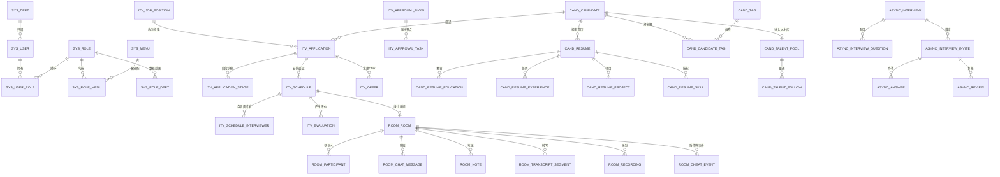

# 02 · 数据库设计

> 目标：三人在同一套数据契约下并行开发，不互相改表、不跨库 JOIN。  
> 数据库：MySQL 8.0（InnoDB / utf8mb4），每个微服务独立 schema；Elasticsearch 8 作为检索与向量库。  
> 本文所有 DDL 是设计基线，落地时用 Flyway 按服务管理版本，**禁止手工改生产表**。

---

## 1. 设计规范

### 1.1 命名

| 对象 | 规则 | 示例 |
|---|---|---|
| schema | `recruit_{service}` | `recruit_interview` |
| 表 | `{域}_{实体}`，小写下划线 | `itv_application` |
| 字段 | 小写下划线 | `candidate_id` |
| 主键 | `id` | `id BIGINT UNSIGNED` |
| 外键引用 | `{实体}_id` | `job_id`、`resume_id` |
| 布尔 | `is_` / 动词 | `is_latest`、`enabled` |
| 时间 | `_at` 或 `_time` | `created_at`、`start_time` |
| 金额 | `_amount` 或 `salary_min/max`，单位分或元需注释 | `salary_min INT`（元/月） |
| 索引 | `idx_`；唯一索引 `uk_` | `idx_app_status` |

表前缀：

| 前缀 | 服务 |
|---|---|
| `sys_` | system |
| `auth_` | auth |
| `itv_` | interview |
| `cand_` | resume |
| `room_` / `async_` | room |
| `msg_` | notification |
| `file_` | file |
| `ai_` | AI |
| `common_` | 各服务共用模式（outbox 等） |

### 1.2 公共字段

除日志/关联表外，业务表统一包含：

```sql
id BIGINT UNSIGNED NOT NULL COMMENT '雪花ID',
created_at DATETIME(3) NOT NULL DEFAULT CURRENT_TIMESTAMP(3),
updated_at DATETIME(3) NOT NULL DEFAULT CURRENT_TIMESTAMP(3) ON UPDATE CURRENT_TIMESTAMP(3),
created_by BIGINT UNSIGNED NULL,
updated_by BIGINT UNSIGNED NULL,
deleted TINYINT NOT NULL DEFAULT 0 COMMENT '逻辑删除：0否 1是',
version INT NOT NULL DEFAULT 0 COMMENT '乐观锁版本',
PRIMARY KEY (id)
```

约定：

- 数据库存 **UTC**；应用写入 `Instant`，API 输出带时区（如 `+08:00`）。
- 主键雪花 ID；JSON 序列化为 **字符串**，避免 JS 精度丢失（Jackson 全局 `Long → String`）。
- 枚举用 `VARCHAR(32)` 存代码，不用 MySQL `ENUM`；枚举字典集中在第 4 节。
- 金额用 `INT`（元）或 `DECIMAL(12,2)`；本期薪资用 `INT`（元/月），字段注释写清楚。
- 不用物理外键；跨服务引用不建外键；服务内部也建议只建索引。
- 大文本用 `TEXT` / `LONGTEXT`；结构化数据用 `JSON`，但**可检索字段要落到普通列**，不要依赖 JSON 查询做核心检索。
- 逻辑删除仅用于主数据；日志、消息、证据类不做删除，靠保留策略清理。

### 1.3 索引原则

1. 每个查询都必须能命中索引；高频列表按「过滤字段 + 时间倒序」建组合索引。
2. 区分度低的字段（状态）不要单独建索引，放在组合索引前导位置时需评估。
3. 唯一约束用于业务唯一性（用户名、手机号、申请编号），不要只靠代码判重。
4. 时间范围 + 状态 + 外键的组合索引优先；避免在索引列上做函数运算。
5. 大表（日志、转写、消息）按时间归档；`sys_oper_log` 可按月分区。

### 1.4 跨服务引用规则

| 引用 | 规则 |
|---|---|
| `user_id` | system 的 `sys_user.id`；其他服务只存 ID + 展示名快照 |
| `candidate_id` / `resume_id` | resume 主数据；interview/room 只存 ID + 姓名/岗位快照 |
| `job_id` | interview 主数据；resume 通过 `cand_job_snapshot` 冗余 |
| `application_id` / `schedule_id` | interview 主数据；room 只存 ID |
| `room_id` / `room_no` | room 主数据；interview 存引用 + 编号快照 |
| `file_id` | file 主数据 |
| `ai_task_no` | AI 主数据；业务表存任务号，本地维护展示状态 |

> 快照只用于展示与历史留痕，**不能作为业务判断依据**；需要最新数据时回查归属服务。

---

## 2. 分库总览

| schema | 服务 | 表数 | 说明 |
|---|---|---|---|
| `recruit_system` | system | 11 | 用户/角色/菜单/部门/字典/配置/日志 |
| `recruit_auth` | auth | 1 | 登录日志；令牌在 Redis |
| `recruit_interview` | interview | 13 | 岗位/投递/流程/排期/评价/Offer/审批 |
| `recruit_resume` | resume | 17 | 候选人/简历/标签/查重/匹配/人才库 |
| `recruit_room` | room | 16 | 房间/参与人/聊天/笔记/转写/录制/防作弊/异步面试/题库 |
| `recruit_notify` | notification | 3 | 模板/消息/发送日志 |
| `recruit_file` | file | 2 | 文件/分片上传会话 |
| `recruit_ai` | AI | 3 | AI 任务/提示词/调用日志 |

每个 schema 另建 `common_outbox`、`common_consumed` 两张公共表（见 3.1）。

### 2.1 核心 ER 图



---

## 3. 表设计

### 3.1 公共表（每个 schema 各一份）

```sql
-- 事务消息 Outbox：与业务写在同一本地事务
CREATE TABLE common_outbox (
  id            BIGINT UNSIGNED NOT NULL,
  event_id      CHAR(36)        NOT NULL COMMENT 'UUID，消费端幂等键',
  topic         VARCHAR(128)    NOT NULL,
  event_type    VARCHAR(128)    NOT NULL,
  aggregate_id  VARCHAR(64)     NOT NULL COMMENT '消息Key，保证同聚合有序',
  payload       JSON            NOT NULL,
  status        VARCHAR(16)     NOT NULL DEFAULT 'NEW' COMMENT 'NEW/SENT/FAILED',
  retry_count   INT             NOT NULL DEFAULT 0,
  next_retry_at DATETIME(3)     NULL,
  created_at    DATETIME(3)     NOT NULL DEFAULT CURRENT_TIMESTAMP(3),
  sent_at       DATETIME(3)     NULL,
  PRIMARY KEY (id),
  UNIQUE KEY uk_event_id (event_id),
  KEY idx_status_next (status, next_retry_at),
  KEY idx_aggregate (aggregate_id, created_at)
) ENGINE=InnoDB DEFAULT CHARSET=utf8mb4 COLLATE=utf8mb4_0900_ai_ci;

-- 消费幂等表
CREATE TABLE common_consumed (
  consumer_group VARCHAR(128) NOT NULL,
  message_id     CHAR(36)     NOT NULL,
  consumed_at    DATETIME(3)  NOT NULL DEFAULT CURRENT_TIMESTAMP(3),
  PRIMARY KEY (consumer_group, message_id)
) ENGINE=InnoDB DEFAULT CHARSET=utf8mb4 COLLATE=utf8mb4_0900_ai_ci;
```

> Outbox Relay 每 500ms 扫描 `status='NEW' OR (status='FAILED' AND next_retry_at<=NOW())`，批量 100 条投递；发送成功后更新 `SENT`。消费端在本地事务内写 `common_consumed`，唯一键冲突即视为重复消息。

---

### 3.2 `recruit_system`

#### 3.2.1 sys_dept

```sql
CREATE TABLE sys_dept (
  id             BIGINT UNSIGNED NOT NULL,
  parent_id      BIGINT UNSIGNED NOT NULL DEFAULT 0 COMMENT '0为根',
  ancestors      VARCHAR(512)    NOT NULL DEFAULT '0' COMMENT '祖级路径，逗号分隔',
  dept_code      VARCHAR(64)     NOT NULL,
  dept_name      VARCHAR(128)    NOT NULL,
  leader_user_id BIGINT UNSIGNED NULL,
  sort           INT             NOT NULL DEFAULT 0,
  status         VARCHAR(16)     NOT NULL DEFAULT 'ACTIVE' COMMENT 'ACTIVE/DISABLED',
  created_at     DATETIME(3)     NOT NULL DEFAULT CURRENT_TIMESTAMP(3),
  updated_at     DATETIME(3)     NOT NULL DEFAULT CURRENT_TIMESTAMP(3) ON UPDATE CURRENT_TIMESTAMP(3),
  created_by     BIGINT UNSIGNED NULL,
  updated_by     BIGINT UNSIGNED NULL,
  deleted        TINYINT         NOT NULL DEFAULT 0,
  version        INT             NOT NULL DEFAULT 0,
  PRIMARY KEY (id),
  UNIQUE KEY uk_dept_code (dept_code),
  KEY idx_parent (parent_id),
  KEY idx_status (status)
) ENGINE=InnoDB DEFAULT CHARSET=utf8mb4 COLLATE=utf8mb4_0900_ai_ci;
```

#### 3.2.2 sys_user

```sql
CREATE TABLE sys_user (
  id              BIGINT UNSIGNED NOT NULL,
  username        VARCHAR(64)     NOT NULL COMMENT '登录名；候选人可用手机号',
  password_hash   VARCHAR(100)    NULL COMMENT 'BCrypt；短信登录候选人可为空',
  user_type       VARCHAR(16)     NOT NULL COMMENT 'EMPLOYEE/CANDIDATE',
  real_name       VARCHAR(64)     NOT NULL,
  nickname        VARCHAR(64)     NULL,
  phone           VARCHAR(32)     NULL,
  email           VARCHAR(128)    NULL,
  avatar_file_id  BIGINT UNSIGNED NULL,
  dept_id         BIGINT UNSIGNED NULL COMMENT '员工部门；候选人空',
  employee_no     VARCHAR(64)     NULL,
  status          VARCHAR(16)     NOT NULL DEFAULT 'ACTIVE' COMMENT 'ACTIVE/DISABLED/LOCKED',
  last_login_at   DATETIME(3)     NULL,
  last_login_ip   VARCHAR(64)     NULL,
  pwd_updated_at  DATETIME(3)     NULL,
  failed_attempts INT             NOT NULL DEFAULT 0,
  locked_until    DATETIME(3)     NULL,
  remark          VARCHAR(500)    NULL,
  created_at      DATETIME(3)     NOT NULL DEFAULT CURRENT_TIMESTAMP(3),
  updated_at      DATETIME(3)     NOT NULL DEFAULT CURRENT_TIMESTAMP(3) ON UPDATE CURRENT_TIMESTAMP(3),
  created_by      BIGINT UNSIGNED NULL,
  updated_by      BIGINT UNSIGNED NULL,
  deleted         TINYINT         NOT NULL DEFAULT 0,
  version         INT             NOT NULL DEFAULT 0,
  PRIMARY KEY (id),
  UNIQUE KEY uk_username (username),
  UNIQUE KEY uk_phone (phone),
  UNIQUE KEY uk_employee_no (employee_no),
  KEY idx_dept (dept_id),
  KEY idx_type_status (user_type, status)
) ENGINE=InnoDB DEFAULT CHARSET=utf8mb4 COLLATE=utf8mb4_0900_ai_ci;
```

> 候选人账号的 `username` 默认等于手机号；`password_hash` 可为空（验证码登录）。员工账号由管理员创建，候选人账号由短信登录自动注册。

#### 3.2.3 sys_role

```sql
CREATE TABLE sys_role (
  id          BIGINT UNSIGNED NOT NULL,
  role_code   VARCHAR(64)     NOT NULL COMMENT '权限判断使用，如 HR/INTERVIEWER',
  role_name   VARCHAR(64)     NOT NULL,
  role_type   VARCHAR(16)     NOT NULL DEFAULT 'BUSINESS' COMMENT 'SYSTEM/BUSINESS/CANDIDATE',
  data_scope  VARCHAR(24)     NOT NULL DEFAULT 'SELF' COMMENT 'ALL/DEPT/DEPT_AND_CHILD/SELF/CUSTOM',
  sort        INT             NOT NULL DEFAULT 0,
  status      VARCHAR(16)     NOT NULL DEFAULT 'ACTIVE',
  remark      VARCHAR(500)    NULL,
  created_at  DATETIME(3)     NOT NULL DEFAULT CURRENT_TIMESTAMP(3),
  updated_at  DATETIME(3)     NOT NULL DEFAULT CURRENT_TIMESTAMP(3) ON UPDATE CURRENT_TIMESTAMP(3),
  created_by  BIGINT UNSIGNED NULL,
  updated_by  BIGINT UNSIGNED NULL,
  deleted     TINYINT         NOT NULL DEFAULT 0,
  version     INT             NOT NULL DEFAULT 0,
  PRIMARY KEY (id),
  UNIQUE KEY uk_role_code (role_code)
) ENGINE=InnoDB DEFAULT CHARSET=utf8mb4 COLLATE=utf8mb4_0900_ai_ci;
```

#### 3.2.4 sys_menu

```sql
CREATE TABLE sys_menu (
  id         BIGINT UNSIGNED NOT NULL,
  parent_id  BIGINT UNSIGNED NOT NULL DEFAULT 0,
  app_code   VARCHAR(16)     NOT NULL COMMENT 'ADMIN/CANDIDATE',
  menu_type  CHAR(1)         NOT NULL COMMENT 'M目录 C菜单 F按钮 L外链',
  menu_name  VARCHAR(64)     NOT NULL,
  path       VARCHAR(255)    NULL COMMENT '路由路径',
  component  VARCHAR(255)    NULL COMMENT 'views 下的组件路径',
  route_name VARCHAR(128)    NULL,
  perms      VARCHAR(128)    NULL COMMENT '权限码，如 interview:schedule:create',
  icon       VARCHAR(64)     NULL,
  sort       INT             NOT NULL DEFAULT 0,
  visible    TINYINT         NOT NULL DEFAULT 1,
  keep_alive TINYINT         NOT NULL DEFAULT 0,
  status     VARCHAR(16)     NOT NULL DEFAULT 'ACTIVE',
  created_at DATETIME(3)     NOT NULL DEFAULT CURRENT_TIMESTAMP(3),
  updated_at DATETIME(3)     NOT NULL DEFAULT CURRENT_TIMESTAMP(3) ON UPDATE CURRENT_TIMESTAMP(3),
  created_by BIGINT UNSIGNED NULL,
  updated_by BIGINT UNSIGNED NULL,
  deleted    TINYINT         NOT NULL DEFAULT 0,
  version    INT             NOT NULL DEFAULT 0,
  PRIMARY KEY (id),
  UNIQUE KEY uk_perms (perms),
  KEY idx_app_parent (app_code, parent_id),
  KEY idx_status (status)
) ENGINE=InnoDB DEFAULT CHARSET=utf8mb4 COLLATE=utf8mb4_0900_ai_ci;
```

> `perms` 为 `NULL` 表示纯目录/页面（无接口权限）；按钮和需要权限的页面必须填写。唯一键用于尽早发现权限码重复。

#### 3.2.5 关联表

```sql
CREATE TABLE sys_user_role (
  id         BIGINT UNSIGNED NOT NULL,
  user_id    BIGINT UNSIGNED NOT NULL,
  role_id    BIGINT UNSIGNED NOT NULL,
  created_at DATETIME(3)     NOT NULL DEFAULT CURRENT_TIMESTAMP(3),
  created_by BIGINT UNSIGNED NULL,
  PRIMARY KEY (id),
  UNIQUE KEY uk_user_role (user_id, role_id),
  KEY idx_role (role_id)
) ENGINE=InnoDB DEFAULT CHARSET=utf8mb4 COLLATE=utf8mb4_0900_ai_ci;

CREATE TABLE sys_role_menu (
  id         BIGINT UNSIGNED NOT NULL,
  role_id    BIGINT UNSIGNED NOT NULL,
  menu_id    BIGINT UNSIGNED NOT NULL,
  created_at DATETIME(3)     NOT NULL DEFAULT CURRENT_TIMESTAMP(3),
  created_by BIGINT UNSIGNED NULL,
  PRIMARY KEY (id),
  UNIQUE KEY uk_role_menu (role_id, menu_id),
  KEY idx_menu (menu_id)
) ENGINE=InnoDB DEFAULT CHARSET=utf8mb4 COLLATE=utf8mb4_0900_ai_ci;

CREATE TABLE sys_role_dept (
  id         BIGINT UNSIGNED NOT NULL,
  role_id    BIGINT UNSIGNED NOT NULL,
  dept_id    BIGINT UNSIGNED NOT NULL,
  created_at DATETIME(3)     NOT NULL DEFAULT CURRENT_TIMESTAMP(3),
  PRIMARY KEY (id),
  UNIQUE KEY uk_role_dept (role_id, dept_id),
  KEY idx_dept (dept_id)
) ENGINE=InnoDB DEFAULT CHARSET=utf8mb4 COLLATE=utf8mb4_0900_ai_ci;
```

#### 3.2.6 字典与参数

```sql
CREATE TABLE sys_dict_type (
  id         BIGINT UNSIGNED NOT NULL,
  dict_code  VARCHAR(64)     NOT NULL,
  dict_name  VARCHAR(128)    NOT NULL,
  status     VARCHAR(16)     NOT NULL DEFAULT 'ACTIVE',
  remark     VARCHAR(500)    NULL,
  created_at DATETIME(3)     NOT NULL DEFAULT CURRENT_TIMESTAMP(3),
  updated_at DATETIME(3)     NOT NULL DEFAULT CURRENT_TIMESTAMP(3) ON UPDATE CURRENT_TIMESTAMP(3),
  created_by BIGINT UNSIGNED NULL,
  updated_by BIGINT UNSIGNED NULL,
  deleted    TINYINT         NOT NULL DEFAULT 0,
  version    INT             NOT NULL DEFAULT 0,
  PRIMARY KEY (id),
  UNIQUE KEY uk_dict_code (dict_code)
) ENGINE=InnoDB DEFAULT CHARSET=utf8mb4 COLLATE=utf8mb4_0900_ai_ci;

CREATE TABLE sys_dict_data (
  id           BIGINT UNSIGNED NOT NULL,
  dict_type_id BIGINT UNSIGNED NOT NULL,
  dict_label   VARCHAR(128)    NOT NULL,
  dict_value   VARCHAR(128)    NOT NULL,
  sort         INT             NOT NULL DEFAULT 0,
  css_class    VARCHAR(64)     NULL,
  is_default   TINYINT         NOT NULL DEFAULT 0,
  status       VARCHAR(16)     NOT NULL DEFAULT 'ACTIVE',
  created_at   DATETIME(3)     NOT NULL DEFAULT CURRENT_TIMESTAMP(3),
  updated_at   DATETIME(3)     NOT NULL DEFAULT CURRENT_TIMESTAMP(3) ON UPDATE CURRENT_TIMESTAMP(3),
  created_by   BIGINT UNSIGNED NULL,
  updated_by   BIGINT UNSIGNED NULL,
  deleted      TINYINT         NOT NULL DEFAULT 0,
  version      INT             NOT NULL DEFAULT 0,
  PRIMARY KEY (id),
  UNIQUE KEY uk_type_value (dict_type_id, dict_value),
  KEY idx_type (dict_type_id)
) ENGINE=InnoDB DEFAULT CHARSET=utf8mb4 COLLATE=utf8mb4_0900_ai_ci;

CREATE TABLE sys_config (
  id           BIGINT UNSIGNED NOT NULL,
  config_key   VARCHAR(128)    NOT NULL,
  config_value TEXT            NULL,
  value_type   VARCHAR(16)     NOT NULL DEFAULT 'STRING' COMMENT 'STRING/NUMBER/BOOLEAN/JSON',
  group_code   VARCHAR(64)     NOT NULL DEFAULT 'DEFAULT',
  editable     TINYINT         NOT NULL DEFAULT 1,
  remark       VARCHAR(500)    NULL,
  created_at   DATETIME(3)     NOT NULL DEFAULT CURRENT_TIMESTAMP(3),
  updated_at   DATETIME(3)     NOT NULL DEFAULT CURRENT_TIMESTAMP(3) ON UPDATE CURRENT_TIMESTAMP(3),
  created_by   BIGINT UNSIGNED NULL,
  updated_by   BIGINT UNSIGNED NULL,
  deleted      TINYINT         NOT NULL DEFAULT 0,
  version      INT             NOT NULL DEFAULT 0,
  PRIMARY KEY (id),
  UNIQUE KEY uk_config_key (config_key),
  KEY idx_group (group_code)
) ENGINE=InnoDB DEFAULT CHARSET=utf8mb4 COLLATE=utf8mb4_0900_ai_ci;
```

#### 3.2.7 操作日志

```sql
CREATE TABLE sys_oper_log (
  id             BIGINT UNSIGNED NOT NULL,
  trace_id       VARCHAR(64)     NULL,
  user_id        BIGINT UNSIGNED NULL,
  username       VARCHAR(64)     NULL,
  module         VARCHAR(64)     NOT NULL,
  operation      VARCHAR(128)    NOT NULL,
  request_method VARCHAR(16)     NULL,
  request_uri    VARCHAR(512)    NULL,
  request_params JSON            NULL COMMENT '脱敏后的请求参数',
  response_code  INT             NULL,
  success        TINYINT         NOT NULL DEFAULT 1,
  error_msg      VARCHAR(2000)   NULL,
  ip             VARCHAR(64)     NULL,
  user_agent     VARCHAR(512)    NULL,
  cost_ms        INT             NULL,
  created_at     DATETIME(3)     NOT NULL DEFAULT CURRENT_TIMESTAMP(3),
  PRIMARY KEY (id),
  KEY idx_user_time (user_id, created_at),
  KEY idx_time (created_at),
  KEY idx_module (module, created_at)
) ENGINE=InnoDB DEFAULT CHARSET=utf8mb4 COLLATE=utf8mb4_0900_ai_ci;
```

> 数据量大时按月分区或定期归档，不在业务库长期保留。

---

### 3.3 `recruit_auth`

```sql
CREATE TABLE auth_login_log (
  id          BIGINT UNSIGNED NOT NULL,
  user_id     BIGINT UNSIGNED NULL,
  username    VARCHAR(64)     NULL,
  login_type  VARCHAR(16)     NOT NULL COMMENT 'PASSWORD/SMS/REFRESH',
  app_code    VARCHAR(16)     NULL COMMENT 'ADMIN/CANDIDATE',
  ip          VARCHAR(64)     NULL,
  user_agent  VARCHAR(512)    NULL,
  success     TINYINT         NOT NULL DEFAULT 1,
  fail_reason VARCHAR(255)    NULL,
  created_at  DATETIME(3)     NOT NULL DEFAULT CURRENT_TIMESTAMP(3),
  PRIMARY KEY (id),
  KEY idx_user_time (user_id, created_at),
  KEY idx_username_time (username, created_at),
  KEY idx_time (created_at)
) ENGINE=InnoDB DEFAULT CHARSET=utf8mb4 COLLATE=utf8mb4_0900_ai_ci;
```

> 令牌、验证码、刷新令牌族、权限缓存全部在 Redis，不落 MySQL；Key 规范见 [03-auth-rbac.md](03-auth-rbac.md)。

---

### 3.4 `recruit_interview`

#### 3.4.1 itv_job_position

```sql
CREATE TABLE itv_job_position (
  id                BIGINT UNSIGNED NOT NULL,
  job_code          VARCHAR(64)     NOT NULL,
  title             VARCHAR(128)    NOT NULL,
  dept_id           BIGINT UNSIGNED NOT NULL,
  job_type          VARCHAR(16)     NOT NULL DEFAULT 'FULL_TIME' COMMENT 'FULL_TIME/INTERN/CONTRACT',
  city              VARCHAR(64)     NULL,
  salary_min        INT             NULL COMMENT '元/月',
  salary_max        INT             NULL COMMENT '元/月',
  headcount         INT             NOT NULL DEFAULT 1,
  jd_text           LONGTEXT        NULL,
  requirements_json JSON            NULL COMMENT 'AI解析后的硬性/加分要求、职责、标签',
  status            VARCHAR(16)     NOT NULL DEFAULT 'DRAFT' COMMENT 'DRAFT/PUBLISHED/PAUSED/CLOSED',
  owner_hr_id       BIGINT UNSIGNED NULL,
  published_at      DATETIME(3)     NULL,
  closed_at         DATETIME(3)     NULL,
  created_at        DATETIME(3)     NOT NULL DEFAULT CURRENT_TIMESTAMP(3),
  updated_at        DATETIME(3)     NOT NULL DEFAULT CURRENT_TIMESTAMP(3) ON UPDATE CURRENT_TIMESTAMP(3),
  created_by        BIGINT UNSIGNED NULL,
  updated_by        BIGINT UNSIGNED NULL,
  deleted           TINYINT         NOT NULL DEFAULT 0,
  version           INT             NOT NULL DEFAULT 0,
  PRIMARY KEY (id),
  UNIQUE KEY uk_job_code (job_code),
  KEY idx_dept_status (dept_id, status),
  KEY idx_owner (owner_hr_id),
  KEY idx_status_publish (status, published_at)
) ENGINE=InnoDB DEFAULT CHARSET=utf8mb4 COLLATE=utf8mb4_0900_ai_ci;
```

#### 3.4.2 流程模板与阶段

```sql
CREATE TABLE itv_process_template (
  id            BIGINT UNSIGNED NOT NULL,
  template_name VARCHAR(128)    NOT NULL,
  job_id        BIGINT UNSIGNED NULL COMMENT '为空表示通用模板',
  is_default    TINYINT         NOT NULL DEFAULT 0,
  status        VARCHAR(16)     NOT NULL DEFAULT 'ACTIVE',
  remark        VARCHAR(500)    NULL,
  created_at    DATETIME(3)     NOT NULL DEFAULT CURRENT_TIMESTAMP(3),
  updated_at    DATETIME(3)     NOT NULL DEFAULT CURRENT_TIMESTAMP(3) ON UPDATE CURRENT_TIMESTAMP(3),
  created_by    BIGINT UNSIGNED NULL,
  updated_by    BIGINT UNSIGNED NULL,
  deleted       TINYINT         NOT NULL DEFAULT 0,
  version       INT             NOT NULL DEFAULT 0,
  PRIMARY KEY (id),
  KEY idx_job (job_id),
  KEY idx_default (is_default, status)
) ENGINE=InnoDB DEFAULT CHARSET=utf8mb4 COLLATE=utf8mb4_0900_ai_ci;

CREATE TABLE itv_process_stage (
  id                       BIGINT UNSIGNED NOT NULL,
  template_id              BIGINT UNSIGNED NOT NULL,
  stage_no                 INT             NOT NULL COMMENT '1..N',
  stage_name               VARCHAR(64)     NOT NULL,
  stage_type               VARCHAR(24)     NOT NULL COMMENT 'SCREEN/WRITTEN/INTERVIEW/HR/OFFER',
  default_mode             VARCHAR(16)     NOT NULL DEFAULT 'ONLINE' COMMENT 'ONLINE/OFFLINE',
  default_duration_min     INT             NOT NULL DEFAULT 60,
  evaluator_role_code      VARCHAR(64)     NULL COMMENT '建议评价人角色，如 INTERVIEWER',
  required_evaluator_count INT             NOT NULL DEFAULT 1,
  allow_skip               TINYINT         NOT NULL DEFAULT 0,
  config_json              JSON            NULL,
  sort                     INT             NOT NULL DEFAULT 0,
  created_at               DATETIME(3)     NOT NULL DEFAULT CURRENT_TIMESTAMP(3),
  updated_at               DATETIME(3)     NOT NULL DEFAULT CURRENT_TIMESTAMP(3) ON UPDATE CURRENT_TIMESTAMP(3),
  PRIMARY KEY (id),
  UNIQUE KEY uk_template_stage (template_id, stage_no),
  KEY idx_template (template_id)
) ENGINE=InnoDB DEFAULT CHARSET=utf8mb4 COLLATE=utf8mb4_0900_ai_ci;
```

#### 3.4.3 投递与阶段实例

```sql
CREATE TABLE itv_application (
  id                BIGINT UNSIGNED NOT NULL,
  application_no    VARCHAR(64)     NOT NULL,
  job_id            BIGINT UNSIGNED NOT NULL,
  job_version       INT             NOT NULL DEFAULT 0 COMMENT '投递时的岗位版本，用于匹配缓存',
  candidate_id      BIGINT UNSIGNED NOT NULL,
  resume_id         BIGINT UNSIGNED NOT NULL,
  resume_version    INT             NOT NULL DEFAULT 1,
  source_channel    VARCHAR(32)     NOT NULL DEFAULT 'PORTAL',
  current_stage_no  INT             NOT NULL DEFAULT 1,
  status            VARCHAR(24)     NOT NULL DEFAULT 'SUBMITTED'
                    COMMENT 'SUBMITTED/SCREENING/IN_INTERVIEW/OFFER/ONBOARDED/REJECTED/WITHDRAWN/TALENT_POOL/ON_HOLD',
  reject_reason_code VARCHAR(64)    NULL,
  reject_reason     VARCHAR(500)    NULL,
  owner_hr_id       BIGINT UNSIGNED NULL,
  candidate_name    VARCHAR(64)     NULL COMMENT '展示快照',
  candidate_phone   VARCHAR(32)     NULL COMMENT '脱敏展示快照',
  job_title         VARCHAR(128)    NULL COMMENT '展示快照',
  applied_at        DATETIME(3)     NOT NULL DEFAULT CURRENT_TIMESTAMP(3),
  last_action_at    DATETIME(3)     NULL,
  created_at        DATETIME(3)     NOT NULL DEFAULT CURRENT_TIMESTAMP(3),
  updated_at        DATETIME(3)     NOT NULL DEFAULT CURRENT_TIMESTAMP(3) ON UPDATE CURRENT_TIMESTAMP(3),
  created_by        BIGINT UNSIGNED NULL,
  updated_by        BIGINT UNSIGNED NULL,
  deleted           TINYINT         NOT NULL DEFAULT 0,
  version           INT             NOT NULL DEFAULT 0,
  PRIMARY KEY (id),
  UNIQUE KEY uk_application_no (application_no),
  KEY idx_job_status (job_id, status),
  KEY idx_candidate (candidate_id, applied_at),
  KEY idx_owner_status (owner_hr_id, status),
  KEY idx_applied (applied_at)
) ENGINE=InnoDB DEFAULT CHARSET=utf8mb4 COLLATE=utf8mb4_0900_ai_ci;

CREATE TABLE itv_application_stage (
  id             BIGINT UNSIGNED NOT NULL,
  application_id BIGINT UNSIGNED NOT NULL,
  stage_no       INT             NOT NULL,
  stage_name     VARCHAR(64)     NOT NULL,
  stage_type     VARCHAR(24)     NOT NULL,
  round_no       INT             NOT NULL DEFAULT 1 COMMENT '同一阶段可复面',
  status         VARCHAR(24)     NOT NULL DEFAULT 'PENDING'
                 COMMENT 'PENDING/SCHEDULED/IN_PROGRESS/PASSED/FAILED/ON_HOLD/SKIPPED/CANCELED',
  mode           VARCHAR(16)     NULL COMMENT 'ONLINE/OFFLINE',
  scheduled_start DATETIME(3)    NULL,
  scheduled_end   DATETIME(3)    NULL,
  result          VARCHAR(24)    NULL,
  started_at     DATETIME(3)     NULL,
  finished_at    DATETIME(3)     NULL,
  remark         VARCHAR(1000)   NULL,
  created_at     DATETIME(3)     NOT NULL DEFAULT CURRENT_TIMESTAMP(3),
  updated_at     DATETIME(3)     NOT NULL DEFAULT CURRENT_TIMESTAMP(3) ON UPDATE CURRENT_TIMESTAMP(3),
  version        INT             NOT NULL DEFAULT 0,
  PRIMARY KEY (id),
  UNIQUE KEY uk_app_stage_round (application_id, stage_no, round_no),
  KEY idx_app_status (application_id, status)
) ENGINE=InnoDB DEFAULT CHARSET=utf8mb4 COLLATE=utf8mb4_0900_ai_ci;

CREATE TABLE itv_application_log (
  id             BIGINT UNSIGNED NOT NULL,
  application_id BIGINT UNSIGNED NOT NULL,
  stage_id       BIGINT UNSIGNED NULL,
  action         VARCHAR(64)     NOT NULL COMMENT 'CREATE/SCHEDULE/SUBMIT_EVALUATION/PASS/REJECT/TRANSFER/OFFER/...',
  from_status    VARCHAR(24)     NULL,
  to_status      VARCHAR(24)     NULL,
  operator_id    BIGINT UNSIGNED NULL,
  operator_role  VARCHAR(64)     NULL,
  comment        VARCHAR(1000)   NULL,
  created_at     DATETIME(3)     NOT NULL DEFAULT CURRENT_TIMESTAMP(3),
  PRIMARY KEY (id),
  KEY idx_app_time (application_id, created_at)
) ENGINE=InnoDB DEFAULT CHARSET=utf8mb4 COLLATE=utf8mb4_0900_ai_ci;
```

#### 3.4.4 排期

```sql
CREATE TABLE itv_schedule (
  id                     BIGINT UNSIGNED NOT NULL,
  schedule_no            VARCHAR(64)     NOT NULL,
  application_id         BIGINT UNSIGNED NOT NULL,
  stage_id               BIGINT UNSIGNED NOT NULL,
  round_no               INT             NOT NULL DEFAULT 1,
  mode                   VARCHAR(16)     NOT NULL COMMENT 'ONLINE/OFFLINE',
  start_time             DATETIME(3)     NOT NULL,
  end_time               DATETIME(3)     NOT NULL,
  timezone               VARCHAR(64)     NOT NULL DEFAULT 'Asia/Shanghai',
  location               VARCHAR(255)    NULL COMMENT '线下地址/线上说明',
  room_id                BIGINT UNSIGNED NULL COMMENT 'room 服务房间ID',
  room_no                VARCHAR(32)     NULL COMMENT '房间编号快照',
  evaluation_template_id BIGINT UNSIGNED NULL,
  status                 VARCHAR(24)     NOT NULL DEFAULT 'PENDING'
                         COMMENT 'PENDING/CONFIRMED/ROOM_PENDING/IN_PROGRESS/COMPLETED/CANCELED/NO_SHOW',
  cancel_reason          VARCHAR(500)    NULL,
  created_by             BIGINT UNSIGNED NULL,
  created_at             DATETIME(3)     NOT NULL DEFAULT CURRENT_TIMESTAMP(3),
  updated_at             DATETIME(3)     NOT NULL DEFAULT CURRENT_TIMESTAMP(3) ON UPDATE CURRENT_TIMESTAMP(3),
  updated_by             BIGINT UNSIGNED NULL,
  deleted                TINYINT         NOT NULL DEFAULT 0,
  version                INT             NOT NULL DEFAULT 0,
  PRIMARY KEY (id),
  UNIQUE KEY uk_schedule_no (schedule_no),
  KEY idx_application (application_id, start_time),
  KEY idx_time (start_time, end_time),
  KEY idx_room (room_id),
  KEY idx_status_time (status, start_time)
) ENGINE=InnoDB DEFAULT CHARSET=utf8mb4 COLLATE=utf8mb4_0900_ai_ci;

CREATE TABLE itv_schedule_interviewer (
  id              BIGINT UNSIGNED NOT NULL,
  schedule_id     BIGINT UNSIGNED NOT NULL,
  interviewer_id  BIGINT UNSIGNED NOT NULL,
  interviewer_role VARCHAR(16)    NOT NULL DEFAULT 'LEAD' COMMENT 'LEAD/ASSISTANT/OBSERVER',
  status          VARCHAR(16)     NOT NULL DEFAULT 'INVITED' COMMENT 'INVITED/CONFIRMED/DECLINED/COMPLETED',
  evaluation_id   BIGINT UNSIGNED NULL,
  created_at      DATETIME(3)     NOT NULL DEFAULT CURRENT_TIMESTAMP(3),
  updated_at      DATETIME(3)     NOT NULL DEFAULT CURRENT_TIMESTAMP(3) ON UPDATE CURRENT_TIMESTAMP(3),
  PRIMARY KEY (id),
  UNIQUE KEY uk_schedule_interviewer (schedule_id, interviewer_id),
  KEY idx_interviewer_status (interviewer_id, status)
) ENGINE=InnoDB DEFAULT CHARSET=utf8mb4 COLLATE=utf8mb4_0900_ai_ci;
```

> 冲突查询使用半开区间：`new.start < old.end AND new.end > old.start`。索引 `idx_interviewer_status` 支撑「某面试官某时间段」查询；schedule 的时间索引支撑候选人/房间冲突。

#### 3.4.5 评价模板与评价

```sql
CREATE TABLE itv_evaluation_template (
  id              BIGINT UNSIGNED NOT NULL,
  template_name   VARCHAR(128)    NOT NULL,
  job_id          BIGINT UNSIGNED NULL,
  dimensions_json JSON            NOT NULL
                  COMMENT '[{code,name,weight,maxScore,vetoThreshold,description}]',
  instructions    TEXT            NULL,
  version_no      INT             NOT NULL DEFAULT 1,
  status          VARCHAR(16)     NOT NULL DEFAULT 'ACTIVE',
  created_at      DATETIME(3)     NOT NULL DEFAULT CURRENT_TIMESTAMP(3),
  updated_at      DATETIME(3)     NOT NULL DEFAULT CURRENT_TIMESTAMP(3) ON UPDATE CURRENT_TIMESTAMP(3),
  created_by      BIGINT UNSIGNED NULL,
  updated_by      BIGINT UNSIGNED NULL,
  deleted         TINYINT         NOT NULL DEFAULT 0,
  version         INT             NOT NULL DEFAULT 0,
  PRIMARY KEY (id),
  KEY idx_job (job_id),
  KEY idx_status (status)
) ENGINE=InnoDB DEFAULT CHARSET=utf8mb4 COLLATE=utf8mb4_0900_ai_ci;

CREATE TABLE itv_evaluation (
  id                  BIGINT UNSIGNED NOT NULL,
  schedule_id         BIGINT UNSIGNED NOT NULL,
  application_id      BIGINT UNSIGNED NOT NULL,
  interviewer_id      BIGINT UNSIGNED NOT NULL,
  template_id         BIGINT UNSIGNED NOT NULL,
  dimensions_snapshot JSON            NOT NULL COMMENT '提交时的维度快照，防止模板变更影响历史',
  dimension_scores    JSON            NOT NULL COMMENT '{code: score}',
  total_score         DECIMAL(5,2)    NULL,
  recommendation      VARCHAR(24)     NULL COMMENT 'STRONG_PASS/PASS/HOLD/REJECT/TRANSFER',
  summary             TEXT            NULL,
  strengths           TEXT            NULL,
  risks               TEXT            NULL,
  ai_draft_json       JSON            NULL COMMENT 'AI草稿：摘要/证据/建议分/风险',
  ai_draft_status     VARCHAR(16)     NOT NULL DEFAULT 'NONE' COMMENT 'NONE/GENERATED/ACCEPTED',
  status              VARCHAR(16)     NOT NULL DEFAULT 'DRAFT' COMMENT 'DRAFT/SUBMITTED',
  submitted_at        DATETIME(3)     NULL,
  created_at          DATETIME(3)     NOT NULL DEFAULT CURRENT_TIMESTAMP(3),
  updated_at          DATETIME(3)     NOT NULL DEFAULT CURRENT_TIMESTAMP(3) ON UPDATE CURRENT_TIMESTAMP(3),
  created_by          BIGINT UNSIGNED NULL,
  updated_by          BIGINT UNSIGNED NULL,
  deleted             TINYINT         NOT NULL DEFAULT 0,
  version             INT             NOT NULL DEFAULT 0,
  PRIMARY KEY (id),
  UNIQUE KEY uk_schedule_interviewer (schedule_id, interviewer_id),
  KEY idx_application (application_id),
  KEY idx_status (status)
) ENGINE=InnoDB DEFAULT CHARSET=utf8mb4 COLLATE=utf8mb4_0900_ai_ci;
```

#### 3.4.6 Offer 与审批

```sql
CREATE TABLE itv_offer (
  id                    BIGINT UNSIGNED NOT NULL,
  offer_no              VARCHAR(64)     NOT NULL,
  application_id        BIGINT UNSIGNED NOT NULL,
  job_id                BIGINT UNSIGNED NOT NULL,
  candidate_id          BIGINT UNSIGNED NOT NULL,
  salary_structure_json JSON            NULL,
  job_level             VARCHAR(32)     NULL,
  probation_months      INT             NULL,
  expected_onboard_date DATE            NULL,
  status                VARCHAR(24)     NOT NULL DEFAULT 'DRAFT'
                        COMMENT 'DRAFT/PENDING_APPROVAL/APPROVED/SENT/ACCEPTED/DECLINED/EXPIRED/WITHDRAWN',
  expires_at            DATETIME(3)     NULL,
  sent_at               DATETIME(3)     NULL,
  responded_at          DATETIME(3)     NULL,
  attachment_file_id    BIGINT UNSIGNED NULL,
  approval_flow_id      BIGINT UNSIGNED NULL,
  onboarding_json       JSON            NULL COMMENT '入职资料清单与文件ID（最小闭环）',
  remark                VARCHAR(500)    NULL,
  created_at            DATETIME(3)     NOT NULL DEFAULT CURRENT_TIMESTAMP(3),
  updated_at            DATETIME(3)     NOT NULL DEFAULT CURRENT_TIMESTAMP(3) ON UPDATE CURRENT_TIMESTAMP(3),
  created_by            BIGINT UNSIGNED NULL,
  updated_by            BIGINT UNSIGNED NULL,
  deleted               TINYINT         NOT NULL DEFAULT 0,
  version               INT             NOT NULL DEFAULT 0,
  PRIMARY KEY (id),
  UNIQUE KEY uk_offer_no (offer_no),
  KEY idx_application (application_id),
  KEY idx_candidate (candidate_id),
  KEY idx_status (status, expires_at)
) ENGINE=InnoDB DEFAULT CHARSET=utf8mb4 COLLATE=utf8mb4_0900_ai_ci;

CREATE TABLE itv_approval_flow (
  id          BIGINT UNSIGNED NOT NULL,
  flow_name   VARCHAR(128)    NOT NULL,
  biz_type    VARCHAR(32)     NOT NULL DEFAULT 'OFFER',
  nodes_json  JSON            NOT NULL COMMENT '[{nodeNo,nodeName,approverType,approverId/roleCode}]',
  status      VARCHAR(16)     NOT NULL DEFAULT 'ACTIVE',
  created_at  DATETIME(3)     NOT NULL DEFAULT CURRENT_TIMESTAMP(3),
  updated_at  DATETIME(3)     NOT NULL DEFAULT CURRENT_TIMESTAMP(3) ON UPDATE CURRENT_TIMESTAMP(3),
  created_by  BIGINT UNSIGNED NULL,
  updated_by  BIGINT UNSIGNED NULL,
  deleted     TINYINT         NOT NULL DEFAULT 0,
  version     INT             NOT NULL DEFAULT 0,
  PRIMARY KEY (id),
  KEY idx_biz (biz_type, status)
) ENGINE=InnoDB DEFAULT CHARSET=utf8mb4 COLLATE=utf8mb4_0900_ai_ci;

CREATE TABLE itv_approval_task (
  id          BIGINT UNSIGNED NOT NULL,
  flow_id     BIGINT UNSIGNED NOT NULL,
  biz_type    VARCHAR(32)     NOT NULL,
  biz_id      BIGINT UNSIGNED NOT NULL,
  node_no     INT             NOT NULL,
  node_name   VARCHAR(64)     NOT NULL,
  approver_id BIGINT UNSIGNED NOT NULL,
  status      VARCHAR(16)     NOT NULL DEFAULT 'PENDING' COMMENT 'PENDING/APPROVED/REJECTED/SKIPPED',
  comment     VARCHAR(1000)   NULL,
  acted_at    DATETIME(3)     NULL,
  created_at  DATETIME(3)     NOT NULL DEFAULT CURRENT_TIMESTAMP(3),
  PRIMARY KEY (id),
  KEY idx_biz (biz_type, biz_id, node_no),
  KEY idx_approver (approver_id, status)
) ENGINE=InnoDB DEFAULT CHARSET=utf8mb4 COLLATE=utf8mb4_0900_ai_ci;
```

---

### 3.5 `recruit_resume`

#### 3.5.1 候选人

```sql
CREATE TABLE cand_candidate (
  id               BIGINT UNSIGNED NOT NULL,
  user_id          BIGINT UNSIGNED NULL COMMENT '候选人账号；导入简历可为空',
  canonical_id     BIGINT UNSIGNED NULL COMMENT '合并后的主候选人ID；空表示自身为主',
  name             VARCHAR(64)     NOT NULL,
  gender           VARCHAR(16)     NULL COMMENT 'MALE/FEMALE/UNKNOWN',
  birth_date       DATE            NULL,
  phone            VARCHAR(32)     NULL,
  email            VARCHAR(128)    NULL,
  current_city     VARCHAR(64)     NULL,
  education_level  VARCHAR(24)     NULL COMMENT 'HIGH_SCHOOL/ASSOCIATE/BACHELOR/MASTER/DOCTOR',
  work_years       DECIMAL(4,1)    NULL,
  current_company  VARCHAR(128)    NULL,
  current_title    VARCHAR(128)    NULL,
  source_channel   VARCHAR(32)     NULL,
  owner_hr_id      BIGINT UNSIGNED NULL,
  status           VARCHAR(16)     NOT NULL DEFAULT 'ACTIVE' COMMENT 'ACTIVE/MERGED/ARCHIVED',
  profile_summary  TEXT            NULL COMMENT 'AI/人工候选人摘要',
  summary_version  INT             NOT NULL DEFAULT 0,
  avatar_file_id   BIGINT UNSIGNED NULL,
  last_active_at   DATETIME(3)     NULL,
  created_at       DATETIME(3)     NOT NULL DEFAULT CURRENT_TIMESTAMP(3),
  updated_at       DATETIME(3)     NOT NULL DEFAULT CURRENT_TIMESTAMP(3) ON UPDATE CURRENT_TIMESTAMP(3),
  created_by       BIGINT UNSIGNED NULL,
  updated_by       BIGINT UNSIGNED NULL,
  deleted          TINYINT         NOT NULL DEFAULT 0,
  version          INT             NOT NULL DEFAULT 0,
  PRIMARY KEY (id),
  UNIQUE KEY uk_user_id (user_id),
  KEY idx_phone (phone),
  KEY idx_email (email),
  KEY idx_name (name),
  KEY idx_canonical (canonical_id),
  KEY idx_owner (owner_hr_id, status),
  KEY idx_active (last_active_at)
) ENGINE=InnoDB DEFAULT CHARSET=utf8mb4 COLLATE=utf8mb4_0900_ai_ci;
```

> 手机号/邮箱用于精确查重，默认明文存储 + API 脱敏；生产建议增加 `phone_hash`/`email_hash` 或字段级加密（AES-GCM），检索走哈希。

#### 3.5.2 简历与解析任务

```sql
CREATE TABLE cand_resume (
  id               BIGINT UNSIGNED NOT NULL,
  candidate_id     BIGINT UNSIGNED NOT NULL,
  file_id          BIGINT UNSIGNED NOT NULL,
  file_name        VARCHAR(255)    NOT NULL,
  file_ext         VARCHAR(16)     NOT NULL,
  file_size        BIGINT          NOT NULL DEFAULT 0,
  sha256           CHAR(64)        NOT NULL,
  source_channel   VARCHAR(32)     NOT NULL DEFAULT 'UPLOAD',
  source_ref       VARCHAR(255)    NULL COMMENT '渠道消息ID/邮件UID',
  parse_status     VARCHAR(16)     NOT NULL DEFAULT 'PENDING'
                   COMMENT 'PENDING/PARSING/SUCCEEDED/PARTIAL/FAILED',
  parse_error      VARCHAR(1000)   NULL,
  markdown_file_id BIGINT UNSIGNED NULL COMMENT 'MinerU 输出的 markdown/图片包',
  structured_json  JSON            NULL COMMENT 'LLM抽取的完整结构化结果',
  manual_edits_json JSON           NULL COMMENT '人工校正字段，覆盖 structured_json',
  summary_text     TEXT            NULL COMMENT '简历摘要，用于画像与向量化',
  version_no       INT             NOT NULL DEFAULT 1,
  is_latest        TINYINT         NOT NULL DEFAULT 1,
  dedup_status     VARCHAR(16)     NOT NULL DEFAULT 'UNCHECKED' COMMENT 'UNCHECKED/PASS/DUPLICATE/MERGED',
  created_at       DATETIME(3)     NOT NULL DEFAULT CURRENT_TIMESTAMP(3),
  updated_at       DATETIME(3)     NOT NULL DEFAULT CURRENT_TIMESTAMP(3) ON UPDATE CURRENT_TIMESTAMP(3),
  created_by       BIGINT UNSIGNED NULL,
  updated_by       BIGINT UNSIGNED NULL,
  deleted          TINYINT         NOT NULL DEFAULT 0,
  version          INT             NOT NULL DEFAULT 0,
  PRIMARY KEY (id),
  UNIQUE KEY uk_candidate_version (candidate_id, version_no),
  KEY idx_file (file_id),
  KEY idx_sha256 (sha256),
  KEY idx_candidate_latest (candidate_id, is_latest),
  KEY idx_parse_status (parse_status),
  KEY idx_source (source_channel, created_at)
) ENGINE=InnoDB DEFAULT CHARSET=utf8mb4 COLLATE=utf8mb4_0900_ai_ci;

CREATE TABLE cand_parse_task (
  id             BIGINT UNSIGNED NOT NULL,
  resume_id      BIGINT UNSIGNED NOT NULL,
  task_no        VARCHAR(64)     NOT NULL,
  ai_task_no     VARCHAR(64)     NULL,
  status         VARCHAR(16)     NOT NULL DEFAULT 'QUEUED'
                 COMMENT 'QUEUED/RUNNING/SUCCEEDED/PARTIAL/FAILED/CANCELED',
  stage          VARCHAR(16)     NOT NULL DEFAULT 'QUEUED'
                 COMMENT 'QUEUED/DOWNLOAD/PARSE/EXTRACT/EMBED/DONE',
  progress       INT             NOT NULL DEFAULT 0 COMMENT '0-100',
  model          VARCHAR(64)     NULL,
  prompt_version VARCHAR(32)     NULL,
  mineru_version VARCHAR(32)     NULL,
  error_code     VARCHAR(64)     NULL,
  error_msg      VARCHAR(2000)   NULL,
  retry_count    INT             NOT NULL DEFAULT 0,
  started_at     DATETIME(3)     NULL,
  finished_at    DATETIME(3)     NULL,
  created_at     DATETIME(3)     NOT NULL DEFAULT CURRENT_TIMESTAMP(3),
  updated_at     DATETIME(3)     NOT NULL DEFAULT CURRENT_TIMESTAMP(3) ON UPDATE CURRENT_TIMESTAMP(3),
  PRIMARY KEY (id),
  UNIQUE KEY uk_task_no (task_no),
  KEY idx_resume (resume_id, created_at),
  KEY idx_status (status, created_at)
) ENGINE=InnoDB DEFAULT CHARSET=utf8mb4 COLLATE=utf8mb4_0900_ai_ci;
```

#### 3.5.3 结构化子表

```sql
CREATE TABLE cand_resume_education (
  id                BIGINT UNSIGNED NOT NULL,
  resume_id         BIGINT UNSIGNED NOT NULL,
  school            VARCHAR(255)    NULL,
  school_normalized VARCHAR(255)    NULL,
  major             VARCHAR(255)    NULL,
  degree            VARCHAR(24)     NULL,
  start_date        DATE            NULL,
  end_date          DATE            NULL,
  is_full_time      TINYINT         NOT NULL DEFAULT 1,
  description       VARCHAR(1000)   NULL,
  sort              INT             NOT NULL DEFAULT 0,
  PRIMARY KEY (id),
  KEY idx_resume (resume_id),
  KEY idx_school (school_normalized)
) ENGINE=InnoDB DEFAULT CHARSET=utf8mb4 COLLATE=utf8mb4_0900_ai_ci;

CREATE TABLE cand_resume_experience (
  id                  BIGINT UNSIGNED NOT NULL,
  resume_id           BIGINT UNSIGNED NOT NULL,
  company             VARCHAR(255)    NULL,
  company_normalized  VARCHAR(255)    NULL,
  title               VARCHAR(255)    NULL,
  start_date          DATE            NULL,
  end_date            DATE            NULL,
  is_current          TINYINT         NOT NULL DEFAULT 0,
  city                VARCHAR(64)     NULL,
  description         TEXT            NULL,
  achievements        TEXT            NULL,
  sort                INT             NOT NULL DEFAULT 0,
  PRIMARY KEY (id),
  KEY idx_resume (resume_id),
  KEY idx_company (company_normalized)
) ENGINE=InnoDB DEFAULT CHARSET=utf8mb4 COLLATE=utf8mb4_0900_ai_ci;

CREATE TABLE cand_resume_project (
  id          BIGINT UNSIGNED NOT NULL,
  resume_id   BIGINT UNSIGNED NOT NULL,
  project_name VARCHAR(255)   NULL,
  role_name   VARCHAR(128)    NULL,
  start_date  DATE            NULL,
  end_date    DATE            NULL,
  description TEXT            NULL,
  tech_stack  VARCHAR(500)    NULL,
  sort        INT             NOT NULL DEFAULT 0,
  PRIMARY KEY (id),
  KEY idx_resume (resume_id)
) ENGINE=InnoDB DEFAULT CHARSET=utf8mb4 COLLATE=utf8mb4_0900_ai_ci;

CREATE TABLE cand_resume_skill (
  id               BIGINT UNSIGNED NOT NULL,
  resume_id        BIGINT UNSIGNED NOT NULL,
  skill_name       VARCHAR(128)    NOT NULL,
  skill_normalized VARCHAR(128)    NOT NULL,
  level            VARCHAR(16)     NULL COMMENT 'BEGINNER/INTERMEDIATE/ADVANCED/EXPERT',
  years            DECIMAL(4,1)    NULL,
  source           VARCHAR(16)     NOT NULL DEFAULT 'AI',
  sort             INT             NOT NULL DEFAULT 0,
  PRIMARY KEY (id),
  UNIQUE KEY uk_resume_skill (resume_id, skill_normalized),
  KEY idx_skill (skill_normalized)
) ENGINE=InnoDB DEFAULT CHARSET=utf8mb4 COLLATE=utf8mb4_0900_ai_ci;
```

#### 3.5.4 标签、去重、人才库

```sql
CREATE TABLE cand_tag (
  id        BIGINT UNSIGNED NOT NULL,
  tag_code  VARCHAR(64)     NOT NULL,
  tag_name  VARCHAR(64)     NOT NULL,
  dimension VARCHAR(24)     NOT NULL COMMENT 'FUNCTION/LEVEL/SKILL/SOURCE/SCHOOL/CITY/CERT',
  parent_id BIGINT UNSIGNED NULL,
  source    VARCHAR(16)     NOT NULL DEFAULT 'MANUAL' COMMENT 'RULE/AI/MANUAL',
  status    VARCHAR(16)     NOT NULL DEFAULT 'ACTIVE',
  sort      INT             NOT NULL DEFAULT 0,
  created_at DATETIME(3)    NOT NULL DEFAULT CURRENT_TIMESTAMP(3),
  updated_at DATETIME(3)    NOT NULL DEFAULT CURRENT_TIMESTAMP(3) ON UPDATE CURRENT_TIMESTAMP(3),
  created_by BIGINT UNSIGNED NULL,
  updated_by BIGINT UNSIGNED NULL,
  deleted   TINYINT         NOT NULL DEFAULT 0,
  version   INT             NOT NULL DEFAULT 0,
  PRIMARY KEY (id),
  UNIQUE KEY uk_tag_code (tag_code),
  KEY idx_dimension (dimension, status),
  KEY idx_parent (parent_id)
) ENGINE=InnoDB DEFAULT CHARSET=utf8mb4 COLLATE=utf8mb4_0900_ai_ci;

CREATE TABLE cand_candidate_tag (
  id           BIGINT UNSIGNED NOT NULL,
  candidate_id BIGINT UNSIGNED NOT NULL,
  tag_id       BIGINT UNSIGNED NOT NULL,
  confidence   DECIMAL(4,3)    NULL,
  source       VARCHAR(16)     NOT NULL DEFAULT 'AI',
  created_at   DATETIME(3)     NOT NULL DEFAULT CURRENT_TIMESTAMP(3),
  created_by   BIGINT UNSIGNED NULL,
  PRIMARY KEY (id),
  UNIQUE KEY uk_candidate_tag (candidate_id, tag_id),
  KEY idx_tag (tag_id)
) ENGINE=InnoDB DEFAULT CHARSET=utf8mb4 COLLATE=utf8mb4_0900_ai_ci;

CREATE TABLE cand_merge_record (
  id                  BIGINT UNSIGNED NOT NULL,
  source_candidate_id BIGINT UNSIGNED NOT NULL,
  target_candidate_id BIGINT UNSIGNED NOT NULL,
  match_type          VARCHAR(32)     NOT NULL COMMENT 'PHONE/EMAIL/NAME_COMPANY/VECTOR/MANUAL',
  similarity          DECIMAL(5,4)    NULL,
  status              VARCHAR(16)     NOT NULL DEFAULT 'PENDING' COMMENT 'PENDING/CONFIRMED/REJECTED',
  evidence_json       JSON            NULL,
  operator_id         BIGINT UNSIGNED NULL,
  confirmed_at        DATETIME(3)     NULL,
  created_at          DATETIME(3)     NOT NULL DEFAULT CURRENT_TIMESTAMP(3),
  PRIMARY KEY (id),
  KEY idx_source (source_candidate_id, status),
  KEY idx_target (target_candidate_id, status)
) ENGINE=InnoDB DEFAULT CHARSET=utf8mb4 COLLATE=utf8mb4_0900_ai_ci;

CREATE TABLE cand_talent_pool (
  id             BIGINT UNSIGNED NOT NULL,
  candidate_id   BIGINT UNSIGNED NOT NULL,
  pool_type      VARCHAR(32)     NOT NULL
                 COMMENT 'PASSIVE/REJECTED_HIGH_SCORE/OFFER_DECLINED/PASSED_NOT_ONBOARD/OTHER',
  status         VARCHAR(24)     NOT NULL DEFAULT 'ACTIVE'
                 COMMENT 'ACTIVE/CONTACTING/INTERESTED/NOT_INTERESTED/HIRED/ARCHIVED',
  owner_hr_id    BIGINT UNSIGNED NULL,
  priority       TINYINT         NOT NULL DEFAULT 3 COMMENT '1最高',
  enter_reason   VARCHAR(500)    NULL,
  enter_at       DATETIME(3)     NOT NULL DEFAULT CURRENT_TIMESTAMP(3),
  last_follow_at DATETIME(3)     NULL,
  next_follow_at DATETIME(3)     NULL,
  ai_portrait    TEXT            NULL COMMENT 'AI候选人画像',
  portrait_version INT           NOT NULL DEFAULT 0,
  created_at     DATETIME(3)     NOT NULL DEFAULT CURRENT_TIMESTAMP(3),
  updated_at     DATETIME(3)     NOT NULL DEFAULT CURRENT_TIMESTAMP(3) ON UPDATE CURRENT_TIMESTAMP(3),
  created_by     BIGINT UNSIGNED NULL,
  updated_by     BIGINT UNSIGNED NULL,
  deleted        TINYINT         NOT NULL DEFAULT 0,
  version        INT             NOT NULL DEFAULT 0,
  PRIMARY KEY (id),
  UNIQUE KEY uk_candidate (candidate_id),
  KEY idx_owner_status (owner_hr_id, status),
  KEY idx_follow (next_follow_at),
  KEY idx_pool_type (pool_type, status)
) ENGINE=InnoDB DEFAULT CHARSET=utf8mb4 COLLATE=utf8mb4_0900_ai_ci;

CREATE TABLE cand_talent_follow (
  id             BIGINT UNSIGNED NOT NULL,
  talent_id      BIGINT UNSIGNED NOT NULL,
  hr_id          BIGINT UNSIGNED NOT NULL,
  follow_type    VARCHAR(16)     NOT NULL COMMENT 'PHONE/EMAIL/WECHAT/SITE/OTHER',
  content        TEXT            NOT NULL,
  result         VARCHAR(32)     NULL,
  next_follow_at DATETIME(3)     NULL,
  created_at     DATETIME(3)     NOT NULL DEFAULT CURRENT_TIMESTAMP(3),
  PRIMARY KEY (id),
  KEY idx_talent_time (talent_id, created_at),
  KEY idx_next (next_follow_at)
) ENGINE=InnoDB DEFAULT CHARSET=utf8mb4 COLLATE=utf8mb4_0900_ai_ci;
```

#### 3.5.5 筛选、匹配、岗位快照

```sql
CREATE TABLE cand_screening_rule (
  id          BIGINT UNSIGNED NOT NULL,
  job_id      BIGINT UNSIGNED NOT NULL,
  rule_name   VARCHAR(128)    NOT NULL,
  rules_json  JSON            NOT NULL COMMENT 'DSL，见 04-ai.md',
  match_mode  VARCHAR(8)      NOT NULL DEFAULT 'ALL' COMMENT 'ALL/ANY',
  priority    INT             NOT NULL DEFAULT 0,
  enabled     TINYINT         NOT NULL DEFAULT 1,
  created_at  DATETIME(3)     NOT NULL DEFAULT CURRENT_TIMESTAMP(3),
  updated_at  DATETIME(3)     NOT NULL DEFAULT CURRENT_TIMESTAMP(3) ON UPDATE CURRENT_TIMESTAMP(3),
  created_by  BIGINT UNSIGNED NULL,
  updated_by  BIGINT UNSIGNED NULL,
  deleted     TINYINT         NOT NULL DEFAULT 0,
  version     INT             NOT NULL DEFAULT 0,
  PRIMARY KEY (id),
  KEY idx_job_enabled (job_id, enabled, priority)
) ENGINE=InnoDB DEFAULT CHARSET=utf8mb4 COLLATE=utf8mb4_0900_ai_ci;

CREATE TABLE cand_match_record (
  id              BIGINT UNSIGNED NOT NULL,
  job_id          BIGINT UNSIGNED NOT NULL,
  job_version     INT             NOT NULL DEFAULT 0,
  candidate_id    BIGINT UNSIGNED NOT NULL,
  resume_id       BIGINT UNSIGNED NOT NULL,
  resume_version  INT             NOT NULL DEFAULT 1,
  match_type      VARCHAR(24)     NOT NULL DEFAULT 'SCREENING'
                  COMMENT 'SCREENING/MANUAL/TALENT_REACTIVATION',
  cache_key       CHAR(64)        NOT NULL COMMENT 'sha256(jobId+jobVersion+resumeId+resumeVersion+promptVersion)',
  overall_score   DECIMAL(5,2)    NULL,
  dimension_scores JSON           NULL,
  evidence_json   JSON            NULL COMMENT '匹配证据：命中技能/项目/年限',
  gaps_json       JSON            NULL COMMENT '缺口/风险',
  model           VARCHAR(64)     NULL,
  prompt_version  VARCHAR(32)     NULL,
  status          VARCHAR(16)     NOT NULL DEFAULT 'SUCCEEDED' COMMENT 'SUCCEEDED/FAILED/STALE',
  error_msg       VARCHAR(1000)   NULL,
  created_at      DATETIME(3)     NOT NULL DEFAULT CURRENT_TIMESTAMP(3),
  PRIMARY KEY (id),
  UNIQUE KEY uk_cache_key (cache_key),
  KEY idx_job_score (job_id, overall_score DESC),
  KEY idx_resume (resume_id, created_at),
  KEY idx_candidate (candidate_id, created_at)
) ENGINE=InnoDB DEFAULT CHARSET=utf8mb4 COLLATE=utf8mb4_0900_ai_ci;

CREATE TABLE cand_screening_result (
  id              BIGINT UNSIGNED NOT NULL,
  batch_no        VARCHAR(64)     NOT NULL,
  job_id          BIGINT UNSIGNED NOT NULL,
  rule_id         BIGINT UNSIGNED NULL,
  candidate_id    BIGINT UNSIGNED NOT NULL,
  resume_id       BIGINT UNSIGNED NOT NULL,
  rule_passed     TINYINT         NOT NULL DEFAULT 1,
  rule_detail     JSON            NULL COMMENT '每条规则的命中/未命中原因',
  match_record_id BIGINT UNSIGNED NULL,
  final_score     DECIMAL(5,2)    NULL,
  decision        VARCHAR(16)     NOT NULL DEFAULT 'REVIEW' COMMENT 'PASS/REVIEW/REJECT',
  created_at      DATETIME(3)     NOT NULL DEFAULT CURRENT_TIMESTAMP(3),
  PRIMARY KEY (id),
  KEY idx_batch (batch_no),
  KEY idx_job_score (job_id, final_score DESC),
  KEY idx_candidate (candidate_id, created_at),
  KEY idx_decision (job_id, decision, created_at)
) ENGINE=InnoDB DEFAULT CHARSET=utf8mb4 COLLATE=utf8mb4_0900_ai_ci;

-- 读模型：以 job_id 为主键，由 job.published/job.closed 事件维护，不作为业务写入入口
CREATE TABLE cand_job_snapshot (
  job_id            BIGINT UNSIGNED NOT NULL,
  job_code          VARCHAR(64)     NOT NULL,
  title             VARCHAR(128)    NOT NULL,
  dept_id           BIGINT UNSIGNED NOT NULL,
  city              VARCHAR(64)     NULL,
  jd_text           LONGTEXT        NULL,
  requirements_json JSON            NULL,
  job_version       INT             NOT NULL DEFAULT 0,
  status            VARCHAR(16)     NOT NULL,
  updated_at        DATETIME(3)     NOT NULL DEFAULT CURRENT_TIMESTAMP(3) ON UPDATE CURRENT_TIMESTAMP(3),
  PRIMARY KEY (job_id),
  KEY idx_status (status),
  KEY idx_dept (dept_id)
) ENGINE=InnoDB DEFAULT CHARSET=utf8mb4 COLLATE=utf8mb4_0900_ai_ci;

CREATE TABLE cand_ingest_cursor (
  id           BIGINT UNSIGNED NOT NULL,
  channel      VARCHAR(32)     NOT NULL COMMENT 'EMAIL/BOSS/ZHAOPIN/LIEPIN/API/UPLOAD',
  account      VARCHAR(255)    NOT NULL,
  cursor_value VARCHAR(255)    NULL COMMENT 'IMAP UID/渠道游标',
  last_sync_at DATETIME(3)     NULL,
  status       VARCHAR(16)     NOT NULL DEFAULT 'ACTIVE',
  created_at   DATETIME(3)     NOT NULL DEFAULT CURRENT_TIMESTAMP(3),
  updated_at   DATETIME(3)     NOT NULL DEFAULT CURRENT_TIMESTAMP(3) ON UPDATE CURRENT_TIMESTAMP(3),
  PRIMARY KEY (id),
  UNIQUE KEY uk_channel_account (channel, account)
) ENGINE=InnoDB DEFAULT CHARSET=utf8mb4 COLLATE=utf8mb4_0900_ai_ci;
```

---

### 3.6 `recruit_room`

#### 3.6.1 房间与参与人

```sql
CREATE TABLE room_room (
  id                BIGINT UNSIGNED NOT NULL,
  room_no           VARCHAR(32)     NOT NULL,
  schedule_id       BIGINT UNSIGNED NULL,
  application_id    BIGINT UNSIGNED NULL,
  job_id            BIGINT UNSIGNED NULL,
  candidate_id      BIGINT UNSIGNED NULL COMMENT '1v1时的主要候选人',
  room_type         VARCHAR(24)     NOT NULL DEFAULT 'ONLINE_1V1'
                    COMMENT 'ONLINE_1V1/ONLINE_GROUP/ONLINE_PANEL',
  group_mode        VARCHAR(16)     NOT NULL DEFAULT 'NONE' COMMENT 'NONE/GROUP/PANEL',
  title             VARCHAR(128)    NULL,
  livekit_room_name VARCHAR(128)    NOT NULL,
  host_user_id      BIGINT UNSIGNED NULL,
  max_participants  TINYINT         NOT NULL DEFAULT 6,
  waiting_room      TINYINT         NOT NULL DEFAULT 1,
  candidate_visibility TINYINT      NOT NULL DEFAULT 1 COMMENT '候选人之间是否可见（UI策略）',
  layout_mode       VARCHAR(16)     NOT NULL DEFAULT 'GRID' COMMENT 'GRID/SPEAKER',
  status            VARCHAR(16)     NOT NULL DEFAULT 'SCHEDULED'
                    COMMENT 'SCHEDULED/WAITING/LIVE/ENDED/CANCELED',
  scheduled_start   DATETIME(3)     NULL,
  scheduled_end     DATETIME(3)     NULL,
  actual_start      DATETIME(3)     NULL,
  actual_end        DATETIME(3)     NULL,
  recording_status  VARCHAR(16)     NOT NULL DEFAULT 'NONE'
                    COMMENT 'NONE/RECORDING/PROCESSING/AVAILABLE/FAILED',
  settings_json     JSON            NULL COMMENT '录制/静音/水印/最大分辨率等',
  candidate_name    VARCHAR(64)     NULL COMMENT '展示快照',
  job_title         VARCHAR(128)    NULL COMMENT '展示快照',
  created_at        DATETIME(3)     NOT NULL DEFAULT CURRENT_TIMESTAMP(3),
  updated_at        DATETIME(3)     NOT NULL DEFAULT CURRENT_TIMESTAMP(3) ON UPDATE CURRENT_TIMESTAMP(3),
  created_by        BIGINT UNSIGNED NULL,
  updated_by        BIGINT UNSIGNED NULL,
  deleted           TINYINT         NOT NULL DEFAULT 0,
  version           INT             NOT NULL DEFAULT 0,
  PRIMARY KEY (id),
  UNIQUE KEY uk_room_no (room_no),
  UNIQUE KEY uk_livekit_room (livekit_room_name),
  KEY idx_schedule (schedule_id),
  KEY idx_status_time (status, scheduled_start),
  KEY idx_application (application_id)
) ENGINE=InnoDB DEFAULT CHARSET=utf8mb4 COLLATE=utf8mb4_0900_ai_ci;

CREATE TABLE room_participant (
  id               BIGINT UNSIGNED NOT NULL,
  room_id          BIGINT UNSIGNED NOT NULL,
  user_id          BIGINT UNSIGNED NULL,
  candidate_id     BIGINT UNSIGNED NULL,
  display_name     VARCHAR(64)     NOT NULL,
  role             VARCHAR(16)     NOT NULL COMMENT 'HOST/INTERVIEWER/CANDIDATE/OBSERVER',
  livekit_identity VARCHAR(128)    NOT NULL,
  status           VARCHAR(16)     NOT NULL DEFAULT 'INVITED'
                   COMMENT 'INVITED/WAITING/ADMITTED/JOINED/LEFT/KICKED',
  join_at          DATETIME(3)     NULL,
  leave_at         DATETIME(3)     NULL,
  duration_sec     INT             NULL,
  device_json      JSON            NULL COMMENT '浏览器/设备/分辨率',
  network_json     JSON            NULL COMMENT '入会时网络质量',
  ip               VARCHAR(64)     NULL,
  last_seen_at     DATETIME(3)     NULL,
  created_at       DATETIME(3)     NOT NULL DEFAULT CURRENT_TIMESTAMP(3),
  updated_at       DATETIME(3)     NOT NULL DEFAULT CURRENT_TIMESTAMP(3) ON UPDATE CURRENT_TIMESTAMP(3),
  PRIMARY KEY (id),
  UNIQUE KEY uk_room_identity (room_id, livekit_identity),
  KEY idx_room_status (room_id, status),
  KEY idx_candidate (candidate_id)
) ENGINE=InnoDB DEFAULT CHARSET=utf8mb4 COLLATE=utf8mb4_0900_ai_ci;
```

#### 3.6.2 聊天、笔记、转写

```sql
CREATE TABLE room_chat_message (
  id          BIGINT UNSIGNED NOT NULL,
  room_id     BIGINT UNSIGNED NOT NULL,
  sender_id   BIGINT UNSIGNED NULL,
  sender_role VARCHAR(16)     NOT NULL,
  msg_type    VARCHAR(16)     NOT NULL DEFAULT 'TEXT' COMMENT 'TEXT/IMAGE/SYSTEM',
  content     TEXT            NOT NULL,
  visible_to  VARCHAR(16)     NOT NULL DEFAULT 'ALL' COMMENT 'ALL/INTERVIEWER/CANDIDATE',
  created_at  DATETIME(3)     NOT NULL DEFAULT CURRENT_TIMESTAMP(3),
  PRIMARY KEY (id),
  KEY idx_room_time (room_id, created_at)
) ENGINE=InnoDB DEFAULT CHARSET=utf8mb4 COLLATE=utf8mb4_0900_ai_ci;

CREATE TABLE room_note (
  id                  BIGINT UNSIGNED NOT NULL,
  room_id             BIGINT UNSIGNED NOT NULL,
  author_id           BIGINT UNSIGNED NULL,
  note_type           VARCHAR(24)     NOT NULL DEFAULT 'MANUAL'
                      COMMENT 'MANUAL/AI_SUGGESTION/AI_SUMMARY/PINNED',
  content             TEXT            NOT NULL,
  related_segment_id  BIGINT UNSIGNED NULL,
  visible_to          VARCHAR(16)     NOT NULL DEFAULT 'INTERVIEWER' COMMENT 'ALL/INTERVIEWER/CANDIDATE',
  created_at          DATETIME(3)     NOT NULL DEFAULT CURRENT_TIMESTAMP(3),
  updated_at          DATETIME(3)     NOT NULL DEFAULT CURRENT_TIMESTAMP(3) ON UPDATE CURRENT_TIMESTAMP(3),
  PRIMARY KEY (id),
  KEY idx_room_time (room_id, created_at),
  KEY idx_type (room_id, note_type)
) ENGINE=InnoDB DEFAULT CHARSET=utf8mb4 COLLATE=utf8mb4_0900_ai_ci;

CREATE TABLE room_transcript_segment (
  id           BIGINT UNSIGNED NOT NULL,
  room_id      BIGINT UNSIGNED NOT NULL,
  speaker_id   BIGINT UNSIGNED NULL,
  speaker_role VARCHAR(16)     NOT NULL,
  segment_no   INT             NOT NULL,
  start_ms     BIGINT          NOT NULL,
  end_ms       BIGINT          NOT NULL,
  text         TEXT            NOT NULL,
  is_final     TINYINT         NOT NULL DEFAULT 1,
  confidence   DECIMAL(4,3)    NULL,
  source       VARCHAR(16)     NOT NULL DEFAULT 'REALTIME' COMMENT 'REALTIME/FILE',
  created_at   DATETIME(3)     NOT NULL DEFAULT CURRENT_TIMESTAMP(3),
  PRIMARY KEY (id),
  UNIQUE KEY uk_room_speaker_segment (room_id, speaker_id, segment_no),
  KEY idx_room_time (room_id, start_ms)
) ENGINE=InnoDB DEFAULT CHARSET=utf8mb4 COLLATE=utf8mb4_0900_ai_ci;
```

#### 3.6.3 录制与防作弊

```sql
CREATE TABLE room_recording (
  id             BIGINT UNSIGNED NOT NULL,
  room_id        BIGINT UNSIGNED NOT NULL,
  egress_id      VARCHAR(128)    NULL,
  file_id        BIGINT UNSIGNED NULL,
  recording_type VARCHAR(24)     NOT NULL DEFAULT 'ROOM_COMPOSITE'
                 COMMENT 'ROOM_COMPOSITE/TRACK/SCREEN',
  layout         VARCHAR(32)     NULL,
  status         VARCHAR(16)     NOT NULL DEFAULT 'STARTING'
                 COMMENT 'STARTING/ACTIVE/PROCESSING/COMPLETED/FAILED',
  duration_sec   INT             NULL,
  size_bytes     BIGINT          NULL,
  started_at     DATETIME(3)     NULL,
  ended_at       DATETIME(3)     NULL,
  error_msg      VARCHAR(1000)   NULL,
  created_at     DATETIME(3)     NOT NULL DEFAULT CURRENT_TIMESTAMP(3),
  updated_at     DATETIME(3)     NOT NULL DEFAULT CURRENT_TIMESTAMP(3) ON UPDATE CURRENT_TIMESTAMP(3),
  PRIMARY KEY (id),
  KEY idx_room (room_id, created_at),
  KEY idx_status (status)
) ENGINE=InnoDB DEFAULT CHARSET=utf8mb4 COLLATE=utf8mb4_0900_ai_ci;

CREATE TABLE room_face_verify (
  id             BIGINT UNSIGNED NOT NULL,
  room_id        BIGINT UNSIGNED NOT NULL,
  candidate_id   BIGINT UNSIGNED NOT NULL,
  verify_type    VARCHAR(16)     NOT NULL COMMENT 'ENTRY/PERIODIC',
  image_file_id  BIGINT UNSIGNED NULL,
  similarity     DECIMAL(5,4)    NULL,
  liveness_score DECIMAL(5,4)    NULL,
  result         VARCHAR(16)     NOT NULL COMMENT 'PASS/FAIL/REVIEW',
  model          VARCHAR(64)     NULL,
  occurred_at    DATETIME(3)     NOT NULL DEFAULT CURRENT_TIMESTAMP(3),
  PRIMARY KEY (id),
  KEY idx_room_candidate (room_id, candidate_id, occurred_at)
) ENGINE=InnoDB DEFAULT CHARSET=utf8mb4 COLLATE=utf8mb4_0900_ai_ci;

CREATE TABLE room_cheat_event (
  id              BIGINT UNSIGNED NOT NULL,
  room_id         BIGINT UNSIGNED NOT NULL,
  candidate_id    BIGINT UNSIGNED NULL,
  event_type      VARCHAR(32)     NOT NULL
                  COMMENT 'TAB_SWITCH/FACE_MISSING/MULTI_FACE/NOISE/LIVENESS_FAIL/SCREEN_SHARE_STOP',
  severity        VARCHAR(16)     NOT NULL DEFAULT 'LOW' COMMENT 'LOW/MEDIUM/HIGH',
  detail_json     JSON            NULL,
  evidence_file_id BIGINT UNSIGNED NULL,
  occurred_at     DATETIME(3)     NOT NULL DEFAULT CURRENT_TIMESTAMP(3),
  created_at      DATETIME(3)     NOT NULL DEFAULT CURRENT_TIMESTAMP(3),
  PRIMARY KEY (id),
  KEY idx_room_time (room_id, occurred_at),
  KEY idx_room_type (room_id, event_type),
  KEY idx_candidate (candidate_id, occurred_at)
) ENGINE=InnoDB DEFAULT CHARSET=utf8mb4 COLLATE=utf8mb4_0900_ai_ci;

CREATE TABLE room_cheat_report (
  id               BIGINT UNSIGNED NOT NULL,
  room_id          BIGINT UNSIGNED NOT NULL,
  candidate_id     BIGINT UNSIGNED NOT NULL,
  risk_score       INT             NOT NULL DEFAULT 0,
  level            VARCHAR(16)     NOT NULL DEFAULT 'LOW' COMMENT 'LOW/MEDIUM/HIGH',
  event_counts_json JSON           NULL,
  summary          TEXT            NULL,
  generated_at     DATETIME(3)     NOT NULL DEFAULT CURRENT_TIMESTAMP(3),
  PRIMARY KEY (id),
  UNIQUE KEY uk_room_candidate (room_id, candidate_id),
  KEY idx_level (level, generated_at)
) ENGINE=InnoDB DEFAULT CHARSET=utf8mb4 COLLATE=utf8mb4_0900_ai_ci;

CREATE TABLE room_whiteboard_snapshot (
  id         BIGINT UNSIGNED NOT NULL,
  room_id    BIGINT UNSIGNED NOT NULL,
  file_id    BIGINT UNSIGNED NOT NULL,
  created_at DATETIME(3)     NOT NULL DEFAULT CURRENT_TIMESTAMP(3),
  PRIMARY KEY (id),
  KEY idx_room (room_id, created_at)
) ENGINE=InnoDB DEFAULT CHARSET=utf8mb4 COLLATE=utf8mb4_0900_ai_ci;
```

#### 3.6.4 异步面试与题库

```sql
CREATE TABLE async_interview (
  id              BIGINT UNSIGNED NOT NULL,
  job_id          BIGINT UNSIGNED NOT NULL,
  title           VARCHAR(128)    NOT NULL,
  status          VARCHAR(16)     NOT NULL DEFAULT 'DRAFT' COMMENT 'DRAFT/PUBLISHED/CLOSED',
  start_at        DATETIME(3)     NULL,
  end_at          DATETIME(3)     NULL,
  max_attempts    INT             NOT NULL DEFAULT 1,
  prep_seconds    INT             NOT NULL DEFAULT 30,
  answer_seconds  INT             NOT NULL DEFAULT 180,
  allow_retake    TINYINT         NOT NULL DEFAULT 0,
  question_count  INT             NOT NULL DEFAULT 0,
  settings_json   JSON            NULL,
  created_at      DATETIME(3)     NOT NULL DEFAULT CURRENT_TIMESTAMP(3),
  updated_at      DATETIME(3)     NOT NULL DEFAULT CURRENT_TIMESTAMP(3) ON UPDATE CURRENT_TIMESTAMP(3),
  created_by      BIGINT UNSIGNED NULL,
  updated_by      BIGINT UNSIGNED NULL,
  deleted         TINYINT         NOT NULL DEFAULT 0,
  version         INT             NOT NULL DEFAULT 0,
  PRIMARY KEY (id),
  KEY idx_job_status (job_id, status),
  KEY idx_time (start_at, end_at)
) ENGINE=InnoDB DEFAULT CHARSET=utf8mb4 COLLATE=utf8mb4_0900_ai_ci;

CREATE TABLE async_interview_question (
  id                 BIGINT UNSIGNED NOT NULL,
  async_interview_id BIGINT UNSIGNED NOT NULL,
  seq                INT             NOT NULL,
  question_id        BIGINT UNSIGNED NULL COMMENT '关联题库',
  content            TEXT            NOT NULL,
  question_type      VARCHAR(24)     NOT NULL DEFAULT 'OPEN' COMMENT 'BEHAVIORAL/TECHNICAL/SITUATIONAL/OPEN',
  prep_seconds       INT             NULL,
  answer_seconds     INT             NULL,
  weight             DECIMAL(4,2)    NOT NULL DEFAULT 1.00,
  created_at         DATETIME(3)     NOT NULL DEFAULT CURRENT_TIMESTAMP(3),
  PRIMARY KEY (id),
  UNIQUE KEY uk_async_seq (async_interview_id, seq)
) ENGINE=InnoDB DEFAULT CHARSET=utf8mb4 COLLATE=utf8mb4_0900_ai_ci;

CREATE TABLE async_interview_invite (
  id                 BIGINT UNSIGNED NOT NULL,
  async_interview_id BIGINT UNSIGNED NOT NULL,
  candidate_id       BIGINT UNSIGNED NOT NULL,
  application_id     BIGINT UNSIGNED NULL,
  token_hash         CHAR(64)        NOT NULL COMMENT '邀请链接令牌的哈希',
  status             VARCHAR(16)     NOT NULL DEFAULT 'SENT'
                     COMMENT 'SENT/OPENED/IN_PROGRESS/SUBMITTED/EXPIRED/CANCELED',
  attempt_no         INT             NOT NULL DEFAULT 1,
  expires_at         DATETIME(3)     NOT NULL,
  submitted_at       DATETIME(3)     NULL,
  created_at         DATETIME(3)     NOT NULL DEFAULT CURRENT_TIMESTAMP(3),
  updated_at         DATETIME(3)     NOT NULL DEFAULT CURRENT_TIMESTAMP(3) ON UPDATE CURRENT_TIMESTAMP(3),
  PRIMARY KEY (id),
  UNIQUE KEY uk_token_hash (token_hash),
  UNIQUE KEY uk_async_candidate_attempt (async_interview_id, candidate_id, attempt_no),
  KEY idx_candidate (candidate_id, status)
) ENGINE=InnoDB DEFAULT CHARSET=utf8mb4 COLLATE=utf8mb4_0900_ai_ci;

CREATE TABLE async_answer (
  id               BIGINT UNSIGNED NOT NULL,
  invite_id        BIGINT UNSIGNED NOT NULL,
  question_id      BIGINT UNSIGNED NOT NULL,
  seq              INT             NOT NULL,
  video_file_id    BIGINT UNSIGNED NULL,
  audio_file_id    BIGINT UNSIGNED NULL,
  duration_sec     INT             NULL,
  transcript       TEXT            NULL,
  asr_status       VARCHAR(16)     NOT NULL DEFAULT 'PENDING'
                   COMMENT 'PENDING/RUNNING/SUCCEEDED/FAILED',
  ai_score         DECIMAL(5,2)    NULL,
  ai_detail        JSON            NULL,
  reviewer_score   DECIMAL(5,2)    NULL,
  reviewer_comment VARCHAR(1000)   NULL,
  submitted_at     DATETIME(3)     NULL,
  created_at       DATETIME(3)     NOT NULL DEFAULT CURRENT_TIMESTAMP(3),
  updated_at       DATETIME(3)     NOT NULL DEFAULT CURRENT_TIMESTAMP(3) ON UPDATE CURRENT_TIMESTAMP(3),
  PRIMARY KEY (id),
  UNIQUE KEY uk_invite_seq (invite_id, seq),
  KEY idx_invite (invite_id)
) ENGINE=InnoDB DEFAULT CHARSET=utf8mb4 COLLATE=utf8mb4_0900_ai_ci;

CREATE TABLE async_review (
  id              BIGINT UNSIGNED NOT NULL,
  invite_id       BIGINT UNSIGNED NOT NULL,
  reviewer_id     BIGINT UNSIGNED NOT NULL,
  dimension_scores JSON           NULL,
  total_score     DECIMAL(5,2)    NULL,
  comment         TEXT            NULL,
  status          VARCHAR(16)     NOT NULL DEFAULT 'DRAFT' COMMENT 'DRAFT/SUBMITTED',
  submitted_at    DATETIME(3)     NULL,
  created_at      DATETIME(3)     NOT NULL DEFAULT CURRENT_TIMESTAMP(3),
  updated_at      DATETIME(3)     NOT NULL DEFAULT CURRENT_TIMESTAMP(3) ON UPDATE CURRENT_TIMESTAMP(3),
  PRIMARY KEY (id),
  UNIQUE KEY uk_invite_reviewer (invite_id, reviewer_id)
) ENGINE=InnoDB DEFAULT CHARSET=utf8mb4 COLLATE=utf8mb4_0900_ai_ci;

CREATE TABLE room_question_bank (
  id               BIGINT UNSIGNED NOT NULL,
  question_code    VARCHAR(64)     NOT NULL,
  content          TEXT            NOT NULL,
  category         VARCHAR(64)     NULL,
  job_tag          VARCHAR(128)    NULL,
  difficulty       VARCHAR(16)     NOT NULL DEFAULT 'MIDDLE' COMMENT 'JUNIOR/MIDDLE/SENIOR',
  reference_answer TEXT            NULL,
  tags_json        JSON            NULL,
  status           VARCHAR(16)     NOT NULL DEFAULT 'ACTIVE',
  created_at       DATETIME(3)     NOT NULL DEFAULT CURRENT_TIMESTAMP(3),
  updated_at       DATETIME(3)     NOT NULL DEFAULT CURRENT_TIMESTAMP(3) ON UPDATE CURRENT_TIMESTAMP(3),
  created_by       BIGINT UNSIGNED NULL,
  updated_by       BIGINT UNSIGNED NULL,
  deleted          TINYINT         NOT NULL DEFAULT 0,
  version          INT             NOT NULL DEFAULT 0,
  PRIMARY KEY (id),
  UNIQUE KEY uk_question_code (question_code),
  KEY idx_category_diff (category, difficulty),
  KEY idx_status (status)
) ENGINE=InnoDB DEFAULT CHARSET=utf8mb4 COLLATE=utf8mb4_0900_ai_ci;
```

---

### 3.7 `recruit_notify`

```sql
CREATE TABLE msg_template (
  id            BIGINT UNSIGNED NOT NULL,
  template_code VARCHAR(64)     NOT NULL,
  channel       VARCHAR(16)     NOT NULL COMMENT 'SITE/EMAIL/SMS/WECHAT',
  biz_type      VARCHAR(32)     NOT NULL COMMENT 'INTERVIEW_INVITE/OFFER/REMINDER/...',
  title_tpl     VARCHAR(255)    NULL,
  content_tpl   TEXT            NOT NULL COMMENT '支持 {{var}} 占位符',
  variables_json JSON           NULL,
  version       INT             NOT NULL DEFAULT 1,
  status        VARCHAR(16)     NOT NULL DEFAULT 'ACTIVE' COMMENT 'DRAFT/ACTIVE/DISABLED',
  created_at    DATETIME(3)     NOT NULL DEFAULT CURRENT_TIMESTAMP(3),
  updated_at    DATETIME(3)     NOT NULL DEFAULT CURRENT_TIMESTAMP(3) ON UPDATE CURRENT_TIMESTAMP(3),
  created_by    BIGINT UNSIGNED NULL,
  updated_by    BIGINT UNSIGNED NULL,
  deleted       TINYINT         NOT NULL DEFAULT 0,
  PRIMARY KEY (id),
  UNIQUE KEY uk_code_channel_version (template_code, channel, version),
  KEY idx_biz_channel (biz_type, channel, status)
) ENGINE=InnoDB DEFAULT CHARSET=utf8mb4 COLLATE=utf8mb4_0900_ai_ci;

CREATE TABLE msg_message (
  id              BIGINT UNSIGNED NOT NULL,
  message_no      VARCHAR(64)     NOT NULL,
  receiver_user_id BIGINT UNSIGNED NULL,
  receiver_addr   VARCHAR(255)    NULL COMMENT '邮箱/手机号',
  channel         VARCHAR(16)     NOT NULL,
  biz_type        VARCHAR(32)     NULL,
  biz_id          VARCHAR(64)     NULL,
  template_code   VARCHAR(64)     NULL,
  title           VARCHAR(255)    NULL,
  content         TEXT            NOT NULL,
  status          VARCHAR(16)     NOT NULL DEFAULT 'PENDING'
                  COMMENT 'PENDING/SENT/FAILED/READ/CANCELED',
  retry_count     INT             NOT NULL DEFAULT 0,
  send_at         DATETIME(3)     NULL,
  read_at         DATETIME(3)     NULL,
  error_msg       VARCHAR(1000)   NULL,
  created_at      DATETIME(3)     NOT NULL DEFAULT CURRENT_TIMESTAMP(3),
  updated_at      DATETIME(3)     NOT NULL DEFAULT CURRENT_TIMESTAMP(3) ON UPDATE CURRENT_TIMESTAMP(3),
  PRIMARY KEY (id),
  UNIQUE KEY uk_message_no (message_no),
  KEY idx_receiver (receiver_user_id, status, created_at),
  KEY idx_biz (biz_type, biz_id),
  KEY idx_status (status, created_at)
) ENGINE=InnoDB DEFAULT CHARSET=utf8mb4 COLLATE=utf8mb4_0900_ai_ci;

CREATE TABLE msg_send_log (
  id           BIGINT UNSIGNED NOT NULL,
  message_id   BIGINT UNSIGNED NOT NULL,
  provider     VARCHAR(32)     NOT NULL COMMENT 'SMTP/ALIYUN/TENCENT/MOCK/SITE',
  request_id   VARCHAR(128)    NULL,
  response_json JSON           NULL,
  success      TINYINT         NOT NULL,
  cost_ms      INT             NULL,
  created_at   DATETIME(3)     NOT NULL DEFAULT CURRENT_TIMESTAMP(3),
  PRIMARY KEY (id),
  KEY idx_message (message_id),
  KEY idx_time (created_at)
) ENGINE=InnoDB DEFAULT CHARSET=utf8mb4 COLLATE=utf8mb4_0900_ai_ci;
```

---

### 3.8 `recruit_file`

```sql
CREATE TABLE file_asset (
  id             BIGINT UNSIGNED NOT NULL,
  file_no        VARCHAR(64)     NOT NULL,
  bucket         VARCHAR(64)     NOT NULL,
  object_key     VARCHAR(512)    NOT NULL,
  original_name  VARCHAR(255)    NOT NULL,
  ext            VARCHAR(16)     NULL,
  mime_type      VARCHAR(128)    NULL,
  size_bytes     BIGINT          NOT NULL DEFAULT 0,
  sha256         CHAR(64)        NULL,
  biz_type       VARCHAR(32)     NULL COMMENT 'RESUME/RECORDING/ASYNC_ANSWER/EVIDENCE/OFFER/AVATAR',
  biz_id         VARCHAR(64)     NULL,
  owner_user_id  BIGINT UNSIGNED NULL,
  visibility     VARCHAR(16)     NOT NULL DEFAULT 'PRIVATE' COMMENT 'PRIVATE/INTERNAL/PUBLIC',
  status         VARCHAR(16)     NOT NULL DEFAULT 'UPLOADING' COMMENT 'UPLOADING/AVAILABLE/DELETED',
  metadata_json  JSON            NULL,
  created_at     DATETIME(3)     NOT NULL DEFAULT CURRENT_TIMESTAMP(3),
  updated_at     DATETIME(3)     NOT NULL DEFAULT CURRENT_TIMESTAMP(3) ON UPDATE CURRENT_TIMESTAMP(3),
  deleted        TINYINT         NOT NULL DEFAULT 0,
  PRIMARY KEY (id),
  UNIQUE KEY uk_file_no (file_no),
  UNIQUE KEY uk_bucket_key (bucket, object_key),
  KEY idx_sha256 (sha256),
  KEY idx_biz (biz_type, biz_id),
  KEY idx_owner (owner_user_id, created_at)
) ENGINE=InnoDB DEFAULT CHARSET=utf8mb4 COLLATE=utf8mb4_0900_ai_ci;

CREATE TABLE file_upload_session (
  id            BIGINT UNSIGNED NOT NULL,
  upload_id     VARCHAR(64)     NOT NULL,
  bucket        VARCHAR(64)     NOT NULL,
  object_key    VARCHAR(512)    NOT NULL,
  original_name VARCHAR(255)    NOT NULL,
  total_size    BIGINT          NOT NULL,
  part_size     BIGINT          NOT NULL,
  uploaded_parts JSON           NULL COMMENT '已完成分片号数组',
  status        VARCHAR(16)     NOT NULL DEFAULT 'INIT' COMMENT 'INIT/UPLOADING/COMPLETED/ABORTED',
  expires_at    DATETIME(3)     NOT NULL,
  created_at    DATETIME(3)     NOT NULL DEFAULT CURRENT_TIMESTAMP(3),
  updated_at    DATETIME(3)     NOT NULL DEFAULT CURRENT_TIMESTAMP(3) ON UPDATE CURRENT_TIMESTAMP(3),
  PRIMARY KEY (id),
  UNIQUE KEY uk_upload_id (upload_id),
  KEY idx_status_expire (status, expires_at)
) ENGINE=InnoDB DEFAULT CHARSET=utf8mb4 COLLATE=utf8mb4_0900_ai_ci;
```

> MinIO bucket 规划：`resume-origin`、`resume-artifact`、`interview-recording`、`async-answer`、`evidence`、`offer-attachment`、`avatar`、`whiteboard`。全部私有，通过预签名 URL 访问。

---

### 3.9 `recruit_ai`

```sql
CREATE TABLE ai_task (
  id            BIGINT UNSIGNED NOT NULL,
  task_no       VARCHAR(64)     NOT NULL,
  biz_type      VARCHAR(32)     NOT NULL
                COMMENT 'RESUME_PARSE/JD_PARSE/EMBED/MATCH/INTERVIEW_SUMMARY/INTERVIEW_SUGGEST/ASYNC_SCORE/FACE_VERIFY',
  biz_id        VARCHAR(64)     NULL,
  caller_service VARCHAR(32)    NULL,
  status        VARCHAR(16)     NOT NULL DEFAULT 'QUEUED'
                COMMENT 'QUEUED/RUNNING/SUCCEEDED/FAILED/CANCELED',
  progress      INT             NOT NULL DEFAULT 0,
  priority      TINYINT         NOT NULL DEFAULT 3 COMMENT '1最高',
  queue_name    VARCHAR(32)     NOT NULL DEFAULT 'default',
  input_json    JSON            NULL COMMENT '只存引用与必要上下文，避免PII',
  output_json   JSON            NULL,
  error_code    VARCHAR(64)     NULL,
  error_msg     VARCHAR(2000)   NULL,
  model         VARCHAR(64)     NULL,
  retry_count   INT             NOT NULL DEFAULT 0,
  started_at    DATETIME(3)     NULL,
  finished_at   DATETIME(3)     NULL,
  heartbeat_at  DATETIME(3)     NULL,
  created_at    DATETIME(3)     NOT NULL DEFAULT CURRENT_TIMESTAMP(3),
  updated_at    DATETIME(3)     NOT NULL DEFAULT CURRENT_TIMESTAMP(3) ON UPDATE CURRENT_TIMESTAMP(3),
  PRIMARY KEY (id),
  UNIQUE KEY uk_task_no (task_no),
  KEY idx_status_priority (status, priority, created_at),
  KEY idx_biz (biz_type, biz_id),
  KEY idx_caller (caller_service, created_at)
) ENGINE=InnoDB DEFAULT CHARSET=utf8mb4 COLLATE=utf8mb4_0900_ai_ci;

CREATE TABLE ai_prompt_template (
  id             BIGINT UNSIGNED NOT NULL,
  prompt_code    VARCHAR(64)     NOT NULL,
  version        INT             NOT NULL,
  content        LONGTEXT        NOT NULL,
  variables_json JSON            NULL,
  model          VARCHAR(64)     NULL,
  temperature    DECIMAL(3,2)    NOT NULL DEFAULT 0.20,
  max_tokens     INT             NOT NULL DEFAULT 2048,
  response_schema JSON           NULL COMMENT 'JSON Schema，用于结构化输出校验',
  status         VARCHAR(16)     NOT NULL DEFAULT 'DRAFT' COMMENT 'DRAFT/ACTIVE/ARCHIVED',
  created_at     DATETIME(3)     NOT NULL DEFAULT CURRENT_TIMESTAMP(3),
  created_by     BIGINT UNSIGNED NULL,
  PRIMARY KEY (id),
  UNIQUE KEY uk_code_version (prompt_code, version),
  KEY idx_code_status (prompt_code, status)
) ENGINE=InnoDB DEFAULT CHARSET=utf8mb4 COLLATE=utf8mb4_0900_ai_ci;

CREATE TABLE ai_call_log (
  id             BIGINT UNSIGNED NOT NULL,
  trace_id       VARCHAR(64)     NULL,
  service_name   VARCHAR(32)     NULL,
  task_type      VARCHAR(32)     NULL,
  model          VARCHAR(64)     NULL,
  prompt_code    VARCHAR(64)     NULL,
  prompt_version INT             NULL,
  input_tokens   INT             NULL,
  output_tokens  INT             NULL,
  latency_ms     INT             NULL,
  status         VARCHAR(16)     NOT NULL COMMENT 'SUCCESS/FAILED/TIMEOUT',
  error_code     VARCHAR(64)     NULL,
  created_at     DATETIME(3)     NOT NULL DEFAULT CURRENT_TIMESTAMP(3),
  PRIMARY KEY (id),
  KEY idx_time (created_at),
  KEY idx_task (task_type, created_at),
  KEY idx_trace (trace_id)
) ENGINE=InnoDB DEFAULT CHARSET=utf8mb4 COLLATE=utf8mb4_0900_ai_ci;
```

---

## 4. 枚举字典（统一代码）

> 所有服务必须使用同一套代码；展示文案放 `sys_dict_data` 或前端 i18n，不在数据库存中文。

### 4.1 系统与权限

| 枚举 | 值 |
|---|---|
| `user_type` | `EMPLOYEE`、`CANDIDATE` |
| `user_status` | `ACTIVE`、`DISABLED`、`LOCKED` |
| `role_type` | `SYSTEM`、`BUSINESS`、`CANDIDATE` |
| `data_scope` | `ALL`、`DEPT`、`DEPT_AND_CHILD`、`SELF`、`CUSTOM` |
| `menu_type` | `M` 目录、`C` 菜单、`F` 按钮、`L` 外链 |
| `app_code` | `ADMIN`、`CANDIDATE` |
| `dept_status` | `ACTIVE`、`DISABLED` |

### 4.2 招聘与面试

| 枚举 | 值 |
|---|---|
| `job_status` | `DRAFT`、`PUBLISHED`、`PAUSED`、`CLOSED` |
| `job_type` | `FULL_TIME`、`INTERN`、`CONTRACT` |
| `application_status` | `SUBMITTED`、`SCREENING`、`IN_INTERVIEW`、`OFFER`、`ONBOARDED`、`REJECTED`、`WITHDRAWN`、`TALENT_POOL`、`ON_HOLD` |
| `stage_status` | `PENDING`、`SCHEDULED`、`IN_PROGRESS`、`PASSED`、`FAILED`、`ON_HOLD`、`SKIPPED`、`CANCELED` |
| `stage_type` | `SCREEN`、`WRITTEN`、`INTERVIEW`、`HR`、`OFFER` |
| `schedule_status` | `PENDING`、`CONFIRMED`、`ROOM_PENDING`、`IN_PROGRESS`、`COMPLETED`、`CANCELED`、`NO_SHOW` |
| `interview_mode` | `ONLINE`、`OFFLINE` |
| `evaluation_recommendation` | `STRONG_PASS`、`PASS`、`HOLD`、`REJECT`、`TRANSFER` |
| `evaluation_status` | `DRAFT`、`SUBMITTED` |
| `offer_status` | `DRAFT`、`PENDING_APPROVAL`、`APPROVED`、`SENT`、`ACCEPTED`、`DECLINED`、`EXPIRED`、`WITHDRAWN` |
| `approval_status` | `PENDING`、`APPROVED`、`REJECTED`、`SKIPPED` |

### 4.3 简历与人才

| 枚举 | 值 |
|---|---|
| `education_level` | `HIGH_SCHOOL`、`ASSOCIATE`、`BACHELOR`、`MASTER`、`DOCTOR`、`OTHER` |
| `parse_status` | `PENDING`、`PARSING`、`SUCCEEDED`、`PARTIAL`、`FAILED` |
| `parse_stage` | `QUEUED`、`DOWNLOAD`、`PARSE`、`EXTRACT`、`EMBED`、`DONE` |
| `dedup_status` | `UNCHECKED`、`PASS`、`DUPLICATE`、`MERGED` |
| `merge_status` | `PENDING`、`CONFIRMED`、`REJECTED` |
| `tag_dimension` | `FUNCTION`、`LEVEL`、`SKILL`、`SOURCE`、`SCHOOL`、`CITY`、`CERT` |
| `talent_pool_type` | `PASSIVE`、`REJECTED_HIGH_SCORE`、`OFFER_DECLINED`、`PASSED_NOT_ONBOARD`、`OTHER` |
| `talent_status` | `ACTIVE`、`CONTACTING`、`INTERESTED`、`NOT_INTERESTED`、`HIRED`、`ARCHIVED` |
| `match_decision` | `PASS`、`REVIEW`、`REJECT` |
| `source_channel` | `PORTAL`、`EMAIL`、`UPLOAD`、`BOSS`、`ZHAOPIN`、`LIEPIN`、`REFERRAL`、`HEADHUNTER`、`API` |

### 4.4 在线面试

| 枚举 | 值 |
|---|---|
| `room_type` | `ONLINE_1V1`、`ONLINE_GROUP`、`ONLINE_PANEL` |
| `group_mode` | `NONE`、`GROUP`、`PANEL` |
| `room_status` | `SCHEDULED`、`WAITING`、`LIVE`、`ENDED`、`CANCELED` |
| `participant_role` | `HOST`、`INTERVIEWER`、`CANDIDATE`、`OBSERVER` |
| `participant_status` | `INVITED`、`WAITING`、`ADMITTED`、`JOINED`、`LEFT`、`KICKED` |
| `recording_status` | `NONE`、`RECORDING`、`PROCESSING`、`AVAILABLE`、`FAILED` |
| `recording_type` | `ROOM_COMPOSITE`、`TRACK`、`SCREEN` |
| `note_type` | `MANUAL`、`AI_SUGGESTION`、`AI_SUMMARY`、`PINNED` |
| `cheat_event_type` | `TAB_SWITCH`、`FACE_MISSING`、`MULTI_FACE`、`NOISE`、`LIVENESS_FAIL`、`SCREEN_SHARE_STOP` |
| `severity` | `LOW`、`MEDIUM`、`HIGH` |
| `async_invite_status` | `SENT`、`OPENED`、`IN_PROGRESS`、`SUBMITTED`、`EXPIRED`、`CANCELED` |
| `asr_status` | `PENDING`、`RUNNING`、`SUCCEEDED`、`FAILED` |
| `question_difficulty` | `JUNIOR`、`MIDDLE`、`SENIOR` |

### 4.5 通知与 AI

| 枚举 | 值 |
|---|---|
| `msg_channel` | `SITE`、`EMAIL`、`SMS`、`WECHAT` |
| `msg_status` | `PENDING`、`SENT`、`FAILED`、`READ`、`CANCELED` |
| `ai_task_status` | `QUEUED`、`RUNNING`、`SUCCEEDED`、`FAILED`、`CANCELED` |
| `ai_biz_type` | `RESUME_PARSE`、`JD_PARSE`、`EMBED`、`MATCH`、`INTERVIEW_SUMMARY`、`INTERVIEW_SUGGEST`、`ASYNC_SCORE`、`FACE_VERIFY` |
| `file_status` | `UPLOADING`、`AVAILABLE`、`DELETED` |
| `file_visibility` | `PRIVATE`、`INTERNAL`、`PUBLIC` |

---

## 5. Elasticsearch 索引设计

### 5.1 索引与别名

| 别名 | 物理索引 | 文档粒度 | 用途 |
|---|---|---|---|
| `candidate_profile` | `candidate_profile_v1` | 1 候选人 1 文档 | 人才检索、查重、人才盘活 |
| `resume_chunk` | `resume_chunk_v1` | 1 简历块 1 文档 | 简历语义/关键词混合检索、RAG |
| `job_chunk` | `job_chunk_v1` | 1 JD 块 1 文档 | JD 检索、匹配召回 |
| `question_bank` | `question_bank_v1` | 1 题目 1 文档 | 面试问题推荐、题库检索 |
| `transcript` | `transcript_v1` | 1 转写段落 1 文档 | 面试全文检索、纪要引用 |

> 写入使用物理索引，查询使用别名；重建索引时新建 `_v2`，验证后原子切换别名，避免停机。ES 由 AI 服务写入与查询，业务服务不直连 ES。

### 5.2 分片与副本

- 开发：1 主分片、0 副本。
- 演示/小规模：1~3 主分片、1 副本。
- 5 万份简历、约 50 万块向量：建议 3 主分片、1 副本，堆内存 4~8GB。
- 向量维度 1024（BGE-M3），`dense_vector` + HNSW；单块内容 300~600 字，最多 800 token。

### 5.3 `resume_chunk_v1` mapping

```json
PUT resume_chunk_v1
{
  "settings": {
    "number_of_shards": 3,
    "number_of_replicas": 1,
    "analysis": {
      "analyzer": {
        "ik_index": { "type": "custom", "tokenizer": "ik_max_word", "filter": ["lowercase"] },
        "ik_search": { "type": "custom", "tokenizer": "ik_smart", "filter": ["lowercase"] }
      }
    }
  },
  "mappings": {
    "properties": {
      "chunk_id":        { "type": "keyword" },
      "resume_id":       { "type": "keyword" },
      "candidate_id":    { "type": "keyword" },
      "candidate_name":  { "type": "text", "analyzer": "ik_index", "search_analyzer": "ik_search" },
      "chunk_type":      { "type": "keyword" },
      "section":         { "type": "keyword" },
      "content": {
        "type": "text",
        "analyzer": "ik_index",
        "search_analyzer": "ik_search",
        "fields": { "raw": { "type": "keyword", "ignore_above": 256 } }
      },
      "content_vector": {
        "type": "dense_vector",
        "dims": 1024,
        "index": true,
        "similarity": "cosine",
        "index_options": { "type": "hnsw", "m": 16, "ef_construction": 100 }
      },
      "company":         { "type": "text", "analyzer": "ik_index", "fields": { "kw": { "type": "keyword" } } },
      "title":           { "type": "text", "analyzer": "ik_index", "fields": { "kw": { "type": "keyword" } } },
      "school":          { "type": "keyword" },
      "skills":          { "type": "keyword" },
      "tags":            { "type": "keyword" },
      "work_years":      { "type": "integer" },
      "education_level": { "type": "keyword" },
      "city":            { "type": "keyword" },
      "source_channel":  { "type": "keyword" },
      "candidate_status":{ "type": "keyword" },
      "job_id":          { "type": "keyword" },
      "updated_at":      { "type": "date" }
    }
  }
}
```

`candidate_profile_v1` 额外包含：

```json
{
  "candidate_id": "keyword",
  "name": { "type": "text", "analyzer": "ik_index" },
  "phone": "keyword",
  "email": "keyword",
  "city": "keyword",
  "education_level": "keyword",
  "work_years": "integer",
  "current_company": "text",
  "current_title": "text",
  "skills": "keyword",
  "tags": "keyword",
  "summary_text": { "type": "text", "analyzer": "ik_index" },
  "summary_vector": { "type": "dense_vector", "dims": 1024, "index": true, "similarity": "cosine" },
  "status": "keyword",
  "last_active_at": "date"
}
```

`job_chunk_v1`：`job_id`、`job_version`、`title`、`dept_id`、`city`、`content`、`content_vector`、`requirements_json`（`enabled: false` 仅存储）、`status`、`updated_at`。

`transcript_v1`：`room_id`、`candidate_id`、`speaker_role`、`text`（ik）、`text_vector`、`start_ms`、`end_ms`、`created_at`。

`question_bank_v1`：`question_id`、`category`、`difficulty`、`tags`、`content`（ik）、`content_vector`、`reference_answer`、`status`。

### 5.4 混合检索示例（BM25 + kNN + RRF）

```json
POST resume_chunk/_search
{
  "retriever": {
    "rrf": {
      "retrievers": [
        {
          "standard": {
            "query": {
              "bool": {
                "must": [
                  { "multi_match": { "query": "Java 微服务 Elasticsearch 高并发", "fields": ["content", "title^2", "company^1.5"] } }
                ],
                "filter": [
                  { "term": { "candidate_status": "ACTIVE" } },
                  { "range": { "work_years": { "gte": 3 } } }
                ]
              }
            }
          }
        },
        {
          "knn": {
            "field": "content_vector",
            "query_vector": [0.0123, -0.0456, "…共1024维…"],
            "k": 50,
            "num_candidates": 200,
            "filter": {
              "bool": {
                "filter": [
                  { "term": { "candidate_status": "ACTIVE" } },
                  { "range": { "work_years": { "gte": 3 } } }
                ]
              }
            }
          }
        }
      ],
      "rank_constant": 60,
      "window_size": 50
    }
  },
  "size": 20,
  "_source": ["candidate_id", "resume_id", "chunk_type", "section", "content", "skills"]
}
```

> 需要 `analysis-ik` 插件且版本与 ES 完全一致；中文用 `ik_max_word` 建索引、`ik_smart` 查询。向量由 AI 服务归一化后写入，查询向量同样归一化，`similarity=cosine`。

### 5.5 查重（去重）检索

两层：

1. **精确层**：手机号/邮箱/文件 SHA-256 在 MySQL 查重；速度快、可解释。
2. **相似层**：对 `candidate_profile.summary_vector` 做 kNN Top 5，结合姓名、最近公司、学校做规则复核；相似度建议阈值 0.90~0.93（需用样本校准）。

```json
POST candidate_profile/_search
{
  "knn": {
    "field": "summary_vector",
    "query_vector": [ "…1024维…" ],
    "k": 5,
    "num_candidates": 50
  },
  "_source": ["candidate_id", "name", "phone", "current_company", "school"]
}
```

> 不要仅凭向量相似就自动合并；必须至少命中一个辅助条件（同手机号/同邮箱/同姓名+同公司/同姓名+同学校），并保留人工确认。

### 5.6 ES 写入与一致性

- 文档 `_id` 使用稳定键：`resume_id:chunk_no`、`candidate_id`、`question_id`、`room_id:segment_no`。
- `refresh=false` 批量写入，搜索前允许 1s 延迟；用户刚上传的简历在 UI 上显示「索引中」。
- 删除/合并：按 `candidate_id`/`resume_id` 使用 `delete_by_query`；失败进入重试表。
- 重建：`reindex` 到 `_v2`，抽样对比命中结果，切换别名。
- ES 不是主数据：任何检索结果都要回 MySQL 校验状态与权限。

---

## 6. 关键查询与索引

### 6.1 排期冲突

```sql
-- 面试官时间冲突（半开区间）
SELECT s.id, s.start_time, s.end_time
FROM itv_schedule s
JOIN itv_schedule_interviewer si ON si.schedule_id = s.id
WHERE si.interviewer_id = ?
  AND s.status IN ('PENDING','CONFIRMED','ROOM_PENDING','IN_PROGRESS')
  AND s.start_time < ?   -- new end
  AND s.end_time   > ?   -- new start
  AND s.deleted = 0;
```

候选人冲突：把 `si.interviewer_id` 换成 `s.application_id`/`candidate_id` 的关联查询（通过 `itv_application.candidate_id`）。建议在 `itv_application(candidate_id)` + `itv_schedule(application_id, start_time)` 上命中。

### 6.2 候选人流程看板

```sql
SELECT status, COUNT(*) AS cnt
FROM itv_application
WHERE job_id = ? AND deleted = 0
GROUP BY status;
```

索引 `idx_job_status(job_id, status)` 覆盖。按时间漏斗统计时用 `applied_at` 范围 + 状态。

### 6.3 人才库到期提醒

```sql
SELECT id, candidate_id, owner_hr_id, next_follow_at
FROM cand_talent_pool
WHERE status IN ('ACTIVE','CONTACTING','INTERESTED')
  AND next_follow_at IS NOT NULL
  AND next_follow_at <= ?
  AND deleted = 0
ORDER BY next_follow_at
LIMIT 200;
```

索引 `idx_follow(next_follow_at)` + 状态过滤；XXL-Job 每小时执行，发 `talent.follow.due` 事件。

### 6.4 转写检索

先按 `room_id` + `start_ms` 从 MySQL 取全文，或走 ES `transcript` 索引做关键词定位；AI 纪要引用时回 MySQL 取段落，保证权限与版本一致。

### 6.5 Outbox 扫描

```sql
SELECT *
FROM common_outbox
WHERE status IN ('NEW','FAILED')
  AND (next_retry_at IS NULL OR next_retry_at <= NOW(3))
ORDER BY id
LIMIT 100
FOR UPDATE SKIP LOCKED;
```

> `FOR UPDATE SKIP LOCKED` 支持多实例 Relay；`idx_status_next` 覆盖。

---

## 7. 数据量与容量估算

假设演示/试点规模：1 万个候选人、2 万份简历、100 个岗位、每月 300 场面试。

| 数据 | 估算 |
|---|---|
| MySQL 业务数据 | < 5GB（不含日志/转写） |
| 简历原件 | 2 万 × 1MB ≈ 20GB |
| 解析产物（Markdown/图片） | 2 万 × 2MB ≈ 40GB |
| ES 向量 | 2 万 × 10 块 × 1024 维 × 4B ≈ 0.8GB 原始；HNSW 索引约 1.5~2GB |
| 转写文本 | 单场 1 小时约 20~40KB；1000 场 < 50MB |
| 录像 | 1v1 720p 1 小时约 0.7~1.2GB；1v5 合成约 1.5~3GB；每月 300 场 → 300~900GB，必须做生命周期 |
| MinIO 证据快照 | 单场几十张 × 100KB ≈ 几 MB，量小但需保留策略 |

建议：

- MinIO 录像保留 90 天，证据 180 天，简历长期；桶生命周期自动清理。
- `sys_oper_log`、`auth_login_log` 90 天归档；`room_transcript_segment` 与录像同期。
- ES 堆内存 ≥ 4GB，磁盘 ≥ 100GB；单节点演示可接受，生产至少 3 节点。

---

## 8. 种子数据

### 8.1 角色

```sql
INSERT INTO sys_role (id, role_code, role_name, role_type, data_scope, sort, status)
VALUES
  (1, 'SUPER_ADMIN',   '超级管理员', 'SYSTEM',   'ALL',             1, 'ACTIVE'),
  (2, 'HR_ADMIN',      '招聘管理员', 'BUSINESS', 'ALL',             2, 'ACTIVE'),
  (3, 'HR',            '招聘专员',   'BUSINESS', 'DEPT',            3, 'ACTIVE'),
  (4, 'INTERVIEWER',   '面试官',     'BUSINESS', 'SELF',            4, 'ACTIVE'),
  (5, 'DEPT_MANAGER',  '用人经理',   'BUSINESS', 'DEPT_AND_CHILD',  5, 'ACTIVE'),
  (6, 'CANDIDATE',     '候选人',     'CANDIDATE','SELF',            6, 'ACTIVE');
```

> 演示环境可直接插固定 ID；生产用雪花 ID，由初始化程序生成。

### 8.2 菜单与权限码（示例）

```sql
-- 一级目录：招聘管理
INSERT INTO sys_menu (id, parent_id, app_code, menu_type, menu_name, path, component, route_name, perms, icon, sort, visible, status)
VALUES (100, 0, 'ADMIN', 'M', '招聘管理', '/interview', NULL, NULL, NULL, 'briefcase', 10, 1, 'ACTIVE');

-- 菜单：面试日程
INSERT INTO sys_menu (id, parent_id, app_code, menu_type, menu_name, path, component, route_name, perms, icon, sort, visible, status)
VALUES (110, 100, 'ADMIN', 'C', '面试日程', '/interview/schedule', 'interview/schedule/index', 'InterviewSchedule',
        'interview:schedule:view', 'calendar', 10, 1, 'ACTIVE');

-- 按钮：新建排期
INSERT INTO sys_menu (id, parent_id, app_code, menu_type, menu_name, path, component, route_name, perms, icon, sort, visible, status)
VALUES (111, 110, 'ADMIN', 'F', '新建排期', NULL, NULL, NULL, 'interview:schedule:create', NULL, 1, 1, 'ACTIVE');

-- 角色勾选：HR 拥有面试日程查看/新建
INSERT INTO sys_role_menu (id, role_id, menu_id) VALUES (1001, 3, 110), (1002, 3, 111);
```

完整权限码清单见 [03-auth-rbac.md](03-auth-rbac.md)。

### 8.3 流程模板与评价模板

```sql
INSERT INTO itv_process_template (id, template_name, is_default, status)
VALUES (200, '标准研发招聘流程', 1, 'ACTIVE');

INSERT INTO itv_process_stage (id, template_id, stage_no, stage_name, stage_type, default_mode, default_duration_min, required_evaluator_count, sort)
VALUES
  (201, 200, 1, '简历初筛', 'SCREEN',   'OFFLINE', 0,  1, 1),
  (202, 200, 2, '笔试',     'WRITTEN',  'ONLINE',  60, 1, 2),
  (203, 200, 3, '一面',     'INTERVIEW','ONLINE',  60, 1, 3),
  (204, 200, 4, '二面',     'INTERVIEW','ONLINE',  60, 2, 4),
  (205, 200, 5, 'HR面',     'HR',       'ONLINE',  30, 1, 5);

INSERT INTO itv_evaluation_template (id, template_name, dimensions_json, instructions, status)
VALUES (300, '技术面试评价表',
 '[
   {"code":"professional","name":"专业能力","weight":0.40,"maxScore":5,"vetoThreshold":2},
   {"code":"problem_solving","name":"问题解决","weight":0.25,"maxScore":5,"vetoThreshold":2},
   {"code":"communication","name":"沟通表达","weight":0.20,"maxScore":5,"vetoThreshold":1},
   {"code":"potential","name":"成长潜力","weight":0.15,"maxScore":5,"vetoThreshold":1}
 ]',
 '请结合具体事实打分，避免仅凭印象。', 'ACTIVE');
```

### 8.4 字典示例

```sql
INSERT INTO sys_dict_type (id, dict_code, dict_name, status)
VALUES (400, 'source_channel', '简历来源', 'ACTIVE'),
       (401, 'education_level', '学历', 'ACTIVE'),
       (402, 'reject_reason', '淘汰原因', 'ACTIVE');

INSERT INTO sys_dict_data (id, dict_type_id, dict_label, dict_value, sort, is_default, status)
VALUES
  (410, 400, '官网投递', 'PORTAL', 1, 1, 'ACTIVE'),
  (411, 400, '邮箱',     'EMAIL',  2, 0, 'ACTIVE'),
  (412, 400, 'BOSS直聘', 'BOSS',   3, 0, 'ACTIVE'),
  (420, 401, '本科',     'BACHELOR', 1, 0, 'ACTIVE'),
  (421, 401, '硕士',     'MASTER',   2, 0, 'ACTIVE'),
  (430, 402, '技能不匹配', 'SKILL_MISMATCH', 1, 0, 'ACTIVE'),
  (431, 402, '经验不足',   'LESS_EXPERIENCE', 2, 0, 'ACTIVE');
```

> 密码种子不要写死在 SQL；用初始化程序生成 BCrypt，或首次启动时读取环境变量。演示账号建议 `admin / Admin@123`、`hr01 / Hr@123456`、`interviewer01 / Itv@123456`。

---

## 9. 数据安全与运维

### 9.1 账号权限

每个服务一个 MySQL 账号：

```sql
CREATE USER 'svc_interview'@'%' IDENTIFIED BY '强随机密码';
GRANT SELECT, INSERT, UPDATE, DELETE ON recruit_interview.* TO 'svc_interview'@'%';
-- 不授予其他 schema 权限；不使用 root 连接业务
```

### 9.2 备份与保留

| 数据 | 策略 |
|---|---|
| MySQL | 每日全量 + binlog；保留 7~30 天；定期恢复演练 |
| MinIO | 桶版本控制；录像 90 天、证据 180 天、简历长期 |
| ES | 快照仓库（MinIO）；每周快照；索引可从 MySQL 重建 |
| Redis | 只存可重建数据；AOF 可选；不把唯一数据放 Redis |
| 日志 | 90 天；敏感字段脱敏 |

### 9.3 迁移

- 每个服务独立 Flyway；命名 `V{yyyyMMddHHmm}__{description}.sql`。
- 只前进不回滚；破坏性变更用「新增列 → 双写 → 迁移 → 删除旧列」分版本完成。
- 初始化数据（角色、菜单、字典、模板）单独放 `R__seed_*.sql`，可重复执行需幂等。
- CI 校验：迁移脚本可在空库执行；表必须有主键；新增表必须有注释。

### 9.4 敏感数据

- 手机号/邮箱 API 默认脱敏（`138****1234`），仅授权角色可看全量。
- 日志、事件载荷、AI 输入不包含完整身份证/银行卡；简历中如出现，抽取时过滤或加密。
- 录像/证据预签名 URL 有效期 ≤ 15 分钟；下载行为记入操作日志。
- 删除候选人时：逻辑删除主数据，异步删除 ES 文档与 MinIO 文件；录像按合规要求保留或匿名化。

---

## 10. 表清单速查

| schema | 表 |
|---|---|
| system | `sys_dept`、`sys_user`、`sys_role`、`sys_menu`、`sys_user_role`、`sys_role_menu`、`sys_role_dept`、`sys_dict_type`、`sys_dict_data`、`sys_config`、`sys_oper_log` |
| auth | `auth_login_log` |
| interview | `itv_job_position`、`itv_process_template`、`itv_process_stage`、`itv_application`、`itv_application_stage`、`itv_application_log`、`itv_schedule`、`itv_schedule_interviewer`、`itv_evaluation_template`、`itv_evaluation`、`itv_offer`、`itv_approval_flow`、`itv_approval_task` |
| resume | `cand_candidate`、`cand_resume`、`cand_parse_task`、`cand_resume_education`、`cand_resume_experience`、`cand_resume_project`、`cand_resume_skill`、`cand_tag`、`cand_candidate_tag`、`cand_merge_record`、`cand_talent_pool`、`cand_talent_follow`、`cand_screening_rule`、`cand_match_record`、`cand_screening_result`、`cand_job_snapshot`、`cand_ingest_cursor` |
| room | `room_room`、`room_participant`、`room_chat_message`、`room_note`、`room_transcript_segment`、`room_recording`、`room_face_verify`、`room_cheat_event`、`room_cheat_report`、`room_whiteboard_snapshot`、`async_interview`、`async_interview_question`、`async_interview_invite`、`async_answer`、`async_review`、`room_question_bank` |
| notify | `msg_template`、`msg_message`、`msg_send_log` |
| file | `file_asset`、`file_upload_session` |
| ai | `ai_task`、`ai_prompt_template`、`ai_call_log` |
| 公共 | `common_outbox`、`common_consumed`（每 schema） |
