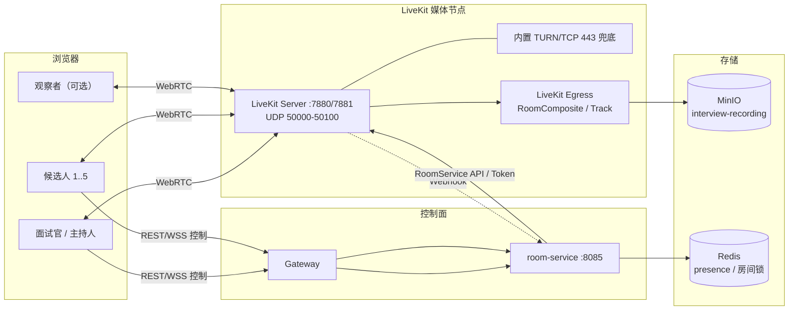
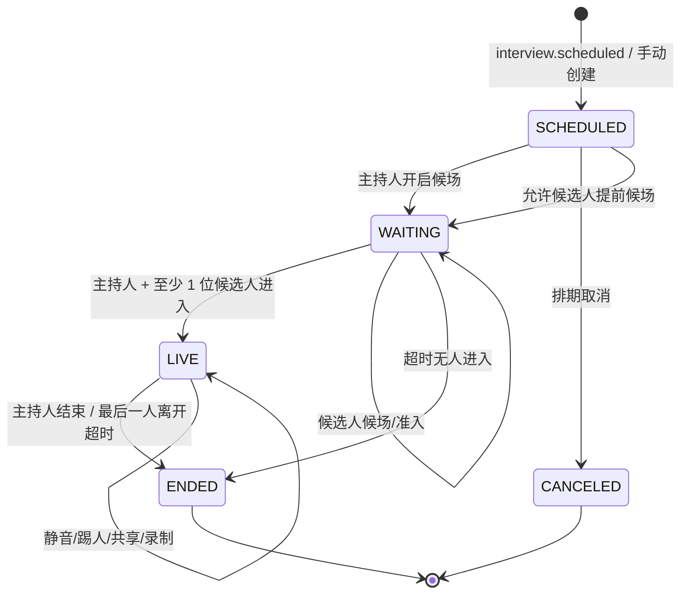
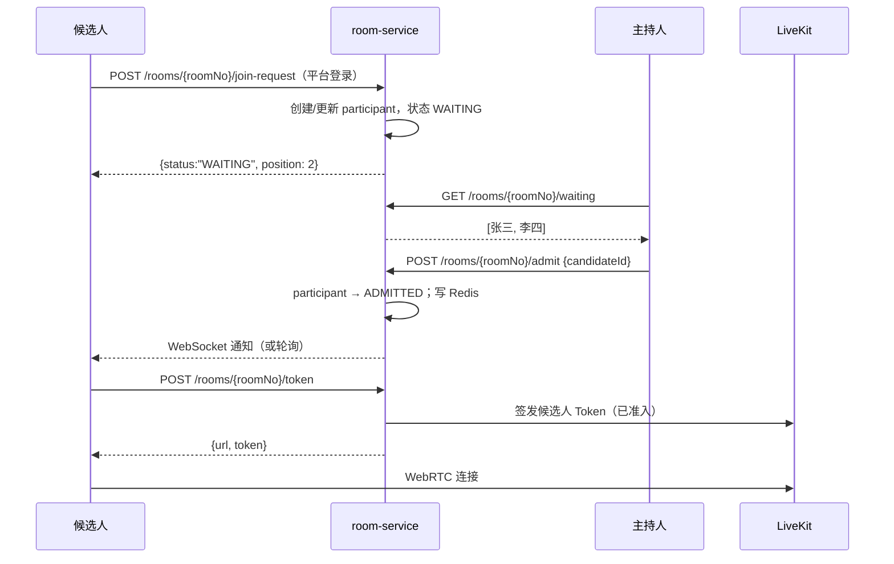
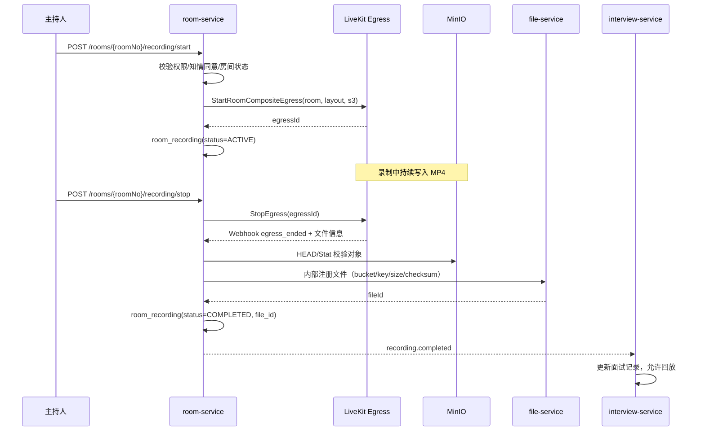
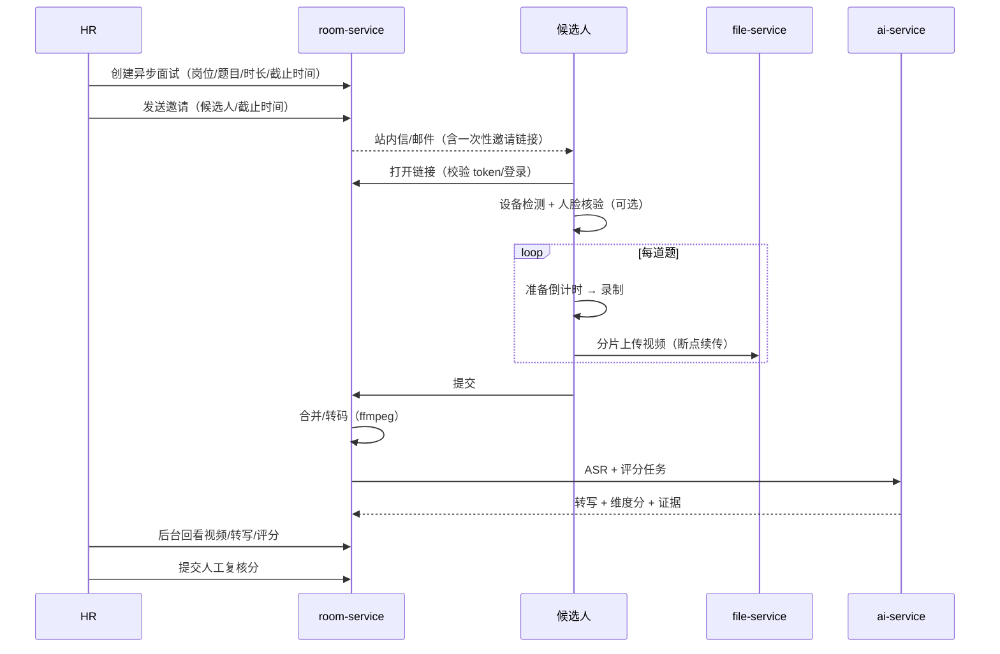

# 05 · 在线面试与并发设计

> 对应需求：实时音视频、录制回放、屏幕共享、虚拟背景/美颜/降噪、面试笔记与 AI 纪要、防作弊、AI 面试助手、1v1/1v5 并发、异步 AI 面试。  
> 核心结论：**媒体面用 LiveKit SFU，Java 只做控制面；录制用 Egress 落 MinIO；AI 转写与总结异步旁路，故障不阻断面试。**

---

## 1. 范围与角色

### 1.1 两种面试形态

| 形态 | 说明 | 关键能力 |
|---|---|---|
| 实时视频面试 | 面试官与候选人在线音视频，1v1 或 1v5 | WebRTC、屏幕共享、聊天、录制、实时转写、AI 提示 |
| 异步 AI 面试（录播） | 候选人按预设题目逐题录制，面试官后台回看打分 | 题目集、计时、录制上传、ASR、AI 评分、人工复核 |

### 1.2 1v5 的两种语义

需求中的「1 对多（最多 1 对 5）」可能指两种情况，系统都支持：

| 模式 | `group_mode` | 组成 | 典型场景 |
|---|---|---|---|
| 群面 | `GROUP` | 1 位面试官（HOST）+ 最多 5 位候选人 | 校招群面、批量初面 |
| Panel | `PANEL` | 1 位候选人 + 最多 5 位面试官/观察者 | 终面、多部门联合面试 |

- 单房间 `max_participants=6`；服务端在签发令牌与房间配置两处同时限制。
- 角色由 `room_participant.role` 决定：`HOST / INTERVIEWER / CANDIDATE / OBSERVER`。
- 布局与可见性由 `layout_mode`、`candidate_visibility` 控制；权限仍由令牌 grants 决定。
- 注意：LiveKit 的 token 只提供 `canSubscribe` 粒度的订阅权限，**不提供「候选人 A 不能订阅候选人 B」的逐人策略**。`candidate_visibility` 是 UI/订阅策略；若要求强隐私隔离（候选人彼此完全不可见），需要拆分子房间或服务端选择性转发，本期不做，默认群面互看。

---

## 2. 媒体面架构

### 2.1 为什么用 SFU

| 方案 | 1v1 | 1v5 | 录制 | 工程成本 |
|---|---|---|---|---|
| Mesh（端到端） | 可 | 每端上行 5 路，带宽/CPU 压力大 | 难 | 低 |
| **SFU（LiveKit）** | 好 | 每端只上行 1 路，SFU 转发 | 原生 Egress | 中 |
| 自研 SFU | — | — | — | 很高，不建议 |

结论：采用 **LiveKit 开源 SFU**。浏览器只与 SFU 建立 WebRTC 连接；Java 不碰媒体流。

### 2.2 拓扑



### 2.3 组件职责

| 组件 | 职责 |
|---|---|
| LiveKit Server | 房间、WebRTC 转发、Simulcast、Data Channel、Webhook |
| LiveKit Egress | 房间合成录制、单轨录制、输出到 S3/MinIO |
| TURN | 对称 NAT/校园网兜底（TCP 443） |
| room-service | 房间生命周期、令牌、候场、踢人/静音、聊天/笔记、录制登记、防作弊事件、异步面试 |
| gateway | 统一鉴权、REST/WSS 入口；媒体不经过网关 |
| AI 服务 | 实时转写、建议、纪要、异步评分 |
| file-service | 录像/证据文件元数据与预签名播放 |
| Redis | 在线状态、房间锁、候场队列、AI 会话令牌 |

---

## 3. 房间生命周期

### 3.1 状态机



- 房间与 `itv_schedule` 通过 `schedule_id` 关联；interview 发起，room 创建。
- `room_no` 面向用户（短码），`livekit_room_name` 系统内部唯一（如 `r_{roomNo}`）。
- `empty_timeout`：房间无人后自动关闭（如 5 分钟）；`departure_timeout`：所有人离开后延迟关闭（如 20 秒），避免误退。
- 结束时写 `actual_end`，停止录制，发布 `room.ended`；interview 更新排期状态为 `COMPLETED`。

### 3.2 创建房间

interview-service 创建线上排期后，通过 Feign 调用 room-service：

```
POST /internal/rooms
{
  "scheduleId": "…",
  "applicationId": "…",
  "jobId": "…",
  "candidateId": "…",
  "roomType": "ONLINE_GROUP",
  "groupMode": "GROUP",
  "title": "Java 后端一面",
  "scheduledStart": "2026-11-02T10:00:00+08:00",
  "scheduledEnd": "2026-11-02T11:00:00+08:00",
  "hostUserId": "…",
  "maxParticipants": 6,
  "waitingRoom": true,
  "record": true,
  "candidateName": "张三",
  "jobTitle": "Java 后端工程师"
}
```

room-service：

1. 生成 `room_no`（如 `IV-8F3K2`）与 `livekit_room_name`；
2. 调 LiveKit `RoomServiceClient.createRoom`，设置 `emptyTimeout`、`departureTimeout`、`maxParticipants`；
3. 写 `room_room`，状态 `SCHEDULED`；初始化主持人与候选人参与人记录；
4. 返回 `roomId/roomNo`；interview 更新排期 `room_id/room_no`，状态从 `ROOM_PENDING` → `CONFIRMED`；
5. 失败重试 3 次；仍失败则排期保留 `ROOM_PENDING`，HR 可手动重试，通知不发送「房间已就绪」。

### 3.3 开启与结束

| 操作 | 接口 | 权限 | 行为 |
|---|---|---|---|
| 开启候场 | `POST /api/room/rooms/{roomNo}/open` | HOST / `room:room:update` | 状态 `WAITING`；候选人在大厅等待 |
| 准入 | `POST /api/room/rooms/{roomNo}/admit` | HOST | 参与人 `WAITING → ADMITTED`，发 WS 通知；候选人可换 token |
| 拒绝 | `POST /api/room/rooms/{roomNo}/reject` | HOST | 参与人 `KICKED`，通知候选人 |
| 静音 | `POST /api/room/rooms/{roomNo}/mute` | HOST | 调 LiveKit 更新权限/静音轨道 |
| 踢人 | `POST /api/room/rooms/{roomNo}/kick` | HOST | 调 LiveKit `removeParticipant`；记录事件 |
| 结束 | `POST /api/room/rooms/{roomNo}/end` | HOST / HR | 停止录制；断开参与者；状态 `ENDED` |
| 取消 | `POST /api/room/rooms/{roomNo}/cancel` | HR | 状态 `CANCELED`；不删除历史 |

---

## 4. 令牌与权限

### 4.1 LiveKit Token

room-service 使用 LiveKit API Key/Secret 签发 JWT（不是平台 access token）：

```json
{
  "iss": "APIxxxxxxxx",
  "sub": "u_183920000000000001",
  "exp": 1760707200,
  "nbf": 1760700000,
  "video": {
    "room": "r_IV-8F3K2",
    "roomJoin": true,
    "canPublish": true,
    "canSubscribe": true,
    "canPublishData": true,
    "canPublishSources": ["microphone", "camera", "screen_share"],
    "roomAdmin": false,
    "hidden": false
  }
}
```

| 角色 | canPublish | canSubscribe | canPublishData | roomAdmin | 说明 |
|---|---|---|---|---|---|
| HOST | 是 | 是 | 是 | 是 | 主持人可踢人/静音/准入 |
| INTERVIEWER | 是 | 是 | 是 | 否 | 可共享屏幕（按配置） |
| CANDIDATE | 是（音视频） | 是 | 是 | 否 | 默认不允许共享屏幕/录屏 |
| OBSERVER | 否 | 是 | 否 | 否 | 只看不听/听，不发言 |

规则：

- 令牌 TTL ≤ 2 小时；进入房间前动态获取，不提前长期下发。
- `identity` 唯一：员工 `u_{userId}`、候选人 `c_{candidateId}`、观察者 `o_{userId}`；同一 identity 重连会顶掉旧连接，避免幽灵参会。
- 令牌绑定 `room`；不能拿去进其他房间。
- 候选人只有在 `admit` 后才能拿到可发布令牌；候场阶段不建房内连接。
- 屏幕共享：默认只有 HOST/INTERVIEWER；候选人如需演示作品，由主持人临时放开 `screen_share`。
- 录制：Egress 使用独立的 recorder 身份，不需要用户令牌。

### 4.2 候场（Waiting Room）



- 候选人页面在候场时显示「等待主持人准入」；每 3 秒轮询兜底 + WebSocket 实时通知。
- 主持人可在「候场列表」看到姓名、投递岗位、等待时长。
- 候场超时（如面试开始后 20 分钟）自动取消并通知。
- 未登录的候选人必须先通过候选人门户登录；邀请链接不能绕过平台登录（除非使用一次性访客令牌，本期不做）。

---

## 5. 前端房间设计

### 5.1 页面阶段

```
PreJoin（设备检测） → Lobby（候场） → Live（面试中） → Ended（结束页）
```

**PreJoin**：

- 摄像头/麦克风权限申请；设备选择；本地预览；麦克风电平；网络检测（可选 ping/TURN）。
- 提示浏览器要求：Chrome/Edge 最新版、HTTPS、允许摄像头/麦克风、关闭占用设备的其他应用。
- 候选人确认「面试将录制」的知情同意（勾选后才能进入）。
- 检测失败提供「仅音频加入」或「重新检测」。

**Lobby**：

- 显示面试信息、开始时间、面试官、等待状态。
- 禁止提前拿到可发布令牌；主持人准入后自动进入。

**Live**：

- 视频网格/演讲者布局；1v1 大画面；1v5 网格 + 主持人 spotlight。
- 底部控制：麦克风、摄像头、屏幕共享、聊天、笔记、设置、离开。
- 面试官侧边栏：候选人简历摘要、评价维度、AI 建议、实时转写、笔记。
- 候选人侧边栏：面试须知、聊天、网络状态；不显示 AI 建议与面试官笔记。
- 顶部：面试计时、录制中标识、网络质量、房间号。
- 观察者：只订阅，无发布按钮。

**Ended**：

- 显示「面试已结束」；面试官跳转评价页；候选人跳转投递状态页。
- 若录制处理中，显示「录像处理中，稍后可回放」。

### 5.2 技术实现

```ts
import {
  Room, RoomEvent, Track, VideoPresets, createLocalVideoTrack
} from 'livekit-client'

const room = new Room({
  adaptiveStream: true,
  dynacast: true,
  videoCaptureDefaults: { resolution: VideoPresets.h720.resolution },
  publishDefaults: {
    simulcast: true,
    videoCodec: 'vp8',
    screenShareEncoding: { maxBitrate: 1_500_000, maxFramerate: 15 }
  }
})
```

- 入会：`room.connect(livekitUrl, token)`；监听 `ParticipantConnected/Disconnected`、`TrackSubscribed`、`ConnectionQualityChanged`、`Reconnecting/Reconnected`。
- 渲染：根据 `participant` 与 `track` 绑定 `<video>`；屏幕共享单独大画面。
- 设备切换：`room.switchActiveDevice('videoinput', deviceId)`。
- 自适应：`adaptiveStream` 根据可见性/尺寸订阅合适层；`dynacast` 暂停无人观看的层。
- 兼容：Safari 用 H.264 更稳；Chrome 用 VP8；LiveKit 会协商。
- 断线：显示重连提示；LiveKit 自动重连；超过 30 秒失败则提示重新进入。
- 离开：`room.disconnect()`；页面卸载前调用 `navigator.sendBeacon` 上报离开事件（可选）。

### 5.3 屏幕共享与白板

| 能力 | 实现 | 说明 |
|---|---|---|
| 屏幕共享 | `room.localParticipant.setScreenShareEnabled(true)` | 面试官默认可用；候选人按房间配置 |
| 代码面试 | 屏幕共享 + 可选 Monaco 协同编辑 | 协同编辑用 Yjs，独立 WS 服务；本期可选 |
| 白板 | Excalidraw + Yjs + y-websocket | 独立服务；结束存快照到 MinIO；可选 |
| 聊天 | room-service WebSocket（STOMP） | 持久化、可审计；不支持端到端加密（面试场景可接受） |

> 白板/协同编辑器属于增强项，优先保证屏幕共享稳定；不要为了白板牺牲主链路。

### 5.4 虚拟背景、美颜、降噪

| 能力 | 方案 | 注意 |
|---|---|---|
| 背景虚化/虚拟背景 | `@livekit/track-processors`（MediaPipe） | 需要在客户端加载模型；低端机降级为关闭 |
| 降噪 | `getUserMedia` 的 `noiseSuppression/echoCancellation/autoGainControl`；可选 RNNoise WASM | 浏览器原生已足够；不要叠加多层处理 |
| 美颜 | Canvas/WebGL 滤镜（可选） | 与防作弊冲突：人脸核验/抽帧必须用原始轨 |
| 弱网 | 关闭视频、降分辨率、仅音频 | 用户可手动切换；系统自动提示 |

---

## 6. 录制与回放

### 6.1 录制方式

| 方式 | 说明 | 用途 |
|---|---|---|
| RoomComposite Egress | SFU 合成整间房画面 + 混音，输出 MP4 | 主录像，支持回放 |
| Track Egress | 单轨录制（候选人摄像头/屏幕） | 证据留存、单人复核 |
| 客户端录屏 | 候选人共享屏幕时由浏览器录制上传 | 可选，依赖候选人授权 |

### 6.2 Egress 流程



### 6.3 配置要点

- Egress 输出到 MinIO：S3 兼容，`force_path_style=true`，bucket `interview-recording`。
- 合成布局：
  - 1v1：`speaker`（主讲大画面 + 小窗）。
  - 1v5：`grid`（3×2）或 `speaker`（主持人 + 候选人缩略图）。
- 分辨率 1280×720、30fps；音频 AAC 128kbps；1 小时约 0.8~1.2GB（1v1）、1.5~3GB（1v5）。
- Egress 是 CPU 密集型：每个合成任务启动 Chrome + 编码器；独立节点部署，按并发扩容。
- 录制开始前必须展示知情同意；未同意则不允许录制（或只记录音频，按合规要求）。
- 录制失败不影响面试；UI 提示「录制失败，已记录，可重试」；支持重试一次。
- 录像保留 90 天（可配置）；到期 MinIO 生命周期清理；证据文件 180 天。
- 回放：file-service 预签名 URL（15 分钟），前端视频播放器；下载需 `room:recording:download`，记审计日志。

### 6.4 录制 CPU/带宽估算

| 场景 | 单路录制码率 | 50 路并发 |
|---|---|---|
| 720p30 合成 | 1.5~2.5 Mbps | 75~125 Mbps 出口 + 50 个编码任务 |
| 1080p30 合成 | 3~4 Mbps | 150~200 Mbps 出口，CPU 更高 |

> 50 路同时录制对 CPU 压力很大；建议演示环境控制并发（如只录制 1v1 或最多 10 路），或把 Egress 放到独立机器。答辩时说明容量边界比硬撑更可信。

---

## 7. AI 实时转写与纪要

### 7.1 音频路径

- 每位参会人从**自己的麦克风**采集 16kHz PCM，推送到 AI 的 WSS；服务端按来源标注角色。
- 不抓取远端混音，避免重复/回声；每人的音频只转写一次。
- 仅 HOST/INTERVIEWER/CANDIDATE 推流；OBSERVER 不推。
- 客户端本地 VAD/静音检测，减少无效帧；服务端 VAD 兜底。
- 建议参会人戴耳机，减少候选人麦克风重复采集面试官声音导致转写重复；客户端开启回声消除，服务端以「音频来源角色」标注说话人。
- 详细协议见 [04-ai.md](04-ai.md) 第 7.1 节。

### 7.2 权限与令牌

```
POST /api/room/rooms/{roomNo}/ai-token
→ { "wsUrl": "wss://.../api/ai/v1/asr/stream", "token": "…", "expiresIn": 300 }
```

- 令牌 `scope=asr`，绑定 `roomId/userId/role`，5 分钟有效；Nginx 只做 TLS/转发，由 AI 服务校验令牌。
- 只有房间内的参会人能获取；观察者/外部人拒绝。
- 断线重连换新令牌。

### 7.3 实时建议

- 面试官页面每 25 秒（或新增 80 字）请求一次；room-service 汇总上下文调 AI；
- 建议只在面试官侧展示，可点击「采用」插入笔记；
- 超时 8 秒直接放弃，不阻塞；
- 房间结束后停止。

### 7.4 纪要与评价草稿

- 房间结束 / 转写完成后触发；AI 生成纪要 + 评价草稿；
- 写入 `room_note`（`AI_SUMMARY`），事件 `ai.summary.ready`；
- 面试官打开评价页时拉取草稿，人工修改后提交；
- 草稿必须标注「AI 生成，需人工确认」，不能直接作为最终评价。

### 7.5 降级

| 故障 | 表现 | 处理 |
|---|---|---|
| ASR 过载 | 新流转写失败 | 提示「转写暂停」；录音继续；结束后离线补转写 |
| AI 建议超时 | 侧边栏空 | 静默降级；不弹错误 |
| 总结失败 | 评价页无草稿 | 提示「AI 纪要生成失败，可重试」；不影响人工评价 |
| 网络抖动 | partial 延迟 | 丢弃积压帧；final 以服务端为准 |

---

## 8. 防作弊

### 8.1 能力清单

| 能力 | 实现 | 触发 |
|---|---|---|
| 入场人脸核验 | 拍照 + 与头像/证件照比对 + 活体（可选） | 进入房间前 |
| 周期人脸检测 | 每 30~60 秒抽帧，检测无人/多人 | 面试中 |
| 切屏检测 | `visibilitychange` / `blur` / 全屏退出 | 面试中 |
| 环境噪声 | WebAudio RMS | 持续 |
| 屏幕共享状态 | 共享开始/停止事件 | 面试中 |
| 服务端录屏 | Egress 合成录像 | 全场 |
| 风险报告 | 事件加权 + 证据 | 结束后 |

### 8.2 事件上报

```json
POST /api/room/rooms/{roomNo}/cheat-events
{
  "events": [
    {"type":"TAB_SWITCH","occurredAt":"2026-11-02T10:15:03+08:00","detail":{"durationMs":4200}},
    {"type":"MULTI_FACE","occurredAt":"2026-11-02T10:18:20+08:00","evidenceFileId":"…","detail":{"faces":2}}
  ]
}
```

- 客户端节流/去重：同类事件 2 秒内合并；最多每 10 秒上报一次批量。
- 证据图先上传 file-service（`biz_type=EVIDENCE`），再带 `fileId` 上报。
- 服务端校验参会人身份与房间状态；不能伪造别人的 `candidateId`。
- 事件写 `room_cheat_event`；结束后聚合 `room_cheat_report`。

### 8.3 风险评分

建议权重（可在配置中调整）：

| 事件 | 分值 | 上限 |
|---|---|---|
| 活体失败 | 40 | 40 |
| 多人脸 | 25/次 | 50 |
| 人脸缺失 > 30s | 15/次 | 30 |
| 切屏 | 5/次 | 20 |
| 噪声异常 | 2/次 | 10 |
| 停止屏幕共享 | 5/次 | 10 |

- `LOW < 20`、`MEDIUM 20~50`、`HIGH > 50`。
- 报告展示事件时间线、证据截图、录像定位（时间戳）；**必须人工复核**，不能自动判定作弊。
- 候选人有权申诉；证据保留有期限。

### 8.4 隐私与边界

- 进入前明确告知采集内容、用途、保留期限，取得同意；不同意则不能录制/人脸核验，可选择线下或关闭该功能。
- 人脸比对只用于身份核验，不用于性格/情绪/能力判断。
- 美颜/虚拟背景会干扰识别：核验和抽帧使用原始摄像头轨。
- 证据文件私有桶、短时签名、访问审计；到期删除。
- 不要承诺「100% 防作弊」；定位为「风险提示 + 人工判断」。

---

## 9. 异步 AI 面试

### 9.1 流程



### 9.2 关键规则

| 项 | 设计 |
|---|---|
| 邀请 | 一次性令牌 + 登录绑定；有效期；可取消/重发 |
| 题目 | 题库选题或自定义；顺序可随机；每题准备/作答时长独立配置 |
| 重录 | 按题目策略：不允许/允许 1 次/不限；记录尝试次数 |
| 上传 | MediaRecorder 分片（5~10 秒/片），失败重试；提交前校验完整性 |
| 转码 | 合并 WebM/MP4 → 统一 MP4（H.264/AAC），生成播放器可用的文件 |
| ASR | 离线 SenseVoice/Whisper；按题输出转写与时间戳 |
| 评分 | 相关性、结构化、深度、表达、专业性；证据引用；人工可覆盖 |
| 防作弊 | 切屏、每题前人脸核验、环境快照、录制本身；不做实时监考 |
| 存储 | `async-answer` bucket；保留 90 天；播放走预签名 |

### 9.3 异步面试评分维度（示例）

| 维度 | 权重 | 说明 |
|---|---|---|
| 内容相关性 | 30 | 是否正面回答题目 |
| 结构与逻辑 | 20 | 分层、因果、STAR 等 |
| 专业深度 | 25 | 技术细节、取舍、数据 |
| 表达清晰度 | 15 | 语速、口头禅、组织 |
| 职业素养 | 10 | 诚信、动机、稳定性（谨慎使用） |

> 表达类评分容易受口音/设备影响，需在 UI 说明「仅供参考」，人工复核为主。

---

## 10. 并发与容量设计

### 10.1 控制面负载

| 操作 | 单次请求 | 频率 | 结论 |
|---|---|---|---|
| 获取房间信息 | 1 | 进入前 | 低 |
| 获取 LiveKit token | 1 | 每次进入/重连 | 低 |
| 候场轮询/WS | 1/3s 或长连接 | 候场期间 | 中（WS 更优） |
| 聊天/笔记 | 1/条 | 低频 | 低 |
| Webhook | 1/事件 | 房间生命周期 | 低 |
| 转写 final 批量写 | 1/2s/流 | 面试中 | 中 |

600 名参与者、100 个房间的估算：

- 入会：600 次 token + 600 次房间信息，集中在 10 分钟 → < 5 RPS。
- 候场 WS：600 长连接；2 个 room-service 实例各 300，Netty 轻松。
- 转写写入：假设 50 个活跃房间 × 2 条说话流 × 每 3 秒一段 → ~33 段/秒，批量插入无压力。
- 控制面不是瓶颈；瓶颈在 SFU 出口带宽、Egress 编码、AI GPU。

### 10.2 媒体面带宽模型

假设：

- 720p 高清层 1.2 Mbps，360p 中间层 0.4 Mbps，180p 缩略层 0.15 Mbps；音频 40 kbps；协议开销 10%。
- 开启 Simulcast + Dynacast + AdaptiveStream。

| 场景 | 上行/房间 | 下行/房间（估算） | 说明 |
|---|---|---|---|
| 1v1 | 2 × 1.2 = 2.4 Mbps | 2 × 1.2 = 2.4 Mbps | 双方各看对方高清 |
| 1v5 群面（互看，自适应） | 6 × 1.2 = 7.2 Mbps | 主持人 ~2.4 + 5 候选人 × ~2.4 ≈ 14.4 Mbps | 缩略层+活跃层 |
| 1v5 群面（候选人只看主持人） | 7.2 Mbps | 主持人 2.4 + 5 × 1.2 ≈ 8.4 Mbps | UI 策略，降低出口 |
| 1v5 不启用 Simulcast | 7.2 Mbps | 6 × 5 × 1.2 = 36 Mbps | 对照组，说明必须开 Simulcast |
| + 录制合成 | — | +1.5~2.5 Mbps / 房间 | Egress 独立出口 |

> 以上是设计估算，实际以 `livekit-cli load-test` 压测为准；不同分辨率/帧率/码率策略差异很大。

### 10.3 规模估算

| 规模 | 房间构成 | 参与者 | SFU 出口（估算） | 建议 |
|---|---|---|---|---|
| 演示 | 1 个 1v5 + 1 个 1v1 | 8 | < 20 Mbps | 单机 |
| 试点 | 50 房间（25×1v1 + 25×1v5） | 200 | ~250~450 Mbps | 1 台 8C16G + 10GbE |
| 中型 | 100 房间（50×1v1 + 50×1v5） | 400 | ~500~850 Mbps | 2 台 SFU + Redis |
| 压力目标 | 100 个 1v5 | 600 | ~1.2~1.6 Gbps | 2~3 台 SFU + 10GbE |

补充：

- 加上录制，出口再增加 75~250 Mbps（取决于并发录制数）；Egress 独立节点。
- SFU 主要消耗网络与少量 CPU（转发/加密）；8 vCPU 可承载数百路，需实测。
- 1v5 房间内每人的上行只有 1 路；不要用 P2P Mesh 的「N×N」估算。
- 若校园网限制 UDP，TURN/TCP 443 兜底会增加延迟与服务器带宽；容量按 TCP 再留 20% 余量。

### 10.4 录制与 AI 的并发

| 资源 | 估算 | 措施 |
|---|---|---|
| Egress 合成 | 50 路并发 ≈ 50~100 vCPU | 独立节点；限制同时录制数；优先录 1v1/关键场次 |
| ASR 流 | 50 房间 × 2 条说话流 ≈ 100 路 | VAD 降载；GPU 压测；超限只保留候选人流或转离线 |
| LLM 建议 | 50 房间 / 25s ≈ 2 RPS | vLLM 批量；超时丢弃 |
| LLM 总结 | 结束瞬间峰值 | 队列削峰；优先级低于实时 |
| MinIO 写入 | 录制码率 × 并发 | 独立磁盘/节点；生命周期清理 |

### 10.5 压测方案

**控制面**：

- k6/JMeter：token 签发、房间详情、候场列表、聊天写入；目标 50~100 RPS，P95 < 300ms。
- 验证鉴权、幂等、限流；观察 MySQL/Redis 连接池。

**媒体面**：

- `livekit-cli load-test` 或官方 load tester：创建 N 个房间 × 6 个参与者，发布合成音视频；逐步加压。
- 指标：入会成功率、首帧时间、RTT、抖动、丢包、卡顿率、SFU CPU/内存/带宽、Egress 成功率。
- 网络模拟：`tc netem` 注入 100~200ms 延迟、1~3% 丢包；验证自适应与音频优先。

**端到端**：

- Playwright 打开两个浏览器上下文（面试官/候选人），使用假摄像头/麦克风：
  `--use-fake-device-for-media-stream --use-fake-ui-for-media-stream`。
- 验证：进入候场、准入、音视频、屏幕共享、聊天、录制、结束、回放链接。
- 1v5 用 6 个上下文，观察网格与 CPU。

**AI**：

- Locust 并发触发解析/匹配/总结；记录 P95、失败率、GPU 利用率、队列长度。
- ASR 并发用预录音频循环推流；测最大稳定流数。
- 压测结果写进论文「性能测试」章节，注明硬件、网络、码率、并发模型。

### 10.6 降级与故障处理

| 故障 | 用户表现 | 处理 |
|---|---|---|
| SFU 节点故障 | 连接断开 | 客户端重连到其他节点；房间状态从 Redis/DB 恢复；录制可能中断 |
| UDP 被禁 | 无法连接 | TURN/TCP 443 兜底；提示切换网络 |
| 带宽不足 | 卡顿/模糊 | 自动降层/关视频；提示「仅音频」 |
| 录制失败 | 无回放 | 面试继续；记录失败；重试；关键场次可客户端备份 |
| AI 转写失败 | 无实时字幕 | 面试继续；结束后离线补转写 |
| 房间服务不可用 | 无法准入/获取 token | 已入会者继续；恢复后重连；控制面多实例 |
| 数据库慢 | 入会变慢 | token 签发读 Redis 缓存；控制面与媒体解耦 |

---

## 11. 可观测性

### 11.1 指标

| 层 | 指标 |
|---|---|
| LiveKit | 房间数、参与者数、发布/订阅轨数、RTT、丢包、抖动、连接失败、TURN 使用率 |
| Egress | 活跃任务、成功率、时长、文件大小、失败原因、CPU |
| room-service | token QPS/P95、候场人数、准入耗时、WS 连接数、转写写入延迟、录制登记延迟 |
| 客户端 | 首帧时间、重连次数、网络质量、设备错误、权限拒绝 |
| AI | ASR 并发流、partial 延迟、final 延迟、LLM 队列、建议超时率、总结耗时 |

### 11.2 日志与追踪

- room-service 记录房间生命周期事件（创建/开启/准入/加入/离开/结束/录制/异常），带 `roomNo/traceId`。
- LiveKit Webhook 原样落日志（脱敏），便于排查。
- 客户端错误上报：`POST /api/room/rooms/{roomNo}/client-events`（限频），记录设备/网络/播放失败。
- 全链路 TraceId 从网关透传到 room-service/AI；媒体链路单独用 LiveKit 指标。

### 11.3 告警

- 入会失败率 > 2%（5 分钟）
- 房间创建失败率 > 1%
- 录制失败率 > 5%
- Egress CPU > 85%
- LiveKit 丢包/抖动异常
- AI ASR 拒绝率 > 10%
- 候场等待 > 15 分钟人数 > 阈值

---

## 12. 安全与隐私

| 风险 | 措施 |
|---|---|
| 令牌泄露 | 短 TTL、绑定房间/身份、HTTPS/WSS、不在 URL 长期暴露 |
| 未授权进入 | 平台登录 + 候场准入 + 房间锁；token 每次动态获取 |
| 录像泄露 | 私有桶、预签名 15 分钟、下载权限与审计、水印可选 |
| 屏幕共享滥用 | 候选人默认禁止；主持人可临时授权 |
| 聊天骚扰 | 主持人可禁言/踢人；消息持久化可审计 |
| 防作弊误判 | 只提示不判定；人工复核；申诉通道 |
| 隐私 | 录制/人脸/环境检测知情同意；最小化采集；保留期限；删除机制 |
| 面试官越权 | 只允许进入被安排的房间；HR 数据范围校验 |
| 重放攻击 | LiveKit token 短时效；AI ASR token 5 分钟；WS 一次性握手 |

---

## 13. 实施清单

### 13.1 第一阶段（1v1 主链路）

- [ ] LiveKit + Redis + Egress + MinIO 部署，TLS/WSS、TURN 可用。
- [ ] room-service：创建房间、token、候场、准入、结束、Webhook。
- [ ] 前端：PreJoin、Lobby、Live、设备切换、聊天。
- [ ] 1v1 录制 → MinIO → 回放。
- [ ] interview-service：排期 → 建房 → 通知 → 状态回写。
- [ ] 断线重连、错误提示、权限校验。

### 13.2 第二阶段（1v5 与 AI）

- [ ] 6 人房间、网格布局、主持人控制、观察者。
- [ ] Simulcast/Dynacast/AdaptiveStream 参数调优。
- [ ] AI 实时转写 WSS + 会议纪要。
- [ ] AI 建议（面试官侧）、评价草稿。
- [ ] 防作弊：切屏、人脸缺席、多人脸、风险报告。
- [ ] 异步面试：题目、邀请、录制上传、ASR、评分、复核。

### 13.3 第三阶段（稳定性与性能）

- [ ] 压测：控制面、媒体面、录制、ASR。
- [ ] 容量报告与降级演练（断网、AI 宕机、Egress 失败）。
- [ ] 监控看板与告警。
- [ ] 隐私合规检查、渗透测试（越权/令牌/文件）。
- [ ] 答辩演示脚本：1v1 + 1v5 + 录像回放 + AI 纪要。

---

## 14. 关键取舍（答辩可讲）

1. **SFU 而非 Mesh**：1v5 时 Mesh 每端上行 5 路，带宽和 CPU 都不可控；SFU 每端只上行 1 路，服务端承担转发，容量可计算。
2. **媒体面不经过 Java**：Java 只做控制面，避免大流量穿过业务服务；这是能支撑 1v5 并发的关键。
3. **录制与面试解耦**：Egress 失败不影响面试；录制是旁路能力。
4. **AI 旁路**：转写/建议/总结故障只降级，不阻断音视频；避免把 AI 放在关键路径上。
5. **候场准入**：不是所有拿到链接的人都能直接进房，降低骚扰与误入风险。
6. **1v5 双语义**：群面与 Panel 用同一套房间模型，只改角色与布局，减少重复开发。
